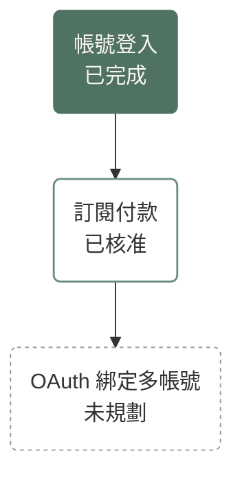

# Spec-Driven Development

## Document Model

| Path | Contains | Does Not Contain (Belongs In) |
| --- | --- | --- |
| `docs/specs/product.md` | Positioning, target users, scope, non-goals, glossary | Behavior requirements (capability spec); technical choices (`architecture.md`); feature timelines (`roadmap.md`) |
| `docs/specs/architecture.md` | Current technical architecture, with inline rationale | User-visible behavior (capability spec); planned architecture (plan); full decision discussions (archived plan) |
| `docs/specs/<capability>.md` | Implemented behavior of one product capability | Planned behavior (plan's "Spec 變更"); technical structure (`architecture.md`); implementation details such as tables, classes, libraries (code) |
| `docs/plans/NNNN-slug.md` | An approved plan whose implementation has not merged | Step-by-step implementation (left to the implementer); test names (test code); manual check steps (`tests/manual/`) |
| `docs/plans/archive/NNNN-slug.md` | Done or abandoned plans | Any edit after the PR that archives it merges; current behavior (specs) |
| `docs/plans/roadmap.md` | Dependency graph, plus vision for unfinished features | Detailed requirements (the stage's plan); `draft` and `in-progress` work (branches and open PRs); finished features' descriptions (specs) |
| `tests/manual/<capability>.md` | Steps and expected results for the scenarios of `<capability>.md` that need a manual check | Results of a check (PR body); scenarios that automated tests cover fully (test code) |

Specs on the `main` branch describe only what the code on `main` implements. The exception is the positioning, target users, scope, and non-goals in `product.md`: they describe the intended product and bound every plan. Future behavior lives in a plan's "Spec 變更" section and enters the spec in the same PR as the code that implements it.

Archived plans are history. Never treat them as current guidance; read them only to understand why something is the way it is. The requirement and scenario IDs in them, and in merged PR descriptions, are the IDs of their time: an ID may since have been removed, moved to another spec, or reused.

Nothing in `docs/specs/` or `roadmap.md` is final. If you see a better approach than what they describe, including a decision the user already made, propose it before acting on it: state the trade-offs, address any recorded reason the alternative was rejected, and let the user decide. Until the user agrees, follow the documents as written.

## Pick the Tier

1. **Tier 1**: the change alters behavior a spec describes (or should describe), alters architecture, or adds a spec file. A bug in a case no spec covers is a spec gap, so it is Tier 1. Use the `plan` and `implement` procedures.
2. **Tier 2**: behavior-preserving but non-trivial: a bug fix that restores spec'd behavior, a refactor, a performance change, dev tooling or CI config, a minor or major dependency bump. Use the `change` procedure.
3. **Tier 3**: on the trivial whitelist below. No plan and no PR template; open a PR once the user instructs a push. The whitelist is exhaustive:
   - Typos, punctuation, and formatter output.
   - Comment-only changes.
   - Patch-level dependency bumps.
   - Doc-only fixes that make `docs/specs/` match current code. Never add new behavior this way.
   - Roadmap vision edits; adding, splitting, or removing `unplanned` nodes and re-linking their edges; removing edges that "Roadmap Conventions" leaves out; collapsing finished features.
   - Edits to AGENTS.md and to this skill.
   - Edits to the positioning, target users, scope, or non-goals in `product.md` that the user explicitly asks for, together with the glossary terms that text uses.

When unsure, take the higher tier.

## Rules That Apply Everywhere

- Never push to `main`. Never merge a PR. The user merges; a merge is the user's approval.
- Commit and push only when the user explicitly instructs it.
- In a PR body's manual checklist, tick an item only if the latest run of its check passed. Leave an item unticked only if you could not run the check, and state why under the item so the user can run it.
- Assign every PR you open to the user who directed the work: `gh pr create --assignee @me`, which resolves to the account `gh` is logged in as. If `gh` is logged in as a bot or someone other than that user, ask the user who to assign.
- Every time you push new content to a branch that has an open PR, check whether the PR title and description still match the branch's latest state, and update them if they do not.
- Right before every update to a PR title or description, fetch the current version from GitHub (`gh pr view <number> --json title,body`) and apply your edits on top of it, no matter how well you remember what you last wrote. Other people may be editing the same PR at the same time.
- For `approved`, `done`, and `abandoned`, the plan's frontmatter `status` is the source of truth, and the PR that sets one of them also updates `roadmap.md`. Change statuses only through the procedures below.
- When an edit to this skill or its templates changes what a plan must contain or which reviews a plan must pass, list every `draft` and `approved` plan in that PR's description, each with the user's decision: bring it up to the new rules, or keep it as written. Bring an `approved` plan up to date as "Procedure: Plan" describes for revising an approved plan, in that PR or in its own; bring a `draft` plan up to date on its branch. If the plan has never passed a review that the new rules require, run that review as it runs for a new plan, not only on the revised parts.
- Never edit positioning, target users, scope, or non-goals in `product.md` unless the user explicitly asks. If a plan would conflict with `product.md`, stop and tell the user. A glossary term that the positioning, target users, scope, or non-goals use enters the glossary together with that text. Any other glossary addition or change goes in the plan's "Spec 變更" section and enters with the implementation.
- After every implementation PR merges, `main` must work. There is no size cap on a plan; split by what can ship on its own.
- These rules constrain PR content, not commit structure. Humans may commit on any branch; number and order of commits do not matter.
- Language: specs, plans, roadmap, PR descriptions and `tests/manual/` are written in Traditional Chinese (Taiwan usage). PR titles, filenames, frontmatter keys and values, requirement IDs, scenario IDs, branch names and Mermaid node IDs are English.

## Plan Statuses

| Status | Where it is represented |
| --- | --- |
| `unplanned` | A roadmap node only; no plan file exists |
| `draft` | A `plan/NNNN-slug` branch, local or on `origin`, or an open `[plan NNNN]` PR, for a plan not yet on `main`; never written in a file |
| `approved` | A plan file on `main`. The plan PR writes `approved` from the start; merging the PR is the approval |
| `in-progress` | An `impl/NNNN-slug` branch, local or on `origin`, or an open `[impl NNNN]` PR; never written in a file |
| `done` | An archived plan file; set inside the implementation PR |
| `abandoned` | An archived plan file; set by the `abandon` procedure |

## Procedure: Plan

1. Read `product.md`, `architecture.md`, every affected spec, `roadmap.md`, and the output of `gh pr list --state open`.
2. Pick the ID: take the highest `NNNN` across `docs/plans/**/*.md` and open PR titles (`[plan NNNN]`, `[impl NNNN]`), then add 1. If two plans end up with the same ID, the one merged later renumbers.
3. Create branch `plan/NNNN-slug` from up-to-date `main`.
4. Copy `templates/plan.md` to `docs/plans/NNNN-slug.md` and fill it in:
   - `specs` lists every spec file the plan touches; `depends_on` lists plan IDs that must be `done` first.
   - "Spec 變更" refers to requirements by ID, grouped by spec file; changes to spec text outside the requirements, such as the definitions or flowchart at the top of a spec, name the section they change. Write each changed part in full as it will read after the change, in the spec format, scenario IDs included (see "Spec Conventions"):
     - An added requirement: all of it, scenarios and rationale included.
     - An existing requirement: the whole rule text if any of it changes, each added or modified scenario, and the whole rationale if any of it changes.
     - The glossary: each added or modified row.
     - Other text: each changed paragraph, list, table, or diagram as a whole. When its section holds more than one such block, identify the block by the opening words of its current text, never by position such as "the third paragraph": whether a rationale counts as a paragraph is unclear, and positions shift when `main` changes.

     Never copy unchanged text, such as a modified requirement's other scenarios: the copy goes stale if `main` changes that text before the implementation, and applying the plan would then revert it. Wherever only some parts of a requirement or section are written out, state that the rest stays unchanged, such as 「既有的情境與設計理由不變」, so whoever applies the plan does not replace the whole requirement or section with those parts. Never describe an edit inside one of these parts, such as "replace the last two sentences" or "change two nodes of the flowchart". A removed requirement or scenario needs only its ID, a removed glossary row only its term, and a removed paragraph only its opening words. Give each requirement or section its own heading and write everything the plan changes in it there, removals included; do not also list the changes at the top of the spec file's section, because the two copies drift apart. Before each rule, rationale, or other block written out because it is rewritten as a whole, add one sentence stating what its meaning changes, as in 「講者視窗連上時，按鈕改照 NAV-R11 隱藏。規則改成：」, so a reviewer does not have to compare the block with the spec; the sentence states the change in meaning, never an edit to make.
   - Every decision ends with a "併入" line naming where its rationale goes (see "Spec Conventions"), or "無". Promote a decision to a spec only if a future agent reading the spec would plausibly re-propose the rejected option.
   - "做法要點" covers only what the user must know before approving: architecture impact, and risky or hard-to-reverse operations (data migration, breaking changes, deploy order). No step-by-step implementation list.
   - "驗證方式" marks every scenario of every added requirement, and every scenario that the plan adds to or modifies in an existing requirement, by scenario ID, with how it will be verified: one or more of `unit`, `integration`, `e2e`, and `手動`. Do not name tests or write manual steps; the implementation does not exist yet. Manual steps go in `tests/manual/` during implementation.
   - "還沒定案的問題" must read 「無」 before asking the user to merge: ask the user each question there, and write each answer into the section it belongs to.
5. Update `roadmap.md` (see "Roadmap Conventions"): add the plan to the stage's node, which is the matching `unplanned` node, the node of the stage whose delivered behavior the plan only changes, or a new node; set the node's status; add edges from `depends_on`, except edges within one node and those that "Roadmap Conventions" leaves out; link the plan from the feature's vision section.
6. Run the spec review (see "Independent Review") with everything in the plan's "Spec 變更" as the changes. Its input is the plan file. Write each finding that holds into "還沒定案的問題" and settle it with the user like any other open question.
7. Tell the user the plan is ready and wait. When the user instructs a push, commit, push, and open the PR. Title: `[plan NNNN] <English title>`. Body: the plan's "目標" paragraph. Do not link the plan file: the PR's changed files already show it, and GitHub does not resolve relative links in PR descriptions. Then stop and wait for the user to merge.

To revise an approved plan before its implementation starts, that is, while no `impl/NNNN-*` branch exists: create branch `plan/NNNN-slug` from up-to-date `main`, keep the ID, edit the plan, and update `roadmap.md` if the revision affects it. Run the spec review with the revised parts of "Spec 變更" as the changes, then follow step 7, with a PR body that states what the revision changes. Once an `impl/NNNN-*` branch exists, revise the plan through step 3 of "Procedure: Implement" instead. A revision that changes no behavior, such as adding IDs or renumbering after a collision, goes in the PR that causes it.

## Procedure: Implement <id>

Preconditions: `docs/plans/NNNN-*.md` exists on `main` with `status: approved`, every plan in `depends_on` is archived as `done`, and no `impl/NNNN-*` branch exists locally (`git branch --list 'impl/NNNN-*'`) or on `origin` (`git ls-remote --heads origin 'impl/NNNN-*'`). Otherwise stop and tell the user.

1. Create branch `impl/NNNN-slug` from up-to-date `main`.
2. Apply the plan's spec changes to the spec files first, then write code against the updated specs.
3. If the plan turns out wrong in a way that changes spec'd behavior, stop and ask the user, laid out like a decision in the plan: options, trade-offs, and your recommendation. Change the plan and specs on this branch only after the user agrees. Changes that alter no spec'd behavior need no approval, such as an implementation detail or a scenario that spells out what an existing rule already implies. Every change to the plan or specs is a deviation, which the PR body lists in step 7.
4. Review your own diff against the plan's "驗證方式": every scenario marked for automated testing must have a test at the stated level whose title names the scenario ID as "Spec Conventions" describes; add any that are missing. For every scenario marked `手動`, write its section in `tests/manual/` (see "Spec Conventions") with concrete steps against the actual implementation and the expected result taken from the scenario. Then run all automated tests and `make check-scenarios`, and make them pass. Then run every manual check you can (start the app, drive a browser), and fix failures before moving on. If a check fails and you cannot fix it, stop and tell the user. If manual checks change during implementation, update the plan's "驗證方式" on this branch first; that is a deviation too.
5. Before the review, make sure the branch contains all of the following:
   - Every spec change, including deviations.
   - The code.
   - The tests and the `tests/manual/` sections from step 4.
   - Every decision with a "併入" target, written as a rationale (see "Spec Conventions") next to the related requirement or architecture section.
   - The architecture impact from "做法要點", reflected in `architecture.md`.
   - The plan with `status: done`, moved to `docs/plans/archive/`.
   - `roadmap.md` with the node's status updated, which is `done` once every plan the node stands for is done, and the vision section's link pointing to the archive path, as "Roadmap Conventions" describes.
6. Run the code review (see "Independent Review"). Its inputs are the branch's changes and the approved plan as of the plan commit, the last `main` commit that touched the plan file (`git log -1 --format=%H main -- 'docs/plans/NNNN-*.md'`). Give the sub-agent the spec review's checklist as well: it runs the spec review with the spec differences that its code review lists as the changes, and skips the spec review if there are none. If a spec file in the plan's `specs` changed on `main` after the plan commit (`git log <plan commit>..$(git merge-base main HEAD) -- <those files>` lists a commit), tell the sub-agent to add everything in the plan's "Spec 變更" to the changes and to run the spec review even if there are no differences. Fix code that does not match its spec. Before resolving a finding by changing spec'd behavior, ask the user; the outcome is a deviation too. If resolving the findings changes any spec text or code, give every added or changed scenario a test or a `tests/manual/` section, as in step 4, then run all automated tests and `make check-scenarios` again, and rerun every manual check you can run.
7. Tell the user the work is ready and stop. When the user instructs a push, commit, push, and open the PR. Title: `[impl NNNN] <English title>`. Body: `templates/pr-impl.md`, written against `main` and the approved plan, not the branch's history: describe the final state, and leave out problems that were found and fixed on the branch.
   - The first line links to the approved plan with a full GitHub URL pinned to the plan commit from step 6. A relative link does not resolve in PR descriptions, a link to the impl branch breaks when GitHub deletes the branch on merge, and a link to `main` breaks once the plan moves to the archive.
   - "與 Plan 不同的地方" lists every deviation, split into "行為改變" and "實作細節". It covers every difference that the review reported between the branch and the approved plan.
   - "手動檢查" has one checklist item per scenario marked `手動` in the plan's "驗證方式" as it stands on this branch, no more and no fewer, with the steps and expected result from its section in `tests/manual/`.
   - Do not list automated tests or their results; reviewers read the tests themselves, and CI reports results.

## Procedure: Change

1. Create branch `change/slug` from up-to-date `main`. Before writing any code, tell the user the change's "問題", "原因", and "做法", as `templates/pr-change.md` defines them, and wait for the user to agree. If step 4 needs this text and you no longer have it word for word, such as after the conversation was compacted, write the "問題" and "做法" out again and get the user's agreement again.
2. Implement. If the "做法" has to change, agree the new one with the user before going on. If the change turns out to alter spec'd behavior, stop: it is Tier 1.
3. Run all automated tests and `make check-scenarios`, and make them pass. List every scenario in `tests/manual/` whose behavior the change could affect, plus any check the change itself needs. Run every check you can, and fix failures before moving on. If a check fails and you cannot fix it, stop and tell the user. If the change makes a section's steps outdated, such as by renaming a command, update the section on this branch.
4. Run the code review (see "Independent Review"). Its inputs are the branch's changes and the "問題" and "做法" that the user agreed to, word for word. Fix code that does not match them, and run every manual check that the review lists and step 3 missed. If a finding shows the change alters spec'd behavior, stop: it is Tier 1. If resolving the findings changes any code, run all automated tests and `make check-scenarios` again, and rerun every manual check you can run.
5. Tell the user the work is ready and stop. When the user instructs a push, commit, push, and open the PR. Body: `templates/pr-change.md`, describing the final state. Its manual checklist has one item per check from steps 3 and 4; an item for a scenario in `tests/manual/` starts with the scenario ID and takes its steps and expected result from that scenario's section.

## Procedure: Abandon <id>

First list every plan, on `main` or in an open `[plan NNNN]` PR, whose `depends_on` names NNNN. If there are any, tell the user and wait for a decision on each: revise it or abandon it too. Then:

- If the plan exists only in an open `[plan NNNN]` PR, close that PR.
- If the plan is on `main`:
  1. Close any open `[impl NNNN]` PR. If an `impl/NNNN-*` branch exists locally or on `origin`, tell the user and let them decide whether to delete it; never delete it yourself.
  2. Create branch `abandon/NNNN-slug` from up-to-date `main`. Set `status: abandoned`, add one line under the title stating why and which plan replaces it (if any), and move the file to `docs/plans/archive/`. If the user decided that a plan on `main` only needs its `depends_on` changed, for example from NNNN to the plan that replaces it, edit that `depends_on` on this branch. This changes no behavior, so it needs no separate revision PR.
  3. In `roadmap.md`, if the node stands only for this plan, remove the node and its edges, and reconnect dependents to the replacing plan's node if there is one; otherwise update the node's status. Update the vision section.
  4. Tell the user the change is ready and wait. When the user instructs a push, commit, push, and open a PR titled `[abandon NNNN] <English title>`; then stop.

Make every other revision the user chose outside this procedure. For a plan on `main`, revise it as "Procedure: Plan" describes for an approved plan. For a plan in an open `[plan MMMM]` PR, edit the plan on that PR's branch.

## Independent Review

### Running a Review

- Start a sub-agent without this conversation's context. If your tool cannot start one, tell the user and give them the instructions to run in a new session.
- Check which skills this environment offers. If one fits the review, tell the sub-agent to use it, and add each checklist item below that the skill does not cover. Without a fitting skill, give the checklists themselves. One sub-agent runs every check of a review.
- If the fitting skill itself hands the review to sub-agents without your conversation context, run the skill yourself instead of inside a sub-agent, because some tools do not let a sub-agent start another. The rules in this section then apply to the sub-agents that the skill starts: besides what the skill tells them, they get only the inputs and the checklist items that the skill does not cover.
- Give the sub-agent only the inputs that the procedure step names, and the checklists. Never add your own summary, reasoning, or assessment of the work: the review is worth running only because the sub-agent lacks them.
- "The branch's changes" means the working tree compared with the point where the branch left `main`: `git diff $(git merge-base main HEAD)` for tracked files, plus the new files that `git ls-files --others --exclude-standard` lists. Do not point the sub-agent at a commit range; it misses uncommitted work.
- Tell the sub-agent to report findings and not edit files.
- Check every finding against the documents and code. Never drop a finding silently: for each one you reject, tell the user why in one sentence.
- If resolving the findings changes any spec text, in a spec file or in a plan's "Spec 變更", or any code, run the review again with the same inputs, plus the previous review's report word for word. The sub-agent first confirms that each earlier finding is resolved, then looks for new ones.

### Spec Review

The spec review looks for gaps and contradictions in the specs. It covers the changes that the procedure step names, plus every existing requirement and scenario, in the specs or in the plan's "Spec 變更", that:

1. Refers to a changed requirement by ID, or uses a term or definition that the changes alter.
2. Handles an input or state that a changed requirement also handles.
3. Has a scenario whose 前提 or 結果 depends on a changed rule.

The sub-agent must report gaps and contradictions in these existing requirements too, never drop one as out of scope. Checklist:

- How every input or state that the changes add or alter combines with each existing rule that handles the same input or state: for example, a key pressed while the screen is black, while a page number is being typed, while a component has focus, or while the key auto-repeats. If an affected spec opens with a flowchart, start from the inputs and states it routes.
- No two requirements or scenarios give different results for the same situation, and every scenario's 結果 follows from its requirement's rule.
- Spec text outside the requirements, such as definitions and flowcharts, agrees with the requirements.
- No requirement conflicts with the scope or non-goals in `product.md`, or with a constraint recorded in `architecture.md`, such as a browser behavior tested there.
- Every scenario's 結果 can be judged as met or not met.
- Every boundary condition of a rule has its own scenario.

### Code Review

The items below cover only what this workflow adds. They do not replace a general review of correctness and code quality: tell the sub-agent to run one too.

Every code review checks:

- Every test asserts its scenario's 結果. `make check-scenarios` only matches scenario IDs to test titles.
- The code respects the constraints that `architecture.md` records, such as the syntax that the build output rules out.

For an implementation, the sub-agent also:

- Checks that the code carries out every scenario of the specs that this branch changes, as written. User-visible behavior that no scenario describes is a finding too: either the code or the spec is wrong.
- Lists every difference between the branch and the approved plan, in specs and in code.

For a change, the sub-agent also:

- Checks that the code follows the agreed "做法" and solves the "問題".
- Checks that every behavior the specs describe stays as it was.
- Lists every scenario in `tests/manual/` whose behavior the change could affect.

## Roadmap Conventions

`roadmap.md` has two sections: "總覽" holds one Mermaid graph for the whole project; "功能願景" holds one subsection per unfinished feature.

````markdown

````

- Use `flowchart TD`. Do not group nodes into subgraphs, because a plan can span several features.
- A node stands for one stage of a feature and for every plan that works on that stage. A plan that only changes behavior the stage already delivered, without adding a capability, joins that stage's node instead of getting its own, as a plan that reverses one of the stage's design decisions does.
- Node IDs: a snake_case ID that names the stage, chosen when the node is added and kept when plans join it; a snake_case feature ID, with class `done`, for a collapsed finished feature.
- Use rounded nodes, `("...")`, never square `["..."]`.
- Labels read `<name><br/><status>`: the stage or feature name, then the status as text as well as color: `已完成`, `已核准`, `未規劃`. Labels carry no plan numbers, because a node can stand for several plans; the vision section links each plan.
- A node takes the status of its least advanced plan on `main`: `未規劃` while the stage has none, `已核准` while any of its plans is not done, `已完成` once every plan is done.
- Copy the three `classDef` lines above verbatim; do not change colors or add classes. They are tuned for both GitHub light and dark themes. Fill level shows progress: dashed outline, solid outline, solid fill.
- `A --> B` means B depends on A.
- Draw only direct dependencies: leave out `A --> C` when another path already leads from A to C, as in `A --> B --> C`. That path already implies the order, and the extra edge only adds crossings. After any change to the graph, remove the edges this rule leaves out.
- Keep `done` nodes until their feature is collapsed.
- A vision subsection states the feature's goal and scope, then lists its stages in order, linking every plan of each stage: a stage with one plan links its name, and a stage with several plans names each one after the stage name, as in `預覽總覽（[plan 0005](archive/0005-overview.md)、[plan 0006](0006-overview-in-presenter-window.md)）`. If the feature has only one stage, skip the list: describe the stage in the same paragraph and put its plan link there. Keep it at the level of goals and stages; details belong in the stage's plan when it is written. Decisions the user has already made for an unplanned stage may be recorded in that stage's line, one sentence each, so they survive until the stage's plan is written. Remove the subsection when every stage is done.
- If the graph becomes hard to read, collapse each finished feature into one node in a Tier 3 PR. The collapsed node takes over every edge between the feature's nodes and nodes outside the feature.

## Spec Conventions

- One spec file per product capability that a user would recognize (`auth.md`, `billing.md`), not per page or technical module. Split a file into smaller capabilities when it grows too large.
- The frontmatter declares `prefix` (for example `AUTH`), and every requirement in the file uses it. Never change it, even if the file is renamed, so existing IDs stay valid. A file split from another declares a new prefix. Renumber the requirements moved into it under that prefix in their order in the new file, and number each one's scenarios from 1. In the same PR, rename the matching test titles and `tests/manual/` sections, and every reference to the old IDs in specs and in plans on `main` or in open PRs.
- Requirement format: see `templates/spec.md`. IDs are `<PREFIX>-R<n>`.
- A new requirement or scenario takes one more than the largest number its prefix or requirement has in `docs/specs/`, in the plans on `main` outside the archive, and in the diff of every open `[plan NNNN]` PR, for example `grep -rhoE 'NAV-R9\.[0-9]+' docs/specs docs/plans/*.md`. The plans count because an approved plan claims its numbers before they reach a spec.
- Scenario IDs are `<requirement ID>.<n>` and start the scenario's line, followed by the scenario's name, as in `- NAV-R8.11 在 iPad 上滑動`. Plans, PR bodies, test titles, and `tests/manual/` refer to a scenario by its ID, so a grep for the ID from any of them finds the scenario. Number a new requirement's scenarios from 1 in order. A scenario added to an existing requirement takes the next number as above, wherever it goes in the list. The requirement and scenario IDs that a plan adds are not final until the plan is `done`: whenever the plan adds or removes one, renumber the IDs it added so they have no gaps. In a new spec or under a new requirement, they run from 1 in list order; elsewhere, they start at one more than the largest number that `docs/specs/`, the other plans on `main`, and the other open `[plan NNNN]` PRs have for that prefix or requirement. Update every reference to them at the same time, in plans, open PRs, tests, and `tests/manual/`. IDs already in a spec on `main` follow the next rule even while a plan modifies them. Once an ID is in a spec on `main`, never renumber it, except when its requirement moves to a split-off spec: a scenario keeps its ID when its content changes, and a removed scenario leaves a gap, so a test that names an ID keeps pointing at the scenario it was written for. If two plans still claim the same ID before either reaches a spec on `main`, the later of the two to merge renumbers its own IDs, along with every reference to them in plans on `main` and in open PRs.
- A test that carries out a scenario starts its title with the scenario ID, as in `test("NAV-R8.1 a swipe to the left moves to the next slide", ...)`. When one test covers several scenarios, such as a Playwright test that runs in every browser, list every ID, separated by commas, as in `DIST-R2.1, DIST-R2.2, DIST-R2.3 opening index.html from file:// shows the first slide`. Write the IDs literally in the title string, because `make check-scenarios` reads titles from the source without running the tests. A test of behavior that no scenario describes, such as an implementation detail, takes no ID.
- Every scenario that needs a manual check, alone or on top of automated tests, has a section in the file of `tests/manual/` named after its spec, headed `## <scenario ID> <scenario name>`. The section states why the check is manual, then gives the steps and the expected result. Setup that every section of a file shares goes before its first section. When a scenario changes or is removed, update or remove its section in the same PR.
- `make check-scenarios`, which `make check` and CI run, fails when a scenario has neither a test nor a `tests/manual/` section, when a test title or a section names an ID that no spec has, or when a section's name or file does not match its scenario.
- Write the reason for the chosen option and, for each rejected option, the facts that rule it out, so a future agent does not re-propose it. Leave out what mattered only while deciding: the option-by-option comparison, research notes, and anything the reader can infer from the choice itself. Behavior trade-offs go in the capability spec; technical trade-offs go in `architecture.md`.
- Write every rationale, in capability specs and `architecture.md` alike, as a blockquote that starts with `> 設計理由：` and ends with `完整討論見 [NNNN](../plans/archive/NNNN-slug.md)。`, so readers recognize it at a glance and one grep finds them all. Each rationale covers one decision and follows the paragraph, table, or heading it explains, so the reader knows what it is about before reading it. Never stack rationales back to back: when several would end up adjacent, give each its own subsection under a heading that names what it explains.
