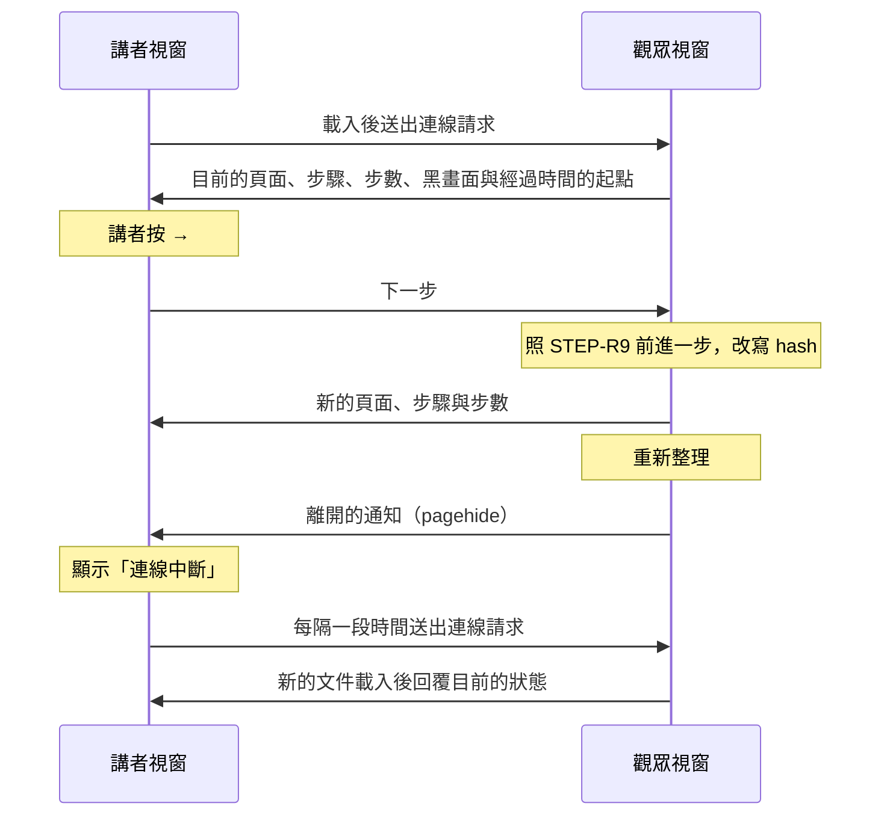

# 0004 講者模式

## 目標

完成後，講者把筆電接上投影幕時，可以在播放簡報的視窗按 `S` 另外開一個講者視窗，把原本的視窗拖到投影幕上給觀眾看，自己在筆電上看著目前頁、這一頁的下一步、下一頁、講者備註、經過時間與目前時刻。講者在任一個視窗按快捷鍵或用翻頁器，兩個視窗都會一起換頁；任一個視窗重新整理之後，兩個視窗會自動重新連上。講者備註用 Markdown 寫在每一頁的 TSX 檔裡，寫法有誤時 build 失敗。

## 範圍

- 要做：
  - 在觀眾視窗按 `S` 開啟講者視窗，講者視窗顯示目前頁、下一步、下一頁、講者備註，以及經過時間、目前時刻、頁碼與步驟。
  - 講者視窗跟著觀眾視窗換頁，並把快捷鍵轉給觀眾視窗執行。
  - 頁面匯出 `notes`，用 Markdown 寫講者備註；build 時檢查 `notes` 的寫法。
  - 新增 `presenter.md`；在 `framework.md` 新增 FRAME-R6、FRAME-R7；修改 `navigation.md` 開頭的說明與 NAV-R9、NAV-R14。
  - 在 `README.md` 的「Playing a Deck」說明講者模式的用法：按 `S` 開啟講者視窗、電腦接投影幕時要設成延伸桌面而不是鏡像輸出，以及在 macOS 上要開著「系統設定」裡「桌面與 Dock」的「顯示器有不同的空間」，否則一個螢幕上的視窗進入全螢幕時，另一個螢幕會變黑。
  - 在這個 plan 的 PR 直接把「觀眾視窗」與「講者視窗」加進 `product.md` 的術語表，因為這兩個詞是產品層級的用詞，不必等實作。
- 刻意不做的事：
  - 自動把觀眾視窗放到投影幕，理由寫在「決策」一節。
  - 在平板與手機上使用講者模式。這些裝置沒有鍵盤可以按 `S`，而且 iPad 的 Safari 會把新視窗開成分頁。
  - 在講者視窗用觸控滑動換頁，理由寫在「決策」一節。
  - 開啟講者模式的按鈕、倒數計時與暫停計時，理由寫在「決策」一節。
  - 調整備註字級的按鈕或快捷鍵。講者在講者視窗用瀏覽器的縮放調整字級，按著 Cmd 或 Ctrl 的按鍵本來就交給瀏覽器（NAV-R7）。
  - 處理講者視窗裡的影片聲音與圖表動畫。講者視窗會另外 render 一份頁面，roadmap 的「圖片與影片」與「ECharts 圖表」要各自處理，這一點寫進 `architecture.md`（見「做法要點」）。

## Spec 變更

### presenter.md

新增這份 spec，`prefix` 為 `PRES`，開頭的說明與設計理由寫在下方「開頭的說明」。

- 新增 PRES-R1 用 `S` 開啟講者視窗
- 新增 PRES-R2 講者視窗顯示觀眾視窗目前的位置
- 新增 PRES-R3 在講者視窗操作簡報
- 新增 PRES-R4 全螢幕只作用在講者按下快捷鍵的視窗
- 新增 PRES-R5 講者視窗的版面
- 新增 PRES-R6 目前頁
- 新增 PRES-R7 下一步與下一頁
- 新增 PRES-R8 資訊列
- 新增 PRES-R9 經過時間
- 新增 PRES-R10 講者備註
- 新增 PRES-R11 點過講者視窗的按鈕或連結之後仍然可以用按鍵換頁
- 新增 PRES-R12 連線中斷時保留最後的畫面
- 新增 PRES-R13 觀眾視窗關閉時講者視窗跟著關閉
- 新增 PRES-R14 不是從觀眾視窗開啟的講者視窗
- 新增 PRES-R15 一個講者視窗只控制開啟它的觀眾視窗

#### 開頭的說明

講者模式是講者把電腦接上投影幕播放簡報時，在自己的螢幕上看著目前頁、下一步、下一頁、講者備註與時間的能力。講者在播放簡報的視窗按 `S`，播放器另外開一個講者視窗；原本播放簡報的視窗叫做觀眾視窗，投影幕上顯示的就是觀眾視窗。講者視窗顯示觀眾視窗目前的頁面與步驟；講者在講者視窗按下的快捷鍵，也交給觀眾視窗照 [navigation.md](navigation.md) 與 [steps.md](steps.md) 的規則執行。

講者開啟講者視窗之後，自己把觀眾視窗拖到投影幕上，在觀眾視窗按 `F` 進入全螢幕，講者視窗留在自己的螢幕上。

> 設計理由：講者手動把觀眾視窗拖到投影幕。曾考慮在講者按 `S` 時，用 Window Management API 讓觀眾視窗在外接螢幕上全螢幕、講者視窗開在筆電螢幕上，但從 `file://` 開啟時只有 Chromium 支援這個 API，第一次使用時還要講者授權，所以講者換到 Firefox、Safari 或現場的電腦時，開講前的操作就不一樣；接了兩個以上的外接螢幕時，也要另訂規則決定把觀眾視窗放在哪一個外接螢幕。完整討論見 [0004](../plans/archive/0004-presenter-mode.md)。

#### PRES-R1 用 `S` 開啟講者視窗

在觀眾視窗按 `S` 時，播放器開啟講者視窗。講者視窗是獨立的瀏覽器視窗，不是分頁，所以可以單獨拖到另一個螢幕。這個觀眾視窗開啟的講者視窗已經開著時，按 `S` 會把既有的講者視窗移到最前面，不會再開一個。在講者視窗按 `S` 沒有作用。`S` 和其他快捷鍵一樣適用 [navigation.md](navigation.md) 的 NAV-R7，黑畫面時與按住不放時的行為寫在 NAV-R9 與 NAV-R14。

- 情境：開啟講者視窗
  - 前提：講者視窗沒有開啟，畫面顯示 `agenda`
  - 動作：按 `S`
  - 結果：開啟講者視窗，講者視窗的目前頁顯示 `agenda`
- 情境：講者視窗已經開著
  - 前提：觀眾視窗已經開啟講者視窗，講者視窗在觀眾視窗後面
  - 動作：在觀眾視窗按 `S`
  - 結果：沒有開啟新的視窗，既有的講者視窗移到最前面
- 情境：觀眾視窗重新整理後再按 `S`
  - 前提：觀眾視窗已經開啟講者視窗
  - 動作：重新整理觀眾視窗，再在觀眾視窗按 `S`
  - 結果：沒有開啟新的視窗
- 情境：在講者視窗按 `S`
  - 前提：講者視窗已經開著，焦點在講者視窗
  - 動作：按 `S`
  - 結果：沒有開啟新的視窗
- 情境：在 Safari 開啟講者視窗
  - 前提：在 macOS 的 Safari 用 `file://` 開啟簡報，Safari 使用預設的彈出視窗設定
  - 動作：按 `S`
  - 結果：開啟講者視窗

> 設計理由：講者只能用 `S` 開啟講者視窗，因為講者模式只在接著投影幕的電腦上使用，講者一定有鍵盤。曾考慮在全螢幕按鈕旁邊另外放一顆開啟講者視窗的按鈕，但平板與手機不支援講者模式，所以播放器得先判斷裝置能不能開獨立視窗，才能決定要不要顯示這顆按鈕。完整討論見 [0004](../plans/archive/0004-presenter-mode.md)。

#### PRES-R2 講者視窗顯示觀眾視窗目前的位置

觀眾視窗的頁面、步驟或黑畫面改變時，講者視窗跟著更新。不論改變是講者在哪個視窗按下快捷鍵造成的，還是觀眾視窗的網址 hash 改變造成的，例如講者在觀眾視窗按了瀏覽器的上一頁，講者視窗都會更新。

- 情境：在觀眾視窗換頁
  - 前提：講者視窗已經開著，觀眾視窗顯示 `intro`，下一頁是 `agenda`
  - 動作：在觀眾視窗按 →
  - 結果：講者視窗的目前頁顯示 `agenda`
- 情境：在觀眾視窗按瀏覽器的上一頁
  - 前提：講者視窗已經開著，觀眾視窗顯示 `agenda`，講者在觀眾視窗按 End 跳到 `recap`
  - 動作：在觀眾視窗按瀏覽器的上一頁
  - 結果：講者視窗的目前頁顯示 `agenda`

#### PRES-R3 在講者視窗操作簡報

講者在講者視窗按快捷鍵時，播放器照 [navigation.md](navigation.md) 與 [steps.md](steps.md) 的規則操作觀眾視窗，判斷的順序和講者在觀眾視窗按下按鍵時相同，判斷是不是黑畫面時看的是觀眾視窗。和在觀眾視窗操作有以下差別：

1. 全螢幕的快捷鍵只作用在講者視窗（PRES-R4）。
2. 講者輸入的頁碼只顯示在講者視窗的資訊列（PRES-R8），觀眾視窗不顯示。
3. 跳頁新增的瀏覽紀錄在觀眾視窗，要回到跳頁之前的頁面時，講者要在觀眾視窗按瀏覽器的上一頁（NAV-R6）。講者視窗只有開啟時的那一筆瀏覽紀錄，在講者視窗按瀏覽器的上一頁不會換頁。
4. `S` 在講者視窗沒有作用（PRES-R1）。

- 情境：在講者視窗按下一步
  - 前提：焦點在講者視窗，觀眾視窗顯示 `intro`，下一頁是 `agenda`
  - 動作：按 →
  - 結果：觀眾視窗與講者視窗的目前頁都顯示 `agenda`
- 情境：在講者視窗跳頁後回到原來的頁面
  - 前提：焦點在講者視窗，觀眾視窗顯示 `agenda`，最後一頁是 `recap`
  - 動作：按 End，再在觀眾視窗按瀏覽器的上一頁
  - 結果：按 End 之後，觀眾視窗顯示 `recap`；按瀏覽器的上一頁之後，觀眾視窗與講者視窗的目前頁都顯示 `agenda`
- 情境：在講者視窗切換黑畫面
  - 前提：焦點在講者視窗，觀眾視窗顯示 `intro`
  - 動作：按 `B`
  - 結果：觀眾視窗變成黑畫面，講者視窗的目前頁仍然顯示 `intro`，上面寫著「觀眾看到黑畫面」
- 情境：黑畫面時在講者視窗按下一步
  - 前提：焦點在講者視窗，觀眾視窗顯示 `intro`，接著切換成黑畫面
  - 動作：按 →
  - 結果：觀眾視窗的黑畫面結束，畫面顯示 `intro`
- 情境：在講者視窗輸入頁碼
  - 前提：焦點在講者視窗，簡報依序是 `intro`、`agenda`、`recap` 三頁，觀眾視窗顯示 `intro`
  - 動作：輸入 3，再按 Enter
  - 結果：輸入 3 之後，講者視窗的資訊列顯示 3，觀眾視窗沒有顯示頁碼；按 Enter 之後，觀眾視窗顯示 `recap`
- 情境：焦點在講者視窗時用翻頁器換頁
  - 前提：筆電接上翻頁器，焦點在講者視窗，觀眾視窗顯示 `intro`，下一頁是 `agenda`
  - 動作：按翻頁器的下一頁鍵
  - 結果：觀眾視窗顯示 `agenda`

> 設計理由：兩個視窗都接受快捷鍵，因為翻頁器送出的按鍵只會送到有焦點的視窗，而講者點過講者視窗之後，例如捲動備註，焦點就留在講者視窗。曾考慮只讓觀眾視窗接受快捷鍵，但這樣講者點過講者視窗之後，要回頭點觀眾視窗才能繼續用翻頁器換頁，而觀眾視窗在投影幕上全螢幕，講者看不到游標在哪裡；也考慮過只讓講者視窗接受快捷鍵，但沒開講者視窗時觀眾視窗仍然要接受快捷鍵，關掉講者視窗時又要恢復，規則反而變多。完整討論見 [0004](../plans/archive/0004-presenter-mode.md)。

#### PRES-R4 全螢幕只作用在講者按下快捷鍵的視窗

講者在講者視窗按全螢幕的快捷鍵（`F`、F5、Shift+F5）時，講者視窗照 NAV-R10 的規則切換全螢幕，觀眾視窗不受影響。瀏覽器只在一個視窗收到講者的操作時，才允許這個視窗進入全螢幕，所以講者在講者視窗沒辦法讓觀眾視窗進入全螢幕；講者要讓投影幕全螢幕時，要在觀眾視窗按 `F`。

- 情境：在講者視窗按 `F`
  - 前提：講者視窗與觀眾視窗都不在全螢幕，焦點在講者視窗
  - 動作：按 `F`
  - 結果：講者視窗進入全螢幕，觀眾視窗仍然不在全螢幕
- 情境：兩個螢幕各自全螢幕
  - 前提：筆電用延伸桌面接上投影幕，觀眾視窗在投影幕上，講者視窗在筆電螢幕上，兩個視窗都不在全螢幕
  - 動作：在觀眾視窗按 `F`，再點講者視窗，按 `F`
  - 結果：觀眾視窗在投影幕上全螢幕，講者視窗在筆電螢幕上全螢幕，兩個視窗同時維持全螢幕

#### PRES-R5 講者視窗的版面

講者視窗照下圖排版，用深色背景與淺色文字，不受簡報配色的影響。目前頁、下一步與下一頁三格都把 1920×1080 的畫布等比縮放到格子裡，下一步與下一頁兩格分別標上「下一步」與「下一頁」。

```text
┌───────────────────────────────────────────────────────────────┐
│ 經過時間 [歸零]  目前時刻  第 4 / 12 頁  第 1 / 3 步  輸入中的頁碼  │
├──────────────────────────────────────┬────────────────────────┤
│                                      │ 下一步                  │
│                                      │                        │
│ 目前頁                                ├────────────────────────┤
│                                      │ 下一頁                  │
│                                      │                        │
├──────────────────────────────────────┴────────────────────────┤
│ 講者備註                                                       │
│                                                               │
└───────────────────────────────────────────────────────────────┘
```

講者視窗的標題是 `deck.json` 的 `title` 加上「（講者視窗）」。講者視窗不隱藏游標（NAV-R12），也不顯示全螢幕按鈕（NAV-R11）。

- 情境：視窗標題
  - 前提：`deck.json` 的 `title` 是 `年度回顧`
  - 動作：開啟講者視窗
  - 結果：講者視窗的標題是 `年度回顧（講者視窗）`
- 情境：滑鼠停止移動 2 秒
  - 前提：游標在講者視窗上
  - 動作：2 秒內不移動滑鼠
  - 結果：游標仍然顯示

> 設計理由：講者視窗不顯示上一頁。曾考慮在目前頁的左邊多放一格上一頁，但講者很少需要回頭看上一頁，多一格就會壓縮備註的空間，而備註是講者視窗裡最需要大字的部分。完整討論見 [0004](../plans/archive/0004-presenter-mode.md)。

#### PRES-R6 目前頁

目前頁顯示觀眾視窗目前的頁面與步驟。講者視窗 render 自己的一份頁面，所以講者在觀眾視窗操作互動元件之後，講者視窗的目前頁仍然顯示這一頁在目前步驟的初始狀態。目前頁、下一步與下一頁三格都不能操作：點不到格子裡的元素，也不能用 Tab 把焦點移到格子裡。觀眾視窗是黑畫面時，目前頁照常顯示頁面，上面疊一層半透明的黑色遮罩，寫著「觀眾看到黑畫面」。

- 情境：顯示目前的步驟
  - 前提：`list` 這一頁有 3 步，觀眾視窗顯示 `list` 的第 2 步
  - 動作：按 `S`
  - 結果：講者視窗的目前頁顯示 `list` 的第 2 步
- 情境：點不到目前頁上的按鈕
  - 前提：觀眾視窗顯示 `counter`，這一頁有一個計數器，初始值是 0
  - 動作：在講者視窗點目前頁上的計數器
  - 結果：講者視窗與觀眾視窗的計數器都顯示 0
- 情境：Tab 移不到目前頁裡的元素
  - 前提：觀眾視窗顯示 `counter`，焦點在講者視窗
  - 動作：按 Tab 直到焦點繞過講者視窗裡所有可以取得焦點的元素
  - 結果：焦點從來沒有移到目前頁、下一步與下一頁三格裡的計數器上
- 情境：在觀眾視窗操作互動元件
  - 前提：觀眾視窗顯示 `counter`，這一頁有一個計數器，初始值是 0
  - 動作：在觀眾視窗把計數器按到 3
  - 結果：講者視窗的目前頁的計數器仍然顯示 0
- 情境：觀眾視窗是黑畫面
  - 前提：講者視窗已經開著，觀眾視窗顯示 `intro`
  - 動作：在觀眾視窗按 `B`
  - 結果：講者視窗的目前頁仍然顯示 `intro`，上面疊著半透明的黑色遮罩，寫著「觀眾看到黑畫面」

> 設計理由：講者視窗的三格都不能操作，因為講者示範互動元件時本來就看著投影幕操作，講者視窗的目前頁和投影幕不一致的影響不大。曾考慮讓目前頁可以操作，但兩個視窗的互動元件各有各的狀態，講者在講者視窗操作元件時，投影幕上的畫面不會改變。也考慮過把觀眾視窗裡互動元件的狀態同步到講者視窗，但這樣每個互動元件都要照一套同步規則實作。還考慮過用螢幕擷取把觀眾視窗的畫面即時顯示在講者視窗，但講者每次開啟講者視窗都要授權並挑選要擷取的視窗。完整討論見 [0004](../plans/archive/0004-presenter-mode.md)。

#### PRES-R7 下一步與下一頁

「下一步」顯示觀眾視窗目前的頁面在下一步的畫面，也就是講者按下一步之後這一頁會出現的畫面；目前的頁面已經在最後一步，或沒有步驟時，這一格是灰底，寫著「沒有下一步」。「下一頁」顯示下一頁的第 0 步；目前的頁面是最後一頁時，這一格是灰底，寫著「簡報結束」。目前的頁面還有沒有下一步，依觀眾視窗目前 render 的步數決定，所以觀眾視窗的步數因為互動而改變時（STEP-R14），「下一步」也跟著改變。

- 情境：這一頁還有步驟
  - 前提：`list` 這一頁有 3 步，下一頁是 `recap`，觀眾視窗顯示 `list` 的第 1 步
  - 動作：按 `S`
  - 結果：「下一步」顯示 `list` 的第 2 步，「下一頁」顯示 `recap` 的第 0 步
- 情境：已經在最後一步
  - 前提：`list` 這一頁有 3 步，下一頁是 `recap`，觀眾視窗顯示 `list` 的第 3 步
  - 動作：按 `S`
  - 結果：「下一步」是灰底，寫著「沒有下一步」；「下一頁」顯示 `recap` 的第 0 步
- 情境：沒有步驟的頁面
  - 前提：`intro` 這一頁沒有步驟，下一頁是 `agenda`，觀眾視窗顯示 `intro`
  - 動作：按 `S`
  - 結果：「下一步」是灰底，寫著「沒有下一步」；「下一頁」顯示 `agenda` 的第 0 步
- 情境：最後一頁
  - 前提：最後一頁 `finale` 有 2 步，觀眾視窗顯示 `finale` 的第 1 步
  - 動作：按 `S`
  - 結果：「下一步」顯示 `finale` 的第 2 步；「下一頁」是灰底，寫著「簡報結束」
- 情境：觀眾視窗的步數變少
  - 前提：`toggle` 這一頁有 `<Step at={1}>`、`<Step at={2}>`，以及一個按下後移除 `<Step at={2}>` 的按鈕；講者視窗已經開著，觀眾視窗顯示 `toggle` 的第 1 步
  - 動作：在觀眾視窗按這個按鈕
  - 結果：講者視窗的「下一步」變成灰底，寫著「沒有下一步」

> 設計理由：「下一步」與「下一頁」分成兩格，每一格顯示的內容固定，所以講者看一眼就知道下一次按下一步時會不會換頁：「下一步」是灰底時，講者再按下一步，觀眾就會看到「下一頁」那一格的畫面。曾考慮只放一格，顯示講者下一次按下一步之後的畫面，但這一頁的步驟還沒走完時，講者看不到下一頁，而且這一格顯示的不論是這一頁的下一步還是下一頁，看起來都只是一張縮圖，講者要比對內容才分得出來會不會換頁。也考慮過在沒有下一步時，讓右下角改顯示再下一頁，讓兩格不重複，但這樣講者按到最後一步、準備換頁時，下一頁的預覽會從右下角移到右上角。完整討論見 [0004](../plans/archive/0004-presenter-mode.md)。

#### PRES-R8 資訊列

講者視窗最上方的資訊列照 PRES-R5 的圖，顯示經過時間（PRES-R9）與歸零按鈕、目前時刻、目前的頁碼與步驟，以及講者在講者視窗輸入中的頁碼（PRES-R3）。目前時刻以 24 小時制顯示時與分，例如 `14:05`。頁碼寫成「第 4 / 12 頁」，頁碼從 1 開始；目前的頁面有步驟時，旁邊再寫目前的步驟與步數，例如「第 1 / 3 步」，步數依觀眾視窗目前 render 的步數決定。講者在講者視窗輸入頁碼時，資訊列才顯示輸入中的頁碼，頁碼出現與消失的規則和觀眾視窗相同（NAV-R5），例如停止輸入 3 秒後，頁碼從資訊列消失。

- 情境：有步驟的頁面
  - 前提：簡報有 12 頁，第 4 頁有 3 步，觀眾視窗顯示第 4 頁的第 1 步
  - 動作：按 `S`
  - 結果：講者視窗的資訊列顯示「第 4 / 12 頁」與「第 1 / 3 步」
- 情境：沒有步驟的頁面
  - 前提：簡報有 12 頁，第 1 頁沒有步驟，觀眾視窗顯示第 1 頁
  - 動作：按 `S`
  - 結果：講者視窗的資訊列顯示「第 1 / 12 頁」，沒有顯示步驟
- 情境：目前時刻
  - 前提：電腦的時間是 14:05
  - 動作：按 `S`
  - 結果：講者視窗的資訊列顯示 `14:05`
- 情境：停止輸入頁碼 3 秒
  - 前提：焦點在講者視窗，觀眾視窗顯示 `intro`
  - 動作：輸入 3，等 3 秒
  - 結果：輸入 3 之後，講者視窗的資訊列顯示 3；等 3 秒之後，資訊列不再顯示頁碼，觀眾視窗仍然顯示 `intro`

> 設計理由：資訊列顯示經過時間與目前時刻，因為講者看這兩個時間就能判斷進度。目前時刻不能只靠作業系統的時鐘，因為講者視窗全螢幕時，macOS 的選單列與 Windows 的工作列都會被藏起來。曾考慮在 `deck.json` 加上演講長度的欄位，讓資訊列倒數剩下的時間，但同一份簡報在不同場合的演講長度常常不同。完整討論見 [0004](../plans/archive/0004-presenter-mode.md)。

#### PRES-R9 經過時間

還沒開始計時時，經過時間顯示「未開始」。講者點經過時間時開始計時；講者沒有點的話，觀眾視窗第一次換頁或換步驟時自動開始計時，不論講者是在哪個視窗按下快捷鍵。講者點歸零按鈕時，經過時間回到「未開始」，之後同樣在講者點經過時間，或觀眾視窗下一次換頁或換步驟時開始計時。

經過時間寫成「分:秒」，例如 `12:34`；超過一小時之後寫成「時:分:秒」，例如 `1:02:03`。經過時間一律從開始計時的那一刻算起，所以觀眾視窗或講者視窗重新整理，或講者關掉講者視窗、之後再按 `S` 開啟時，經過時間都包含重新整理或講者視窗關著的那段時間。觀眾視窗關掉之後，經過時間不再保留，講者在新的分頁或視窗重新開啟簡報、按 `S` 開啟的講者視窗顯示「未開始」。

- 情境：點經過時間開始計時
  - 前提：講者視窗剛開啟，經過時間顯示「未開始」
  - 動作：點經過時間，等 5 秒
  - 結果：經過時間顯示 `00:05`
- 情境：第一次換步驟時開始計時
  - 前提：講者視窗剛開啟，經過時間顯示「未開始」，觀眾視窗顯示 `intro`
  - 動作：在觀眾視窗按 →，等 5 秒
  - 結果：經過時間顯示 `00:05`
- 情境：歸零
  - 前提：經過時間顯示 `12:34`
  - 動作：點歸零按鈕，等 5 秒，再按 →，等 5 秒
  - 結果：點歸零按鈕之後經過時間顯示「未開始」，等 5 秒之後仍然是「未開始」；按 → 再等 5 秒之後，經過時間顯示 `00:05`
- 情境：超過一小時
  - 前提：經過時間顯示 `59:59`
  - 動作：等 4 秒
  - 結果：經過時間顯示 `1:00:03`
- 情境：講者視窗重新整理
  - 前提：經過時間顯示 `12:34`
  - 動作：重新整理講者視窗，講者視窗在 1 秒後載入完成
  - 結果：經過時間顯示 `12:35`
- 情境：觀眾視窗重新整理
  - 前提：經過時間顯示 `12:34`
  - 動作：重新整理觀眾視窗，觀眾視窗在 1 秒後載入完成
  - 結果：講者視窗恢復連線之後，經過時間顯示 `12:35`
- 情境：關掉講者視窗再開啟
  - 前提：經過時間顯示 `12:34`
  - 動作：關掉講者視窗，等 10 秒，在觀眾視窗按 `S`
  - 結果：新開啟的講者視窗的經過時間顯示 `12:44`
- 情境：關掉觀眾視窗後重新開啟簡報
  - 前提：經過時間顯示 `12:34`
  - 動作：關掉觀眾視窗與講者視窗，在新的分頁開啟這份簡報，按 `S`
  - 結果：新開啟的講者視窗的經過時間顯示「未開始」

> 設計理由：講者通常在開講前就開好講者視窗，還會按幾下翻頁器測試，所以經過時間先停在「未開始」。講者在標題頁自我介紹時，可以點經過時間開始計時，講者忘了點的話，第一次換頁時也會開始計時。曾考慮在開啟講者視窗時就開始計時，但講者忘了在開講時歸零的話，經過時間會多出整段準備時間；也考慮過只在第一次換頁時開始，但這樣講者在標題頁講的時間不會算進去。經過時間不能暫停，因為授課中途休息時，講者看目前時刻就能掌握時間。完整討論見 [0004](../plans/archive/0004-presenter-mode.md)。

#### PRES-R10 講者備註

備註區顯示觀眾視窗目前頁面的講者備註，備註的寫法寫在 [framework.md](framework.md) 的 FRAME-R6。播放器照 CommonMark 把備註的 Markdown 轉成格式化的文字；備註裡的 HTML 標籤不會 render，照原文顯示。講者點備註裡的連結時，瀏覽器在新的分頁開啟連結，講者視窗維持原狀。頁面沒有備註時，備註區寫著「這一頁沒有備註」。

備註比備註區長時，講者用觸控板或滑鼠滾輪捲動備註區。換到其他頁面時，備註區捲回最上方；換到同一頁的其他步驟時，備註區維持原本的捲動位置。

- 情境：顯示備註
  - 前提：`agenda` 的 `notes` 是一個兩項的清單，其中一項有粗體字，觀眾視窗顯示 `agenda`
  - 動作：按 `S`
  - 結果：講者視窗的備註區顯示兩項的清單，粗體字以粗體顯示
- 情境：沒有備註
  - 前提：`intro` 沒有匯出 `notes`，觀眾視窗顯示 `intro`
  - 動作：按 `S`
  - 結果：講者視窗的備註區寫著「這一頁沒有備註」
- 情境：備註裡的 HTML
  - 前提：`agenda` 的 `notes` 寫了 `<b>重點</b>`，觀眾視窗顯示 `agenda`
  - 動作：按 `S`
  - 結果：講者視窗的備註區顯示 `<b>重點</b>` 這段文字，「重點」沒有以粗體顯示
- 情境：點備註裡的連結
  - 前提：`agenda` 的 `notes` 有一個連到 `https://example.com` 的連結，講者視窗顯示 `agenda` 的備註
  - 動作：在講者視窗點這個連結
  - 結果：瀏覽器在新的分頁開啟 `https://example.com`，講者視窗仍然顯示 `agenda` 的備註
- 情境：換頁時捲回最上方
  - 前提：`agenda` 與下一頁 `recap` 的備註都比備註區長，觀眾視窗顯示 `agenda`，講者把講者視窗的備註區捲到最下方
  - 動作：按 →
  - 結果：備註區顯示 `recap` 的備註，捲動位置在最上方
- 情境：換步驟時維持捲動位置
  - 前提：`list` 這一頁有 3 步，備註比備註區長，觀眾視窗顯示 `list` 的第 1 步，講者把講者視窗的備註區捲到最下方
  - 動作：按 →
  - 結果：備註區仍然捲在最下方

> 設計理由：講者只能用觸控板或滑鼠捲動備註，因為 ↑、↓、PageUp、PageDown 都是換頁的快捷鍵（NAV-R3）。曾考慮在焦點位於備註區時，讓這些按鍵改成捲動備註，但這樣講者點過備註區之後，翻頁器送出的 PageDown 就不會換頁。完整討論見 [0004](../plans/archive/0004-presenter-mode.md)。

#### PRES-R11 點過講者視窗的按鈕或連結之後仍然可以用按鍵換頁

講者用滑鼠或手指點經過時間、歸零按鈕或備註裡的連結時，這些元素不取得焦點，所以講者點過之後按 Space 或 Enter 仍然會換頁，不會再按一次按鈕或再開一次連結，理由和 NAV-R11 的全螢幕按鈕相同。

- 情境：點歸零按鈕後按 Space
  - 前提：焦點在講者視窗，觀眾視窗顯示 `intro`，下一頁是 `agenda`，經過時間顯示 `12:34`
  - 動作：點歸零按鈕，再按 Space
  - 結果：觀眾視窗顯示 `agenda`，經過時間開始計時
- 情境：點備註裡的連結後按 Enter
  - 前提：講者視窗顯示 `agenda` 的備註，備註裡有一個連結，下一頁是 `recap`
  - 動作：在講者視窗點這個連結，回到講者視窗，再按 Enter
  - 結果：觀眾視窗顯示 `recap`，瀏覽器只開啟一個新的分頁

#### PRES-R12 連線中斷時保留最後的畫面

講者視窗連不上觀眾視窗時，例如觀眾視窗正在重新整理，或講者在觀眾視窗按瀏覽器的上一頁離開了簡報，講者視窗保留最後收到的畫面與備註，上面疊一條「連線中斷」的提示。這段期間，講者在講者視窗按的快捷鍵沒有作用，經過時間照常累計。觀眾視窗回到簡報之後，講者視窗自動恢復，顯示觀眾視窗目前的位置。講者視窗重新整理之後，也會自動顯示觀眾視窗目前的位置。

- 情境：觀眾視窗重新整理
  - 前提：講者視窗已經開著，觀眾視窗顯示 `agenda`，下一頁是 `recap`
  - 動作：重新整理觀眾視窗，再在講者視窗按 →
  - 結果：重新整理之後，講者視窗的目前頁顯示 `agenda`；按 → 之後，觀眾視窗與講者視窗的目前頁都顯示 `recap`
- 情境：觀眾視窗離開簡報
  - 前提：在瀏覽器開啟網站首頁，再從首頁開啟這份簡報，觀眾視窗顯示 `intro`，接著按 `S` 開啟講者視窗
  - 動作：在觀眾視窗按瀏覽器的上一頁
  - 結果：講者視窗的目前頁仍然顯示 `intro`，上面疊著「連線中斷」
- 情境：觀眾視窗回到簡報
  - 前提：觀眾視窗從簡報回到網站首頁，講者視窗顯示「連線中斷」
  - 動作：在觀眾視窗按瀏覽器的下一頁
  - 結果：講者視窗的「連線中斷」消失，目前頁顯示觀眾視窗的頁面
- 情境：連線中斷時按下一步
  - 前提：觀眾視窗從簡報回到網站首頁，講者視窗顯示「連線中斷」，目前頁是 `intro`
  - 動作：在講者視窗按 →
  - 結果：講者視窗的目前頁仍然顯示 `intro`
- 情境：講者視窗重新整理
  - 前提：觀眾視窗顯示 `list` 的第 2 步
  - 動作：重新整理講者視窗
  - 結果：講者視窗的目前頁顯示 `list` 的第 2 步

#### PRES-R13 觀眾視窗關閉時講者視窗跟著關閉

觀眾視窗關閉時，講者視窗跟著關閉。觀眾視窗重新整理或離開簡報時，講者視窗不會關閉，而是照 PRES-R12 處理。

- 情境：關閉觀眾視窗
  - 前提：講者視窗已經開著
  - 動作：關閉觀眾視窗
  - 結果：講者視窗跟著關閉

> 設計理由：觀眾視窗關閉時講者視窗跟著關閉，因為講者每場演講結束時都會關掉觀眾視窗，講者視窗留著的話，講者還得再關一次。曾考慮保留講者視窗並疊上「觀眾視窗已關閉」，讓講者誤關觀眾視窗時，還看得到剛才講到第幾頁與已經講了多久，但講者在台上誤關觀眾視窗的情況很少見，而且講者重新開啟簡報、按 `S` 之後，畫面上會同時有舊的與新的講者視窗。完整討論見 [0004](../plans/archive/0004-presenter-mode.md)。

#### PRES-R14 不是從觀眾視窗開啟的講者視窗

講者視窗的網址是 slidetray 的 `index.html` 加上 `?presenter`。講者視窗不是講者在觀眾視窗按 `S` 開啟時，例如講者用瀏覽器重新開啟剛關掉的講者視窗（macOS 是 Cmd+Shift+T），或從瀏覽紀錄開啟講者視窗的網址，講者視窗只顯示「請在簡報裡按 S 開啟講者視窗」。

- 情境：直接開啟講者視窗的網址
  - 前提：簡報已經 build 好
  - 動作：在瀏覽器的網址列開啟 slidetray 的 `index.html?presenter`
  - 結果：畫面只顯示「請在簡報裡按 S 開啟講者視窗」
- 情境：重新開啟關掉的講者視窗
  - 前提：觀眾視窗已經開啟講者視窗
  - 動作：關掉講者視窗，按 Cmd+Shift+T
  - 結果：重新開啟的視窗只顯示「請在簡報裡按 S 開啟講者視窗」

> 設計理由：講者視窗只顯示提示，請講者回到觀眾視窗按 `S`，因為會碰到這種講者視窗的，通常是誤關了講者視窗、想用 Cmd+Shift+T 找回來的講者，這時投影幕上的觀眾視窗還開著。曾考慮拿掉網址的 `?presenter`，把這個視窗換成一般的播放器，但這樣筆電上會多出第二個從第一頁開始播放的觀眾視窗；講者在這個視窗按 `S` 的話，開出的講者視窗控制的是筆電上的這個視窗（PRES-R15），投影幕上的觀眾視窗不會跟著換頁。完整討論見 [0004](../plans/archive/0004-presenter-mode.md)。

#### PRES-R15 一個講者視窗只控制開啟它的觀眾視窗

同一份簡報開在好幾個分頁或視窗時，每個講者視窗只顯示並操作開啟它的那個觀眾視窗；講者可以在每個觀眾視窗各自按 `S`，開啟這個觀眾視窗自己的講者視窗。

- 情境：兩個分頁各自開啟講者視窗
  - 前提：同一份簡報開在兩個分頁，兩個分頁都顯示 `intro`，下一頁是 `agenda`
  - 動作：在第一個分頁按 `S`，在第二個分頁按 `S`，再在第一個分頁開啟的講者視窗按 →
  - 結果：開啟兩個講者視窗；第一個分頁顯示 `agenda`，第二個分頁仍然顯示 `intro`

> 設計理由：講者視窗只控制開啟它的觀眾視窗。曾考慮讓一個講者視窗控制同一份簡報的所有分頁，但從 `file://` 開啟時，`BroadcastChannel` 在 WebKit 收不到訊息，而 `localStorage` 在 Chromium 與 WebKit 由所有 `file://` 網頁共用，用 `localStorage` 傳訊息的話，講者視窗會連其他簡報的分頁一起控制。要把同一個畫面投到兩個螢幕時，用作業系統的鏡像輸出。完整討論見 [0004](../plans/archive/0004-presenter-mode.md)。

### framework.md

- 新增 FRAME-R6 用 `notes` 匯出講者備註：完整內容寫在下方
- 新增 FRAME-R7 `notes` 的寫法不符規則時 build 失敗：完整內容寫在下方

#### FRAME-R6 用 `notes` 匯出講者備註

頁面的 TSX 檔可以用 `export const notes` 匯出這一頁的講者備註，內容是 CommonMark 格式的 Markdown，講者在講者視窗的備註區看到的就是這段內容（[presenter.md](presenter.md) 的 PRES-R10）。

```tsx
export const notes = `
- 先問觀眾有沒有用過 Keynote
- 強調 \`useStep\` 的參數要列出每一步
`;

export default function Agenda() {
  // ...
}
```

備註寫在 template literal 裡，所以 Markdown 的反引號要寫成 `` \` ``，`${` 要寫成 `\${`，`notes` 的其他規則寫在 FRAME-R7。照 FRAME-R4 讓同一頁出現兩次時，`export { default } from "./agenda";` 不會帶上 `agenda` 的備註；要沿用 `agenda` 的備註時，寫成 `export { default, notes } from "./agenda";`。

- 情境：備註裡的反引號
  - 前提：`agenda` 的 `notes` 寫了 `` 強調 \`useStep\` ``
  - 動作：Build，在觀眾視窗顯示 `agenda` 時按 `S`
  - 結果：Build 成功，講者視窗的備註區把 `useStep` 顯示成行內程式碼
- 情境：重新匯出時不帶備註
  - 前提：`agenda` 有備註，`agenda-recap.tsx` 的內容是 `export { default } from "./agenda";`
  - 動作：在觀眾視窗顯示 `agenda-recap` 時按 `S`
  - 結果：講者視窗的備註區寫著「這一頁沒有備註」
- 情境：重新匯出時一起匯出備註
  - 前提：`agenda` 有備註，`agenda-recap.tsx` 的內容是 `export { default, notes } from "./agenda";`
  - 動作：在觀眾視窗顯示 `agenda-recap` 時按 `S`
  - 結果：講者視窗的備註區顯示 `agenda` 的備註

> 設計理由：備註寫成具名匯出的 template literal，放在檔案最上方。JSX 會把文字裡的換行與縮排併成一個空白，而 Markdown 的清單與段落都靠換行，所以 Markdown 一定要放在 template literal 裡。曾考慮用 `<Notes>` 元件把備註寫在頁面的 JSX 裡，但 template literal 會跟著 JSX 縮排，而 Markdown 把縮排 4 格以上的行當成程式碼區塊，AI 容易寫錯，播放器也要先 render 那一頁才讀得到備註；也考慮過寫成元件的屬性，例如 `Agenda.notes = ...`，但這不是常見的 React 寫法。具名匯出的代價是 `@vitejs/plugin-react` 只在檔案匯出的全都是元件時才熱更新，所以用 `make dev` 修改有 `notes` 的頁面時，整頁會重新載入。完整討論見 [0004](../plans/archive/0004-presenter-mode.md)。

#### FRAME-R7 `notes` 的寫法不符規則時 build 失敗

`deck.json` 列出的頁面匯出 `notes` 時，要用 `export const` 宣告，值是字串，或沒有 `${...}` 的 template literal；也可以用 `export { notes } from "./<slide-id>"` 從 `slides/` 目錄裡的其他頁面重新匯出。不符合這些規則時 build 失敗，錯誤訊息寫出 slide ID；template literal 裡有 `${...}` 時，錯誤訊息另外說明要把 `${` 寫成 `\${`。

- 情境：Template literal 裡有 `${`
  - 前提：`agenda` 的 `notes` 寫了 `` 範例：`${name}` ``，`${` 沒有跳脫
  - 動作：Build
  - 結果：Build 失敗，錯誤訊息寫出 `agenda`，並說明要把 `${` 寫成 `\${`
- 情境：`notes` 不是字串
  - 前提：`agenda` 寫了 `export const notes = 42;`
  - 動作：Build
  - 結果：Build 失敗，錯誤訊息寫出 `agenda`
- 情境：`notes` 是其他檔案的常數
  - 前提：`agenda` 寫了 `import { script } from "../shared";` 與 `export const notes = script;`
  - 動作：Build
  - 結果：Build 失敗，錯誤訊息寫出 `agenda`
- 情境：`${` 已經跳脫
  - 前提：`agenda` 的 `notes` 寫了 `\${name}`
  - 動作：Build，在觀眾視窗顯示 `agenda` 時按 `S`
  - 結果：Build 成功，講者視窗的備註區顯示 `${name}`

> 設計理由：Build 時檢查 `notes`，不只靠型別檢查，因為 `make build` 本身不做型別檢查，而且有些漏掉的跳脫連型別檢查都擋不下來。備註漏掉 `${` 的跳脫時，`${user}` 這種沒有宣告的名稱只有 `make check` 的型別檢查擋得下來，講者只跑 `make build` 的話，build 會成功，播放時整份簡報的 JS 一載入就出錯，畫面一片空白，因為所有頁面都打包在同一個 JS 檔裡。`${name}`、`${status}` 這種剛好是瀏覽器全域變數的名稱，連型別檢查都會通過，播放時備註裡的這段文字直接消失。完整討論見 [0004](../plans/archive/0004-presenter-mode.md)。

### navigation.md

- 修改開頭的說明：快捷鍵加上開啟講者視窗的 `S`，新的第三段與流程圖的修改寫在下方。
- 修改 NAV-R9：黑畫面時按 `S` 照常開啟講者視窗，並維持黑畫面；新增一個情境，新的內容寫在下方。設計理由不變。
- 修改 NAV-R14：按住不放時只在第一次按下時觸發的快捷鍵加上 `S`；新增一個情境，新的內容寫在下方。設計理由不變。

#### 開頭的說明

第三段的最後兩句改成下面這段：

播放器的快捷鍵是 NAV-R3、NAV-R4、NAV-R5、NAV-R9、NAV-R10 列出的按鍵，包括輸入頁碼用的數字鍵，以及開啟講者視窗的 `S`（[presenter.md](presenter.md) 的 PRES-R1）。講者按下按鍵時，播放器依下圖的順序決定要做什麼，每個判斷的細節寫在對應的需求裡。

流程圖改兩個節點，其他不變：

- `repeat` 改成 `{"按住不放時自動重複送出的 B、.、S 或全螢幕的快捷鍵？"}`。
- `fullscreen` 改成 `{"全螢幕的快捷鍵或 S？"}`，`toggle` 改成 `("切換全螢幕或開啟講者視窗，維持黑畫面（NAV-R9）")`。

#### NAV-R9 黑畫面

按 `B` 或 `.` 時切換黑畫面，黑畫面蓋住整個畫布。黑畫面時，按其他快捷鍵或觸控滑動只會結束黑畫面，不執行原本的動作。全螢幕的快捷鍵（`F`、F5、Shift+F5）與開啟講者視窗的 `S` 例外，照常切換全螢幕或開啟講者視窗，並維持黑畫面。黑畫面時，如果網址的 hash 改變，例如講者按了瀏覽器的上一頁，播放器照常換頁，並維持黑畫面。

既有的情境不變，新增以下情境：

- 情境：黑畫面時開啟講者視窗
  - 前提：講者視窗沒有開啟，畫面顯示 `intro`，接著切換成黑畫面
  - 動作：按 `S`
  - 結果：開啟講者視窗，觀眾視窗仍然是黑畫面

#### NAV-R14 按住按鍵不放時的快捷鍵

講者按住按鍵不放時，作業系統會自動重複送出這個按鍵，這時 `B`、`.`、`S` 與全螢幕的快捷鍵（`F`、F5、Shift+F5）只在第一次按下時觸發，其他快捷鍵照常連續觸發。

既有的情境不變，新增以下情境：

- 情境：按住 `S` 不放
  - 前提：講者視窗沒有開啟
  - 動作：按住 `S`，直到作業系統自動送出好幾次 `S`
  - 結果：只開啟一個講者視窗

### product.md

術語表新增兩列，已經在這個 plan 的 PR 直接加進 `product.md`：

| 術語 | 定義 |
| --- | --- |
| 觀眾視窗 | 講者模式裡顯示在投影幕上、給觀眾看的播放器視窗，也就是講者開啟簡報的那個視窗。 |
| 講者視窗 | 講者模式裡由觀眾視窗另外開啟、只給講者看的視窗，顯示目前頁、下一步、下一頁、講者備註與時間。 |

## 決策

### 講者視窗能不能操作簡報

- 選項：
  1. 兩個視窗都接受所有快捷鍵，任一個視窗換頁時，另一個視窗跟著換。
  2. 只有觀眾視窗接受快捷鍵，講者視窗只負責顯示。
  3. 只有講者視窗接受快捷鍵，觀眾視窗只負責顯示。
- 取捨：翻頁器送出的按鍵只會送到有焦點的視窗。選項 2 讓講者點過講者視窗之後，要回頭點全螢幕的觀眾視窗才能繼續用翻頁器換頁。選項 3 讓觀眾視窗在沒開講者視窗時要接受快捷鍵、開了之後又不接受，規則變多。
- 結論：選項 1。黑畫面切換的是觀眾視窗；全螢幕只作用在講者按下快捷鍵的視窗（PRES-R4）；講者輸入的頁碼只顯示在講者視窗。
- 併入：presenter.md#PRES-R3

### 講者視窗要不要處理觸控滑動

- 選項：
  1. 不處理，在講者視窗只能用快捷鍵換頁。
  2. 照 NAV-R8 處理，滑動轉給觀眾視窗執行。
- 取捨：講者視窗開在筆電上，選項 2 只有在有觸控螢幕的筆電上用得到；而備註區裡比備註區寬的程式碼區塊可以左右捲動，講者用手指捲動這些程式碼時，選項 2 會把這個動作當成滑動而換頁，因為 NAV-R8 只排除設定了 `touch-action: none` 或呼叫了 `preventDefault()` 的元素。
- 結論：選項 1。
- 併入：無

### 目前的位置以哪個視窗為準

- 選項：
  1. 以觀眾視窗為準。網址的 hash、瀏覽紀錄與步數只在觀眾視窗；講者視窗把動作轉給觀眾視窗，再顯示觀眾視窗傳回的位置。
  2. 兩個視窗對等，各自有 hash 與瀏覽紀錄，任一邊換頁時另一邊照做一次。
- 取捨：選項 1 讓講者視窗只能透過觀眾視窗換頁，所以觀眾視窗重新整理或離開簡報的期間，講者在講者視窗按的快捷鍵沒有作用（PRES-R12），在講者視窗按瀏覽器的上一頁也不會換頁。選項 2 要另外規定 NAV-R6 的瀏覽紀錄在兩個視窗之間怎麼對應，兩邊幾乎同時換頁時以哪一邊為準；而且往回換頁時，兩個視窗各自 render 上一頁、各自算出最後一步，觀眾視窗操作過互動元件時（STEP-R14），兩邊可能停在不同的步驟。
- 結論：選項 1。換頁、步驟校正與瀏覽紀錄的規則只在觀眾視窗執行。
- 併入：architecture.md#講者視窗

### 要不要自動把觀眾視窗放到投影幕

- 選項：
  1. 不做，講者手動把觀眾視窗拖到投影幕。
  2. 在 Chromium 用 Window Management API，講者按 `S` 時讓觀眾視窗在外接螢幕上全螢幕，講者視窗開在筆電螢幕上；Firefox 與 Safari 照選項 1。
- 取捨：選項 2 只有 Chromium 支援（寫這個 plan 時在 Playwright 實測過，從 `file://` 開啟時 Chromium 有這個 API，Firefox 與 WebKit 沒有），第一次使用要講者授權，而且讓觀眾視窗全螢幕與開啟講者視窗要在同一次按 `S` 時完成，能不能做到要實測；接了兩個以上的外接螢幕時也要另訂規則。
- 結論：選項 1。
- 併入：presenter.md#講者模式

### 下一步與下一頁怎麼顯示

- 選項：
  1. 一格，顯示講者下一次按下一步之後的畫面：這一頁還有步驟時是這一頁的下一步，沒有時是下一頁的第 0 步。
  2. 一格，一律顯示下一頁的第 0 步。
  3. 兩格，右上角顯示下一次按下一步之後的畫面，右下角顯示右上角那一頁的再下一頁。
  4. 兩格，右上角固定顯示這一頁的下一步，沒有時是灰底；右下角固定顯示下一頁的第 0 步。
- 取捨：選項 1 讓這一格顯示的不論是這一頁的下一步還是下一頁，看起來都只是一張縮圖，講者要比對內容才分得出來會不會換頁。選項 3 讓下一頁的預覽在講者按到最後一步時，從右下角移到右上角。
- 結論：選項 4。
- 併入：presenter.md#PRES-R7

### 講者視窗要不要顯示上一頁

- 選項：
  1. 不顯示。
  2. 在目前頁的左邊多放一格上一頁。
- 取捨：選項 2 多出的一格會壓縮備註的空間，而講者很少需要回頭看上一頁。
- 結論：選項 1。
- 併入：presenter.md#PRES-R5

### 講者視窗裡的頁面能不能操作

- 選項：
  1. 三格都不能操作。
  2. 目前頁可以操作，狀態不和觀眾視窗同步。
  3. 把觀眾視窗裡互動元件的狀態同步到講者視窗。
  4. 用螢幕擷取把觀眾視窗的畫面即時顯示在講者視窗。
- 取捨：選項 1 讓講者在觀眾視窗操作過互動元件之後，講者視窗的目前頁和投影幕不一致。選項 2 讓講者在講者視窗操作元件時，以為觀眾也看到了。選項 3 要求每個互動元件都照一套同步規則實作。選項 4 要講者每次開啟講者視窗都授權並挑選要擷取的視窗。
- 結論：選項 1。
- 併入：presenter.md#PRES-R6

### 經過時間怎麼計時

- 選項：
  1. 開啟講者視窗時開始，提供歸零按鈕。
  2. 第一次換頁或換步驟時開始，歸零後等下一次換頁或換步驟時再開始。
  3. 先停在「未開始」，講者點經過時間時開始；講者沒點的話，第一次換頁或換步驟時開始。歸零後回到「未開始」。不能暫停。
  4. 同選項 3，另外提供暫停。
- 取捨：選項 1 讓講者忘了在開講時歸零時，經過時間多出整段準備時間。選項 2 不會算進講者在標題頁講的時間。選項 4 的暫停在授課中途休息時才用得到，而這時講者看目前時刻就能掌握時間。
- 結論：選項 3。經過時間一律從開始計時的那一刻算起，觀眾視窗或講者視窗重新整理、講者視窗關掉再開啟時，經過時間都包含中間的那段時間。
- 併入：presenter.md#PRES-R9

### 資訊列顯示哪些時間

- 選項：
  1. 經過時間與目前時刻。
  2. 只顯示經過時間，目前時刻看作業系統的時鐘。
  3. 經過時間，加上依 `deck.json` 裡的演講長度倒數剩下的時間。
- 取捨：選項 2 讓講者在講者視窗全螢幕時看不到目前時刻，因為 macOS 的選單列與 Windows 的工作列都會被藏起來。選項 3 的演講長度寫在簡報裡，但同一份簡報在不同場合的長度常常不同。
- 結論：選項 1。目前時刻用 24 小時制，不必寫上午或下午。
- 併入：presenter.md#PRES-R8

### 備註怎麼寫在 TSX 檔裡

- 選項：
  1. 具名匯出：`` export const notes = `...` ``。
  2. `<Notes>` 元件，寫在頁面的 JSX 裡，由播放器在 render 時收集。
  3. 元件的屬性：`` Agenda.notes = `...` ``。
- 取捨：選項 1 讓講者用 `make dev` 修改有 `notes` 的頁面時，瀏覽器整頁重新載入，不只熱更新那一頁。選項 2 的 Markdown 跟著 JSX 縮排，播放器要先去掉共同的縮排，AI 也容易寫錯，而且要讀一頁的備註得先 render 那一頁。選項 3 不是常見的 React 寫法。
- 結論：選項 1。
- 併入：framework.md#FRAME-R6

### 重新匯出另一頁時要不要帶上備註

- 選項：
  1. 不帶，要沿用時明確寫出 `export { default, notes } from "./agenda";`。
  2. 自動沿用被重新匯出那一頁的備註。
- 取捨：同一頁第二次出現時，講者通常要講不同的內容，選項 2 讓講者要另外寫一份備註蓋掉沿用的備註。
- 結論：選項 1。
- 併入：無

### 怎麼開啟講者視窗

- 選項：
  1. 只用 `S` 開啟。
  2. 用 `S` 開啟，另外在全螢幕按鈕旁邊放一顆按鈕，在沒有滑鼠的裝置上不顯示。
- 取捨：選項 2 讓播放器要判斷裝置能不能開獨立視窗，例如用 `(pointer: fine)` 判斷有沒有滑鼠；講者模式只在接著投影幕的電腦上使用，講者一定有鍵盤。
- 結論：選項 1。講者視窗已經開著時，按 `S` 把既有的講者視窗移到最前面；在講者視窗按 `S` 沒有作用；按住不放時只在第一次按下時觸發。
- 併入：presenter.md#PRES-R1

### 黑畫面時按 `S` 要不要結束黑畫面

- 選項：
  1. 照常開啟講者視窗，維持黑畫面，和全螢幕的快捷鍵一樣例外。
  2. 照 NAV-R9 的一般規則，只結束黑畫面，不開啟講者視窗。
- 取捨：開啟講者視窗不會改變觀眾看到的畫面，選項 2 讓講者想開講者視窗時，反而讓觀眾看到了頁面。
- 結論：選項 1。
- 併入：無

### 觀眾視窗關閉時講者視窗怎麼處理

- 選項：
  1. 保留最後的畫面，顯示「觀眾視窗已關閉」，由講者自己關掉講者視窗。
  2. 講者視窗跟著自動關閉。
- 取捨：選項 1 讓講者每場演講結束時都要多關一個視窗；講者誤關觀眾視窗後重新開啟簡報、按 `S` 時，畫面上也會同時有舊的與新的講者視窗。選項 2 讓講者誤關觀眾視窗時，看不到剛才講到第幾頁與已經講了多久。
- 結論：選項 2。
- 併入：presenter.md#PRES-R13

### 不是從觀眾視窗開啟的講者視窗怎麼處理

- 選項：
  1. 只顯示「請在簡報裡按 S 開啟講者視窗」。
  2. 拿掉網址的 `?presenter`，把這個視窗換成一般的播放器。
- 取捨：選項 2 讓講者用 Cmd+Shift+T 找回誤關的講者視窗時，筆電上多出第二個觀眾視窗；講者在這個視窗按 `S`，開出的講者視窗控制的是筆電上的這個視窗，投影幕上的觀眾視窗不會跟著換頁。
- 結論：選項 1。
- 併入：presenter.md#PRES-R14

### 一個講者視窗控制幾個觀眾視窗

- 選項：
  1. 只控制開啟它的觀眾視窗。
  2. 控制同一份簡報的所有分頁。
- 取捨：選項 2 要廣播訊息給所有分頁，但從 `file://` 開啟時，`BroadcastChannel` 在 WebKit 收不到訊息，`localStorage` 在 Chromium 與 WebKit 由所有 `file://` 網頁共用，用 `localStorage` 傳訊息的話，講者視窗會連其他簡報的分頁一起控制。
- 結論：選項 1。
- 併入：presenter.md#PRES-R15

### 怎麼捲動備註

- 選項：
  1. 只用觸控板或滑鼠滾輪捲動。
  2. 焦點在備註區時，↑、↓、PageUp、PageDown 改成捲動備註。
- 取捨：選項 2 讓講者點過備註區之後，翻頁器送出的 PageDown 不會換頁。
- 結論：選項 1。換頁時捲回最上方，換步驟時維持捲動位置。
- 併入：presenter.md#PRES-R10

### 要不要在 Build 時檢查 `notes`

- 選項：
  1. 不檢查，靠 `make check` 的型別檢查。
  2. Build 時解析 `deck.json` 列出的頁面，`notes` 不符合 FRAME-R7 時 build 失敗。
- 取捨：選項 1 讓只跑 `make build` 的講者到播放時才發現整份簡報的畫面一片空白，而 `${name}` 這種剛好是瀏覽器全域變數的名稱連型別檢查都會通過。
- 結論：選項 2。
- 併入：framework.md#FRAME-R7

### 備註的 Markdown 在哪裡轉成 HTML

- 選項：
  1. 播放時：`virtual:deck` 匯入每一頁的 `notes`，講者視窗用打包進 slidetray 的 Markdown library 轉成 HTML。
  2. Build 時：從 TSX 檔抽出 `notes` 轉成 HTML，再從頁面的模組拿掉這個匯出，由 `virtual:deck` 提供轉好的 HTML。
- 取捨：選項 2 要讓 Vite plugin 改寫頁面的程式碼，還要自己解析 `export { default, notes } from "./agenda"` 這種從其他檔案重新匯出的備註；而且改備註時 `virtual:deck` 跟著改變，`make dev` 一樣會整頁重新載入，只有修改頁面、沒改備註時才能熱更新。
- 結論：選項 1。
- 併入：architecture.md#講者備註

### 需求寫在哪一份 Spec

- 選項：
  1. 新增 `presenter.md` 寫講者視窗的行為，`notes` 的寫法與 build 時的檢查寫進 `framework.md`。
  2. 全部寫進 `navigation.md`。
- 取捨：選項 2 讓 `navigation.md` 混進和換頁無關的版面、計時與備註。
- 結論：選項 1。`navigation.md` 只修改快捷鍵列表、NAV-R9 與 NAV-R14。
- 併入：無

## 做法要點

- 講者視窗載入同一份 slidetray 的 `index.html`，網址加上 `?presenter`，播放器看到這段 query string 就 render 講者視窗。Slidetray 仍然只有一個 JS 檔與一個入口 HTML。講者視窗替三格各自提供 0003 加入的步驟 context，指定要顯示哪一步，頁面不必修改。
- 兩個視窗用 `window.open` 與 `postMessage` 通訊，觀眾視窗是目前位置的 source of truth，流程如下圖。觀眾視窗不能在載入時用 `window.open('', name)` 找講者視窗，因為講者視窗不存在時，Chromium 與 Firefox 會擋下彈出視窗，沒擋的瀏覽器會多開一個空白視窗；所以由講者視窗在載入時，以及收到觀眾視窗離開的通知之後，每隔一段時間向 `window.opener` 送出連線請求，直到觀眾視窗回覆。觀眾視窗關閉與重新整理時都會送出離開的通知，所以講者視窗收到通知後，觀察 `window.opener` 一小段時間：`window.opener` 變成 `null` 時，表示觀眾視窗關閉了，講者視窗用 `window.close()` 關掉自己（PRES-R13）；沒有變的話，就照 PRES-R12 送出連線請求。每個觀眾視窗開啟的講者視窗用不同的視窗名稱（PRES-R15）。這個流程與「目前的位置以哪個視窗為準」的設計理由，寫進 `architecture.md` 新增的「講者視窗」一節。



- 經過時間的起點存在觀眾視窗的 `sessionStorage`。`sessionStorage` 每個分頁各自一份，重新整理之後仍然保留；`architecture.md`「播放器的狀態」一節裡「播放器不使用 `localStorage`」要改寫。
- 新增一個 Markdown library，打包進每個 slidetray。Library 在實作時選擇，條件是照 CommonMark 轉換、能把 HTML 標籤照原文輸出、能打包進 IIFE，選擇的結果與理由寫進 `architecture.md` 新增的「講者備註」一節。
- Build 時解析 `deck.json` 列出的每一頁的 TSX 檔，檢查 `notes`（FRAME-R7），`architecture.md`「資料流」的流程圖加上這一步。
- 講者視窗會另外 render 目前頁、下一步與下一頁，其中目前頁與下一步是同一頁的兩份，所以目前這一頁的 effect 會在講者視窗再執行兩次，下一頁的 effect 也會在觀眾視窗換到下一頁之前，就先在講者視窗執行。`architecture.md` 的「講者視窗」一節記下這一點，之後「圖片與影片」與「ECharts 圖表」的 plan 要處理講者視窗裡的影片聲音與圖表動畫。
- 寫這個 plan 時在 Chromium、Firefox、WebKit 實測過以下 `file://` 視窗行為，實作時寫進 `architecture.md`「從 `file://` 開啟 Slidetray」的實測列表：
  - 任一個視窗重新整理之後，兩個視窗仍然能用 `postMessage` 通訊。講者視窗重新整理之後，`window.opener` 仍然指向觀眾視窗；觀眾視窗重新整理之後，可以用講者視窗送來的訊息的 `event.source` 回覆。
  - 觀眾視窗關閉之後，講者視窗的 `window.opener` 變成 `null`。任一個視窗關閉或重新整理時，在 `pagehide` 送出的訊息都來得及送到另一個視窗。
  - 觀眾視窗用 `window.open('', name)` 可以取得同名的講者視窗，講者視窗不會重新載入；觀眾視窗重新整理之後也一樣。
  - `file://` 的網址可以帶 query string，`location.search` 讀得到。
  - 觀眾視窗把畫面直接 render 進 `about:blank` 的彈出視窗時，任一邊重新整理之後就存取不到彈出視窗，或彈出視窗的內容消失，所以講者視窗要自己載入 `index.html`。
- Playwright 的 WebKit 不會擋下任何彈出視窗，所以真正的 Safari 會不會擋下按 `S` 開出的視窗，只能手動檢查（PRES-R1 情境：在 Safari 開啟講者視窗）。Safari 會擋的話，實作 PR 要修改 PRES-R1 的開啟方式，並記在「與 Plan 不同的地方」。

## 驗證方式

| 需求 | 驗證方式 |
| --- | --- |
| PRES-R1 情境：開啟講者視窗 | e2e |
| PRES-R1 情境：講者視窗已經開著 | e2e、手動 |
| PRES-R1 情境：觀眾視窗重新整理後再按 `S` | e2e |
| PRES-R1 情境：在講者視窗按 `S` | e2e |
| PRES-R1 情境：在 Safari 開啟講者視窗 | 手動 |
| PRES-R2 情境：在觀眾視窗換頁 | e2e |
| PRES-R2 情境：在觀眾視窗按瀏覽器的上一頁 | e2e |
| PRES-R3 情境：在講者視窗按下一步 | e2e |
| PRES-R3 情境：在講者視窗跳頁後回到原來的頁面 | e2e |
| PRES-R3 情境：在講者視窗切換黑畫面 | e2e |
| PRES-R3 情境：黑畫面時在講者視窗按下一步 | e2e |
| PRES-R3 情境：在講者視窗輸入頁碼 | e2e |
| PRES-R3 情境：焦點在講者視窗時用翻頁器換頁 | 手動 |
| PRES-R4 情境：在講者視窗按 `F` | e2e |
| PRES-R4 情境：兩個螢幕各自全螢幕 | 手動 |
| PRES-R5 情境：視窗標題 | e2e |
| PRES-R5 情境：滑鼠停止移動 2 秒 | e2e |
| PRES-R6 情境：顯示目前的步驟 | e2e |
| PRES-R6 情境：點不到目前頁上的按鈕 | e2e |
| PRES-R6 情境：Tab 移不到目前頁裡的元素 | e2e |
| PRES-R6 情境：在觀眾視窗操作互動元件 | e2e |
| PRES-R6 情境：觀眾視窗是黑畫面 | e2e |
| PRES-R7 情境：這一頁還有步驟 | e2e |
| PRES-R7 情境：已經在最後一步 | e2e |
| PRES-R7 情境：沒有步驟的頁面 | e2e |
| PRES-R7 情境：最後一頁 | e2e |
| PRES-R7 情境：觀眾視窗的步數變少 | e2e |
| PRES-R8 情境：有步驟的頁面 | e2e |
| PRES-R8 情境：沒有步驟的頁面 | e2e |
| PRES-R8 情境：目前時刻 | e2e |
| PRES-R8 情境：停止輸入頁碼 3 秒 | e2e |
| PRES-R9 情境：點經過時間開始計時 | e2e |
| PRES-R9 情境：第一次換步驟時開始計時 | e2e |
| PRES-R9 情境：歸零 | e2e |
| PRES-R9 情境：超過一小時 | e2e |
| PRES-R9 情境：講者視窗重新整理 | e2e |
| PRES-R9 情境：觀眾視窗重新整理 | e2e |
| PRES-R9 情境：關掉講者視窗再開啟 | e2e |
| PRES-R9 情境：關掉觀眾視窗後重新開啟簡報 | e2e |
| PRES-R10 情境：顯示備註 | e2e |
| PRES-R10 情境：沒有備註 | e2e |
| PRES-R10 情境：備註裡的 HTML | e2e |
| PRES-R10 情境：點備註裡的連結 | e2e |
| PRES-R10 情境：換頁時捲回最上方 | e2e |
| PRES-R10 情境：換步驟時維持捲動位置 | e2e |
| PRES-R11 情境：點歸零按鈕後按 Space | e2e |
| PRES-R11 情境：點備註裡的連結後按 Enter | e2e |
| PRES-R12 情境：觀眾視窗重新整理 | e2e |
| PRES-R12 情境：觀眾視窗離開簡報 | e2e |
| PRES-R12 情境：觀眾視窗回到簡報 | e2e |
| PRES-R12 情境：連線中斷時按下一步 | e2e |
| PRES-R12 情境：講者視窗重新整理 | e2e |
| PRES-R13 情境：關閉觀眾視窗 | e2e |
| PRES-R14 情境：直接開啟講者視窗的網址 | e2e |
| PRES-R14 情境：重新開啟關掉的講者視窗 | 手動 |
| PRES-R15 情境：兩個分頁各自開啟講者視窗 | e2e |
| FRAME-R6 情境：備註裡的反引號 | e2e |
| FRAME-R6 情境：重新匯出時不帶備註 | e2e |
| FRAME-R6 情境：重新匯出時一起匯出備註 | e2e |
| FRAME-R7 情境：Template literal 裡有 `${` | unit |
| FRAME-R7 情境：`notes` 不是字串 | unit |
| FRAME-R7 情境：`notes` 是其他檔案的常數 | unit |
| FRAME-R7 情境：`${` 已經跳脫 | e2e |
| NAV-R9 情境：黑畫面時開啟講者視窗 | e2e |
| NAV-R14 情境：按住 `S` 不放 | e2e |

## 還沒定案的問題

無
