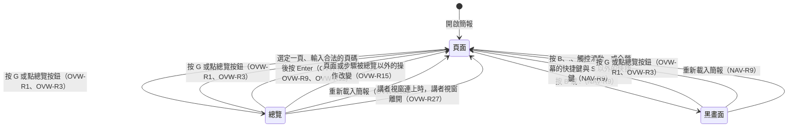
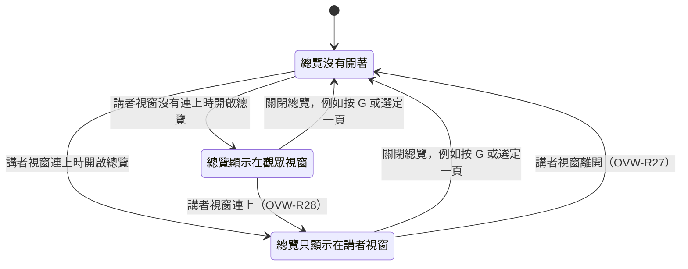

# 0006 講者模式時總覽只顯示在講者視窗

## 目標

完成後，講者視窗連上觀眾視窗時，講者不論在哪個視窗按 `G`，總覽都只顯示在講者視窗，投影幕上的觀眾視窗繼續顯示目前的頁面，所以講者在總覽裡找頁面的過程不會出現在投影幕上，直到講者選定一頁、觀眾視窗跳過去為止。講者的焦點留在觀眾視窗時，照樣可以按 `G`、方向鍵與 Enter 操作講者視窗裡的總覽。沒有開啟講者視窗時，總覽照舊顯示在觀眾視窗。Roadmap 的「現場排序與隱藏」也建立在這個行為上：講者在現場調整順序或隱藏頁面時，觀眾不會在投影幕上看到。

## 範圍

- 要做：
  - 講者視窗連上時，總覽只顯示在講者視窗，講者在兩個視窗按下的按鍵仍然操作同一個總覽。
  - 總覽開著時講者視窗離開或連上的處理。
  - 修改 `overview.md` 開頭的說明，以及 OVW-R3、OVW-R10、OVW-R12 到 OVW-R15、OVW-R17 到 OVW-R23、OVW-R25，新增 OVW-R26 到 OVW-R28；修改 `navigation.md` 開頭的說明、NAV-R5 與 NAV-R11；修改 `presenter.md` 開頭的說明與 PRES-R3；修改 `product.md` 術語表的「總覽」。
  - `README.md` 的「Presenter Mode」改寫成總覽只出現在講者視窗。
- 刻意不做的事：
  - 偵測講者視窗有沒有縮到最小，理由寫在「決策」一節。
  - 在總覽裡拖曳縮圖調整順序與隱藏頁面，這屬於 roadmap 的「開發時排序」與「現場排序與隱藏」。

## Spec 變更

### overview.md

- 修改開頭的說明：「本 spec 同時描述觀眾視窗與講者視窗的總覽」開頭的那段，改成講者視窗連上時總覽只顯示在講者視窗，並寫明情境沒有提到講者視窗時，講者視窗都沒有開啟；「總覽開著時，講者按下按鍵後」開頭的那段，補上講者視窗連上時播放器在觀眾視窗擋下的按鍵；「觀眾視窗的畫面照下圖」開頭的那段與狀態圖，改成描述觀眾視窗的狀態，並在圖上加上講者視窗離開時關閉總覽的轉換。
- 修改 OVW-R3：講者視窗連上時，總覽開著的期間，觀眾視窗的兩顆按鈕照 NAV-R11 出現與隱藏；設計理由一併改寫；新增 OVW-R3.12、OVW-R3.13、OVW-R3.14。
- 修改 OVW-R10：講者視窗連上時，觀眾視窗的頁面仍然顯示在投影幕上，但總覽開著的期間一樣點不到；新增 OVW-R10.6 到 OVW-R10.8。
- 修改 OVW-R12：第 6 點補上講者視窗連上之後總覽改成只顯示在講者視窗；講者視窗連上時，播放器在觀眾視窗擋下捲動總覽的按鍵；設計理由補上這個例外的理由寫在哪裡；修改 OVW-R12.10；新增 OVW-R12.14 到 OVW-R12.16。
- 修改 OVW-R13.2。
- 修改 OVW-R14：講者視窗連上時，手指在觀眾視窗上下滑動不捲動觀眾視窗的頁面。
- 修改 OVW-R15：設計理由補上講者視窗連上時的情況。
- 修改 OVW-R17：規則與設計理由改寫成兩個視窗共用的總覽只顯示在講者視窗，講者在觀眾視窗按下的按鍵也操作這個總覽；修改 OVW-R17.1 到 OVW-R17.10；新增 OVW-R17.11、OVW-R17.12。
- 新增 OVW-R26 講者視窗連上時總覽只顯示在講者視窗、OVW-R27 講者視窗離開時關閉總覽、OVW-R28 總覽開著時講者視窗連上，三條依序放在 OVW-R17 之後、OVW-R18 之前。
- 修改 OVW-R18：名稱、規則與設計理由改寫成講者視窗連上時只有講者視窗的總覽會捲動；移除 OVW-R18.1、OVW-R18.2、OVW-R18.3、OVW-R18.7、OVW-R18.8、OVW-R18.11；修改 OVW-R18.4、OVW-R18.6、OVW-R18.9、OVW-R18.10；新增 OVW-R18.12。
- 修改 OVW-R19：設計理由改寫成和沒有開啟講者視窗時觀眾視窗的總覽版面相同；修改 OVW-R19.2、OVW-R19.3。
- 修改 OVW-R20.1、OVW-R20.2、OVW-R20.3。
- 修改 OVW-R21：講者視窗連上時只有講者視窗播放動畫；總覽開著時講者視窗連上，觀眾視窗播放關閉總覽的動畫；總覽因為講者視窗離開而關閉時，觀眾視窗不播放動畫；修改 OVW-R21.3、OVW-R21.4、OVW-R21.6；新增 OVW-R21.8、OVW-R21.9。
- 修改 OVW-R22：補上總覽開著時講者視窗連上，觀眾視窗播放動畫時顯示的步驟；設計理由裡交叉淡化的代價改成只有播放動畫的視窗要多 render 一份頁面；新增 OVW-R22.5。
- 修改 OVW-R23：規則的最後一句改成講者視窗依自己的縮圖位置判斷，總覽開著時講者視窗連上，觀眾視窗也照這條規則決定要縮放還是淡出；設計理由拿掉兩個視窗各自判斷的部分；移除 OVW-R23.4；新增 OVW-R23.5、OVW-R23.6。
- 修改 OVW-R25：總覽開著時講者視窗連上，觀眾視窗播放的動畫也改成淡出；新增 OVW-R25.2。

#### 開頭的說明

其他段落不變。「本 spec 同時描述觀眾視窗與講者視窗的總覽」開頭的那段改成：

本 spec 同時描述觀眾視窗與講者視窗的總覽。講者視窗連上時，也就是講者視窗連到觀眾視窗，而且兩個視窗的版本相同時（OVW-R26），兩個視窗共用同一個總覽（OVW-R17），但總覽只顯示在講者視窗，投影幕上的觀眾視窗繼續顯示目前的頁面（OVW-R26）。本 spec 的情境沒有提到講者視窗時，講者視窗都沒有開啟。

「總覽開著時，講者按下按鍵後」開頭的那段改成：

總覽開著時，講者按下按鍵後，播放器仍然依 [navigation.md](navigation.md) 開頭的流程圖決定要做什麼，只是播放器的快捷鍵換成 OVW-R12 列出的按鍵。這時頁面上的元件收不到鍵盤事件，焦點也不會停在頁面、縮圖或按鈕上（OVW-R6、OVW-R10、OVW-R11），所以流程圖裡「元件呼叫了 `preventDefault()`」「焦點在可以輸入文字或調整數值的元素裡」與「焦點在按鈕、連結、checkbox 或 radio 上」這三個判斷，在總覽開著時都不會成立。另外，Tab、Shift+Tab，以及 Safari 的 Option+Tab、Option+Shift+Tab，照流程圖會交給瀏覽器，但總覽開著時，播放器照 OVW-R11 擋下這幾個鍵；講者視窗連上時，播放器也在觀眾視窗擋下 PageUp、PageDown、Space、Shift+Space、Home、End，以及沒在輸入頁碼時的 Backspace（OVW-R12）。

「觀眾視窗的畫面照下圖」開頭的那段與狀態圖改成：

觀眾視窗照下圖在頁面、總覽與黑畫面之間切換，每個轉換的細節寫在對應的需求裡。總覽與黑畫面之間沒有直接的轉換，所以兩者不會同時出現（OVW-R13）。圖上的「總覽」指總覽開著；講者視窗連上時，總覽只顯示在講者視窗，觀眾視窗在這個狀態下仍然顯示目前的頁面，但講者按下的按鍵照總覽開著時的規則作用（OVW-R26）。

#### OVW-R3 總覽按鈕

規則改成：

觀眾視窗的右下角、全螢幕按鈕（NAV-R11）的左邊有一顆總覽按鈕。總覽按鈕和全螢幕按鈕一起出現、一起隱藏，出現與隱藏的規則寫在 NAV-R11，其中一顆按鈕有焦點時，兩顆按鈕都保持顯示。觀眾視窗顯示著總覽時，兩顆按鈕一直顯示；觀眾視窗顯示著的總覽關閉，或改成只顯示在講者視窗之後（OVW-R28），兩顆按鈕再顯示 2 秒才隱藏，這段期間講者移動滑鼠或點畫面的話，照 NAV-R11 從最後一次移動滑鼠或點畫面開始計算 2 秒。講者視窗連上時，總覽只顯示在講者視窗（OVW-R26），所以總覽開著的期間，以及這時總覽關閉之後，觀眾視窗的兩顆按鈕都照 NAV-R11 出現與隱藏，不會因為總覽開啟或關閉而出現。用滑鼠或手指點總覽按鈕時，按鈕不取得焦點。總覽沒有開著時，講者用 Tab（Safari 預設是 Option+Tab）移動焦點，焦點先移到總覽按鈕，再移到全螢幕按鈕；焦點在總覽按鈕上時，按 Space 或 Enter 會按下按鈕（NAV-R7）。總覽開著時，講者點到按鈕與縮圖重疊的地方，按下的是按鈕。點總覽按鈕的作用和按 `G` 相同：總覽沒有開著時開啟總覽，開著時關閉總覽；黑畫面時點總覽按鈕只結束黑畫面。瀏覽器不支援讓網頁元素進入全螢幕時，例如 iPhone 的 Safari，播放器不顯示全螢幕按鈕，總覽按鈕單獨顯示在右下角。講者視窗沒有總覽按鈕，講者在講者視窗按 `G` 開關總覽。

既有的情境不變，新增以下情境：

- OVW-R3.12 講者視窗連上時按鈕照常隱藏
  - 前提：瀏覽器支援讓網頁元素進入全螢幕，講者視窗已經開著，焦點在觀眾視窗，總覽沒有開著，觀眾視窗的兩顆按鈕已經顯示
  - 動作：按 `G`，接著 3 秒內不移動滑鼠，也不點畫面
  - 結果：講者視窗顯示總覽；3 秒後，觀眾視窗的兩顆按鈕已經隱藏
- OVW-R3.13 講者視窗連上時關閉總覽，按鈕不出現
  - 前提：瀏覽器支援讓網頁元素進入全螢幕，講者視窗已經開著，焦點在講者視窗，總覽開著，觀眾視窗的兩顆按鈕沒有顯示
  - 動作：按 `G`
  - 結果：總覽關閉，觀眾視窗的兩顆按鈕仍然沒有顯示
- OVW-R3.14 講者視窗連上時點觀眾視窗的總覽按鈕
  - 前提：瀏覽器支援讓網頁元素進入全螢幕，講者視窗已經開著，觀眾視窗顯示 `intro`，總覽開著
  - 動作：在觀眾視窗移動滑鼠，點總覽按鈕
  - 結果：講者視窗的總覽關閉，觀眾視窗仍然顯示 `intro`

設計理由改成：

> 設計理由：觀眾視窗有總覽按鈕，因為用平板播放時沒有鍵盤可以按 `G`，這和 NAV-R11 提供全螢幕按鈕的理由相同。曾考慮用雙指捏合開啟總覽，但雙指捏合是瀏覽器的縮放手勢，播放器要擋下瀏覽器的縮放才能使用，各瀏覽器的擋法不同，iOS 的 Safari 也不理會網頁禁止縮放的設定；而且畫面上看不出有這個手勢。講者視窗沒有總覽按鈕，因為講者模式只在接著投影幕的電腦上使用，講者一定有鍵盤，這和 PRES-R1 不放開啟講者視窗的按鈕的理由相同。觀眾視窗顯示著總覽時兩顆按鈕一直顯示，因為在平板上點總覽裡的縮圖會跳頁，如果按鈕照 NAV-R11 隱藏，講者就找不到不跳頁也能關閉總覽的地方點；總覽本來就是操作用的畫面，不是投影片本身，所以投影幕上多兩顆按鈕不影響觀眾看投影片。曾考慮讓講者點總覽的背景或縮圖之間的空隙來關閉總覽，但空隙很窄，講者點縮圖時手指點偏一點，總覽就直接關閉。講者視窗連上時，總覽開著的期間按鈕照 NAV-R11 隱藏，因為這時觀眾視窗沒有顯示總覽，一直顯示的按鈕會疊在投影幕上的頁面上，而講者模式只在電腦上使用，講者有鍵盤可以按 `G`。完整討論見 [0005](../plans/archive/0005-overview.md) 與 [0006](../plans/archive/0006-overview-in-presenter-window.md)。

#### OVW-R10 總覽底下保留目前的頁面

規則改成：

總覽開著時，目前的頁面留在總覽底下，播放器不重新 mount 這一頁，所以講者按 `G` 關閉總覽，或選定目前的頁面（OVW-R9）時，頁面上互動元件的狀態都還在；跳到其他頁面時，照 NAV-R13 重置。總覽開著的期間，講者點不到總覽底下的頁面，頁面上的元件收不到鍵盤事件，頁面上的元素也不會取得焦點。講者視窗連上時，觀眾視窗不顯示總覽（OVW-R26），目前的頁面仍然顯示在投影幕上，但總覽開著的期間，這一頁一樣點不到、收不到鍵盤事件，裡面的元素也不會取得焦點。開啟總覽時，焦點離開原本所在的元素，包括頁面上的元素與總覽按鈕；關閉總覽時，焦點不會回到原本的元素。不論總覽是因為哪個操作關閉，畫面換上的新頁面裡寫了 `autoFocus` 的元素，都和平常換頁時一樣取得焦點。總覽底下的頁面照常執行 effect。

既有的情境與設計理由不變，新增以下情境：

- OVW-R10.6 講者視窗連上時點投影幕上的頁面
  - 前提：`counter` 這一頁有一個計數器，初始值是 0，觀眾視窗顯示 `counter`，講者視窗已經開著，總覽開著
  - 動作：在觀眾視窗點計數器的按鈕，再按 `G`
  - 結果：點按鈕之後，觀眾視窗的計數器仍然顯示 0，講者視窗仍然顯示總覽；按 `G` 之後，總覽關閉，觀眾視窗的計數器仍然顯示 0
- OVW-R10.7 講者視窗連上時開關總覽之後，投影幕上的輸入框沒有焦點
  - 前提：`intro` 這一頁有一個文字輸入框，講者視窗已經開著，觀眾視窗顯示 `intro`，焦點在觀眾視窗的輸入框裡
  - 動作：點講者視窗，按 `G`，再按一次 `G`
  - 結果：第一次按 `G` 之後，觀眾視窗的輸入框失去焦點；第二次按 `G` 之後，總覽關閉，觀眾視窗的輸入框仍然沒有焦點
- OVW-R10.8 講者視窗連上時，投影幕上頁面的元件收不到按鍵
  - 前提：簡報依序是 `gallery`、`recap` 兩頁，`gallery` 有一個輪播元件，在 `window` 的 keydown 事件遇到 → 時呼叫 `preventDefault()` 並換到下一張圖；講者視窗已經開著，焦點在觀眾視窗，觀眾視窗顯示 `gallery`，輪播顯示第一張圖
  - 動作：按 `G`，再按 →
  - 結果：講者視窗的選取框移到 `recap`，觀眾視窗的輪播仍然顯示第一張圖

#### OVW-R12 總覽開著時的快捷鍵

規則改成：

總覽開著時，播放器的快捷鍵只有下列按鍵；除了 OVW-R11 擋下的 Tab 這幾個鍵，以及講者視窗連上時，播放器在觀眾視窗擋下的捲動按鍵（見下方），其他按鍵都交給瀏覽器處理：

1. 方向鍵，移動選取框（OVW-R7）。
2. Enter，跳到選取框所在的頁面（OVW-R8、OVW-R9）。講者按住 Enter 不放時，自動重複送出的 Enter 照 NAV-R14 不觸發，總覽關閉之後也一樣。
3. 數字鍵，照 NAV-R5 輸入頁碼。輸入途中，Backspace 刪除最後一位數字，Enter 確認頁碼，播放器跳到那一頁的第 0 步並關閉總覽；頁碼是目前的頁面時也一樣。頁碼是 0 或大於總頁數時，播放器照 NAV-R5 不換頁、取消這次輸入，總覽維持開著，選取框也不動。輸入途中按方向鍵或 `G` 時，照 NAV-R5 取消輸入。
4. `G`，關閉總覽（OVW-R1）。
5. 全螢幕的快捷鍵（`F`、F5、Shift+F5），照 NAV-R10 作用，總覽維持開著。
6. `S`，照 PRES-R1 開啟講者視窗，總覽維持開著；講者視窗連上之後，總覽改成只顯示在講者視窗（OVW-R28）。`S` 在講者視窗不是快捷鍵（PRES-R1）。

所以 PageUp、PageDown、Space、Shift+Space、Home、End，以及沒在輸入頁碼時的 Backspace，都照瀏覽器的預設行為作用，例如 Space 與 PageDown 把總覽往下捲動，End 把總覽捲到最下方；這些按鍵不移動選取框，也不換頁。講者視窗連上時，觀眾視窗沒有顯示總覽（OVW-R26），播放器在觀眾視窗擋下這些按鍵，不交給瀏覽器，所以講者在觀眾視窗按這些按鍵沒有作用，觀眾視窗的頁面不捲動，講者視窗的總覽也不捲動（OVW-R18）。`B` 與 `.` 的規則寫在 OVW-R13。這些按鍵不是快捷鍵，所以和用滑鼠滾輪捲動總覽一樣，不取消輸入中的頁碼，在觀眾視窗被擋下時也一樣。翻頁器送出的按鍵裡，PageUp 與 PageDown 只捲動總覽，講者視窗連上、焦點在觀眾視窗時則沒有作用；F5、Shift+F5 與 Esc 照常切換全螢幕，黑畫面鍵沒有作用，所以總覽開著時，講者用翻頁器不能移動選取框、跳頁或關閉總覽，要用鍵盤、滑鼠或觸控操作總覽。

修改以下情境：

- OVW-R12.10 按 `S`
  - 前提：講者視窗沒有開啟，觀眾視窗不在全螢幕，簡報有 7 頁，總覽開著，選取框在第 3 頁
  - 動作：按 `S`
  - 結果：開啟講者視窗，總覽仍然開著；講者視窗連上之後，講者視窗顯示總覽，選取框在第 3 頁，觀眾視窗不再顯示總覽

其他既有的情境不變，新增以下情境：

- OVW-R12.14 講者視窗連上時在觀眾視窗按 Space
  - 前提：簡報有 40 頁，觀眾視窗顯示第 1 頁，講者視窗已經開著，總覽開著，講者視窗的總覽捲在最上方，焦點在觀眾視窗
  - 動作：按 Space
  - 結果：講者視窗的總覽仍然捲在最上方，選取框仍然在第 1 頁，總覽仍然開著，觀眾視窗仍然顯示第 1 頁
- OVW-R12.15 講者視窗連上時捲動不了投影幕上的頁面
  - 前提：`code` 這一頁有一個內容比區塊本身高、可以上下捲動的程式碼區塊，觀眾視窗顯示 `code`，講者視窗已經開著；講者點了一下觀眾視窗裡的程式碼區塊，區塊捲在最上方，接著按 `G`
  - 動作：在觀眾視窗按 Space，再按 PageDown
  - 結果：程式碼區塊仍然捲在最上方，講者視窗仍然顯示總覽
- OVW-R12.16 講者視窗連上時在觀眾視窗按 Backspace
  - 前提：簡報依序是 `intro`、`agenda`、`recap` 三頁，講者視窗已經開著；觀眾視窗顯示 `agenda` 時，講者在觀眾視窗按 End 跳到 `recap`，再按 `G`，焦點在觀眾視窗
  - 動作：按 Backspace
  - 結果：觀眾視窗仍然顯示 `recap`，網址的 hash 仍然是 `#/recap`，講者視窗仍然顯示總覽

接在規則後面、「總覽裡只有方向鍵移動選取框」開頭的設計理由改成：

> 設計理由：總覽裡只有方向鍵移動選取框、只有 Enter 跳到選取的頁面，所以講者不必記住每個換頁的按鍵在總覽裡改成什麼作用。曾考慮讓 PageDown 與 PageUp 像 → 與 ← 一樣移動選取框、Space 像 Enter 一樣跳頁、Home 與 End 把選取框移到第一頁與最後一頁，但這樣總覽裡移動選取框的按鍵變多，Space 平常是下一步，在總覽裡卻會跳頁。這些按鍵交給瀏覽器，沿用 navigation.md 流程圖裡「不是快捷鍵的按鍵交給瀏覽器」的規則。也考慮過讓播放器擋下這些按鍵，畫面完全不動，但講者仍然可以用滑鼠滾輪捲動總覽，所以捲動總覽這件事會變成用滾輪可以、用按鍵不行。講者視窗連上時，播放器在沒有顯示總覽的觀眾視窗擋下這些按鍵，理由寫在 OVW-R18。把這些按鍵交給瀏覽器，再加上 OVW-R13 的規則，代價是講者只拿著翻頁器時，總覽開著的期間不能移動選取框、跳頁或關閉總覽；不過開啟總覽本身就要用鍵盤按 `G`，或用滑鼠、手指點總覽按鈕，所以總覽開著時，講者本來就在電腦旁邊。完整討論見 [0005](../plans/archive/0005-overview.md) 與 [0006](../plans/archive/0006-overview-in-presenter-window.md)。

接在情境後面、「數字鍵在總覽裡照 NAV-R5 輸入頁碼」開頭的設計理由不變。

#### OVW-R13 總覽開著時不能切換黑畫面

既有的規則、其他情境與設計理由不變。修改以下情境：

- OVW-R13.2 總覽開著時在講者視窗按 `B`
  - 前提：講者視窗已經開著，焦點在講者視窗，總覽開著
  - 動作：按 `B`
  - 結果：觀眾視窗沒有變成黑畫面，講者視窗仍然顯示總覽

#### OVW-R14 總覽開著時的觸控與滑鼠

規則改成：

總覽開著時，觸控滑動不換頁，也不移動選取框，NAV-R8 不適用；手指上下滑動時，總覽照瀏覽器的預設行為捲動。這時的滑動也不算 NAV-R5 第 3 點的觸控滑動，所以和用滑鼠滾輪捲動總覽一樣，不取消輸入中的頁碼。滑鼠移到縮圖上時，選取框不動，講者點下縮圖時才跳頁（OVW-R8）。不過講者視窗連上時，觀眾視窗沒有顯示總覽，手指在觀眾視窗上下滑動時，觀眾視窗的頁面不捲動（OVW-R26）。

既有的情境與設計理由不變。

#### OVW-R15 頁面或步驟被總覽以外的操作改變時關閉總覽

既有的規則與情境不變。設計理由改成：

> 設計理由：頁面或步驟被總覽以外的操作改變時關閉總覽，因為這些操作都表示講者已經決定要去哪一頁，總覽用來找頁面的任務已經結束，這和從總覽跳頁之後關閉總覽的結果一致（OVW-R8、OVW-R12）。曾考慮讓總覽維持開著，只把定位圖示移到新的頁面，但這樣沒有開啟講者視窗時，講者換了頁，投影幕上仍然是總覽，觀眾看不到換頁；講者視窗連上時，講者換了頁，講者視窗也仍然顯示總覽，講者看不到目前頁與備註。這和黑畫面不同：黑畫面在 hash 改變時維持（NAV-R9），因為黑畫面是用來遮住投影幕的，要等講者自己結束，總覽則是用來找頁面的。完整討論見 [0005](../plans/archive/0005-overview.md) 與 [0006](../plans/archive/0006-overview-in-presenter-window.md)。

#### OVW-R17 講者模式的兩個視窗共用同一個總覽

規則改成：

講者視窗連上時（OVW-R26），兩個視窗共用同一個總覽，總覽只顯示在講者視窗。講者不論在哪個視窗按 `G`、方向鍵、Enter 或輸入頁碼，作用都相同，操作的都是講者視窗顯示的總覽：焦點在觀眾視窗時按 `G`，總覽出現在講者視窗，投影幕上的頁面與步驟不變，接著按方向鍵時，講者視窗的選取框跟著移動，按 Enter 時，觀眾視窗跳到選取框所在的頁面。講者在講者視窗點縮圖時，觀眾視窗也跳到那一頁。兩個視窗各自有一份輸入中的頁碼（PRES-R3）。講者視窗縮到最小，或被其他應用程式的視窗蓋住時，講者在觀眾視窗按 `G`，總覽一樣顯示在講者視窗，所以投影幕上的頁面與步驟不變，講者接著按方向鍵時，移動的是講者視窗裡的選取框，簡報不換頁；講者再按一次 `G`，就關閉總覽。講者視窗開啟、重新整理或恢復連線時，照觀眾視窗當時的狀態顯示總覽，例如觀眾視窗重新整理之後總覽沒有開著（OVW-R16），講者視窗恢復連線時也就不顯示總覽。連線中斷時，講者視窗保留最後收到的畫面，包括總覽與選取框所在的頁面；需要觀眾視窗執行的操作照 PRES-R12 都沒有作用，例如開關總覽、移動選取框與跳頁，講者在講者視窗用滑鼠滾輪、觸控板、手指、拖曳捲軸或交給瀏覽器的按鍵捲動總覽時照常捲動（OVW-R4、OVW-R18），按方向鍵則沒有作用。這段期間，以及兩個視窗的版本不同時（PRES-R12），講者視窗照最後一次正常連線時收到的狀態判斷總覽有沒有開著，所以講者視窗保留著總覽時，講者按 Space、PageDown 這類交給瀏覽器的按鍵，照 OVW-R18 捲動講者視窗的總覽。

修改以下情境：

- OVW-R17.1 在講者視窗開啟總覽
  - 前提：講者視窗已經開著，焦點在講者視窗，觀眾視窗顯示 `intro`
  - 動作：按 `G`
  - 結果：講者視窗顯示總覽，選取框在 `intro`；觀眾視窗仍然顯示 `intro`，沒有顯示總覽
- OVW-R17.2 在觀眾視窗開啟總覽
  - 前提：講者視窗已經開著，觀眾視窗顯示 `intro`
  - 動作：在觀眾視窗按 `G`
  - 結果：講者視窗顯示總覽，觀眾視窗仍然顯示 `intro`，沒有顯示總覽
- OVW-R17.3 在講者視窗移動選取框
  - 前提：簡報依序是 `intro`、`agenda`、`recap` 三頁，講者視窗已經開著，焦點在講者視窗，總覽開著，選取框在 `intro`
  - 動作：按 →
  - 結果：講者視窗的選取框移到 `agenda`，觀眾視窗仍然顯示 `intro`
- OVW-R17.4 在講者視窗按 Enter 跳頁
  - 前提：簡報依序是 `intro`、`agenda`、`recap` 三頁，講者視窗已經開著，焦點在講者視窗，總覽開著，選取框在 `intro`
  - 動作：按 →，再按 Enter
  - 結果：講者視窗的總覽關閉，觀眾視窗顯示 `agenda`，講者視窗的目前頁顯示 `agenda`
- OVW-R17.5 在講者視窗點縮圖
  - 前提：簡報依序是 `intro`、`agenda`、`recap` 三頁，講者視窗已經開著，總覽開著
  - 動作：在講者視窗點 `recap` 的縮圖
  - 結果：講者視窗的總覽關閉，觀眾視窗顯示 `recap`
- OVW-R17.6 在講者視窗關閉觀眾視窗開啟的總覽
  - 前提：講者視窗已經開著，講者在觀眾視窗按 `G` 開啟總覽
  - 動作：點講者視窗裡總覽的背景，按 `G`
  - 結果：講者視窗的總覽關閉，回到 PRES-R5 的版面
- OVW-R17.7 講者視窗重新整理
  - 前提：簡報依序是 `intro`、`agenda`、`recap` 三頁，講者視窗已經開著，總覽開著，選取框在 `recap`
  - 動作：重新整理講者視窗
  - 結果：講者視窗載入完成之後 1 秒內，講者視窗顯示 PRES-R5 的版面，沒有顯示總覽；觀眾視窗一直沒有顯示總覽
- OVW-R17.8 觀眾視窗重新整理
  - 前提：講者視窗已經開著，總覽開著
  - 動作：重新整理觀眾視窗
  - 結果：觀眾視窗載入完成之後 1 秒內，兩個視窗都沒有顯示總覽
- OVW-R17.9 連線中斷時按方向鍵
  - 前提：在瀏覽器開啟網站首頁，再從首頁開啟這份簡報；簡報有 40 頁，講者視窗已經開著，總覽開著，選取框在第 1 頁；講者在講者視窗用滑鼠滾輪把總覽捲到上緣切在第 5 列開頭的位置，再在觀眾視窗按瀏覽器的上一頁回到網站首頁
  - 動作：點講者視窗裡總覽的背景，按 ↓
  - 結果：講者視窗仍然顯示總覽與「連線中斷」，選取框仍然在第 1 頁，講者視窗的總覽上緣仍然切在第 5 列的開頭
- OVW-R17.10 在講者視窗按住 Enter 不放
  - 前提：簡報依序是 `intro`、`list`、`recap` 三頁，`list` 有 3 步，講者視窗已經開著，焦點在講者視窗，總覽開著，選取框在 `list`
  - 動作：按住 Enter，直到作業系統自動送出好幾次 Enter
  - 結果：講者視窗的總覽關閉，觀眾視窗顯示 `list` 的第 0 步，放開 Enter 之後仍然是第 0 步

新增以下情境：

- OVW-R17.11 在觀眾視窗操作講者視窗的總覽
  - 前提：簡報依序是 `intro`、`agenda`、`recap` 三頁，講者視窗已經開著，焦點在觀眾視窗，觀眾視窗顯示 `intro`
  - 動作：按 `G`，按 →，再按 Enter
  - 結果：按 `G` 之後，講者視窗顯示總覽，選取框在 `intro`，觀眾視窗仍然顯示 `intro`；按 → 之後，講者視窗的選取框移到 `agenda`，觀眾視窗仍然顯示 `intro`；按 Enter 之後，講者視窗的總覽關閉，觀眾視窗顯示 `agenda`
- OVW-R17.12 講者視窗縮到最小時在觀眾視窗按 `G`
  - 前提：簡報依序是 `intro`、`agenda`、`recap` 三頁，講者視窗已經開著，接著縮到最小，焦點在觀眾視窗，觀眾視窗顯示 `intro`
  - 動作：按 `G`，按 →，再把講者視窗還原
  - 結果：按 `G` 與 → 之後，觀眾視窗仍然顯示 `intro`；講者視窗還原之後顯示總覽，選取框在 `agenda`

設計理由改成：

> 設計理由：兩個視窗共用同一個總覽，總覽的狀態以觀眾視窗為準，這和講者視窗顯示觀眾視窗目前的位置（PRES-R2）是同一個做法。總覽只顯示在講者視窗，講者在觀眾視窗按下的按鍵卻仍然操作這個總覽，因為講者點過投影幕上的頁面之後，焦點常常留在觀眾視窗，這樣講者不必先點回講者視窗，按 `G` 再按方向鍵就能在筆電上找頁面；播放器也不能替講者把焦點移到講者視窗，因為把既有的視窗移到最前面時，Chromium 與 Firefox 會讓觀眾視窗離開全螢幕（[architecture.md](architecture.md) 的「從 `file://` 開啟 Slidetray」）。曾考慮講者視窗連上時，總覽只屬於講者視窗，講者在觀眾視窗按下的按鍵照常換頁，但這樣講者在觀眾視窗按 `G` 之後，接著按的方向鍵會讓投影幕換頁，並照 OVW-R15 關閉剛開啟的總覽。也考慮過讓兩個視窗各有一個互不影響的總覽，Slidev 就是這樣做，但這樣講者在觀眾視窗開啟的總覽會出現在投影幕上，講者人在講者視窗時也關不掉它。代價是講者視窗縮到最小或被其他應用程式的視窗蓋住時，講者在觀眾視窗按 `G`，總覽顯示在講者看不到的地方。曾考慮在開啟總覽時偵測講者視窗有沒有縮到最小，縮到最小就把總覽顯示在觀眾視窗，但播放器偵測得到的只有分頁不在前景與視窗縮到最小（PRES-R6），偵測不到講者視窗被其他應用程式的視窗蓋住，例如講者在筆電上把 demo 用的程式開成全螢幕，而且總覽顯示在哪個視窗，會取決於開啟總覽時講者視窗有沒有縮到最小，OVW-R27 與 OVW-R28 都要依這一點再分情況。完整討論見 [0005](../plans/archive/0005-overview.md) 與 [0006](../plans/archive/0006-overview-in-presenter-window.md)。

#### OVW-R26 講者視窗連上時總覽只顯示在講者視窗

本 spec 說「講者視窗連上」，指講者視窗已經連到觀眾視窗、連線沒有中斷，而且兩個視窗的版本相同（PRES-R12）。講者視窗連上時，總覽開著的期間只有講者視窗顯示總覽（OVW-R19），觀眾視窗不顯示總覽，畫面仍然顯示目前的頁面與步驟，所以投影幕上看不到總覽與選取框的移動，直到講者選定一頁、觀眾視窗跳過去為止。這段期間，觀眾視窗的頁面照 OVW-R10 點不到，右下角的按鈕照 OVW-R3 出現與隱藏；講者在觀眾視窗按 PageUp、PageDown、Space、Shift+Space、Home、End，以及沒在輸入頁碼時的 Backspace，都沒有作用（OVW-R12），而且不論講者在觀眾視窗按下哪個按鍵，或用滑鼠滾輪、觸控板或手指捲動，觀眾視窗的頁面都不捲動；講者在觀眾視窗輸入的頁碼照 NAV-R5 顯示在觀眾視窗的右下角，所以會出現在投影幕上；開關總覽的動畫照 OVW-R21 只在講者視窗播放，總覽開著時講者視窗連上的情況除外（OVW-R28）。講者視窗沒有連上時，例如講者視窗沒有開啟，或兩個視窗的版本不同，總覽照本 spec 其他需求的規則顯示在觀眾視窗。總覽開著時講者視窗離開或連上，規則寫在 OVW-R27 與 OVW-R28。總覽顯示在哪個視窗，照下圖隨講者視窗連上與離開改變：

- OVW-R26.1 投影幕上看不到總覽
  - 前提：簡報依序是 `intro`、`list`、`recap` 三頁，`list` 這一頁有 `<Step at={1}>` 包住的「第一點」與 `<Step at={2}>` 包住的「第二點」；講者視窗已經開著，焦點在講者視窗，觀眾視窗顯示 `list` 的第 1 步
  - 動作：按 `G`，再按 →
  - 結果：講者視窗顯示總覽，選取框移到 `recap`；觀眾視窗一直顯示 `list` 的第 1 步，看得到「第一點」，看不到「第二點」，也沒有出現任何縮圖
- OVW-R26.2 兩個視窗的版本不同時
  - 前提：講者視窗已經開著，觀眾視窗顯示 `intro`；講者修改簡報之後重新 build，再重新整理觀眾視窗，講者視窗顯示兩個視窗的版本不同的提示
  - 動作：在觀眾視窗按 `G`
  - 結果：觀眾視窗顯示總覽，講者視窗仍然顯示版本不同的提示
- OVW-R26.3 在觀眾視窗輸入頁碼
  - 前提：簡報依序是 `intro`、`agenda`、`recap` 三頁，講者視窗已經開著，焦點在觀眾視窗，觀眾視窗顯示 `intro`，總覽開著
  - 動作：輸入 3，再按 Enter
  - 結果：輸入 3 之後，觀眾視窗的右下角顯示 3，講者視窗沒有顯示頁碼；按 Enter 之後，講者視窗的總覽關閉，觀眾視窗顯示 `recap`
- OVW-R26.4 按著 Cmd 捲動投影幕上的頁面
  - 前提：`code` 這一頁有一個內容比區塊本身高、可以上下捲動的程式碼區塊，觀眾視窗顯示 `code`，講者視窗已經開著；講者點了一下觀眾視窗裡的程式碼區塊，區塊捲在最上方，接著按 `G`
  - 動作：在觀眾視窗按 Cmd+↓（Windows 按 Ctrl+End）
  - 結果：程式碼區塊仍然捲在最上方，講者視窗仍然顯示總覽
- OVW-R26.5 用滑鼠滾輪捲動投影幕上的頁面
  - 前提：`code` 這一頁有一個內容比區塊本身高、可以上下捲動的程式碼區塊，觀眾視窗顯示 `code`，講者視窗已經開著；講者點了一下觀眾視窗裡的程式碼區塊，區塊捲在最上方，接著按 `G`
  - 動作：把滑鼠移到觀眾視窗的程式碼區塊上，轉動滑鼠滾輪
  - 結果：程式碼區塊仍然捲在最上方，講者視窗仍然顯示總覽，講者視窗的總覽也沒有捲動
- OVW-R26.6 用手指捲動投影幕上的頁面
  - 前提：筆電有觸控螢幕，`code` 這一頁有一個內容比區塊本身高、可以上下捲動的程式碼區塊，觀眾視窗顯示 `code`，講者視窗已經開著；講者點了一下觀眾視窗裡的程式碼區塊，區塊捲在最上方，接著按 `G`
  - 動作：手指在觀眾視窗的程式碼區塊上往上滑
  - 結果：程式碼區塊仍然捲在最上方，講者視窗仍然顯示總覽，講者視窗的總覽也沒有捲動

> 設計理由：講者視窗連上時，總覽只顯示在講者視窗，因為講者開啟總覽是為了找頁面，例如問答時找觀眾問到的那一頁，找的過程不需要讓觀眾看到；roadmap 的「現場排序與隱藏」做出來之後，講者在台上調整順序或隱藏頁面的過程，也不會出現在投影幕上。PowerPoint 的簡報者檢視畫面也這樣做：講者在簡報者檢視畫面查看所有投影片時，縮圖只出現在講者的螢幕上，觀眾繼續看到目前的投影片。曾考慮照 [plan 0005](../plans/archive/0005-overview.md) 的做法讓兩個視窗都顯示總覽，講者開關總覽與移動選取框時，投影幕跟著一起改變，但這樣講者用講者視窗找頁面時，觀眾也看著總覽與選取框在投影幕上移動。代價是講者在觀眾視窗輸入的頁碼仍然出現在投影幕上。曾考慮在講者視窗連上、總覽開著時，把講者在觀眾視窗輸入的頁碼改顯示在講者視窗，但總覽沒有開著時，講者在觀眾視窗輸入的頁碼本來就顯示在投影幕上（NAV-R5），每個視窗也只顯示自己的那一份輸入中的頁碼（PRES-R3），改顯示在講者視窗的話，講者在同一個視窗輸入的頁碼，會隨總覽有沒有開著出現在不同的視窗。另一個代價是講者忘了關閉總覽就拿著翻頁器走開時，不論焦點在哪個視窗，翻頁器的下一頁鍵都只捲動講者視窗的總覽，或沒有作用，黑畫面鍵也沒有作用（OVW-R12、OVW-R13），投影幕上又看不出總覽還開著，講者要看筆電上的講者視窗才知道。曾考慮講者視窗連上時，讓觀眾視窗收到翻頁器的 PageUp、PageDown 就關閉總覽並照常換頁，但這樣 PageDown 在總覽裡的作用會取決於講者視窗有沒有連上，講者不小心碰到翻頁器時，總覽也會關閉。完整討論見 [0006](../plans/archive/0006-overview-in-presenter-window.md)。

#### OVW-R27 講者視窗離開時關閉總覽

講者視窗連上時（OVW-R26），總覽開著的期間，講者視窗關閉、重新整理，或載入其他網頁的話，觀眾視窗關閉總覽：投影幕上的頁面與步驟不變，網址的 hash 不變，播放器也不新增瀏覽紀錄，觀眾視窗輸入中的頁碼照 NAV-R5 取消。所以講者視窗重新整理之後，照 OVW-R17 顯示觀眾視窗當時的狀態，總覽沒有開著。

- OVW-R27.1 關閉講者視窗
  - 前提：簡報依序是 `intro`、`agenda`、`recap` 三頁，三頁都沒有步驟；講者視窗已經開著，觀眾視窗顯示 `intro`，總覽開著，選取框在 `recap`
  - 動作：關閉講者視窗，再在觀眾視窗按 →
  - 結果：關閉講者視窗之後，觀眾視窗仍然顯示 `intro`，沒有顯示總覽；按 → 之後，觀眾視窗顯示 `agenda`
- OVW-R27.2 輸入頁碼途中關閉講者視窗
  - 前提：簡報依序是 `intro`、`agenda`、`recap` 三頁，三頁都沒有步驟；講者視窗已經開著，焦點在觀眾視窗，觀眾視窗顯示 `intro`，總覽開著
  - 動作：在 3 秒內完成以下動作：在觀眾視窗輸入 3，關閉講者視窗，再在觀眾視窗按 Enter
  - 結果：關閉講者視窗之後，觀眾視窗的頁碼消失；按 Enter 之後，觀眾視窗顯示 `agenda`
- OVW-R27.3 講者視窗載入其他網頁
  - 前提：簡報依序是 `intro`、`agenda`、`recap` 三頁，三頁都沒有步驟；講者視窗已經開著，觀眾視窗顯示 `intro`，總覽開著
  - 動作：讓講者視窗載入其他網頁，再在觀眾視窗按 →
  - 結果：講者視窗載入其他網頁之後，觀眾視窗仍然顯示 `intro`，沒有顯示總覽；按 → 之後，觀眾視窗顯示 `agenda`

> 設計理由：講者視窗離開時，觀眾視窗關閉總覽，因為觀眾視窗收到離開的通知時，分不出講者視窗是關閉了，還是正在重新整理，而總覽只顯示在講者視窗（OVW-R26），就是為了不讓總覽出現在投影幕上。曾考慮讓總覽維持開著，改由觀眾視窗顯示，但這樣講者重新整理講者視窗時，投影幕會閃一下總覽。也考慮過讓總覽維持開著但先不顯示，等講者視窗連回來，但等待的期間總覽開著卻看不到，講者在觀眾視窗按 → 時，移動的是看不見的選取框，簡報不換頁。代價是講者重新整理講者視窗之後，要再按一次 `G` 才會回到總覽。完整討論見 [0006](../plans/archive/0006-overview-in-presenter-window.md)。

#### OVW-R28 總覽開著時講者視窗連上

總覽開著時講者視窗連上的話，總覽維持開著，選取框不動，總覽改成只顯示在講者視窗（OVW-R26），例如講者在總覽裡按 `S` 開啟講者視窗（OVW-R12），或講者在兩個視窗的版本不同時重新整理講者視窗，讓兩個視窗的版本相同。這時觀眾視窗照 OVW-R21 播放關閉總覽的動畫，回到目前的頁面與步驟；講者視窗直接顯示總覽，並照 OVW-R18 捲到選取框完整出現的位置。之後觀眾視窗的頁面照 OVW-R10 仍然點不到，右下角的按鈕照 OVW-R3 再顯示 2 秒才隱藏。

- OVW-R28.1 總覽開著時開啟講者視窗
  - 前提：簡報有 40 頁，講者視窗沒有開啟，觀眾視窗不在全螢幕，觀眾視窗顯示第 1 頁，總覽開著，選取框在第 37 頁
  - 動作：按 `S`
  - 結果：講者視窗載入完成之後 1 秒內，講者視窗顯示總覽，選取框在第 37 頁，第 37 頁的縮圖完整出現在講者視窗裡；觀眾視窗顯示第 1 頁，沒有顯示總覽
- OVW-R28.2 版本不同的講者視窗重新整理之後
  - 前提：簡報依序是 `intro`、`agenda`、`recap` 三頁，講者視窗已經開著，觀眾視窗顯示 `intro`；講者修改簡報之後重新 build，再重新整理觀眾視窗，講者視窗顯示兩個視窗的版本不同的提示；講者在觀眾視窗按 `G`，再按 →
  - 動作：重新整理講者視窗
  - 結果：講者視窗載入完成之後 1 秒內，講者視窗顯示總覽，選取框在 `agenda`；觀眾視窗顯示 `intro`，沒有顯示總覽
- OVW-R28.3 總覽改成只顯示在講者視窗之後，按鈕 2 秒後隱藏
  - 前提：瀏覽器支援讓網頁元素進入全螢幕，講者視窗沒有開啟，觀眾視窗不在全螢幕，總覽開著，觀眾視窗的兩顆按鈕顯示著
  - 動作：按 `S`，接著不移動滑鼠，也不點觀眾視窗的畫面
  - 結果：講者視窗連上之後，觀眾視窗的兩顆按鈕仍然顯示，2 秒後隱藏

> 設計理由：總覽開著時講者視窗連上，總覽改成只顯示在講者視窗，和 OVW-R26 的規則一致，選取框也留在講者原本找到的頁面。曾考慮在講者視窗連上時關閉總覽，但這樣講者要在講者視窗重新開啟總覽，再找一次頁面。完整討論見 [0006](../plans/archive/0006-overview-in-presenter-window.md)。

#### OVW-R18 講者模式裡總覽的捲動

名稱從「講者模式裡兩個視窗各自捲動總覽」改成「講者模式裡總覽的捲動」。規則改成：

講者模式裡，兩個視窗各自照 OVW-R4 記錄自己的捲動位置，不互相傳送。講者視窗連上時（OVW-R26），只有講者視窗顯示總覽：開啟總覽時，以及講者在任一個視窗按方向鍵之後，講者視窗照 OVW-R4 與 OVW-R7 捲到選取框完整出現的位置，選取框因為碰到邊界而沒有移動時也一樣；講者在觀眾視窗按 Space、PageDown 這類捲動總覽的按鍵時，播放器照 OVW-R12 擋下這些按鍵，講者視窗的總覽不捲動。總覽開著時講者視窗連上（OVW-R28），講者視窗的總覽捲到選取框完整出現的位置。連線中斷時，講者在講者視窗按方向鍵沒有作用（OVW-R17），講者視窗也不捲到選取框；講者用滑鼠滾輪、觸控板、手指、拖曳捲軸，或交給瀏覽器的按鍵捲動講者視窗保留著的總覽時，總覽照常捲動。講者視窗開著總覽時，交給瀏覽器的按鍵一律捲動總覽，不捲動被總覽蓋住的備註區。

移除 OVW-R18.1、OVW-R18.2、OVW-R18.3、OVW-R18.7、OVW-R18.8、OVW-R18.11，OVW-R18.5 不變。修改以下情境：

- OVW-R18.4 捲走之後在觀眾視窗按方向鍵
  - 前提：簡報有 40 頁，講者視窗已經開著，講者視窗是 1280×1000，總覽開著，選取框在第 1 頁；講者在講者視窗用滑鼠滾輪把總覽捲到最下方，焦點在觀眾視窗
  - 動作：在觀眾視窗按 →
  - 結果：選取框在第 2 頁，講者視窗的總覽捲回第 2 頁的縮圖完整出現的位置
- OVW-R18.6 連線中斷時按 Space
  - 前提：在瀏覽器開啟網站首頁，再從首頁開啟這份簡報；簡報有 40 頁，講者視窗已經開著，總覽開著；講者在觀眾視窗按瀏覽器的上一頁回到網站首頁，講者視窗顯示「連線中斷」，焦點在講者視窗
  - 動作：按 Space
  - 結果：講者視窗的總覽往下捲動，仍然顯示「連線中斷」
- OVW-R18.9 在觀眾視窗碰到邊界時按方向鍵
  - 前提：簡報有 40 頁，講者視窗已經開著，講者視窗是 1280×1000，總覽開著，選取框在第 1 頁；講者在講者視窗用滑鼠滾輪把總覽捲到最下方，焦點在觀眾視窗
  - 動作：在觀眾視窗按 ←
  - 結果：選取框仍然在第 1 頁，講者視窗的總覽捲回第 1 頁的縮圖完整出現的位置
- OVW-R18.10 講者視窗連上之後改變大小
  - 前提：簡報有 40 頁，講者視窗沒有開啟，觀眾視窗不在全螢幕，觀眾視窗顯示第 1 頁，總覽開著，選取框在第 37 頁；講者按 `S`，講者視窗連上之後，講者視窗的總覽捲到第 37 頁的縮圖完整出現的位置
  - 動作：把講者視窗的寬度與高度都縮成原本的一半
  - 結果：講者視窗的總覽照講者視窗連上時捲到的列位置重新捲動，沒有回到最上方

新增以下情境：

- OVW-R18.12 在觀眾視窗開啟總覽時，講者視窗捲到目前的頁面
  - 前提：簡報有 40 頁，講者視窗已經開著，焦點在觀眾視窗，觀眾視窗顯示第 37 頁
  - 動作：按 `G`
  - 結果：講者視窗顯示總覽，第 37 頁的縮圖完整出現在講者視窗裡；觀眾視窗仍然顯示第 37 頁

設計理由改成：

> 設計理由：講者視窗連上時，講者在觀眾視窗按 Space、PageDown 這類捲動總覽的按鍵，由播放器擋下，講者視窗的總覽也不捲動，因為講者在觀眾視窗按方向鍵時，講者視窗本來就會捲到選取框。曾考慮照總覽開著時的其他情況，把這些按鍵交給瀏覽器，再靠 OVW-R26 讓頁面不捲動，但這幾個鍵包括翻頁器的 PageUp 與 PageDown，是講者最常按到的鍵，由播放器直接擋下，結果就不必依靠各瀏覽器對焦點與捲動的處理；而且 Playwright 的 WebKit 收到網頁沒有擋下的 Backspace 時，會回到上一頁（[architecture.md](architecture.md) 的「測試」一節）。按著 Cmd 或 Ctrl 的捲動鍵則不能一律擋下，因為 Cmd+← 是瀏覽器的上一頁（NAV-R6.5），所以只有這些鍵靠 OVW-R26 的做法讓頁面不捲動。也考慮過由觀眾視窗把這些按鍵轉給講者視窗捲動總覽，但這些按鍵在總覽裡交給瀏覽器處理（OVW-R12），轉給講者視窗的話，播放器要自己算出每個按鍵捲動的距離，也要自己做平滑捲動。完整討論見 [0006](../plans/archive/0006-overview-in-presenter-window.md)。

#### OVW-R19 講者視窗的總覽蓋住整個視窗

既有的規則與 OVW-R19.1 不變。修改以下情境：

- OVW-R19.2 在講者視窗的總覽裡輸入頁碼
  - 前提：簡報依序是 `intro`、`agenda`、`recap` 三頁，講者視窗已經開著，焦點在講者視窗，總覽開著
  - 動作：輸入 3，再按 Enter
  - 結果：輸入 3 之後，講者視窗的右下角顯示 3，觀眾視窗沒有顯示頁碼；按 Enter 之後，講者視窗的總覽關閉，觀眾視窗顯示 `recap`
- OVW-R19.3 點到講者視窗輸入中頁碼的位置
  - 前提：簡報有 40 頁，講者視窗已經開著，焦點在講者視窗，總覽開著；講者在講者視窗輸入 3，頁碼蓋住講者視窗右下角某張縮圖的一部分
  - 動作：在 3 秒內點頁碼所在的位置
  - 結果：講者視窗的總覽關閉，觀眾視窗顯示頁碼底下那張縮圖的頁面，講者視窗的頁碼消失

設計理由改成：

> 設計理由：講者視窗的總覽蓋住整個視窗，所以講者視窗的總覽和沒有開啟講者視窗時觀眾視窗的總覽版面相同，同一頁排在同一格，縮圖也能用到最大的空間。曾考慮保留最上方的資訊列，讓輸入中的頁碼、經過時間與目前時刻照常顯示，但總覽通常只開一下子，輸入中的頁碼也可以改顯示在右下角。也考慮過讓備註區留在下方，但 4 欄的總覽會被壓扁，縮圖變得更小。完整討論見 [0005](../plans/archive/0005-overview.md) 與 [0006](../plans/archive/0006-overview-in-presenter-window.md)。

#### OVW-R20 講者視窗開著總覽時的提示

既有的規則與設計理由不變。修改以下情境：

- OVW-R20.1 觀眾視窗的分頁不在前景
  - 前提：講者視窗已經開著，總覽開著
  - 動作：在觀眾視窗所在的瀏覽器視窗切到另一個分頁，再點講者視窗裡總覽的背景，按 `G`
  - 結果：切到另一個分頁之後，講者視窗仍然只顯示總覽，畫面上沒有「觀眾看不到簡報」；按 `G` 之後，講者視窗的目前頁上面疊著「觀眾看不到簡報」
- OVW-R20.2 總覽開著時連線中斷
  - 前提：在瀏覽器開啟網站首頁，再從首頁開啟這份簡報，講者視窗已經開著，總覽開著
  - 動作：在觀眾視窗按瀏覽器的上一頁
  - 結果：1 秒內，講者視窗的總覽上面疊著「連線中斷」
- OVW-R20.3 總覽開著時兩個視窗的版本不同
  - 前提：講者視窗已經開著，總覽開著；講者修改簡報之後重新 build
  - 動作：重新整理觀眾視窗
  - 結果：講者視窗仍然顯示總覽，上面疊著「兩個視窗的簡報版本不同，請用 Ctrl+R（macOS 用 Cmd+R）重新整理兩個視窗」

#### OVW-R21 開關總覽的縮放動畫

規則改成：

開啟總覽時，畫面上那一頁在 300 毫秒內從畫布的位置縮小到它在總覽裡那張縮圖的位置，其他縮圖與總覽的背景在同一段時間內淡入。關閉總覽時，畫面上那一頁在 300 毫秒內從它的縮圖的位置放大到畫布的位置，其他縮圖與總覽的背景在同一段時間內淡出；這一頁是總覽底下保留的那一頁（OVW-R10），或是跳到其他頁面之後剛換上的頁面。縮放的一律是畫面上那一頁本身，不是另外 render 的縮圖，所以縮放途中，頁面上互動元件的狀態與正在執行的 effect，都和這一頁在整頁大小時相同。縮放途中顯示哪一步，寫在 OVW-R22；縮圖整張都在視窗外時，寫在 OVW-R23。

講者視窗連上時（OVW-R26），只有講者視窗播放開關總覽的動畫，觀眾視窗不播放：開啟總覽，或關閉總覽而頁面與步驟沒有改變時，觀眾視窗的頁面與步驟不變；關閉總覽時頁面或步驟改變的話，例如跳到其他頁面（OVW-R8），觀眾視窗立刻換上新的頁面與步驟，不等講者視窗的動畫播完（OVW-R24）。講者視窗縮放的是目前頁那一格：開啟時，目前頁那一格縮小到它在總覽裡那張縮圖的位置，資訊列、下一步、下一頁與備註區同時淡出；關閉時，目前頁那一格從要顯示的那一頁的縮圖的位置放大回原本的位置，其他部分同時淡入。總覽開著時講者視窗連上（OVW-R28）是例外，這時觀眾視窗照關閉總覽的方式播放動畫，畫面上那一頁從它的縮圖的位置放大到畫布的位置，減少動態效果時照 OVW-R25 改成淡出。觀眾視窗因為重新載入簡報而關閉總覽時（OVW-R16），包括從 back-forward cache 還原網頁，觀眾視窗不播放動畫，直接顯示頁面；總覽因為講者視窗離開而關閉時（OVW-R27），觀眾視窗也不播放動畫。講者視窗開啟、重新整理或恢復連線時，直接照觀眾視窗當時的狀態顯示，不播放動畫：總覽開著時，講者視窗直接顯示總覽；講者視窗保留著總覽，而總覽已經關閉時，講者視窗直接回到 PRES-R5 的版面。

既有的設計理由不變。修改以下情境：

- OVW-R21.3 講者視窗的動畫
  - 前提：講者視窗已經開著，焦點在講者視窗
  - 動作：按 `G`
  - 結果：講者視窗的目前頁那一格縮小到它在總覽裡那張縮圖的位置，資訊列、下一步、下一頁與備註區同時淡出；觀眾視窗的頁面一直以整頁大小顯示，沒有縮小，頁面與步驟也沒有改變
- OVW-R21.4 講者視窗重新整理時不播放動畫
  - 前提：講者視窗已經開著，總覽開著
  - 動作：重新整理講者視窗
  - 結果：講者視窗載入完成之後直接顯示 PRES-R5 的版面，沒有播放縮放的動畫；觀眾視窗的頁面與步驟一直沒有改變
- OVW-R21.6 講者視窗恢復連線時總覽已經關閉
  - 前提：在瀏覽器開啟網站首頁，再從首頁開啟這份簡報，講者視窗已經開著，總覽開著；講者在觀眾視窗按瀏覽器的上一頁回到網站首頁，講者視窗保留著總覽，上面疊著「連線中斷」
  - 動作：在觀眾視窗按瀏覽器的下一頁
  - 結果：講者視窗恢復連線之後，直接回到 PRES-R5 的版面，沒有播放縮放的動畫

其他既有的情境不變，新增以下情境：

- OVW-R21.8 總覽開著時開啟講者視窗
  - 前提：簡報有 7 頁，講者視窗沒有開啟，觀眾視窗不在全螢幕，畫面顯示第 6 頁，總覽開著
  - 動作：按 `S`
  - 結果：講者視窗連上之後，觀眾視窗的第 6 頁從總覽第二列第二張縮圖的位置放大到畫布的位置，其他縮圖同時淡出；講者視窗直接顯示總覽，沒有播放縮放的動畫
- OVW-R21.9 講者視窗連上時跳到其他頁面
  - 前提：簡報依序是 `intro`、`agenda`、`recap` 三頁，講者視窗已經開著，焦點在講者視窗，觀眾視窗顯示 `intro`，總覽開著
  - 動作：在講者視窗點 `recap` 的縮圖
  - 結果：講者視窗的目前頁那一格從 `recap` 的縮圖的位置放大回原本的位置；觀眾視窗直接顯示 `recap`，沒有縮放，也沒有淡出

#### OVW-R22 縮放途中顯示的步驟

規則改成：

縮放途中，頁面一律顯示整頁那一端的步驟。整頁那一端指動畫裡頁面是整頁大小的那一端：開啟總覽時是起點，關閉總覽時是終點。開啟總覽時，畫面上那一頁維持目前的步驟縮小，縮到縮圖的位置之後，才換成顯示最後一步的縮圖。關閉總覽時，畫面上那一頁已經在總覽關閉之後要顯示的步驟，從縮圖的位置放大時就顯示這一步，例如跳到其他頁面時是第 0 步（OVW-R8），按 `G` 關閉總覽或點目前頁面的縮圖時是原本的步驟（OVW-R9），總覽因為 OVW-R15 關閉時是改變之後的步驟。總覽開著時講者視窗連上，觀眾視窗照 OVW-R28 播放動畫時，那一頁顯示目前的步驟。

既有的情境不變，新增以下情境：

- OVW-R22.5 總覽開著時開啟講者視窗
  - 前提：`list` 這一頁有 `<Step at={1}>` 包住的「第一點」與 `<Step at={2}>` 包住的「第二點」，講者視窗沒有開啟，觀眾視窗不在全螢幕，觀眾視窗顯示 `list` 的第 1 步，總覽開著，`list` 的縮圖完整出現在視窗裡
  - 動作：按 `S`
  - 結果：講者視窗連上之後，觀眾視窗的 `list` 從它的縮圖的位置放大成整頁，放大途中看得到「第一點」，看不到「第二點」

設計理由改成：

> 設計理由：縮放途中一律顯示整頁那一端的步驟，因為這樣換步驟的那一刻，畫面只有縮圖那麼大，看起來最不明顯，整頁大小的畫面也不會突然多出或少掉內容。曾考慮讓縮圖那一端一律顯示最後一步，但這樣開啟總覽時，講者還沒講到的項目會先以整頁大小出現在投影幕上，才開始縮小。也考慮過在縮放途中讓起點與終點的畫面交叉淡化，但動畫期間，播放動畫的視窗要多 render 一份頁面。完整討論見 [0005](../plans/archive/0005-overview.md)。

#### OVW-R23 縮圖整張都在視窗外時淡出

規則改成：

關閉總覽時，如果畫面要顯示的那一頁的縮圖整張都在視窗外，總覽就不播放縮放的動畫，而是在 300 毫秒內淡出，露出畫面上已經換好的頁面，例如講者在總覽裡輸入頁碼，跳到被捲到視窗外的頁面（OVW-R12），或講者按瀏覽器的上一頁，回到縮圖在視窗外的頁面（OVW-R15）。縮圖只要有一部分在視窗裡，總覽就照 OVW-R21 從縮圖實際的位置放大，超出視窗的部分照樣看不到；總覽因為 OVW-R15 關閉時也一樣。講者視窗開著總覽時，講者視窗依目前頁那一格要顯示的頁面，在講者視窗裡的縮圖位置，決定要縮放還是淡出。總覽開著時講者視窗連上，觀眾視窗照 OVW-R28 播放動畫時，也照這條規則，依目前頁面的縮圖在觀眾視窗裡的位置，決定要縮放還是淡出。

移除 OVW-R23.4，其他既有的情境不變，新增以下情境：

- OVW-R23.5 在講者視窗跳到視窗外的頁面
  - 前提：簡報有 40 頁，講者視窗已經開著，焦點在講者視窗，觀眾視窗顯示第 1 頁，總覽開著，第 40 頁的縮圖不在講者視窗裡
  - 動作：輸入 40，再按 Enter
  - 結果：講者視窗的總覽淡出，露出 PRES-R5 的版面，目前頁那一格沒有縮放；觀眾視窗顯示第 40 頁
- OVW-R23.6 總覽開著時開啟講者視窗，目前頁面的縮圖在視窗外
  - 前提：簡報有 40 頁，講者視窗沒有開啟，觀眾視窗不在全螢幕，觀眾視窗顯示第 1 頁，總覽開著；講者用滑鼠滾輪把總覽捲到最下方，第 1 頁的縮圖不在觀眾視窗裡
  - 動作：按 `S`
  - 結果：講者視窗連上之後，觀眾視窗的總覽淡出，露出第 1 頁，畫面沒有縮放

設計理由改成：

> 設計理由：縮圖整張都在視窗外時改成淡出，因為縮放是為了讓講者看出這一頁在總覽裡的位置，縮圖整張都在視窗外時看不到這個位置，縮放也就沒有意義；縮圖露出一部分時，講者仍然看得出頁面是從哪裡放大的；曾考慮縮圖完整出現在視窗裡才縮放，但這樣「露出多少才算」的界線難以判斷。曾考慮先把總覽瞬間捲到那張縮圖的位置再放大，但投影幕上的總覽會先跳一下，再開始縮放，300 毫秒內發生兩個動作。也考慮過照縮圖在總覽裡的實際位置放大，但縮圖在視窗外時，頁面會從視窗外面放大進來，觀眾看不出它是從哪裡來的。完整討論見 [0005](../plans/archive/0005-overview.md)。

#### OVW-R25 減少動態效果時改成淡入淡出

規則改成：

作業系統開啟減少動態效果的設定時，例如 macOS 的「輔助使用」裡「顯示器」的「減少動態效果」，播放器開關總覽時不播放縮放的動畫，總覽在 300 毫秒內淡入或淡出；總覽開著時講者視窗連上，觀眾視窗照 OVW-R28 播放動畫時也一樣，觀眾視窗的總覽在 300 毫秒內淡出。

既有的情境與設計理由不變，新增以下情境：

- OVW-R25.2 開啟減少動態效果時，總覽開著時開啟講者視窗
  - 前提：作業系統開啟減少動態效果的設定，講者視窗沒有開啟，觀眾視窗不在全螢幕，總覽開著
  - 動作：按 `S`
  - 結果：講者視窗連上之後，觀眾視窗的總覽淡出，畫面沒有縮放

### navigation.md

- 修改開頭的說明：「本 spec 描述播放簡報的視窗」開頭的那段，補上情境沒有提到講者視窗時，講者視窗都沒有開啟。
- 修改 NAV-R5：第 3 點的「講者開啟或關閉總覽時」改成總覽開啟或關閉時，包括總覽因為講者視窗離開而關閉（OVW-R27）。
- 修改 NAV-R11：觀眾視窗顯示著總覽時，全螢幕按鈕才一直顯示；講者視窗連上時，按鈕不會因為總覽開啟或關閉而出現。

#### 開頭的說明

其他段落不變。「本 spec 描述播放簡報的視窗」開頭的那段改成：

本 spec 描述播放簡報的視窗，也就是講者模式的觀眾視窗；講者視窗的行為寫在 [presenter.md](presenter.md)。本 spec 的情境沒有提到講者視窗時，講者視窗都沒有開啟。

#### NAV-R5 輸入頁碼跳頁

規則改成：

講者輸入頁碼後按 Enter 時，播放器跳到 `deck.json` 順序裡的那一頁，頁碼從 1 開始。輸入途中，視窗的右下角顯示講者目前輸入的頁碼，位置在全螢幕按鈕與總覽按鈕（[overview.md](overview.md) 的 OVW-R3）的上方，右緣和最右邊的那顆按鈕切齊。數字鍵盤的數字鍵與鍵盤上排的數字鍵作用相同。輸入途中另有以下規則：

1. 停止輸入 3 秒後，播放器取消這次輸入，頁碼消失。
2. 按 Backspace 時，播放器刪除頁碼的最後一位數字，不執行上一步。頁碼的數字全部刪除之後，這次輸入結束，頁碼消失，Backspace 與 Enter 恢復原本的動作。
3. 按其他快捷鍵或觸控滑動時（總覽開著時的滑動不算，見 OVW-R14），播放器取消這次輸入，頁碼消失，再照常執行原本的動作。目前的頁面或步驟因為其他原因改變時，例如講者按了瀏覽器的上一頁，播放器也會取消這次輸入；總覽開啟或關閉時也一樣，包括講者開關總覽（OVW-R1），以及總覽因為講者視窗離開而關閉（OVW-R27）；觀眾視窗離開簡報之後再回到簡報時（OVW-R16），播放器也會取消這次輸入。
4. 頁碼是 0 或大於總頁數時，按 Enter 不換頁，播放器取消這次輸入，頁碼消失。

既有的情境與設計理由不變。

#### NAV-R11 全螢幕按鈕

規則改成：

滑鼠移動或手指點一下畫面時，視窗的右下角出現全螢幕按鈕，最後一次移動滑鼠或點畫面的 2 秒後，按鈕隱藏；開啟簡報時，按鈕也會先顯示 2 秒。點全螢幕按鈕時切換全螢幕。用滑鼠或手指點全螢幕按鈕時，按鈕不取得焦點，所以講者點過按鈕之後，按 Space 或 Enter 仍然會換頁（NAV-R7），總覽開著時則照 OVW-R12 作用。不過講者用 Tab（Safari 預設是 Option+Tab）把焦點移到全螢幕按鈕時，按鈕在有焦點的期間保持顯示，這時按 Space 或 Enter 會按下按鈕。觀眾視窗顯示著總覽時，全螢幕按鈕一直顯示；觀眾視窗顯示著的總覽關閉，或改成只顯示在講者視窗之後，按鈕再顯示 2 秒才隱藏，這段期間講者移動滑鼠或點畫面的話，從最後一次移動滑鼠或點畫面開始計算 2 秒。講者視窗連上時，總覽只顯示在講者視窗，按鈕不會因為總覽開啟或關閉而出現，照本需求的規則出現與隱藏（[overview.md](overview.md) 的 OVW-R3、OVW-R26）。瀏覽器不支援讓網頁元素進入全螢幕時，例如 iPhone 的 Safari，播放器不顯示這個按鈕。

既有的情境與設計理由不變。

### presenter.md

- 修改開頭的說明：「講者視窗載入同一份 slidetray」開頭的那段，補上講者視窗連上時總覽只顯示在講者視窗。
- 修改 PRES-R3.32。

#### 開頭的說明

其他段落不變。「講者視窗載入同一份 slidetray」開頭的那段改成：

講者視窗載入同一份 slidetray，由同一個播放器 render，但 [playback.md](playback.md) 與 [navigation.md](navigation.md) 的需求只描述觀眾視窗；[steps.md](steps.md) 裡，`<Step>` 與 `useStep` 決定畫面的規則（STEP-R1 到 STEP-R8）也適用於講者視窗的目前頁、下一步與下一頁，換頁與網址 hash 的規則（STEP-R9 到 STEP-R14）只描述觀眾視窗。[overview.md](overview.md) 則同時描述兩個視窗的總覽，講者視窗連上觀眾視窗，而且兩個視窗的版本相同時，兩個視窗共用同一個總覽（OVW-R17），總覽只顯示在講者視窗（OVW-R26）。講者視窗開著總覽時，按鍵的作用照 overview.md 的 OVW-R12，所以 PRES-R10 與 PRES-R11 寫的 Space、Enter、PageDown 與 ↓ 的作用，只描述總覽沒有開著的時候。除了 overview.md，講者視窗只套用本 spec 明確引用的需求，例如 PRES-R3 引用的快捷鍵規則，以及 PRES-R4 引用的 NAV-R10。

#### PRES-R3 在講者視窗操作簡報

既有的規則、其他情境與設計理由不變。修改以下情境：

- PRES-R3.32 在講者視窗輸入頁碼途中，在觀眾視窗開啟總覽
  - 前提：焦點在講者視窗，簡報依序是 `intro`、`agenda`、`recap` 三頁，觀眾視窗顯示 `intro`
  - 動作：在 3 秒內完成以下動作：在講者視窗輸入 3，點觀眾視窗按 `G`，再點講者視窗裡總覽的背景，按 Enter
  - 結果：按 `G` 之後，講者視窗顯示總覽，沒有顯示頁碼，觀眾視窗仍然顯示 `intro`；按 Enter 之後，講者視窗的總覽關閉，觀眾視窗顯示 `intro`

### product.md

- 修改術語表：「總覽」那一列補上講者視窗連上時總覽只顯示在講者視窗。

| 術語 | 定義 |
| --- | --- |
| 總覽 | 播放器把簡報的每一頁排成縮圖，讓講者挑一頁跳過去的畫面，講者按 `G` 開啟，規則寫在 [overview.md](overview.md)。講者視窗連上觀眾視窗，而且兩個視窗的版本相同時，兩個視窗共用同一個總覽，總覽只顯示在講者視窗。 |

## 決策

### 講者視窗連上時總覽顯示在哪個視窗

- 選項：
  1. 只顯示在講者視窗，觀眾視窗繼續顯示目前的頁面。
  2. 維持 plan 0005 的做法，兩個視窗都顯示總覽。
- 取捨：選項 2 讓講者在問答時用講者視窗找頁面，投影幕上也出現總覽與選取框的移動；roadmap 的「現場排序與隱藏」做出來之後，觀眾還會看到講者重排簡報，以及被隱藏頁面的縮圖。
- 結論：選項 1，和 PowerPoint 在簡報者檢視畫面查看所有投影片的做法相同。Plan 0005 否決「兩個視窗各有一個互不影響的總覽」的理由是：講者視窗開著總覽時，投影幕上可能還是頁面；兩個選取框可能停在不同的頁；講者人在講者視窗時，關不掉在觀眾視窗開啟的總覽。選項 1 只有一個總覽，投影幕上顯示頁面又正是想要的結果，所以這些理由都不適用。選項 1 也讓觀眾視窗在講者視窗連上時不 render 縮圖，兩個視窗共用的執行緒只要 render 一份縮圖。
- 併入：overview.md#OVW-R26

### 講者視窗連上、總覽開著時，講者在觀眾視窗輸入的頁碼顯示在哪裡

- 選項：
  1. 照 NAV-R5 顯示在觀眾視窗，也就是出現在投影幕上。
  2. 改顯示在講者視窗的右下角，觀眾視窗不顯示。
- 取捨：選項 1 讓講者看著筆電上的總覽輸入頁碼時，頁碼只出現在投影幕上。選項 2 讓講者在同一個視窗輸入的頁碼，隨總覽有沒有開著出現在不同的視窗，觀眾視窗也要把輸入中的頁碼傳給講者視窗。
- 結論：選項 1。
- 併入：overview.md#OVW-R26

### 總覽只顯示在講者視窗時，翻頁器的按鍵

- 選項：
  1. 照 OVW-R12 與 OVW-R13，翻頁器的下一頁鍵只捲動講者視窗的總覽或沒有作用，黑畫面鍵沒有作用。
  2. 講者視窗連上時，觀眾視窗收到翻頁器的 PageUp、PageDown 就關閉總覽，接著照常換頁。
- 取捨：選項 1 讓講者忘了關閉總覽就拿著翻頁器走開時，投影幕上看不出翻頁器為什麼沒有作用。選項 2 讓 PageDown 在總覽裡的作用取決於講者視窗有沒有連上，講者不小心碰到翻頁器時，總覽也會關閉。
- 結論：選項 1，因為總覽是講者在電腦旁邊開的，講者視窗也在筆電上顯示著總覽。
- 併入：overview.md#OVW-R26

### 講者視窗連上時誰能操作總覽

- 選項：
  1. 兩個視窗共用同一個總覽，狀態以觀眾視窗為準，講者在觀眾視窗按下的按鍵也操作講者視窗顯示的總覽。
  2. 總覽只屬於講者視窗，講者在觀眾視窗按下的按鍵照常換頁。
- 取捨：選項 2 讓焦點在觀眾視窗的講者按 `G` 之後，接著按的方向鍵讓投影幕換頁，並照 OVW-R15 關閉總覽；播放器也不能把焦點移到講者視窗，因為 Chromium 與 Firefox 會讓全螢幕的觀眾視窗離開全螢幕。
- 結論：選項 1，因為狀態與指令的流程和 plan 0005 相同，觀眾視窗只是不顯示總覽。
- 併入：overview.md#OVW-R17

### 講者視窗縮到最小時在觀眾視窗按 `G`

- 選項：
  1. 總覽照常顯示在講者視窗，寫成已知限制。
  2. 開啟總覽時偵測到講者視窗縮到最小，就把總覽顯示在觀眾視窗，直到總覽關閉。
  3. 講者視窗縮到最小時當成沒有連上，總覽改顯示在觀眾視窗，講者視窗還原之後再改回只顯示在講者視窗。
- 取捨：選項 2 與選項 3 只處理得了縮到最小，播放器偵測不到講者視窗被其他應用程式的視窗蓋住（PRES-R6），例如講者在筆電上把 demo 用的程式開成全螢幕。選項 3 讓講者把講者視窗縮到最小時，總覽出現在投影幕上。選項 2 讓總覽顯示在哪個視窗取決於開啟總覽時講者視窗有沒有縮到最小，OVW-R27 與 OVW-R28 都要依這一點再分情況。選項 1 讓講者在講者視窗縮到最小或被蓋住時按 `G`，看不到總覽，要再按一次 `G` 或叫出講者視窗。
- 結論：選項 1。
- 併入：overview.md#OVW-R17

### 總覽開著時講者視窗離開

- 選項：
  1. 觀眾視窗關閉總覽。
  2. 總覽維持開著，改由觀眾視窗顯示。
  3. 總覽維持開著但先不顯示，等講者視窗連回來，沒連回來才顯示在觀眾視窗。
- 取捨：選項 2 讓講者重新整理講者視窗時，投影幕閃一下總覽。選項 3 等待的期間，講者在觀眾視窗按方向鍵時，移動的是看不見的選取框，簡報不換頁。選項 1 讓講者視窗重新整理之後總覽不會重新出現。
- 結論：選項 1。觀眾視窗收到離開的通知時，分不出講者視窗是關閉了，還是正在重新整理，所以兩種情況都關閉總覽。
- 併入：overview.md#OVW-R27

### 總覽開著時講者視窗連上

- 選項：
  1. 總覽維持開著，改成只顯示在講者視窗，選取框不動。
  2. 觀眾視窗關閉總覽。
- 取捨：選項 2 讓講者在講者視窗連上之後，要重新開啟總覽、重新找頁面。
- 結論：選項 1。
- 併入：overview.md#OVW-R28

### 兩個視窗的版本不同時算不算連上

- 選項：
  1. 不算，總覽顯示在觀眾視窗。
  2. 算，總覽只顯示在講者視窗。
- 取捨：選項 2 讓講者在觀眾視窗開啟的總覽，出現在顯示版本不同提示的講者視窗裡，而這時講者視窗的操作都沒有作用（PRES-R12）。
- 結論：選項 1。
- 併入：無

### 講者視窗連上時觀眾視窗的兩顆按鈕

- 選項：
  1. 總覽開著的期間，照 NAV-R11 出現與隱藏。
  2. 照 OVW-R3 在總覽開著的期間一直顯示。
- 取捨：選項 2 讓兩顆按鈕在總覽開著的期間一直疊在投影幕上的頁面上。
- 結論：選項 1，因為 OVW-R3 讓按鈕一直顯示是為了平板，而講者模式只在電腦上使用。
- 併入：overview.md#OVW-R3

### 講者視窗連上時，講者在觀眾視窗按捲動總覽的按鍵

- 選項：
  1. 播放器擋下這些按鍵，沒有作用。
  2. 照總覽開著時的其他情況交給瀏覽器。
  3. 轉給講者視窗捲動總覽。
- 取捨：選項 2 讓這幾個講者最常按到的鍵，要依靠 OVW-R26 讓頁面不捲動的做法在各瀏覽器的結果，而 Playwright 的 WebKit 收到網頁沒有擋下的 Backspace 時，會回到上一頁。選項 3 要由播放器自己算出每個按鍵捲動的距離，也要自己做平滑捲動，因為這些按鍵在總覽裡原本交給瀏覽器處理（OVW-R12）。
- 結論：選項 1，因為講者在觀眾視窗按方向鍵時，講者視窗就會捲到選取框（OVW-R18）。
- 併入：overview.md#OVW-R18

## 做法要點

- 觀眾視窗現在已經記錄講者視窗有沒有連上，也就是收到的連線請求帶著相同的 deck ID 與 build ID，而且還沒收到離開的通知，不過這個值只用來決定要不要執行講者視窗送來的指令。實作時把這個值放進播放器的 reducer，和總覽的狀態一起管理，所以 OVW-R27 關閉總覽與 OVW-R28 改變顯示總覽的視窗，都和其他狀態的轉換一樣一次完成。這個值是 true 時，觀眾視窗不 render 總覽，但總覽開著的期間照舊在 capture 階段攔下鍵盤事件，並把頁面放在 `inert` 的元素裡（OVW-R10）。實作時改寫 `architecture.md` 的「播放器的狀態」與「總覽」兩節，包括「總覽」一節開頭的 sequence diagram、方向鍵序號的那一段，以及「縮圖離視窗不到一個視窗的高度時才 render」那段設計理由裡「兩個視窗要同時 render 160 份頁面」的說法，講者視窗連上時只有講者視窗 render 縮圖。
- OVW-R26 的「兩個視窗的版本相同」以觀眾視窗比對 deck ID 與 build ID 的結果為準。`make dev` 執行中改了 `deck.json`，講者視窗先重新載入時，講者視窗會因為觀眾視窗傳來的頁面超出自己的頁數而當成版本不同（`architecture.md` 的「講者視窗」一節），觀眾視窗卻仍然當成講者視窗連上，所以觀眾視窗重新載入之前，講者按 `G` 時兩個視窗都看不到總覽。實作時把這個已知限制寫進 `architecture.md` 的「講者視窗」一節。
- OVW-R26 規定講者視窗連上、總覽開著時，觀眾視窗的頁面不論講者按下哪個按鍵，或用滑鼠滾輪、觸控板或手指捲動，都不捲動。按著 Cmd 或 Ctrl 的捲動鍵，例如 Cmd+↓，照 NAV-R7 交給瀏覽器，而 Cmd+← 這類上一頁的快捷鍵也要照常交給瀏覽器（NAV-R6.5），所以不能用擋下所有組合鍵的方式處理。實作時實測怎麼讓頁面不捲動，例如把觀眾視窗的焦點移到頁面以外、不能捲動的元素上，並把結果寫進 `architecture.md` 的「總覽」一節。
- `README.md` 的「Presenter Mode」那段改寫成：講者視窗開著時，總覽只出現在講者視窗，投影幕上繼續顯示目前的頁面，講者在兩個視窗按下的按鍵都能操作總覽。

## 驗證方式

| 情境 | 驗證方式 |
| --- | --- |
| OVW-R3.12 講者視窗連上時按鈕照常隱藏 | e2e |
| OVW-R3.13 講者視窗連上時關閉總覽，按鈕不出現 | e2e |
| OVW-R3.14 講者視窗連上時點觀眾視窗的總覽按鈕 | e2e |
| OVW-R10.6 講者視窗連上時點投影幕上的頁面 | e2e |
| OVW-R10.7 講者視窗連上時開關總覽之後，投影幕上的輸入框沒有焦點 | e2e |
| OVW-R10.8 講者視窗連上時，投影幕上頁面的元件收不到按鍵 | e2e |
| OVW-R12.10 按 `S` | e2e |
| OVW-R12.14 講者視窗連上時在觀眾視窗按 Space | e2e |
| OVW-R12.15 講者視窗連上時捲動不了投影幕上的頁面 | e2e |
| OVW-R12.16 講者視窗連上時在觀眾視窗按 Backspace | e2e |
| OVW-R13.2 總覽開著時在講者視窗按 `B` | e2e |
| OVW-R17.1 在講者視窗開啟總覽 | e2e |
| OVW-R17.2 在觀眾視窗開啟總覽 | e2e |
| OVW-R17.3 在講者視窗移動選取框 | e2e |
| OVW-R17.4 在講者視窗按 Enter 跳頁 | e2e |
| OVW-R17.5 在講者視窗點縮圖 | e2e |
| OVW-R17.6 在講者視窗關閉觀眾視窗開啟的總覽 | e2e |
| OVW-R17.7 講者視窗重新整理 | e2e |
| OVW-R17.8 觀眾視窗重新整理 | e2e |
| OVW-R17.9 連線中斷時按方向鍵 | e2e |
| OVW-R17.10 在講者視窗按住 Enter 不放 | e2e |
| OVW-R17.11 在觀眾視窗操作講者視窗的總覽 | e2e |
| OVW-R17.12 講者視窗縮到最小時在觀眾視窗按 `G` | 手動 |
| OVW-R26.1 投影幕上看不到總覽 | e2e |
| OVW-R26.2 兩個視窗的版本不同時 | e2e |
| OVW-R26.3 在觀眾視窗輸入頁碼 | e2e |
| OVW-R26.4 按著 Cmd 捲動投影幕上的頁面 | e2e |
| OVW-R26.5 用滑鼠滾輪捲動投影幕上的頁面 | e2e |
| OVW-R26.6 用手指捲動投影幕上的頁面 | 手動 |
| OVW-R27.1 關閉講者視窗 | e2e |
| OVW-R27.2 輸入頁碼途中關閉講者視窗 | e2e |
| OVW-R27.3 講者視窗載入其他網頁 | e2e |
| OVW-R28.1 總覽開著時開啟講者視窗 | e2e |
| OVW-R28.2 版本不同的講者視窗重新整理之後 | e2e |
| OVW-R28.3 總覽改成只顯示在講者視窗之後，按鈕 2 秒後隱藏 | e2e |
| OVW-R18.4 捲走之後在觀眾視窗按方向鍵 | e2e |
| OVW-R18.6 連線中斷時按 Space | e2e |
| OVW-R18.9 在觀眾視窗碰到邊界時按方向鍵 | e2e |
| OVW-R18.10 講者視窗連上之後改變大小 | e2e |
| OVW-R18.12 在觀眾視窗開啟總覽時，講者視窗捲到目前的頁面 | e2e |
| OVW-R19.2 在講者視窗的總覽裡輸入頁碼 | e2e |
| OVW-R19.3 點到講者視窗輸入中頁碼的位置 | e2e |
| OVW-R20.1 觀眾視窗的分頁不在前景 | e2e、手動 |
| OVW-R20.2 總覽開著時連線中斷 | e2e |
| OVW-R20.3 總覽開著時兩個視窗的版本不同 | e2e |
| OVW-R21.3 講者視窗的動畫 | 手動 |
| OVW-R21.4 講者視窗重新整理時不播放動畫 | 手動 |
| OVW-R21.6 講者視窗恢復連線時總覽已經關閉 | 手動 |
| OVW-R21.8 總覽開著時開啟講者視窗 | 手動 |
| OVW-R21.9 講者視窗連上時跳到其他頁面 | 手動 |
| OVW-R22.5 總覽開著時開啟講者視窗 | 手動 |
| OVW-R23.5 在講者視窗跳到視窗外的頁面 | 手動 |
| OVW-R23.6 總覽開著時開啟講者視窗，目前頁面的縮圖在視窗外 | 手動 |
| OVW-R25.2 開啟減少動態效果時，總覽開著時開啟講者視窗 | 手動 |
| PRES-R3.32 在講者視窗輸入頁碼途中，在觀眾視窗開啟總覽 | e2e |

## 還沒定案的問題

無
