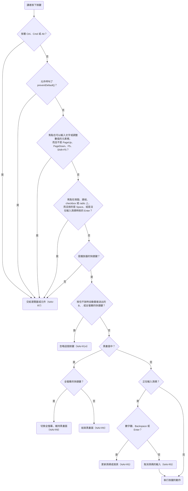

# 0002 換頁與操作

## 目標

完成後，講者可以用鍵盤、翻頁器與觸控滑動換頁，用 Home、End 或輸入頁碼跳頁，並切換黑畫面與全螢幕。播放器把目前頁面的 slide ID 寫進網址的 hash，所以重新整理或開啟分享的連結時，畫面會停在同一頁，調整頁面順序之後，舊連結也仍然指向同一頁。講者誤觸 Home、End 跳頁時，可以用瀏覽器的上一頁回到原來的位置。

## 範圍

- 要做：
  - 播放器提供換頁的快捷鍵與觸控滑動。焦點在互動元件裡時，元件自己要用的按鍵不觸發快捷鍵。
  - 網址的 hash 記錄目前的頁面。跳頁時新增一筆瀏覽紀錄，逐頁換頁時改寫目前的紀錄。
  - 用 Home、End 跳到第一頁與最後一頁，輸入頁碼後按 Enter 跳到指定的頁面。
  - 黑畫面、全螢幕、全螢幕按鈕，以及游標閒置後自動隱藏。
  - 新增 `navigation.md`，修改 PLAY-R1 與 FRAME-R4。Slide ID 重複時，build 的錯誤訊息加上讓同一頁出現兩次的做法。
- 刻意不做的事：
  - 用滑鼠點擊、滾輪或觸控板捲動換頁，理由寫在「決策」一節。
  - 在畫面上顯示頁碼。觀眾不需要看頁碼，講者需要頁碼時，roadmap 的「講者模式」會顯示。
  - 白畫面。翻頁器上沒有對應的按鈕，講者要遮住畫面時用黑畫面。
  - 在網址記錄頁內的步驟。Hash 的第二段（例如 `#/intro/2`）由「頁內分步」的 plan 定義。這個 plan 完成時，播放器把有第二段的 hash 視為指向不存在的頁面（NAV-R2）。

## Spec 變更

### navigation.md

新增這份 spec，`prefix` 為 `NAV`，開頭的說明與設計理由寫在下方「開頭的說明」。

- 新增 NAV-R1 網址的 Hash 記錄目前的頁面
- 新增 NAV-R2 網址的 Hash 指向不存在的頁面
- 新增 NAV-R3 用按鍵逐頁換頁
- 新增 NAV-R4 用 Home 與 End 跳到第一頁與最後一頁
- 新增 NAV-R5 輸入頁碼跳頁
- 新增 NAV-R6 瀏覽器的上一頁回到跳頁之前的頁面
- 新增 NAV-R7 快捷鍵不觸發的情況
- 新增 NAV-R8 觸控滑動換頁
- 新增 NAV-R9 黑畫面
- 新增 NAV-R10 全螢幕
- 新增 NAV-R11 全螢幕按鈕
- 新增 NAV-R12 游標閒置後隱藏
- 新增 NAV-R13 離開一頁時重置頁面
- 新增 NAV-R14 按住按鍵不放時的快捷鍵

#### 開頭的說明

換頁與操作是講者播放簡報時，用鍵盤、翻頁器或觸控滑動換頁，以及切換黑畫面與全螢幕的能力。翻頁器在電腦上就是一把鍵盤，按鍵模仿 PowerPoint 的快捷鍵，所以播放器的快捷鍵也能用翻頁器操作。

滑鼠只用來操作頁面上的互動元件與全螢幕按鈕。用滑鼠或手指點擊頁面、轉動滾輪都不會換頁。

> 設計理由：滑鼠點擊不換頁，因為講者在教學頁面上點擊互動元件時，同一次點擊也會觸發換頁，拖曳元件放開時，瀏覽器也會在放開的位置送出 click 事件。曾考慮只在點到空白處時換頁，但 React 的 `onClick` 不會出現在 DOM 上，播放器判斷不出哪些元素可以互動，只能要求每個互動元件都呼叫 `stopPropagation()`，而 AI 只要在一個元件裡漏寫 `stopPropagation()`，講者就會在台上意外換頁。滾輪與觸控板捲動也不換頁，因為觸控板的慣性捲動一次會送出幾十個 wheel 事件，播放器很容易一次換好幾頁。完整討論見 [0002](../plans/archive/0002-navigation.md)。

本 spec 把換到上一頁或下一頁叫做逐頁換頁，把用 Home、End、輸入頁碼，或改變網址的 hash 換到其他頁面叫做跳頁。播放器的快捷鍵是 NAV-R3、NAV-R4、NAV-R5、NAV-R9、NAV-R10 列出的按鍵，包括輸入頁碼用的數字鍵。講者按下按鍵時，播放器依下圖的順序決定要做什麼，每個判斷的細節寫在對應的需求裡。

#### NAV-R1 網址的 Hash 記錄目前的頁面

播放器把目前頁面的 slide ID 寫進網址的 hash，格式是 `#/<slide-id>`。網址的 hash 改變時，畫面換到 hash 指向的頁面。網址沒有 hash，或 hash 是 `#`、`#/` 時，播放器顯示第一頁（PLAY-R1），並把 hash 改成第一頁的 slide ID。Hash 指向不存在的頁面時，播放器的行為寫在 NAV-R2。

- 情境：開啟 hash 指向的頁面
  - 前提：`deck.json` 依序列出 `intro`、`agenda`、`recap` 三頁
  - 動作：開啟這份簡報，網址的 hash 是 `#/agenda`
  - 結果：畫面顯示 `agenda` 這一頁
- 情境：網址沒有 hash
  - 前提：`deck.json` 的第一頁是 `intro`
  - 動作：開啟這份簡報，網址沒有 hash
  - 結果：網址的 hash 變成 `#/intro`
- 情境：Hash 只有 `#/`
  - 前提：`deck.json` 的第一頁是 `intro`
  - 動作：開啟這份簡報，網址的 hash 是 `#/`
  - 結果：畫面顯示 `intro`，網址的 hash 變成 `#/intro`
- 情境：換頁後更新 hash
  - 前提：畫面顯示 `intro`，下一頁是 `agenda`
  - 動作：換到下一頁
  - 結果：網址的 hash 變成 `#/agenda`
- 情境：重新整理
  - 前提：畫面顯示 `agenda`
  - 動作：重新整理網頁
  - 結果：畫面顯示 `agenda`
- 情境：手動修改 hash
  - 前提：畫面顯示 `intro`
  - 動作：把網址的 hash 改成 `#/recap`
  - 結果：畫面顯示 `recap`
- 情境：點頁面裡的連結
  - 前提：`intro` 這一頁有一個 `href` 是 `#/recap` 的連結
  - 動作：點這個連結
  - 結果：畫面顯示 `recap`

> 設計理由：網址記錄 slide ID，不記錄頁碼，所以調整頁面順序之後，舊連結仍然指向同一頁。這也是 FRAME-R4 禁止重複 slide ID 的原因。完整討論見 [0002](../plans/archive/0002-navigation.md)。

#### NAV-R2 網址的 Hash 指向不存在的頁面

Hash 的 slide ID 不在 `deck.json` 的 `slides` 裡，或格式不是 `#/<slide-id>` 時，播放器把這個 hash 視為指向不存在的頁面。開啟簡報時遇到這種 hash，播放器顯示第一頁，並把 hash 改成第一頁的 slide ID；播放途中 hash 改成這種 hash 時，播放器停在目前的頁面，並把 hash 改回目前頁面的 slide ID。兩種情況下，播放器都會在瀏覽器的 console 印出警告，寫出這個 hash。

- 情境：開啟時 hash 指向不存在的頁面
  - 前提：`deck.json` 的第一頁是 `intro`，沒有 `old-name` 這一頁
  - 動作：開啟這份簡報，網址的 hash 是 `#/old-name`
  - 結果：畫面顯示 `intro`，網址的 hash 變成 `#/intro`，console 的警告寫出 `#/old-name`
- 情境：開啟時 hash 多出一段
  - 前提：`deck.json` 的第一頁是 `intro`，也有 `agenda` 這一頁
  - 動作：開啟這份簡報，網址的 hash 是 `#/agenda/2`
  - 結果：畫面顯示 `intro`，網址的 hash 變成 `#/intro`
- 情境：播放途中 hash 指向不存在的頁面
  - 前提：畫面顯示 `agenda`，簡報沒有 `missing` 這一頁
  - 動作：把網址的 hash 改成 `#/missing`
  - 結果：畫面仍然顯示 `agenda`，網址的 hash 變回 `#/agenda`，console 的警告寫出 `#/missing`

> 設計理由：開啟時顯示第一頁，不顯示錯誤訊息，因為拿著改名前的舊連結開啟簡報的通常是觀眾，對觀眾來說第一頁比錯誤訊息有用。播放途中則停在目前的頁面，因為講者在台上點到 slide ID 打錯的連結時，跳回第一頁會打斷演講。Console 的警告讓講者在開發時找得到打錯的連結。完整討論見 [0002](../plans/archive/0002-navigation.md)。

#### NAV-R3 用按鍵逐頁換頁

按下表的按鍵時，播放器換到 `deck.json` 順序裡的下一頁或上一頁。在最後一頁按下一頁的按鍵，或在第一頁按上一頁的按鍵時，畫面不動。

| 動作 | 按鍵 |
| --- | --- |
| 下一頁 | →、↓、PageDown、Space、Enter |
| 上一頁 | ←、↑、PageUp、Shift+Space、Backspace |

- 情境：換到下一頁
  - 前提：畫面顯示 `intro`，下一頁是 `agenda`
  - 動作：按下一頁的任何一個按鍵
  - 結果：畫面顯示 `agenda`
- 情境：換到上一頁
  - 前提：畫面顯示 `agenda`，上一頁是 `intro`
  - 動作：按上一頁的任何一個按鍵
  - 結果：畫面顯示 `intro`
- 情境：在最後一頁按下一頁
  - 前提：畫面顯示最後一頁 `recap`
  - 動作：按 →
  - 結果：畫面仍然顯示 `recap`
- 情境：在第一頁按上一頁
  - 前提：畫面顯示第一頁 `intro`
  - 動作：按 ←
  - 結果：畫面仍然顯示 `intro`

> 設計理由：曾考慮照 PowerPoint 在最後一頁之後顯示結束畫面，但 PowerPoint 的結束畫面之後是離開放映，瀏覽器裡沒有對應的動作，結束畫面只會多出一張空白頁，講者講完要遮住畫面時可以用黑畫面（NAV-R9）；也考慮過從最後一頁循環回第一頁，但講者在台上按過頭時，畫面會突然回到第一頁。完整討論見 [0002](../plans/archive/0002-navigation.md)。

#### NAV-R4 用 Home 與 End 跳到第一頁與最後一頁

按 Home 時跳到第一頁，按 End 時跳到最後一頁。

- 情境：跳到第一頁
  - 前提：畫面顯示 `recap`，第一頁是 `intro`
  - 動作：按 Home
  - 結果：畫面顯示 `intro`
- 情境：跳到最後一頁
  - 前提：畫面顯示 `intro`，最後一頁是 `recap`
  - 動作：按 End
  - 結果：畫面顯示 `recap`

#### NAV-R5 輸入頁碼跳頁

講者輸入頁碼後按 Enter 時，播放器跳到 `deck.json` 順序裡的那一頁，頁碼從 1 開始。輸入途中，視窗的右下角顯示講者目前輸入的頁碼，位置在全螢幕按鈕的上方，右緣和全螢幕按鈕切齊。數字鍵盤的數字鍵與鍵盤上排的數字鍵作用相同。輸入途中另有以下規則：

1. 停止輸入 3 秒後，播放器取消這次輸入，頁碼消失。
2. 按 Backspace 時，播放器刪除頁碼的最後一位數字，不換到上一頁。頁碼的數字全部刪除之後，這次輸入結束，頁碼消失，Backspace 與 Enter 恢復原本的動作。
3. 按其他快捷鍵或觸控滑動時，播放器取消這次輸入，頁碼消失，再照常執行原本的動作。目前的頁面因為其他原因改變時，例如講者按了瀏覽器的上一頁，播放器也會取消這次輸入。
4. 頁碼是 0 或大於總頁數時，按 Enter 不換頁，播放器取消這次輸入，頁碼消失。

- 情境：跳到指定的頁面
  - 前提：簡報依序是 `intro`、`agenda`、`recap` 三頁，畫面顯示 `intro`
  - 動作：輸入 3，再按 Enter
  - 結果：畫面顯示 `recap`
- 情境：兩位數的頁碼
  - 前提：簡報有 12 頁，畫面顯示第 1 頁
  - 動作：依序輸入 1、2，再按 Enter
  - 結果：畫面顯示第 12 頁
- 情境：輸入時顯示頁碼
  - 前提：簡報有 12 頁，畫面顯示第 1 頁
  - 動作：依序輸入 1、2
  - 結果：視窗的右下角、全螢幕按鈕的上方顯示 12，頁碼的右緣和全螢幕按鈕的右緣切齊
- 情境：停止輸入 3 秒
  - 前提：畫面顯示 `intro`
  - 動作：輸入 3，等 3 秒
  - 結果：頁碼消失
- 情境：停止輸入 3 秒後按 Enter
  - 前提：簡報依序是 `intro`、`agenda`、`recap` 三頁，畫面顯示 `intro`
  - 動作：輸入 3，等 3 秒後按 Enter
  - 結果：畫面顯示 `agenda`，因為這時 Enter 是換到下一頁的按鍵
- 情境：用 Backspace 刪除頁碼的一位數字
  - 前提：簡報依序是 `intro`、`agenda`、`recap` 三頁，畫面顯示 `intro`
  - 動作：依序輸入 3、1，按 Backspace，再按 Enter
  - 結果：畫面顯示 `recap`
- 情境：刪除頁碼的所有數字
  - 前提：畫面顯示 `agenda`，上一頁是 `intro`
  - 動作：輸入 3，再按兩次 Backspace
  - 結果：第一次按 Backspace 後，頁碼消失，畫面仍然顯示 `agenda`；第二次按 Backspace 後，畫面顯示 `intro`
- 情境：輸入途中按其他按鍵
  - 前提：畫面顯示 `intro`，下一頁是 `agenda`
  - 動作：輸入 3，再按 →
  - 結果：畫面顯示 `agenda`，頁碼消失
- 情境：輸入途中滑動
  - 前提：畫面顯示 `intro`，下一頁是 `agenda`
  - 動作：輸入 3，再用手指往左滑 200 px
  - 結果：畫面顯示 `agenda`，頁碼消失
- 情境：頁碼大於總頁數
  - 前提：簡報有 3 頁，畫面顯示 `intro`
  - 動作：輸入 9，再按 Enter
  - 結果：畫面仍然顯示 `intro`，頁碼消失
- 情境：頁碼是 0
  - 前提：畫面顯示 `intro`
  - 動作：輸入 0，再按 Enter
  - 結果：畫面仍然顯示 `intro`，頁碼消失
- 情境：用數字鍵盤輸入
  - 前提：簡報依序是 `intro`、`agenda`、`recap` 三頁，畫面顯示 `intro`
  - 動作：用數字鍵盤輸入 3，再按 Enter
  - 結果：畫面顯示 `recap`

> 設計理由：輸入時在畫面上顯示頁碼，觀眾也看得到這個頁碼，但少了這個提示，講者看不出自己輸入了什麼，打錯了也不會發現。停止輸入 3 秒後取消輸入，是因為講者輸入頁碼之後忘記按 Enter 時，這次輸入會一直保留，等講者之後按 Enter 想換到下一頁，畫面就會跳到那個頁碼。完整討論見 [0002](../plans/archive/0002-navigation.md)。

#### NAV-R6 瀏覽器的上一頁回到跳頁之前的頁面

跳頁時，播放器在瀏覽器新增一筆瀏覽紀錄；逐頁換頁時，播放器改寫目前的瀏覽紀錄。所以按瀏覽器的上一頁時，畫面回到最近一次跳頁之前的頁面；沒有跳頁過時，瀏覽器回到開啟簡報之前的網頁。

- 情境：逐頁換頁不新增瀏覽紀錄
  - 前提：在瀏覽器開啟網站首頁，再從首頁開啟這份簡報，畫面顯示 `intro`
  - 動作：按兩次 →，再按瀏覽器的上一頁
  - 結果：瀏覽器回到網站首頁
- 情境：回到用 End 跳頁之前的頁面
  - 前提：畫面顯示 `agenda`
  - 動作：按 End，再按瀏覽器的上一頁
  - 結果：畫面顯示 `agenda`
- 情境：回到輸入頁碼跳頁之前的頁面
  - 前提：畫面顯示 `recap`
  - 動作：輸入 1 後按 Enter，再按瀏覽器的上一頁
  - 結果：畫面顯示 `recap`
- 情境：跳頁之後又逐頁換頁
  - 前提：簡報依序是 `intro`、`agenda`、`recap` 三頁，畫面顯示 `intro`
  - 動作：按 End、按 ←，再按瀏覽器的上一頁
  - 結果：畫面顯示 `intro`
- 情境：全螢幕時回到跳頁之前的頁面
  - 前提：播放器在全螢幕，畫面顯示 `agenda`
  - 動作：按 End，再按瀏覽器回到上一頁的快捷鍵（macOS 是 Cmd+←，Windows 是 Alt+←）
  - 結果：畫面顯示 `agenda`，播放器仍然在全螢幕

> 設計理由：曾考慮每次換頁都新增一筆瀏覽紀錄，但講者播完 40 頁之後，要按 40 次瀏覽器的上一頁才能離開簡報，滑鼠的上一頁側鍵誤觸時，畫面也會在頁面之間來回換頁。也考慮過每次換頁都只改寫目前的紀錄，但講者誤觸 Home、End 時，就沒辦法回到原來的位置。頁面裡的連結本來就會新增瀏覽紀錄，所以其他跳頁方式也新增紀錄，講者只要記住「跳頁之後可以用瀏覽器的上一頁回去」這一條規則。完整討論見 [0002](../plans/archive/0002-navigation.md)。

#### NAV-R7 快捷鍵不觸發的情況

遇到下列情況時，講者按下的按鍵不觸發播放器的快捷鍵，按鍵照常交給瀏覽器或頁面上的元件：

1. 講者同時按著 Ctrl、Cmd 或 Alt。
2. 頁面上的元件在 keydown 事件呼叫了 `preventDefault()`。
3. 焦點在可以輸入文字或調整數值的元素裡，包括 `textarea`、`select`、`contenteditable` 的元素，以及 `type` 不是 `checkbox`、`radio`、`button`、`submit`、`reset` 的 `input`。這時只有 PageUp、PageDown、F5 與 Shift+F5 仍然觸發快捷鍵。
4. 焦點在按鈕、連結、checkbox 或 radio 上，按下的是 Space 或 Enter。講者正在輸入頁碼時按的 Enter 例外，仍然用來確認頁碼（NAV-R5）。

- 情境：按著 Ctrl、Cmd 或 Alt
  - 前提：畫面顯示 `intro`
  - 動作：分別按著 Ctrl、Cmd、Alt 再按 →
  - 結果：播放器三次都沒有換到下一頁，按鍵照常交給瀏覽器，所以瀏覽器本身的組合鍵仍然有效
- 情境：元件自己用到的按鍵
  - 前提：畫面顯示 `intro`，焦點在頁面上的一個元件上，這個元件在 keydown 事件裡遇到 → 鍵時呼叫 `preventDefault()`
  - 動作：按 →
  - 結果：畫面仍然顯示 `intro`
- 情境：在輸入框裡移動游標
  - 前提：畫面顯示 `intro`，焦點在頁面上的文字輸入框裡
  - 動作：按 →
  - 結果：畫面仍然顯示 `intro`
- 情境：在輸入框裡打字
  - 前提：畫面顯示 `intro`，焦點在頁面上的文字輸入框裡
  - 動作：按 `B`
  - 結果：輸入框裡多了 `b`，畫面沒有變成黑畫面
- 情境：焦點在輸入框時用翻頁器換頁
  - 前提：畫面顯示 `intro`，焦點在頁面上的文字輸入框裡，下一頁是 `agenda`
  - 動作：按 PageDown
  - 結果：畫面顯示 `agenda`
- 情境：焦點在按鈕上按 Space
  - 前提：畫面顯示 `intro`，焦點在頁面上的按鈕上
  - 動作：按 Space
  - 結果：按鈕被按下，畫面仍然顯示 `intro`
- 情境：焦點在按鈕上按 →
  - 前提：畫面顯示 `intro`，焦點在頁面上的按鈕上，下一頁是 `agenda`
  - 動作：按 →
  - 結果：畫面顯示 `agenda`
- 情境：焦點在按鈕上時輸入頁碼
  - 前提：簡報有 12 頁，畫面顯示第 1 頁，焦點在頁面上的按鈕上
  - 動作：輸入 4，再按 Enter
  - 結果：畫面顯示第 4 頁，按鈕沒有被按下

> 設計理由：曾考慮讓快捷鍵一律觸發，由互動元件呼叫 `stopPropagation()` 擋下自己要用的按鍵，但 AI 在一個元件裡漏寫 `stopPropagation()` 時，講者在輸入框打字就會換頁。也考慮過焦點在任何互動元素上時，所有快捷鍵都不觸發，但講者點過頁面上的按鈕之後，翻頁器就會失效，要用滑鼠點按鈕以外的地方才能繼續換頁。焦點在輸入框裡時，翻頁器送出的按鍵仍然觸發快捷鍵，因為講者在輸入框打完字之後，通常會直接按翻頁器換頁。輸入頁碼途中的 Enter 不交給按鈕，因為在 Chromium 用滑鼠點過按鈕之後，焦點會留在按鈕上，講者示範過按鈕再輸入頁碼時，按 Enter 會再按一次按鈕，而不是跳頁。完整討論見 [0002](../plans/archive/0002-navigation.md)。

#### NAV-R8 觸控滑動換頁

手指在畫面上往左滑時換到下一頁，往右滑時換到上一頁，換頁的規則與 NAV-R3 相同。手指放開時，水平移動至少 80 CSS px，而且水平距離大於垂直距離，才算滑動。下列情況不算滑動：

1. 兩指以上的手勢。
2. 滑鼠拖曳。
3. 觸控從 `input`、`textarea`、`select` 或 `contenteditable` 的元素開始。
4. 觸控起點所在的元素，或它的上層元素，設定了 `touch-action: none`。
5. 頁面上的元件在 `pointerdown`、`touchstart` 或 `touchmove` 事件呼叫了 `preventDefault()`。

- 情境：往左滑
  - 前提：畫面顯示 `intro`，下一頁是 `agenda`
  - 動作：手指往左滑 200 px
  - 結果：畫面顯示 `agenda`
- 情境：往右滑
  - 前提：畫面顯示 `agenda`，上一頁是 `intro`
  - 動作：手指往右滑 200 px
  - 結果：畫面顯示 `intro`
- 情境：移動距離不夠
  - 前提：畫面顯示 `intro`
  - 動作：手指往左滑 60 px
  - 結果：畫面仍然顯示 `intro`
- 情境：斜向滑動
  - 前提：畫面顯示 `intro`
  - 動作：手指往左移動 100 px，同時往下移動 150 px
  - 結果：畫面仍然顯示 `intro`
- 情境：兩指滑動
  - 前提：畫面顯示 `intro`
  - 動作：兩指一起往左滑 200 px
  - 結果：畫面仍然顯示 `intro`
- 情境：滑鼠拖曳
  - 前提：畫面顯示 `intro`
  - 動作：按著滑鼠往左拖曳 200 px
  - 結果：畫面仍然顯示 `intro`
- 情境：拖曳 range input
  - 前提：畫面顯示 `intro`，頁面上有一個 range input
  - 動作：手指從 range input 開始往左滑 200 px
  - 結果：Range input 的值改變，畫面仍然顯示 `intro`
- 情境：拖曳設定了 `touch-action: none` 的元素
  - 前提：畫面顯示 `intro`，頁面上有一個設定了 `touch-action: none` 的元素
  - 動作：手指從這個元素開始往左滑 200 px
  - 結果：畫面仍然顯示 `intro`
- 情境：元件呼叫 `preventDefault()`
  - 前提：畫面顯示 `intro`，頁面上有一個元件在 `pointerdown` 事件呼叫 `preventDefault()`
  - 動作：手指從這個元件開始往左滑 200 px
  - 結果：畫面仍然顯示 `intro`
- 情境：元件在 `touchmove` 呼叫 `preventDefault()`
  - 前提：畫面顯示 `intro`，頁面上有一個元件在 `touchmove` 事件呼叫 `preventDefault()`
  - 動作：手指從這個元件開始往左滑 200 px
  - 結果：畫面仍然顯示 `intro`
- 情境：在 iPad 上滑動
  - 前提：在 iPad 的 Safari 開啟簡報，畫面顯示 `intro`
  - 動作：手指往左滑
  - 結果：畫面顯示 `agenda`

> 設計理由：觸控和滑鼠點擊不同，播放器有可靠的方式判斷手勢是不是在操作互動元件。在觸控螢幕上用 pointer 事件實作拖曳時，元素一定要設定 `touch-action: none`，否則瀏覽器會把手勢當成捲動，所以主流的拖曳套件都會設定這個屬性；用 touch 事件實作拖曳的套件，例如 Embla，則會在 `touchmove` 呼叫 `preventDefault()`，因為在 `touchstart` 呼叫的話，瀏覽器就不會送出點擊之後的 click，元件裡的連結與按鈕都會點不到。觸控是不是從表單元素開始，播放器則可以直接從元素的標籤名稱判斷。完整討論見 [0002](../plans/archive/0002-navigation.md)。

#### NAV-R9 黑畫面

按 `B` 或 `.` 時切換黑畫面，黑畫面蓋住整個畫布。黑畫面時，按其他快捷鍵或觸控滑動只會結束黑畫面，不執行原本的動作。全螢幕的快捷鍵（`F`、F5、Shift+F5）例外，照常切換全螢幕，並維持黑畫面。黑畫面時，如果網址的 hash 改變，例如講者按了瀏覽器的上一頁，播放器照常換頁，並維持黑畫面。

- 情境：用 `B` 切換黑畫面
  - 前提：畫面顯示 `intro`
  - 動作：按 `B`，再按一次 `B`
  - 結果：第一次按下後畫面變成黑畫面，第二次按下後畫面顯示 `intro`
- 情境：用 `.` 切換黑畫面
  - 前提：畫面顯示 `intro`
  - 動作：按 `.`，再按一次 `.`
  - 結果：第一次按下後畫面變成黑畫面，第二次按下後畫面顯示 `intro`
- 情境：黑畫面蓋住設定了 `z-index` 的元素
  - 前提：畫面顯示 `intro`，頁面上有一個設定了 `z-index` 的元素
  - 動作：按 `B`
  - 結果：黑畫面蓋住這個元素
- 情境：黑畫面時按換頁的按鍵
  - 前提：畫面顯示 `intro`，接著切換成黑畫面
  - 動作：按 →
  - 結果：黑畫面結束，畫面顯示 `intro`
- 情境：黑畫面時滑動
  - 前提：畫面顯示 `intro`，接著切換成黑畫面
  - 動作：手指往左滑 200 px
  - 結果：黑畫面結束，畫面顯示 `intro`
- 情境：黑畫面時切換全螢幕
  - 前提：播放器不在全螢幕，畫面是黑畫面
  - 動作：按 `F`
  - 結果：播放器進入全螢幕，畫面仍然是黑畫面
- 情境：黑畫面時按瀏覽器的上一頁
  - 前提：畫面顯示 `agenda`，講者按 End 跳到 `recap`，再切換成黑畫面
  - 動作：按瀏覽器的上一頁，再按 `B`
  - 結果：按瀏覽器的上一頁之後，畫面仍然是黑畫面；按 `B` 之後，畫面顯示 `agenda`

> 設計理由：黑畫面時按換頁的按鍵只結束黑畫面，所以講者講完題外話之後，觀眾看到的是黑畫面之前的那一頁，這也是 Keynote 的做法。曾考慮黑畫面時照常換頁，讓講者趁黑畫面先換好下一頁，但講者在黑畫面時看不到目前停在哪一頁，誤觸了也不會發現。網址的 hash 改變時則照常換頁並維持黑畫面，因為講者在問答時誤觸滑鼠的上一頁側鍵時，如果黑畫面跟著結束，觀眾就會看到頁面；曾考慮不理會 hash 的改變，但這樣瀏覽器的上一頁在黑畫面時就沒有作用。完整討論見 [0002](../plans/archive/0002-navigation.md)。

#### NAV-R10 全螢幕

按 `F` 時切換全螢幕。按 F5 或 Shift+F5 時進入全螢幕，已經在全螢幕時維持全螢幕，而且播放器會擋下瀏覽器用 F5 重新整理網頁的行為。按 Esc 時，瀏覽器離開全螢幕。

- 情境：用 `F` 切換全螢幕
  - 前提：播放器不在全螢幕
  - 動作：按 `F`，再按一次 `F`
  - 結果：第一次按下後播放器進入全螢幕，第二次按下後離開全螢幕
- 情境：用 F5 進入全螢幕
  - 前提：播放器不在全螢幕，畫面顯示 `agenda`
  - 動作：按 F5
  - 結果：播放器進入全螢幕，網頁沒有重新載入，畫面仍然顯示 `agenda`
- 情境：全螢幕時按 F5
  - 前提：播放器在全螢幕
  - 動作：按 F5
  - 結果：播放器仍然在全螢幕
- 情境：用 Esc 離開全螢幕
  - 前提：播放器在全螢幕
  - 動作：按 Esc
  - 結果：播放器離開全螢幕
- 情境：用翻頁器播放
  - 前提：筆電接上翻頁器，畫面顯示 `intro`，播放器不在全螢幕
  - 動作：依序按翻頁器的播放鍵、下一頁鍵、黑畫面鍵、黑畫面鍵、播放鍵
  - 結果：播放器進入全螢幕，網頁沒有重新載入；畫面換到 `agenda`；畫面變成黑畫面；畫面顯示 `agenda`；播放器離開全螢幕

> 設計理由：F5 與 Shift+F5 用來進入全螢幕，因為翻頁器的播放鍵在 F5（或 Shift+F5）與 Esc 之間輪流切換，對應 PowerPoint 的開始放映與結束放映；瀏覽器預設用 F5 重新整理網頁，所以播放器要擋下這個行為，否則講者一按播放鍵，簡報就會重新載入。完整討論見 [0002](../plans/archive/0002-navigation.md)。

#### NAV-R11 全螢幕按鈕

滑鼠移動或手指點一下畫面時，視窗的右下角出現全螢幕按鈕，最後一次移動滑鼠或點畫面的 2 秒後，按鈕隱藏；開啟簡報時，按鈕也會先顯示 2 秒。點全螢幕按鈕時切換全螢幕。用滑鼠或手指點全螢幕按鈕時，按鈕不取得焦點，所以講者點過按鈕之後，按 Space 或 Enter 仍然會換頁（NAV-R7）。用 Tab（Safari 預設是 Option+Tab）把焦點移到全螢幕按鈕時，按鈕在有焦點的期間保持顯示，這時按 Space 或 Enter 會按下按鈕。瀏覽器不支援讓網頁元素進入全螢幕時，例如 iPhone 的 Safari，播放器不顯示這個按鈕。

- 情境：開啟簡報時顯示按鈕
  - 前提：瀏覽器支援讓網頁元素進入全螢幕
  - 動作：開啟簡報，2 秒內不移動滑鼠，也不點畫面
  - 結果：開啟時視窗的右下角出現全螢幕按鈕，2 秒後按鈕隱藏
- 情境：移動滑鼠時出現按鈕
  - 前提：全螢幕按鈕沒有顯示
  - 動作：移動滑鼠
  - 結果：視窗的右下角出現全螢幕按鈕
- 情境：停止操作 2 秒
  - 前提：全螢幕按鈕已經顯示
  - 動作：2 秒內不移動滑鼠，也不點畫面
  - 結果：全螢幕按鈕隱藏
- 情境：點按鈕切換全螢幕
  - 前提：播放器不在全螢幕，全螢幕按鈕已經顯示
  - 動作：點全螢幕按鈕，再點一次
  - 結果：第一次點下後播放器進入全螢幕，第二次點下後離開全螢幕
- 情境：點按鈕進入全螢幕後按 Space
  - 前提：播放器不在全螢幕，畫面顯示 `intro`，下一頁是 `agenda`
  - 動作：點全螢幕按鈕，再按 Space
  - 結果：播放器進入全螢幕，畫面顯示 `agenda`
- 情境：用 Tab 移到按鈕
  - 前提：播放器不在全螢幕，全螢幕按鈕沒有顯示，頁面上沒有其他可以取得焦點的元素
  - 動作：按 Tab（Safari 按 Option+Tab），等 2 秒，再按 Space
  - 結果：全螢幕按鈕取得焦點並出現，等 2 秒後仍然顯示；按 Space 之後播放器進入全螢幕，畫面沒有換頁
- 情境：手指點一下畫面
  - 前提：畫面顯示 `intro`，全螢幕按鈕沒有顯示
  - 動作：手指點一下畫面中央
  - 結果：全螢幕按鈕出現，畫面仍然顯示 `intro`
- 情境：瀏覽器不支援全螢幕
  - 前提：在 iPhone 的 Safari 開啟簡報
  - 動作：手指點一下畫面
  - 結果：畫面上沒有全螢幕按鈕

> 設計理由：平板沒有鍵盤，講者按不到 `F`，所以播放器提供全螢幕按鈕。曾考慮用點兩下切換全螢幕，但在互動元件上點兩下會選取文字，在觸控螢幕上點兩下則會觸發瀏覽器的縮放。開啟簡報時也先顯示按鈕，因為用平板播放的講者沒有滑鼠可以移動，不點一下畫面就不會知道有這個按鈕。完整討論見 [0002](../plans/archive/0002-navigation.md)。

#### NAV-R12 游標閒置後隱藏

滑鼠停止移動 2 秒後，播放器隱藏游標；滑鼠移動時，游標重新出現。不論播放器在不在全螢幕都套用這條規則。

- 情境：停止移動 2 秒
  - 前提：游標顯示在畫面上
  - 動作：2 秒內不移動滑鼠
  - 結果：游標隱藏
- 情境：移動滑鼠
  - 前提：游標已經隱藏
  - 動作：移動滑鼠
  - 結果：游標出現

#### NAV-R13 離開一頁時重置頁面

播放器只 render 目前這一頁。換到其他頁面之後再回到原來的頁面時，頁面回到初始狀態。

- 情境：回到操作過的頁面
  - 前提：`intro` 這一頁有一個計數器，初始值是 0，講者把計數器按到 3
  - 動作：換到下一頁，再換回 `intro`
  - 結果：計數器顯示 0
- 情境：兩頁顯示同一個元件
  - 前提：`deck.json` 依序列出 `counter`、`counter-again`，`counter-again.tsx` 重新匯出 `counter.tsx`；`counter` 這一頁有一個計數器，講者把計數器按到 3
  - 動作：換到下一頁 `counter-again`
  - 結果：計數器顯示 0

> 設計理由：曾考慮把看過的頁面隱藏起來、不 unmount，保留互動元件的狀態，但隱藏的頁面裡的影片、計時器與動畫會繼續在背景執行，記憶體用量也會隨看過的頁數增加。講者回到教學頁面時，通常是要重新示範一次，所以頁面回到初始狀態比較符合需要。完整討論見 [0002](../plans/archive/0002-navigation.md)。

#### NAV-R14 按住按鍵不放時的快捷鍵

講者按住按鍵不放時，作業系統會自動重複送出這個按鍵，這時 `B`、`.` 與全螢幕的快捷鍵（`F`、F5、Shift+F5）只在第一次按下時觸發，其他快捷鍵照常連續觸發。

- 情境：按住 → 不放
  - 前提：簡報依序是 `intro`、`agenda`、`recap` 三頁，畫面顯示 `intro`
  - 動作：按住 →，直到作業系統再自動送出一次 →
  - 結果：畫面顯示 `recap`
- 情境：按住 `B` 不放
  - 前提：畫面顯示 `intro`
  - 動作：按住 `B`，直到作業系統自動送出好幾次 `B`
  - 結果：畫面變成黑畫面，放開 `B` 之後仍然是黑畫面
- 情境：按住 `F` 不放
  - 前提：播放器不在全螢幕
  - 動作：按住 `F`，直到作業系統自動送出好幾次 `F`
  - 結果：播放器進入全螢幕，放開 `F` 之後仍然在全螢幕

> 設計理由：`B`、`.` 與全螢幕的快捷鍵不理會自動重複，因為講者按住翻頁器的黑畫面鍵不放時，投影幕會在黑畫面與頁面之間快速閃爍，最後停在哪一邊取決於自動重複的次數。逐頁換頁的按鍵照常重複，講者可以按住 → 快速往後翻；曾考慮讓所有快捷鍵都不理會自動重複，但講者就沒辦法這樣快速翻頁。完整討論見 [0002](../plans/archive/0002-navigation.md)。

### playback.md

- 修改 PLAY-R1：規則改成只適用於網址的 hash 沒有指定頁面的情況，情境的動作補上「網址沒有 hash」。

#### PLAY-R1 開啟簡報時顯示第一頁

開啟一份簡報、網址的 hash 沒有指定頁面時，畫面顯示簡報設定檔 `deck.json` 裡頁面順序的第一頁。網址的 hash 指定頁面時的行為寫在 [navigation.md](navigation.md) 的 NAV-R1 與 NAV-R2。

- 情境：開啟簡報
  - 前提：`deck.json` 依序列出 `intro`、`agenda` 兩頁
  - 動作：開啟這份簡報，網址沒有 hash
  - 結果：畫面顯示 `intro` 這一頁

### framework.md

- 修改 FRAME-R4：規則補上一句，說明兩頁顯示同一個元件；「Slide ID 重複」情境的錯誤訊息加上讓同一頁出現兩次的做法；設計理由改寫成網址需要唯一的 slide ID。

#### FRAME-R4 同一個 Slide ID 在 `slides` 裡只能出現一次

同一個 slide ID 在 `deck.json` 的 `slides` 裡只能出現一次。同一頁要在簡報裡出現兩次時，另外建一個 TSX 檔重新匯出那一頁，例如 `agenda` 要出現兩次時，新增 `slides/agenda-recap.tsx`，內容寫成 `export { default } from "./agenda";`，再把 `agenda-recap` 列進 `slides`。這兩頁顯示同一個元件，所以修改 `agenda.tsx` 時，兩次出現的地方會一起改變。

- 情境：Slide ID 重複
  - 前提：`deck.json` 的 `slides` 是 `["intro", "agenda", "intro"]`
  - 動作：Build
  - 結果：Build 失敗，錯誤訊息寫出 `intro`，並寫出讓同一頁出現兩次的做法：另外建一個 TSX 檔，內容寫成 `export { default } from "./intro";`

> 設計理由：播放器把 slide ID 寫進網址的 hash（[navigation.md](navigation.md) 的 NAV-R1），讓指向某一頁的連結在頁面順序調整後仍然指向同一頁，所以一個 slide ID 只能對應一頁。允許重複的話，hash 要另外記錄這是第幾次出現，例如 `#/agenda~2`，而在第二個 `agenda` 之前再插入一次 `agenda` 之後，舊連結的 `~2` 就會指到另一次出現的位置。錯誤訊息寫出重新匯出的做法，因為 AI 製作簡報時通常不會先讀 spec，而是從 build 的錯誤訊息知道怎麼修正。「預覽總覽與排序」的 plan 決定現場隱藏的頁面怎麼存進瀏覽器時，再評估一次要不要允許重複；現在先禁止重複，之後要放寬時，既有的簡報不受影響。完整討論見 [0001](../plans/archive/0001-project-foundation.md) 與 [0002](../plans/archive/0002-navigation.md)。

## 決策

### 滑鼠與觸控板要不要換頁

- 選項：
  1. 點擊、滾輪與觸控板捲動都不換頁。
  2. 點一下換到下一頁，和 PowerPoint、Keynote 一樣。
  3. 只在點到沒有互動元件的地方時換頁。
  4. 滾輪與觸控板捲動換頁。
- 取捨：選項 2 讓講者點擊或拖曳教學頁面上的互動元件時，播放器也會換頁。選項 3 要求每個互動元件都呼叫 `stopPropagation()`，因為播放器從 DOM 看不到 React 的 `onClick`。選項 4 讓觸控板的慣性捲動一次換好幾頁。
- 結論：選項 1。換頁已經可以用鍵盤、翻頁器與觸控滑動完成。
- 併入：navigation.md#換頁與操作

### 網址怎麼記錄目前的頁面

- 選項：
  1. 記錄 slide ID，例如 `#/agenda`。
  2. 記錄頁碼，例如 `#/2`。
- 取捨：記錄頁碼時，調整頁面順序之後，舊連結會指到別的頁面。
- 結論：記錄 slide ID，roadmap 已經記下專案擁有者的這個決定。這個 plan 只定義 `#/<slide-id>`，步驟的部分由「頁內分步」的 plan 加上。
- 併入：navigation.md#NAV-R1

### 換頁時怎麼更新瀏覽紀錄

- 選項：
  1. 每次換頁都新增一筆瀏覽紀錄。
  2. 每次換頁都只改寫目前的紀錄。
  3. 跳頁新增紀錄，逐頁換頁改寫目前的紀錄。
- 取捨：選項 1 讓講者播完簡報後要按很多次瀏覽器的上一頁才能離開。選項 2 讓誤觸 Home、End 的講者回不到原來的位置。
- 結論：選項 3。
- 併入：navigation.md#NAV-R6

### Hash 指向不存在的頁面時怎麼處理

- 選項：
  1. 開啟時顯示第一頁，播放途中停在目前的頁面。
  2. 開啟時在畫布上顯示錯誤訊息。
  3. 播放途中跳回第一頁。
- 結論：選項 1，兩種情況都在 console 印出警告。
- 併入：navigation.md#NAV-R2

### Slide ID 能不能重複

- 選項：
  1. 維持 0001 的決定，禁止重複。
  2. 允許重複，hash 另外記錄這是第幾次出現，例如 `#/agenda~2`。
- 取捨：選項 2 的簡報在第二個 `agenda` 之前再插入一次 `agenda` 時，`#/agenda~2` 的舊連結會指到另一次出現的位置。
- 結論：選項 1。Build 的錯誤訊息加上重新匯出的做法，roadmap 的「生成簡報 skill」也要求 skill 說明這個做法。「預覽總覽與排序」的 plan 再評估一次。
- 併入：framework.md#FRAME-R4

### 在最後一頁按下一頁

- 選項：
  1. 畫面不動。
  2. 顯示結束畫面，和 PowerPoint 一樣。
  3. 循環回第一頁。
- 結論：選項 1。
- 併入：navigation.md#NAV-R3

### 頁碼跳頁怎麼避免跳錯頁

- 選項：
  1. 輸入時在畫面上顯示頁碼，停止輸入 3 秒後取消輸入。
  2. 照 PowerPoint，不顯示頁碼，也不會自動取消輸入。
- 結論：選項 1。
- 併入：navigation.md#NAV-R5

### 焦點在互動元件裡時哪些快捷鍵會觸發

- 選項：
  1. 元件呼叫 `preventDefault()` 時不觸發快捷鍵；焦點在可以輸入文字或調整數值的元素裡時，只有翻頁器送出的按鍵觸發快捷鍵；焦點在按鈕、連結上時，Space 與 Enter 交給元件。
  2. 快捷鍵一律觸發，由元件呼叫 `stopPropagation()` 擋下自己要用的按鍵。
  3. 焦點在任何互動元素上時，所有快捷鍵都不觸發。
- 取捨：選項 2 讓 AI 在一個元件裡漏寫 `stopPropagation()` 時，講者打字就會換頁。選項 3 讓翻頁器在講者點過按鈕之後失效。
- 結論：選項 1。元件用到方向鍵時本來就要呼叫 `preventDefault()`，才能避免網頁捲動，所以 AI 不用多記一條規則。
- 併入：navigation.md#NAV-R7

### 觸控滑動怎麼避開互動元件

- 選項：
  1. 觸控從表單元素、`touch-action: none` 的元素開始，或元件呼叫了 `preventDefault()` 時，不算滑動。
  2. 所有水平滑動都換頁。
- 取捨：選項 2 讓講者在拖曳互動元件時換頁。
- 結論：選項 1。
- 併入：navigation.md#NAV-R8

### 觸控滑動的門檻

- 選項：
  1. 50 px，和 reveal.js 的 40 px 相近。
  2. 80 px。
  3. 100 px。
- 取捨：100 px 在 iPhone 上約 1.7 公分、在 iPad 上約 1.9 公分，輕快地撥一下常常不到這個距離。
- 結論：80 px，由專案擁有者決定。
- 併入：無

### 黑畫面時按其他快捷鍵

- 選項：
  1. 只結束黑畫面，不執行原本的動作。
  2. 結束黑畫面，並執行原本的動作。
- 結論：選項 1，全螢幕的按鍵例外。
- 併入：navigation.md#NAV-R9

### 翻頁器的播放鍵

- 選項：
  1. F5 與 Shift+F5 進入全螢幕，並擋下瀏覽器的重新整理。
  2. F5 不是快捷鍵，由瀏覽器重新整理網頁。
- 結論：選項 1。翻頁器的播放鍵再按一次時送出 Esc，瀏覽器收到 Esc 會離開全螢幕。
- 併入：navigation.md#NAV-R10

### 沒有鍵盤時怎麼進入全螢幕

- 選項：
  1. 滑鼠移動或手指點一下畫面時，顯示全螢幕按鈕。
  2. 點兩下切換全螢幕。
  3. 只能用鍵盤進入全螢幕。
- 取捨：選項 2 和選取文字、觸控螢幕的縮放衝突。
- 結論：選項 1，按鈕和游標一起在 2 秒後隱藏。
- 併入：navigation.md#NAV-R11

### 離開一頁之後要不要保留狀態

- 選項：
  1. 只 render 目前這一頁，回到一頁時頁面回到初始狀態。
  2. 看過的頁面隱藏起來，保留狀態。
- 結論：選項 1。
- 併入：navigation.md#NAV-R13

### 按住按鍵不放時要不要重複觸發

- 選項：
  1. 所有快捷鍵都照作業系統的自動重複連續觸發。
  2. 所有快捷鍵都不理會自動重複，按住只算按一次。
  3. 逐頁換頁的按鍵會重複，黑畫面與全螢幕的按鍵不理會重複。
- 取捨：選項 1 讓講者按住 `B` 或 `F` 時，黑畫面或全螢幕會來回切換，投影幕會快速閃爍，最後停在哪一邊取決於自動重複的次數。選項 2 讓講者沒辦法按住 → 快速往後翻。
- 結論：選項 3。
- 併入：navigation.md#NAV-R14

### 頁碼與全螢幕按鈕的外觀

- 選項：
  1. 固定的中性樣式：半透明黑底、白字或白色圖示、系統字型。
  2. 定義播放器 UI 專用的 CSS 變數，讓之後的主題覆寫。
- 取捨：選項 2 替還沒規劃的主題預先加上擴充點。
- 結論：選項 1。全螢幕按鈕是正圓形，頁碼和全螢幕按鈕的背景都是 40% 不透明度的黑色。頁碼放在視窗的右下角、全螢幕按鈕的上方，和全螢幕按鈕一樣用 CSS px 定大小：兩者的高度都是 44 CSS px，右緣切齊，頁碼的字級是 24 CSS px。曾考慮把頁碼放在畫布裡、用畫布座標定字級，但這樣頁碼的大小與位置會隨畫布縮放，大小和右緣都對不齊全螢幕按鈕。這些數值由專案擁有者決定。
- 併入：無

### 點過全螢幕按鈕之後，講者按 Space 與 Enter 時要換頁還是按下按鈕

- 選項：
  1. 用滑鼠或手指點按鈕時，按鈕不取得焦點；用 Tab 移到按鈕時照常取得焦點，有焦點的期間保持顯示。
  2. NAV-R7 第 4 條排除播放器自己的按鈕。
  3. 不處理。
- 取捨：在 Chromium 用滑鼠點按鈕之後，焦點會留在按鈕上，所以選了選項 3 的話，講者點按鈕進入全螢幕之後按 Space，等於再按一次按鈕，播放器會離開全螢幕。選項 2 讓用 Tab 移到按鈕的人沒辦法用 Space 按下按鈕。
- 結論：選項 1。
- 併入：無

### 焦點在按鈕上時，輸入頁碼途中按 Enter

- 選項：
  1. Enter 確認頁碼。
  2. 照 NAV-R7 第 4 條，Enter 交給按鈕。
- 取捨：在 Chromium 用滑鼠點過按鈕之後，焦點會留在按鈕上，所以選了選項 2 的話，講者在教學頁示範過按鈕再輸入頁碼時，按 Enter 會再按一次按鈕，不會跳頁。選項 1 讓用 Tab 移到按鈕、輸入數字之後想按下按鈕的人換了頁，不過講者一輸入數字，畫面上就會顯示頁碼。
- 結論：選項 1。
- 併入：navigation.md#NAV-R7

### 輸入頁碼途中，目前的頁面因為其他原因改變

- 選項：
  1. 目前的頁面不論因為什麼原因改變，都取消輸入。
  2. 只有觸控滑動取消輸入。
  3. 只靠 3 秒後的自動取消。
- 結論：選項 1。講者輸入頁碼時，預期從目前這一頁跳過去，目前的頁面改變之後，這個頁碼可能已經不是講者要的。
- 併入：無

### 黑畫面時網址的 hash 改變

- 選項：
  1. 照常換頁並維持黑畫面。
  2. 換頁並結束黑畫面。
  3. 不理會 hash 的改變，把 hash 改回目前的頁面。
- 取捨：選項 2 讓講者在問答時誤觸滑鼠的上一頁側鍵時，播放器就結束黑畫面，把頁面顯示給觀眾看。選項 3 讓瀏覽器的上一頁在黑畫面時失效。
- 結論：選項 1。
- 併入：navigation.md#NAV-R9

### 開啟簡報時要不要顯示全螢幕按鈕

- 選項：
  1. 開啟時顯示 2 秒，游標也在 2 秒後才隱藏。
  2. 開啟時不顯示，等滑鼠移動或手指點畫面時才顯示。
- 取捨：選項 2 讓用平板播放的講者不點一下畫面就不知道有這個按鈕；而且游標和按鈕用同一個 2 秒的計時，選了選項 2 的話，游標也會在開啟時立刻隱藏。
- 結論：選項 1。
- 併入：navigation.md#NAV-R11

### 觸控滑動用哪一種事件判斷

- 選項：
  1. Touch 事件（`touchstart`、`touchmove`、`touchend`）。
  2. Pointer 事件。
- 取捨：元素沒有設定 `touch-action` 時，Chromium 會在手指開始水平移動時送出 `pointercancel`，播放器收不到 `pointerup`；播放器替自己的元素設定 `touch-action: none` 的話，NAV-R8 會把所有觸控都排除在滑動之外。
- 結論：選項 1。另外監聽 `pointerdown`，只用來判斷元件有沒有在 `pointerdown` 呼叫 `preventDefault()`。
- 併入：無。理由寫在 `src/player/swipe.ts` 的註解，因為這個決定只影響這個檔案。

### 用 touch 事件實作拖曳的元件

- 選項：
  1. 元件在 `touchmove` 呼叫 `preventDefault()` 時，也不算滑動。
  2. 維持 NAV-R8 原本的五種情況，由元件在 `touchstart` 呼叫 `preventDefault()`。
  3. 把第 4 條放寬成不允許水平捲動的 `touch-action`，例如 `pan-y`。
- 取捨：Embla 這類用 touch 事件的輪播套件，要等 `touchmove` 判斷出是水平拖曳之後才呼叫 `preventDefault()`，因為在 `touchstart` 呼叫的話，瀏覽器就不會送出接下來的 click，所以選了選項 2 的話，講者在輪播上拖曳時，簡報也會換頁。Embla 本身不設定 `touch-action`，所以選項 3 排除不了 Embla；用 pointer 事件的 Swiper 預設會在 `pointerdown` 呼叫 `preventDefault()`，第 5 條原本就排除了 Swiper。
- 結論：選項 1。
- 併入：navigation.md#NAV-R8

### 需求寫在哪一份 Spec

- 選項：
  1. 新增 `navigation.md`。
  2. 寫在 `playback.md`。
- 取捨：選項 2 會讓之後的分步、動畫、總覽與標註都寫進 `playback.md`，拆檔之後，拆出去的需求仍然沿用 `PLAY-` 的編號。
- 結論：選項 1。
- 併入：無

## 做法要點

- 目前的頁面只記錄在網址的 hash，黑畫面與輸入中的頁碼只存在記憶體，播放器不使用 `localStorage`。
- 有兩項瀏覽器行為要在實作時實測，結果寫進 `architecture.md`：`file://` 底下用 `history.pushState` 只改 hash 時，Chromium、Firefox、WebKit 是否都允許；全螢幕時按瀏覽器的上一頁，是否會離開全螢幕。如果實測發現某個瀏覽器在全螢幕時，講者按瀏覽器的上一頁會離開全螢幕，實作 PR 會修改 NAV-R6 的「全螢幕時回到跳頁之前的頁面」情境，並記在「與 Plan 不同的地方」。

## 驗證方式

| 需求 | 驗證方式 |
| --- | --- |
| NAV-R1 情境：開啟 hash 指向的頁面 | e2e |
| NAV-R1 情境：網址沒有 hash | e2e |
| NAV-R1 情境：Hash 只有 `#/` | e2e |
| NAV-R1 情境：換頁後更新 hash | e2e |
| NAV-R1 情境：重新整理 | e2e |
| NAV-R1 情境：手動修改 hash | e2e |
| NAV-R1 情境：點頁面裡的連結 | e2e |
| NAV-R2 情境：開啟時 hash 指向不存在的頁面 | e2e |
| NAV-R2 情境：開啟時 hash 多出一段 | e2e |
| NAV-R2 情境：播放途中 hash 指向不存在的頁面 | e2e |
| NAV-R3 情境：換到下一頁 | e2e |
| NAV-R3 情境：換到上一頁 | e2e |
| NAV-R3 情境：在最後一頁按下一頁 | e2e |
| NAV-R3 情境：在第一頁按上一頁 | e2e |
| NAV-R4 情境：跳到第一頁 | e2e |
| NAV-R4 情境：跳到最後一頁 | e2e |
| NAV-R5 情境：跳到指定的頁面 | e2e |
| NAV-R5 情境：兩位數的頁碼 | e2e |
| NAV-R5 情境：輸入時顯示頁碼 | e2e |
| NAV-R5 情境：停止輸入 3 秒 | e2e |
| NAV-R5 情境：停止輸入 3 秒後按 Enter | e2e |
| NAV-R5 情境：用 Backspace 刪除頁碼的一位數字 | e2e |
| NAV-R5 情境：刪除頁碼的所有數字 | e2e |
| NAV-R5 情境：輸入途中按其他按鍵 | e2e |
| NAV-R5 情境：輸入途中滑動 | e2e |
| NAV-R5 情境：頁碼大於總頁數 | e2e |
| NAV-R5 情境：頁碼是 0 | e2e |
| NAV-R5 情境：用數字鍵盤輸入 | e2e |
| NAV-R6 情境：逐頁換頁不新增瀏覽紀錄 | e2e |
| NAV-R6 情境：回到用 End 跳頁之前的頁面 | e2e |
| NAV-R6 情境：回到輸入頁碼跳頁之前的頁面 | e2e |
| NAV-R6 情境：跳頁之後又逐頁換頁 | e2e |
| NAV-R6 情境：全螢幕時回到跳頁之前的頁面 | 手動 |
| NAV-R7 情境：按著 Ctrl、Cmd 或 Alt | e2e |
| NAV-R7 情境：元件自己用到的按鍵 | e2e |
| NAV-R7 情境：在輸入框裡移動游標 | e2e |
| NAV-R7 情境：在輸入框裡打字 | e2e |
| NAV-R7 情境：焦點在輸入框時用翻頁器換頁 | e2e |
| NAV-R7 情境：焦點在按鈕上按 Space | e2e |
| NAV-R7 情境：焦點在按鈕上按 → | e2e |
| NAV-R7 情境：焦點在按鈕上時輸入頁碼 | e2e |
| NAV-R8 情境：往左滑 | e2e |
| NAV-R8 情境：往右滑 | e2e |
| NAV-R8 情境：移動距離不夠 | e2e |
| NAV-R8 情境：斜向滑動 | e2e |
| NAV-R8 情境：兩指滑動 | e2e |
| NAV-R8 情境：滑鼠拖曳 | e2e |
| NAV-R8 情境：拖曳 range input | e2e、手動 |
| NAV-R8 情境：拖曳設定了 `touch-action: none` 的元素 | e2e |
| NAV-R8 情境：元件呼叫 `preventDefault()` | e2e |
| NAV-R8 情境：元件在 `touchmove` 呼叫 `preventDefault()` | e2e |
| NAV-R8 情境：在 iPad 上滑動 | 手動 |
| NAV-R9 情境：用 `B` 切換黑畫面 | e2e |
| NAV-R9 情境：用 `.` 切換黑畫面 | e2e |
| NAV-R9 情境：黑畫面蓋住設定了 `z-index` 的元素 | e2e |
| NAV-R9 情境：黑畫面時按換頁的按鍵 | e2e |
| NAV-R9 情境：黑畫面時滑動 | e2e |
| NAV-R9 情境：黑畫面時切換全螢幕 | e2e |
| NAV-R9 情境：黑畫面時按瀏覽器的上一頁 | e2e |
| NAV-R10 情境：用 `F` 切換全螢幕 | e2e |
| NAV-R10 情境：用 F5 進入全螢幕 | e2e |
| NAV-R10 情境：全螢幕時按 F5 | e2e |
| NAV-R10 情境：用 Esc 離開全螢幕 | 手動 |
| NAV-R10 情境：用翻頁器播放 | 手動 |
| NAV-R11 情境：開啟簡報時顯示按鈕 | e2e |
| NAV-R11 情境：移動滑鼠時出現按鈕 | e2e |
| NAV-R11 情境：停止操作 2 秒 | e2e |
| NAV-R11 情境：點按鈕切換全螢幕 | e2e |
| NAV-R11 情境：點按鈕進入全螢幕後按 Space | e2e |
| NAV-R11 情境：用 Tab 移到按鈕 | e2e |
| NAV-R11 情境：手指點一下畫面 | e2e |
| NAV-R11 情境：瀏覽器不支援全螢幕 | 手動 |
| NAV-R12 情境：停止移動 2 秒 | e2e |
| NAV-R12 情境：移動滑鼠 | e2e |
| NAV-R13 情境：回到操作過的頁面 | e2e |
| NAV-R13 情境：兩頁顯示同一個元件 | e2e |
| NAV-R14 情境：按住 → 不放 | e2e |
| NAV-R14 情境：按住 `B` 不放 | e2e |
| NAV-R14 情境：按住 `F` 不放 | e2e |
| PLAY-R1 情境：開啟簡報 | e2e |
| FRAME-R4 情境：Slide ID 重複 | unit |

## 還沒定案的問題

無
