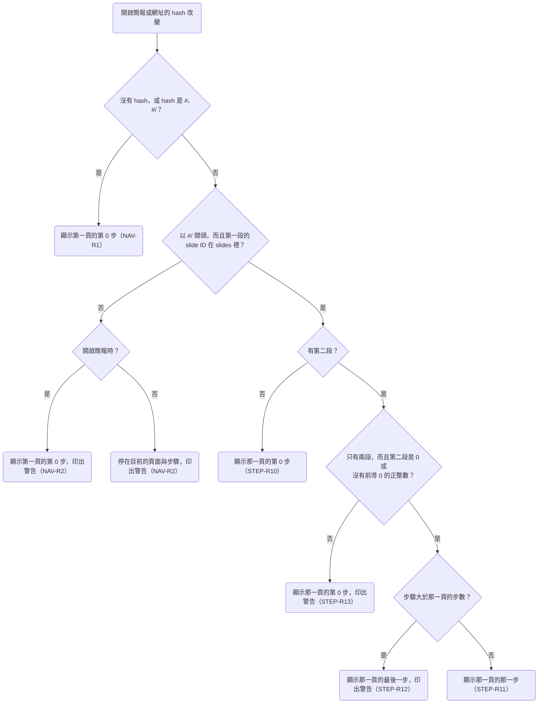

# 0003 頁內分步

## 目標

完成後，講者可以讓一頁的內容分成好幾步出現：頁面用 `<Step at={n}>` 標出每個項目在第幾步出現，需要其他變化的元件用 `useStep` 讀出目前的步驟。講者按 →、PageDown 這類按鍵或往左滑時，播放器先走完這一頁的步驟才換頁；往回換頁時，上一頁停在最後一步。網址的 hash 用第二段記錄目前的步驟，所以重新整理或開啟分享的連結時，畫面會停在同一頁的同一步。

## 範圍

- 要做：
  - 新增 `#diapo` 模組，提供 `Step` 元件與 `useStep` hook。
  - 播放器逐步前進與後退，走完一頁的步驟才換到下一頁，往回換頁時停在上一頁的最後一步。
  - 網址的 hash 用第二段記錄步驟，步驟大於步數時顯示最後一步，步驟的格式錯誤時顯示第 0 步。
  - 步驟跳號或不合法時，播放器在 console 印出警告或錯誤。
  - 新增 `steps.md`，修改 `navigation.md` 的開頭說明與 NAV-R1、NAV-R2、NAV-R3、NAV-R5、NAV-R6、NAV-R8、NAV-R14，在 `product.md` 的術語表新增「步驟」。
  - 修改 roadmap 裡「版面檢查指令」的檢查項目，理由寫在「決策」一節的「步驟跳號時怎麼處理」。
- 刻意不做的事：
  - 進場動畫。Roadmap 的「換頁與進場動畫」會加上進場動畫，在這個 plan 裡，`<Step>` 的內容到了 `at` 指定的步驟時直接出現。
  - 讓 `<Step>` 的內容消失，以及跳過剩下步驟的快捷鍵，理由寫在「決策」一節。
  - 在預覽總覽、匯出 PDF 與講者模式裡顯示指定的步驟。這個 plan 只讓這三項功能之後能指定頁面顯示哪一步（見「做法要點」），實際的顯示由各自的 plan 處理。

## Spec 變更

### steps.md

新增這份 spec，`prefix` 為 `STEP`，開頭的說明與設計理由寫在下方「開頭的說明」。

- 新增 STEP-R1 `<Step>` 從 `at` 指定的步驟開始顯示
- 新增 STEP-R2 `<Step>` 的內容出現之前保留位置
- 新增 STEP-R3 `<Step>` 不影響排版
- 新增 STEP-R4 用 `useStep` 讀出目前的步驟
- 新增 STEP-R5 一頁的步數是登記過的最大步驟
- 新增 STEP-R6 換步驟時頁面保持原狀
- 新增 STEP-R7 跳號的步驟照常播放
- 新增 STEP-R8 不合法的步驟
- 新增 STEP-R9 逐步換頁
- 新增 STEP-R10 跳頁時從第 0 步開始
- 新增 STEP-R11 網址的 Hash 記錄目前的步驟
- 新增 STEP-R12 Hash 的步驟大於步數
- 新增 STEP-R13 Hash 的步驟格式錯誤
- 新增 STEP-R14 頁面顯示途中步數改變時維持目前的步驟

#### 開頭的說明

頁內分步是講者播放簡報時，每按一次下一步，頁面就出現下一個項目的能力。每一頁從第 0 步開始，第 0 步是還沒按過下一步的畫面。頁面用 `<Step>` 標出在某一步出現的內容，需要其他變化的元件用 `useStep` 讀出目前的步驟；`Step` 與 `useStep` 都從 `#diapo` import，兩者共用同一套步驟編號。

```tsx
import { Step, useStep } from "#diapo";

export default function Agenda() {
  const step = useStep(3);
  return (
    <div className="flex flex-col gap-8 p-16 text-[48px]">
      <p>一開始就顯示</p>
      <Step at={1}>
        <p>第 1 步出現</p>
      </Step>
      <Step at={2}>
        <p>第 2 步出現</p>
      </Step>
      <p>{step < 3 ? "第 3 步之前顯示這一句" : "從第 3 步開始顯示這一句"}</p>
    </div>
  );
}
```

`<Step>` 的內容到了 `at` 指定的步驟時直接出現，在之後的每一步都繼續顯示。要讓內容消失或換成其他內容時，用 `useStep` 判斷目前的步驟。

> 設計理由：`<Step>` 只負責讓內容出現，替換內容交給 `useStep`。曾考慮讓 `<Step>` 加上 `until`，例如 `<Step at={2} until={4}>`，但第 4 步時內容是已經消失、還是第 4 步之後才消失，AI 容易寫錯，講者也要實際按到那一步才看得出來；頁面元件本身就能呼叫 `useStep`，替換內容只要寫一個條件判斷。完整討論見 [0003](../plans/archive/0003-steps.md)。

開啟簡報或網址的 hash 改變時，播放器依下圖的順序決定顯示哪一頁的哪一步，每個判斷的細節寫在對應的需求裡。畫面顯示的頁面與步驟和 hash 不一致時，播放器把 hash 改成畫面顯示的頁面與步驟。



#### STEP-R1 `<Step>` 從 `at` 指定的步驟開始顯示

`<Step at={n}>` 包住的內容在第 n 步之前看不見，從第 n 步開始顯示。同一頁的好幾個 `<Step>` 可以寫同一個 `at`，這些 `<Step>` 在同一步一起出現。

- 情境：逐步出現
  - 前提：`list` 這一頁有 `<Step at={1}>` 包住的「第一點」與 `<Step at={2}>` 包住的「第二點」，畫面顯示第 0 步
  - 動作：按 →
  - 結果：「第一點」出現，「第二點」仍然看不見
- 情境：後退一步時再次隱藏
  - 前提：`list` 這一頁有 `<Step at={1}>` 包住的「第一點」與 `<Step at={2}>` 包住的「第二點」，畫面顯示第 2 步
  - 動作：按 ←
  - 結果：「第二點」看不見，「第一點」仍然顯示
- 情境：同一步出現兩個項目
  - 前提：左欄的「第二點」與右欄的圖都包在 `<Step at={2}>` 裡，畫面顯示第 1 步
  - 動作：按 →
  - 結果：「第二點」與圖同時出現
- 情境：不照 DOM 順序出現
  - 前提：頁面上先寫 `<Step at={2}>` 包住的「後出現」，再寫 `<Step at={1}>` 包住的「先出現」，畫面顯示第 0 步
  - 動作：按 →
  - 結果：「先出現」出現，「後出現」仍然看不見

> 設計理由：每個 `<Step>` 都寫明 `at`，AI 讀檔就知道每一項在第幾步出現，編號重複或跳號也直接寫在檔案裡。曾考慮依 `<Step>` 在 DOM 裡的順序自動編號，但這樣不相鄰的項目沒辦法同時出現，用 `useStep` 的元件也要另外在 DOM 裡放標記，才能排進順序。也考慮過預設依 DOM 順序編號、需要時再寫 `at`，但 `at={2}` 表示和第 2 個沒寫 `at` 的 `<Step>` 在同一步出現，AI 在這個 `<Step>` 前面插入新的一項之後，寫了 `at={2}` 的項目會改成和新插入的那一項一起出現，build 不會失敗，畫面上也看不出錯誤。完整討論見 [0003](../plans/archive/0003-steps.md)。

#### STEP-R2 `<Step>` 的內容出現之前保留位置

在 `at` 指定的步驟之前，`<Step>` 的內容仍然會 render，也占著版面的位置，但看不見、點不到，也不能用 Tab 把焦點移到裡面的元素上。

- 情境：保留位置
  - 前提：`list` 這一頁的「第一點」包在 `<Step at={1}>` 裡，下方有一段沒有包進 `<Step>` 的「結語」，畫面顯示第 0 步
  - 動作：按 →
  - 結果：「第一點」出現，「結語」在畫布上的位置不變
- 情境：點不到隱藏的按鈕
  - 前提：`<Step at={1}>` 裡有一個按鈕，畫面顯示第 0 步
  - 動作：點按鈕所在的位置
  - 結果：按鈕沒有被按下
- 情境：Tab 移不到隱藏的元素
  - 前提：`<Step at={1}>` 裡有一個按鈕，畫面顯示第 0 步
  - 動作：按 Tab
  - 結果：焦點沒有移到這個按鈕上

> 設計理由：`<Step>` 的內容在出現之前保留位置，所以每一步的版面都和最後一步相同，新的項目出現時，其他內容不會移動。曾考慮到了 `at` 指定的步驟才把內容放進版面，但垂直置中的內容每多一項就要重新置中，已經出現的項目會跟著移動；用 `display: none` 隱藏時，ECharts、Mermaid 這類在初始化時量容器大小的 library 會量到 0×0。也考慮過用 `opacity: 0` 隱藏，但看不見的按鈕仍然點得到。隱藏的內容一樣會執行 effect，例如自動播放的影片會在 `<Step>` 出現之前就開始播放，這類元件要用 `useStep` 決定什麼時候開始。完整討論見 [0003](../plans/archive/0003-steps.md)。

#### STEP-R3 `<Step>` 不影響排版

元素包進 `<Step>` 之後，在 flex 或 grid 版面裡的位置與大小，和沒有包進 `<Step>` 時相同。不過包進 `<Step>` 的元素在 DOM 裡不再是原本父元素的直接子元素，所以父元素上依直接子元素套用樣式的 Tailwind class，例如 `space-y-*`、`divide-y-*`、`*:`，不會套用到這個元素，這個元素本身的 `first:`、`last:` 也改成依它在 `<Step>` 裡的位置判斷；項目之間的間距要用 flex 或 grid 的 `gap`。

`<Step>` 放在 `<svg>` 裡時，內容在每一步都看不見，播放器在 console 印出錯誤，寫出 slide ID。SVG 裡隨步驟出現的內容要用 `useStep`。

`<Step>` 包住表格的列或儲存格時，畫面照常顯示，但 `<Step>` 加上的那層元素不是表格元素，HTML 不允許它出現在 `<tbody>`、`<tr>` 這類元素裡，所以用 `make dev` 預覽時，React 會在 console 印出錯誤。表格裡隨步驟出現的內容要用 `useStep`。

- 情境：Grid 裡的項目
  - 前提：一個三欄的 grid 依序有三個項目，中間的項目包在 `<Step at={1}>` 裡
  - 動作：顯示第 1 步
  - 結果：三個項目的位置與大小，和三個項目都沒有包進 `<Step>` 時相同
- 情境：Flex 裡的項目
  - 前提：一個 `justify-between` 的 flex 版面依序有三個項目，中間的項目包在 `<Step at={1}>` 裡
  - 動作：顯示第 1 步
  - 結果：三個項目的位置與大小，和三個項目都沒有包進 `<Step>` 時相同
- 情境：放在 SVG 裡
  - 前提：`diagram` 這一頁的 `<svg>` 裡有一個 `<Step at={1}>`
  - 動作：開啟這份簡報，網址的 hash 是 `#/diagram`
  - 結果：console 的錯誤寫出 `diagram`

> 設計理由：`<Step>` 用一層 `display: contents` 的元素包住內容，所以任何內容都能包，包括沒有把 `style` 傳到 DOM 的元件。曾考慮不加這層元素，直接把隱藏用的樣式合併進唯一子元素的 `style`，這樣 `space-y-*` 照常套用，`<Step>` 放在 `<svg>` 裡也能顯示，但子元素是沒有把 `style` 傳到 DOM 的元件時，內容會從第 0 步就顯示，build 不會失敗，console 也沒有任何訊息。完整討論見 [0003](../plans/archive/0003-steps.md)。

#### STEP-R4 用 `useStep` 讀出目前的步驟

頁面或頁面裡的元件呼叫 `useStep(...steps)` 時，`useStep` 回傳這一頁目前的步驟，並把參數列出的每個步驟，登記成這個元件有變化的步驟。參數至少要有一個步驟。

- 情境：依步驟替換內容
  - 前提：`list` 這一頁呼叫 `useStep(3)`，第 3 步之前顯示「舊的結論」，從第 3 步開始顯示「新的結論」，畫面顯示第 2 步
  - 動作：按 →
  - 結果：畫面顯示「新的結論」，「舊的結論」消失
- 情境：後退時換回原本的內容
  - 前提：`list` 這一頁呼叫 `useStep(3)`，第 3 步之前顯示「舊的結論」，從第 3 步開始顯示「新的結論」，畫面顯示第 3 步
  - 動作：按 ←
  - 結果：畫面顯示「舊的結論」，「新的結論」消失

> 設計理由：`useStep` 列出元件有變化的每一步，所以播放器知道 1 到步數之間的每一步有沒有東西會變化，才找得出跳號（STEP-R7）。曾考慮只寫元件的最後一步，例如 `useStep(4)`，但這樣播放器分辨不出第 2、3 步是跳號，還是元件在這兩步確實有變化。可以重複使用的元件由頁面用 props 傳入步驟，例如 `<Chart steps={[2, 3, 4]} />`，元件裡再呼叫 `useStep(...steps)`，所以整頁共用同一套編號。完整討論見 [0003](../plans/archive/0003-steps.md)。

#### STEP-R5 一頁的步數是登記過的最大步驟

一頁的步數，是這一頁目前 render 出來的所有 `<Step>` 的 `at` 與所有 `useStep` 的參數之中最大的值。沒有登記任何步驟的頁面，步數是 0。

- 情境：`<Step>` 與 `useStep` 一起算
  - 前提：`list` 這一頁有 `<Step at={1}>` 與 `<Step at={2}>`，頁面上另一個元件呼叫 `useStep(3)`，下一頁是 `recap`，畫面顯示 `list` 的第 0 步
  - 動作：按 4 次 →
  - 結果：前 3 次按 → 之後，畫面停在 `list`，依序顯示第 1、2、3 步；第 4 次按 → 之後，畫面顯示 `recap`

> 設計理由：步數由播放器統計，所以頁面寫的步驟和步數不會對不上。曾考慮讓頁面用 `export const steps = 3` 宣告步數，讓播放器不必 render 頁面就知道步數，但宣告的步數少於頁面寫的步驟時，後面的項目不會出現；多於頁面寫的步驟時，講者按下一步，畫面不會改變。播放器需要一頁的步數時，都已經 render 過那一頁，例如從下一頁往回時（STEP-R9），播放器先把上一頁 render 成所有步驟都已經走完的畫面，再依 render 時登記的步驟，把 hash 改成最後一步的 hash。完整討論見 [0003](../plans/archive/0003-steps.md)。

#### STEP-R6 換步驟時頁面保持原狀

換到同一頁的其他步驟時，播放器不重新 mount 頁面，所以互動元件的狀態都保留。換到其他頁面時，播放器照 [navigation.md](navigation.md) 的 NAV-R13 重置頁面。

- 情境：換步驟後保留互動元件的狀態
  - 前提：`list` 這一頁有 2 步，還有一個一開始就顯示的計數器，初始值是 0；畫面顯示第 1 步，講者把計數器按到 3
  - 動作：按 →，再按 ←
  - 結果：按 → 之後與再按 ← 之後，計數器都顯示 3

#### STEP-R7 跳號的步驟照常播放

1 到步數之間沒有任何 `<Step>` 或 `useStep` 登記的步驟，叫做空的步驟。空的步驟仍然算一步，講者按到空的步驟時畫面不變。播放器顯示這一頁時，在 console 印出警告，寫出 slide ID 與空的步驟。

- 情境：跳號
  - 前提：`list` 這一頁只有 `<Step at={1}>` 與 `<Step at={3}>`，沒有其他元件登記步驟
  - 動作：開啟這份簡報，網址的 hash 是 `#/list/1`，再按 →
  - 結果：開啟時 console 的警告寫出 `list` 與 2；按 → 之後，網址的 hash 變成 `#/list/2`，畫面和第 1 步相同

> 設計理由：跳號時照寫的步驟播放，所以一頁的步驟一定是 0 到步數之間的每一個整數，hash 與上一步都不用為空的步驟另外訂規則；跳號在彩排時就看得出來，console 也會印出警告。曾考慮按下一步時跳過空的步驟，但這樣 hash 指向空的步驟時要顯示什麼、講者在空的步驟的下一步按上一步時要停在哪裡，都要另外訂規則。也考慮過由播放器重新編號、去掉空的步驟，但這樣 hash 裡的步驟和頁面寫的 `at` 對不上。完整討論見 [0003](../plans/archive/0003-steps.md)。

#### STEP-R8 不合法的步驟

`<Step>` 的 `at` 或 `useStep` 的參數不是正整數時，播放器在 console 印出錯誤，寫出 slide ID 與這個值。這個值不計入步數，`at` 不合法的 `<Step>` 從第 0 步就顯示。

- 情境：`at` 是 0
  - 前提：`hint` 這一頁只有一個 `<Step at={0}>`，裡面是「提示」，下一頁是 `recap`
  - 動作：開啟這份簡報，網址的 hash 是 `#/hint`，再按 →
  - 結果：開啟時畫面顯示「提示」，console 的錯誤寫出 `hint` 與 0；按 → 之後畫面顯示 `recap`
- 情境：`at` 不是整數
  - 前提：`hint` 這一頁只有一個 `<Step at={1.5}>`，裡面是「提示」
  - 動作：開啟這份簡報，網址的 hash 是 `#/hint`
  - 結果：畫面顯示「提示」，console 的錯誤寫出 `hint` 與 1.5
- 情境：`useStep` 的參數不合法
  - 前提：`hint` 這一頁有 `<Step at={1}>`，另一個元件呼叫 `useStep(-1)`，下一頁是 `recap`
  - 動作：開啟這份簡報，網址的 hash 是 `#/hint`，再按兩次 →
  - 結果：開啟時 console 的錯誤寫出 `hint` 與 -1；第一次按 → 之後畫面顯示 `hint` 的第 1 步，第二次按 → 之後畫面顯示 `recap`

> 設計理由：TypeScript 的型別沒辦法限制只能寫正整數，所以播放器在執行時檢查。`at` 不合法的 `<Step>` 照常顯示內容，講者沒發現錯誤就上台時，觀眾看到的只是這段內容從第 0 步就出現。曾考慮不顯示這段內容，或丟出 exception 讓這一頁 render 失敗，但這樣觀眾會看不到那一項，或看到整頁空白。完整討論見 [0003](../plans/archive/0003-steps.md)。

#### STEP-R9 逐步換頁

講者按下一步時，畫面還沒到這一頁的最後一步，播放器就前進一步；已經在最後一步時，播放器換到下一頁的第 0 步。講者按上一步時，畫面不在第 0 步，播放器就後退一步；在第 0 步時，播放器換到上一頁的最後一步。在最後一頁的最後一步按下一步，或在第一頁的第 0 步按上一步時，畫面不動。下一步與上一步的按鍵寫在 [navigation.md](navigation.md) 的 NAV-R3，觸控滑動寫在 NAV-R8。

- 情境：前進一步
  - 前提：`list` 這一頁有 3 步，畫面顯示 `list` 的第 0 步
  - 動作：按 →
  - 結果：畫面顯示 `list` 的第 1 步
- 情境：走完步驟後換頁
  - 前提：`list` 這一頁有 3 步，下一頁是 `recap`，畫面顯示 `list` 的第 3 步
  - 動作：按 →
  - 結果：畫面顯示 `recap` 的第 0 步
- 情境：後退一步
  - 前提：`list` 這一頁有 3 步，畫面顯示 `list` 的第 2 步
  - 動作：按 ←
  - 結果：畫面顯示 `list` 的第 1 步
- 情境：往回時停在上一頁的最後一步
  - 前提：`list` 這一頁有 3 步，下一頁是 `recap`，畫面顯示 `recap` 的第 0 步
  - 動作：按 ←
  - 結果：畫面直接顯示 `list` 的第 3 步，中間沒有閃過 `list` 第 0 步的畫面，網址的 hash 變成 `#/list/3`
- 情境：用滑動前進一步
  - 前提：`list` 這一頁有 3 步，畫面顯示 `list` 的第 0 步
  - 動作：手指往左滑 200 px
  - 結果：畫面顯示 `list` 的第 1 步
- 情境：在最後一頁的最後一步按下一步
  - 前提：最後一頁 `finale` 有 2 步，畫面顯示 `finale` 的第 2 步
  - 動作：按 →
  - 結果：畫面仍然顯示 `finale` 的第 2 步
- 情境：在第一頁的第 0 步按上一步
  - 前提：第一頁 `intro` 有 2 步，畫面顯示 `intro` 的第 0 步
  - 動作：按 ←
  - 結果：畫面仍然顯示 `intro` 的第 0 步

> 設計理由：播放器沒有跳過剩下的步驟、直接換頁的快捷鍵。翻頁器的每個按鈕都送出固定的按鍵，沒有一個按鈕會送出 Shift 加方向鍵；而 Shift+Space 已經是上一步（NAV-R3），如果 Shift 加方向鍵代表跳過剩下的步驟，Shift 在兩組快捷鍵裡的意思就不一致。講者要跳過剩下的步驟時，可以輸入頁碼跳頁，跳頁也會新增瀏覽紀錄，跳錯了能用瀏覽器的上一頁回去。完整討論見 [0003](../plans/archive/0003-steps.md)。

#### STEP-R10 跳頁時從第 0 步開始

講者用 Home、End 或輸入頁碼跳頁，或網址的 hash 改成沒有第二段的 hash 時，畫面顯示那一頁的第 0 步。

- 情境：用 End 跳頁
  - 前提：最後一頁 `finale` 有 2 步，畫面顯示 `intro`
  - 動作：按 End
  - 結果：畫面顯示 `finale` 的第 0 步
- 情境：輸入頁碼跳頁
  - 前提：第 3 頁是 `list`，`list` 有 3 步，畫面顯示 `intro`
  - 動作：輸入 3，再按 Enter
  - 結果：畫面顯示 `list` 的第 0 步
- 情境：點沒有寫步驟的連結
  - 前提：`list` 這一頁有 3 步，畫面顯示 `recap`，`recap` 有一個 `href` 是 `#/list` 的連結
  - 動作：點這個連結
  - 結果：畫面顯示 `list` 的第 0 步

#### STEP-R11 網址的 Hash 記錄目前的步驟

頁面在第 1 步以後時，播放器把步驟寫進網址的 hash 的第二段，格式是 `#/<slide-id>/<步驟>`，步驟寫成沒有前導 0 的正整數；頁面在第 0 步時，hash 是 `#/<slide-id>`。網址的 hash 改成 `#/<slide-id>/<步驟>` 時，畫面換到那一頁的那一步。Hash 的步驟是 0 時，例如 `#/list/0`，播放器顯示那一頁的第 0 步，並把 hash 改成 `#/<slide-id>`。

- 情境：前進一步後更新 hash
  - 前提：畫面顯示 `list` 的第 0 步，網址的 hash 是 `#/list`
  - 動作：按 →
  - 結果：網址的 hash 變成 `#/list/1`
- 情境：回到第 0 步
  - 前提：畫面顯示 `list` 的第 1 步
  - 動作：按 ←
  - 結果：網址的 hash 變成 `#/list`
- 情境：開啟指定的步驟
  - 前提：`list` 這一頁有 3 步
  - 動作：開啟這份簡報，網址的 hash 是 `#/list/2`
  - 結果：畫面顯示 `list` 的第 2 步
- 情境：重新整理
  - 前提：畫面顯示 `list` 的第 2 步
  - 動作：重新整理網頁
  - 結果：畫面顯示 `list` 的第 2 步
- 情境：開啟第 0 步的 hash
  - 前提：`list` 這一頁有 3 步
  - 動作：開啟這份簡報，網址的 hash 是 `#/list/0`
  - 結果：畫面顯示 `list` 的第 0 步，網址的 hash 變成 `#/list`
- 情境：點寫了步驟的連結
  - 前提：`list` 這一頁有 3 步，畫面顯示 `recap`，`recap` 有一個 `href` 是 `#/list/2` 的連結
  - 動作：點這個連結
  - 結果：畫面顯示 `list` 的第 2 步
- 情境：播放途中修改 hash 的步驟
  - 前提：`list` 這一頁有 3 步，畫面顯示 `list` 的第 1 步
  - 動作：把網址的 hash 改成 `#/list/3`
  - 結果：畫面顯示 `list` 的第 3 步

> 設計理由：第 0 步的 hash 不寫第二段，所以 `#/<slide-id>` 一直指向一頁的開頭，頁面加上步驟之後，既有的連結仍然指向同一個畫面，AI 在頁面裡寫連結時也不必先查那一頁有沒有步驟。曾考慮有步驟的頁面一律寫第二段，例如 `#/intro/0`，但這樣一頁加上步驟之後，這一頁開頭的網址就跟著改變。完整討論見 [0003](../plans/archive/0003-steps.md)。

#### STEP-R12 Hash 的步驟大於步數

網址的 hash 的步驟大於那一頁的步數時，畫面顯示那一頁的最後一步，播放器把 hash 改成最後一步的 hash，並在 console 印出警告，寫出原本的 hash。開啟簡報時與播放途中都這樣處理。步驟的格式錯誤時，播放器的行為寫在 STEP-R13。

- 情境：開啟時步驟大於步數
  - 前提：`list` 這一頁有 3 步
  - 動作：開啟這份簡報，網址的 hash 是 `#/list/5`
  - 結果：畫面顯示 `list` 的第 3 步，網址的 hash 變成 `#/list/3`，console 的警告寫出 `#/list/5`
- 情境：播放途中步驟大於步數
  - 前提：`list` 這一頁有 3 步，畫面顯示 `intro`
  - 動作：把網址的 hash 改成 `#/list/9`
  - 結果：畫面顯示 `list` 的第 3 步，網址的 hash 變成 `#/list/3`
- 情境：沒有步驟的頁面
  - 前提：`agenda` 這一頁沒有步驟
  - 動作：開啟這份簡報，網址的 hash 是 `#/agenda/2`
  - 結果：畫面顯示 `agenda`，網址的 hash 變成 `#/agenda`

> 設計理由：Hash 的步驟大於步數，最常見的原因是那一頁改版後刪掉了幾項，這時連結指向的頁面仍然存在，所以播放器顯示這一頁的最後一步，這個畫面最接近連結原本指向的畫面。曾考慮照 NAV-R2 視為指向不存在的頁面，但開啟簡報時會顯示第一頁，和連結原本指向的畫面差得更遠。完整討論見 [0003](../plans/archive/0003-steps.md)。

#### STEP-R13 Hash 的步驟格式錯誤

網址的 hash 的第一段是存在的 slide ID，但 hash 既不是 `#/<slide-id>`，也不是 `#/<slide-id>/<步驟>`（步驟是 0 或沒有前導 0 的正整數）時，畫面顯示那一頁的第 0 步，播放器把 hash 改成 `#/<slide-id>`，並在 console 印出警告，寫出原本的 hash。開啟簡報時與播放途中都這樣處理。

- 情境：步驟不是數字
  - 前提：`list` 這一頁有 3 步
  - 動作：開啟這份簡報，網址的 hash 是 `#/list/abc`
  - 結果：畫面顯示 `list` 的第 0 步，網址的 hash 變成 `#/list`，console 的警告寫出 `#/list/abc`
- 情境：步驟有前導 0
  - 前提：`list` 這一頁有 3 步
  - 動作：開啟這份簡報，網址的 hash 是 `#/list/01`
  - 結果：畫面顯示 `list` 的第 0 步，網址的 hash 變成 `#/list`
- 情境：Hash 有第三段
  - 前提：`list` 這一頁有 3 步
  - 動作：開啟這份簡報，網址的 hash 是 `#/list/1/2`
  - 結果：畫面顯示 `list` 的第 0 步，網址的 hash 變成 `#/list`
- 情境：播放途中步驟的格式錯誤
  - 前提：`list` 這一頁有 3 步，畫面顯示 `intro`
  - 動作：把網址的 hash 改成 `#/list/abc`
  - 結果：畫面顯示 `list` 的第 0 步，網址的 hash 變成 `#/list`

> 設計理由：Hash 的第一段是存在的 slide ID 時，連結指向哪一頁是確定的，只是看不出指向哪一步，所以播放器顯示那一頁的開頭，也就是第 0 步。曾考慮照 NAV-R2 視為指向不存在的頁面，但這樣開啟簡報時會顯示第一頁，播放途中會停在目前的頁面，兩種情況都不會顯示連結指向的那一頁。完整討論見 [0003](../plans/archive/0003-steps.md)。

#### STEP-R14 頁面顯示途中步數改變時維持目前的步驟

頁面顯示途中，元件因為互動而 mount 或 unmount，使步數改變時，播放器維持目前的步驟與 hash，等講者按下一步或上一步時，才依當時的步數決定怎麼換頁（STEP-R9）。播放器只在開啟簡報或換到其他頁面時，對畫面顯示的頁面執行 STEP-R7 與 STEP-R8 的檢查。

- 情境：顯示途中步數變少
  - 前提：`toggle` 這一頁有 `<Step at={1}>`、`<Step at={2}>`，以及一個按下後移除 `<Step at={2}>` 的按鈕，下一頁是 `recap`，畫面顯示 `toggle` 的第 2 步
  - 動作：按這個按鈕，再按 →
  - 結果：按下按鈕之後，網址的 hash 仍然是 `#/toggle/2`；按 → 之後，畫面顯示 `recap`

> 設計理由：步數改變時，播放器不主動修正目前的步驟。曾考慮步數一改變，就把大於步數的目前步驟改成最後一步並改寫 hash，但這樣 hash 會在講者沒按任何鍵時改變；而且依 STEP-R4，元件在大於參數最大值的步驟畫出的內容，和在最大值那一步相同，所以改成最後一步之後，畫面和改之前一樣。完整討論見 [0003](../plans/archive/0003-steps.md)。

### navigation.md

- 修改開頭的說明：「逐頁換頁」改成「逐步換頁」，定義改寫成下方「開頭的說明」。
- 修改 NAV-R1：Hash 加上記錄步驟的第二段，新的內容寫在下方。情境不變。
- 修改 NAV-R2：只用 hash 的第一段判斷指向的頁面存不存在；第一段是存在的 slide ID、但第二段以後有問題時，改照 STEP-R12 與 STEP-R13 處理。移除「開啟時 hash 多出一段」這個情境，新增一個情境，新的內容寫在下方。
- 修改 NAV-R3：標題改成「用按鍵逐步換頁」，按鍵的動作改成下一步與上一步，新的內容寫在下方。情境裡的「按下一頁的任何一個按鍵」「按上一頁的任何一個按鍵」改成「按下一步的任何一個按鍵」「按上一步的任何一個按鍵」；情境名稱「在最後一頁按下一頁」「在第一頁按上一頁」改成「在最後一頁按下一步」「在第一頁按上一步」。設計理由不變。
- 修改 NAV-R5：第 2 條的「不換到上一頁」改成「不執行上一步」；「停止輸入 3 秒後按 Enter」情境的結果，「因為這時 Enter 是換到下一頁的按鍵」改成「因為這時 Enter 是下一步的按鍵」。
- 修改 NAV-R6：逐步換頁與播放器修正 hash 時改寫目前的瀏覽紀錄；兩個情境改名，並新增一個情境，新的內容寫在下方。設計理由不變。
- 修改 NAV-R8：第一句改成「手指在畫面上往左滑時是下一步，往右滑時是上一步，規則與 NAV-R3 相同。」情境與設計理由不變。
- 修改 NAV-R14：設計理由裡的「逐頁換頁的按鍵」改成「逐步換頁的按鍵」。

#### 開頭的說明

第三段改成下面這段，流程圖不變：

本 spec 把前進或後退一步叫做逐步換頁，走完一頁的步驟之後換到相鄰的頁面也算逐步換頁，規則寫在 [steps.md](steps.md) 的 STEP-R9；頁面沒有步驟時，逐步換頁就是換到上一頁或下一頁。用 Home、End、輸入頁碼，或改變網址的 hash 換到其他頁面或步驟，叫做跳頁。播放器的快捷鍵是 NAV-R3、NAV-R4、NAV-R5、NAV-R9、NAV-R10 列出的按鍵，包括輸入頁碼用的數字鍵。講者按下按鍵時，播放器依下圖的順序決定要做什麼，每個判斷的細節寫在對應的需求裡。

#### NAV-R1 網址的 Hash 記錄目前的頁面

播放器把目前頁面的 slide ID 寫進網址的 hash，格式是 `#/<slide-id>`；頁面在第 1 步以後時，hash 另外用第二段記錄步驟，規則寫在 [steps.md](steps.md) 的 STEP-R11。網址的 hash 改變時，畫面換到 hash 指向的頁面。網址沒有 hash，或 hash 是 `#`、`#/` 時，播放器顯示第一頁（PLAY-R1），並把 hash 改成第一頁的 slide ID。Hash 指向不存在的頁面時，播放器的行為寫在 NAV-R2。

#### NAV-R2 網址的 Hash 指向不存在的頁面

Hash 不是以 `#/` 開頭，或 hash 的第一段不在 `deck.json` 的 `slides` 裡時，播放器把這個 hash 視為指向不存在的頁面，hash 的第一段是 `#/` 之後、下一個 `/` 之前的部分。開啟簡報時遇到這種 hash，播放器顯示第一頁，並把 hash 改成第一頁的 slide ID；播放途中 hash 改成這種 hash 時，播放器停在目前的頁面與步驟，並把 hash 改回目前的頁面與步驟。兩種情況下，播放器都會在瀏覽器的 console 印出警告，寫出這個 hash。第一段是存在的 slide ID、但第二段以後有問題時，播放器的行為寫在 [steps.md](steps.md) 的 STEP-R12 與 STEP-R13。

「開啟時 hash 指向不存在的頁面」與「播放途中 hash 指向不存在的頁面」兩個情境不變。移除「開啟時 hash 多出一段」，因為 `#/agenda/2` 的第一段是存在的 slide ID，播放器改照 STEP-R12 顯示 `agenda`。新增以下情境：

- 情境：開啟時不存在的頁面帶著步驟
  - 前提：`deck.json` 的第一頁是 `intro`，沒有 `old-name` 這一頁
  - 動作：開啟這份簡報，網址的 hash 是 `#/old-name/2`
  - 結果：畫面顯示 `intro`，網址的 hash 變成 `#/intro`，console 的警告寫出 `#/old-name/2`

#### NAV-R3 用按鍵逐步換頁

按下表的按鍵時，播放器前進或後退一步，規則寫在 [steps.md](steps.md) 的 STEP-R9；頁面沒有步驟時，就是換到 `deck.json` 順序裡的下一頁或上一頁。在最後一頁的最後一步按下一步的按鍵，或在第一頁的第 0 步按上一步的按鍵時，畫面不動。

| 動作 | 按鍵 |
| --- | --- |
| 下一步 | →、↓、PageDown、Space、Enter |
| 上一步 | ←、↑、PageUp、Shift+Space、Backspace |

#### NAV-R6 瀏覽器的上一頁回到跳頁之前的頁面

跳頁時，播放器在瀏覽器新增一筆瀏覽紀錄；逐步換頁，以及播放器修正網址的 hash 時（NAV-R1、NAV-R2、STEP-R11、STEP-R12、STEP-R13），播放器改寫目前的瀏覽紀錄。所以按瀏覽器的上一頁時，畫面回到最近一次跳頁之前的頁面與步驟；沒有跳頁過時，瀏覽器回到開啟簡報之前的網頁。

「逐頁換頁不新增瀏覽紀錄」改名為「逐步換頁不新增瀏覽紀錄」，「跳頁之後又逐頁換頁」改名為「跳頁之後又逐步換頁」，兩個情境的內容不變。新增以下情境：

- 情境：回到點連結之前的步驟
  - 前提：畫面顯示 `list` 的第 2 步，這一頁有一個 `href` 是 `#/recap` 的連結
  - 動作：點這個連結，再按瀏覽器的上一頁
  - 結果：畫面顯示 `list` 的第 2 步

### product.md

術語表新增一列：

| 術語 | 定義 |
| --- | --- |
| 步驟 | 頁內分步的單位。每一頁從第 0 步開始，第 0 步是還沒按過下一步的畫面；講者每按一次下一步就前進一步，走完一頁的步驟之後才換到下一頁。一頁有幾步，由頁面上的 `<Step>` 與 `useStep` 決定，規則寫在 [steps.md](steps.md)。 |

## 決策

### 頁面怎麼寫步驟

- 選項：
  1. 只有 `<Step>` 元件。
  2. 只有 hook，每一步顯示什麼由頁面自己判斷。
  3. `<Step>` 處理出現，`useStep` 處理其他變化，兩者共用同一套編號。
- 取捨：選項 1 讓 roadmap 的「ECharts 圖表」這類跟著步驟變化的內容沒有寫法，之後寫這些功能的 plan 時要回頭修改 API。選項 2 在最常見的逐項出現時，每一項都要寫一個條件判斷。
- 結論：選項 3。
- 併入：無

### `<Step>` 依什麼順序出現

- 選項：
  1. 依 `<Step>` 在 DOM 裡的順序。
  2. 每個 `<Step>` 都用 `at` 寫明第幾步。
  3. 預設依 DOM 順序，需要時再寫 `at`。
- 取捨：選項 1 讓不相鄰的項目沒辦法同時出現。選項 3 的 `at={n}` 表示和第 n 個沒寫 `at` 的 `<Step>` 在同一步出現，AI 在這個 `<Step>` 前面插入一項之後，寫了 `at={n}` 的項目會改成和新插入的那一項一起出現，build 也不會失敗。
- 結論：選項 2，`useStep` 也用同一套編號。
- 併入：steps.md#STEP-R1

### 播放器怎麼知道一頁有幾步

- 選項：
  1. 頁面用 `export const steps = 3` 宣告。
  2. 播放器在 render 時，統計 `<Step>` 與 `useStep` 登記的步驟。
- 取捨：選項 1 宣告的步數少於頁面寫的步驟時，後面的項目不會出現；多於頁面寫的步驟時，講者按下一步，畫面不會改變。選項 2 讓播放器從下一頁往回時，要先 render 上一頁才知道最後一步是第幾步，處理方式寫在「做法要點」。
- 結論：選項 2。
- 併入：steps.md#STEP-R5

### `<Step>` 的內容出現之前怎麼隱藏

- 選項：
  1. 保留位置但看不見（`visibility: hidden`）。
  2. 不放進版面（不 mount，或 `display: none`）。
  3. 透明但仍然存在（`opacity: 0`）。
- 取捨：選項 1 的隱藏內容一樣會執行 effect，例如自動播放的影片會在 `<Step>` 出現之前就開始播放。選項 2 讓垂直置中的版面每一步都移動，用 `display: none` 時，需要量容器大小的 library 也會量到 0×0。選項 3 讓看不見的按鈕仍然點得到。
- 結論：選項 1。影片什麼時候開始播放，由「圖片與影片」的 plan 用 `useStep` 處理。
- 併入：steps.md#STEP-R2

### `<Step>` 要不要支援消失

- 選項：
  1. 只會出現，替換內容用 `useStep`。
  2. 加上 `until`。
- 取捨：選項 2 在 `until` 那一步，內容是否已經消失，AI 容易弄錯。
- 結論：選項 1。之後需要時再加 `until`，既有的簡報不受影響。
- 併入：steps.md#頁內分步

### `useStep` 怎麼登記步驟

- 選項：
  1. 只寫最後一步，例如 `useStep(4)`。
  2. 列出每一個有變化的步驟，例如 `useStep(2, 3, 4)`。
- 取捨：選項 1 讓播放器分辨不出中間的步驟是跳號，還是元件在那一步有變化。
- 結論：選項 2。
- 併入：steps.md#STEP-R4

### 步驟跳號時怎麼處理

- 選項：
  1. 照寫的步驟播放，console 印出警告。
  2. 按下一步時跳過空的步驟。
  3. 播放器重新編號，去掉空的步驟。
- 取捨：選項 2 要另外規定 hash 指向空的步驟時，以及講者在空的步驟的下一步按上一步時的行為。選項 3 讓 hash 裡的步驟和頁面寫的 `at` 對不上。
- 結論：選項 1。Roadmap 的「版面檢查指令」原本要檢查頁面宣告的步數，現在頁面不宣告步數，所以這一項改成回報播放器在 console 印出的警告與錯誤，跳號與不合法的步驟都在這一項回報。
- 併入：steps.md#STEP-R7

### 不合法的步驟怎麼處理

- 選項：
  1. 照常顯示，不計入步數，console 印出錯誤。
  2. 不顯示，console 印出錯誤。
  3. 丟出 exception，這一頁 render 失敗。
- 結論：選項 1。
- 併入：steps.md#STEP-R8

### 進入頁面時停在第幾步

- 選項：
  1. 往回換頁時停在上一頁的最後一步，其他情況從第 0 步開始。
  2. 一律從第 0 步開始。
- 取捨：選項 2 讓講者往回換頁之後，要再按一次那一頁的所有步驟，才看得到那一頁的結論。
- 結論：選項 1，和 PowerPoint、Keynote、reveal.js 相同。
- 併入：無

### 要不要有跳過剩下步驟的快捷鍵

- 選項：
  1. 不提供。
  2. 提供，例如按 Shift+→ 直接換到下一頁。
- 取捨：翻頁器沒有任何按鈕會送出選項 2 的快捷鍵；Shift 在 Shift+Space 與 Shift 加方向鍵裡的意思也不一致。
- 結論：選項 1，講者用輸入頁碼跳頁。
- 併入：steps.md#STEP-R9

### 第 0 步的 Hash 怎麼寫

- 選項：
  1. 不寫第二段，例如 `#/intro`。
  2. 有步驟的頁面一律寫第二段，例如 `#/intro/0`。
- 取捨：選項 2 讓一頁加上步驟之後，這一頁開頭的網址跟著改變。
- 結論：選項 1。
- 併入：steps.md#STEP-R11

### Hash 的步驟大於步數或格式錯誤時怎麼處理

- 選項：
  1. 步驟大於步數時顯示最後一步，格式錯誤時顯示第 0 步。
  2. 步驟大於步數時顯示最後一步，格式錯誤時照 NAV-R2 處理。
  3. 都照 NAV-R2 處理。
- 取捨：選項 2 與選項 3 讓 slide ID 正確、只有步驟寫錯的連結，開啟簡報時顯示第一頁，播放途中停在目前的頁面。選項 3 也讓講者改版時刪掉一頁的幾項之後，舊連結開啟時顯示第一頁。
- 結論：選項 1。Hash 的第一段決定顯示哪一頁，第二段決定顯示哪一步。
- 併入：steps.md#STEP-R12、steps.md#STEP-R13

### 頁面從哪裡 Import `Step` 與 `useStep`

- 選項：
  1. `#diapo`，用 `package.json` 的 `imports` 設定。
  2. `diapo`，用 Vite 的 `resolve.alias` 加上 tsconfig 的 `paths` 設定。
  3. 相對路徑。
- 取捨：選項 2 的 `diapo` 看起來像 npm 套件，AI 可能會去 npm 找這個套件。選項 3 在 `decks/` 與 `tests/fixtures/decks/` 底下要寫不同的路徑，因為兩個目錄的深度不同。
- 結論：選項 1，`Step` 與 `useStep` 放在新增的 `src/framework/`。
- 併入：architecture.md#程式碼

### `<Step>` 怎麼隱藏內容又不影響排版

- 選項：
  1. 外層包一個 `display: contents` 的 `<span>`，在 `<span>` 上設 `visibility: hidden`，由子元素繼承這個值。
  2. 不加外層元素，用 `cloneElement` 把 `visibility: hidden` 合併進唯一子元素的 `style`。
- 取捨：選項 1 讓包進 `<Step>` 的元素不再是父元素的直接子元素，`space-y-*`、`divide-y-*` 這類依直接子元素套用樣式的 class 不會套用到這個元素；`<Step>` 放在 `<svg>` 裡時，`<span>` 不是 SVG 元素，`<Step>` 的內容在每一步都看不見；`<Step>` 包住表格的列或儲存格時，`<span>` 不能出現在 `<tbody>`、`<tr>` 裡，React 在開發時會在 console 印出錯誤。選項 2 只能包一個子元素，而且子元素是沒有把 `style` 傳到 DOM 的元件時，內容會從第 0 步就顯示，build 不會失敗，console 也沒有任何訊息。
- 結論：選項 1。選項 1 的限制在開發時就看得出來，`<Step>` 放在 `<svg>` 裡時，播放器也會在 console 印出錯誤。這個決策在實作時才定案。
- 併入：steps.md#STEP-R3

### 校正步驟前的那次 Render 給頁面哪一步

- 選項：
  1. 直接給要求的步驟：往回換頁時是 `Infinity`，hash 指定時是 hash 寫的數字。
  2. 每個 `useStep` 回傳要求的步驟與自己參數裡的最大值兩者中較小的那個。
- 取捨：選項 1 讓頁面寫了 `Array.from({ length: step })` 這類程式碼時丟出 `RangeError`，而播放器沒有 error boundary，所以講者在台上按 ← 時，整個畫面會變成空白。選項 2 讓開啟帶步驟的 hash 時一定 render 兩次，兩次都在瀏覽器畫出畫面之前。
- 結論：選項 2。這個決策在實作時才定案。
- 併入：architecture.md#播放器的狀態

### 頁面顯示途中步數改變時怎麼處理

- 選項：
  1. 播放器維持目前的步驟，講者按下一步或上一步時才讀當時的步數。
  2. 播放器在登記的步驟改變時馬上重新計算步數，目前的步驟大於步數時改成最後一步，並改寫 hash。
- 取捨：選項 2 讓 hash 在講者沒按任何鍵時改變，而且依 STEP-R4，元件在大於參數最大值的步驟畫出的內容和在最大值那一步相同，所以播放器把步驟改成最後一步之後，畫面和改之前一樣。
- 結論：選項 1。這個決策在實作時才定案。
- 併入：steps.md#STEP-R14

### 需求寫在哪一份 Spec

- 選項：
  1. 新增 `steps.md`。
  2. 寫法放進 `framework.md`，播放的行為放進 `navigation.md`。
- 取捨：選項 2 讓步數的規則分散在兩份 spec，AI 寫有分步的頁面時要讀兩份 spec。
- 結論：選項 1，`navigation.md` 只修改既有需求，並連到 `steps.md`。
- 併入：無

## 做法要點

- 新增 `src/framework/`，放頁面用的 `Step` 與 `useStep`；`package.json` 新增 `imports` 欄位，把 `#diapo` 對應到 `src/framework/index.ts`。`architecture.md` 的模組劃分與「程式碼」一節加上這個目錄。
- 播放器用 React context 把目前的步驟交給 `Step` 與 `useStep`，`Step` 與 `useStep` 也透過同一個 context 向播放器登記步驟。之後的預覽總覽、匯出 PDF 與講者模式 render 頁面時，各自提供這個 context，指定顯示最後一步或某一步，不必修改頁面。這一點寫進 `architecture.md` 的「播放器的狀態」。
- 播放器要等頁面 render 之後才知道步數，所以播放器在瀏覽器繪製畫面之前（layout effect）取得步數，再換到最後一步或修正 hash，畫面上不會先出現錯誤的步驟。
- NAV-R2 的行為有一處改變：第一段是存在的 slide ID、但帶著第二段的 hash，例如 `#/agenda/2`，原本視為指向不存在的頁面，改成顯示那一頁（STEP-R12、STEP-R13）。既有簡報的頁面都沒有步驟，其他行為不變。

## 驗證方式

| 需求 | 驗證方式 |
| --- | --- |
| STEP-R1 情境：逐步出現 | e2e |
| STEP-R1 情境：後退一步時再次隱藏 | e2e |
| STEP-R1 情境：同一步出現兩個項目 | e2e |
| STEP-R1 情境：不照 DOM 順序出現 | e2e |
| STEP-R2 情境：保留位置 | e2e |
| STEP-R2 情境：點不到隱藏的按鈕 | e2e |
| STEP-R2 情境：Tab 移不到隱藏的元素 | e2e |
| STEP-R3 情境：Grid 裡的項目 | e2e |
| STEP-R3 情境：Flex 裡的項目 | e2e |
| STEP-R3 情境：放在 SVG 裡 | e2e |
| STEP-R4 情境：依步驟替換內容 | e2e |
| STEP-R4 情境：後退時換回原本的內容 | e2e |
| STEP-R5 情境：`<Step>` 與 `useStep` 一起算 | e2e |
| STEP-R6 情境：換步驟後保留互動元件的狀態 | e2e |
| STEP-R7 情境：跳號 | e2e |
| STEP-R8 情境：`at` 是 0 | e2e |
| STEP-R8 情境：`at` 不是整數 | e2e |
| STEP-R8 情境：`useStep` 的參數不合法 | e2e |
| STEP-R9 情境：前進一步 | e2e |
| STEP-R9 情境：走完步驟後換頁 | e2e |
| STEP-R9 情境：後退一步 | e2e |
| STEP-R9 情境：往回時停在上一頁的最後一步 | e2e、手動 |
| STEP-R9 情境：用滑動前進一步 | e2e |
| STEP-R9 情境：在最後一頁的最後一步按下一步 | e2e |
| STEP-R9 情境：在第一頁的第 0 步按上一步 | e2e |
| STEP-R10 情境：用 End 跳頁 | e2e |
| STEP-R10 情境：輸入頁碼跳頁 | e2e |
| STEP-R10 情境：點沒有寫步驟的連結 | e2e |
| STEP-R11 情境：前進一步後更新 hash | e2e |
| STEP-R11 情境：回到第 0 步 | e2e |
| STEP-R11 情境：開啟指定的步驟 | e2e |
| STEP-R11 情境：重新整理 | e2e |
| STEP-R11 情境：開啟第 0 步的 hash | e2e |
| STEP-R11 情境：點寫了步驟的連結 | e2e |
| STEP-R11 情境：播放途中修改 hash 的步驟 | e2e |
| STEP-R12 情境：開啟時步驟大於步數 | e2e |
| STEP-R12 情境：播放途中步驟大於步數 | e2e |
| STEP-R12 情境：沒有步驟的頁面 | e2e |
| STEP-R13 情境：步驟不是數字 | e2e |
| STEP-R13 情境：步驟有前導 0 | unit |
| STEP-R13 情境：Hash 有第三段 | unit |
| STEP-R13 情境：播放途中步驟的格式錯誤 | e2e |
| STEP-R14 情境：顯示途中步數變少 | e2e |
| NAV-R2 情境：開啟時不存在的頁面帶著步驟 | unit |
| NAV-R3 情境：換到下一頁 | e2e |
| NAV-R3 情境：換到上一頁 | e2e |
| NAV-R3 情境：在最後一頁按下一步 | e2e |
| NAV-R3 情境：在第一頁按上一步 | e2e |
| NAV-R5 情境：停止輸入 3 秒後按 Enter | e2e |
| NAV-R6 情境：逐步換頁不新增瀏覽紀錄 | e2e |
| NAV-R6 情境：跳頁之後又逐步換頁 | e2e |
| NAV-R6 情境：回到點連結之前的步驟 | e2e |

## 還沒定案的問題

無
