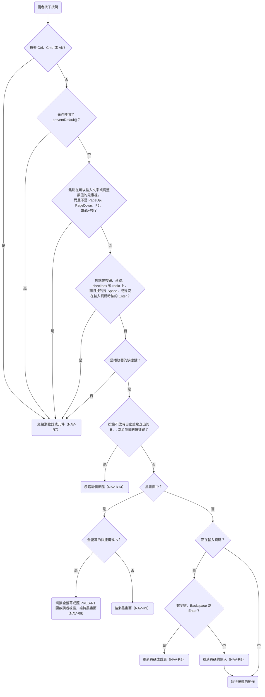
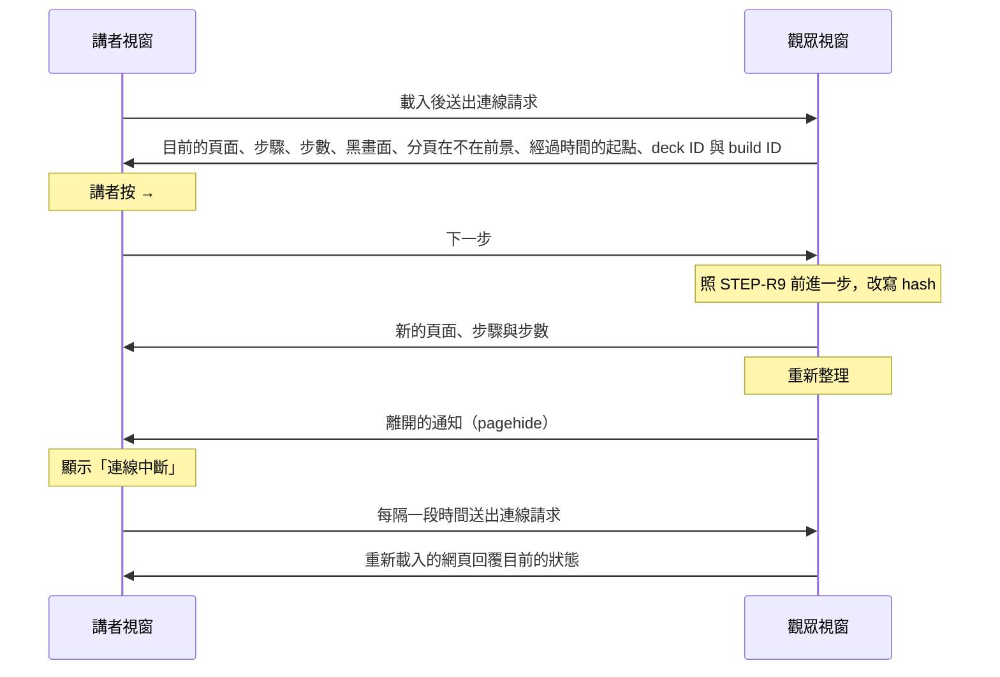

# 0004 講者模式

## 目標

完成後，講者把筆電接上投影幕時，可以在播放簡報的視窗按 `S` 另外開一個講者視窗，把原本的視窗拖到投影幕上給觀眾看，自己在筆電上看著目前頁、這一頁的下一步、下一頁、講者備註、經過時間與目前時刻。講者在任一個視窗按快捷鍵或用翻頁器，兩個視窗都會一起換頁；任一個視窗重新整理之後，兩個視窗會自動重新連上。講者備註用 Markdown 寫在每一頁的 TSX 檔裡，寫法有誤時 build 失敗。

## 範圍

- 要做：
  - 在觀眾視窗按 `S` 開啟講者視窗，講者視窗顯示目前頁、下一步、下一頁、講者備註，以及經過時間、目前時刻、頁碼與步驟。
  - 講者視窗跟著觀眾視窗換頁，並把快捷鍵轉給觀眾視窗執行。
  - 頁面匯出 `notes`，用 Markdown 寫講者備註；build 時檢查 `notes` 的寫法。
  - 新增 `presenter.md`；修改 `framework.md` 開頭的說明，新增 FRAME-R5.3、FRAME-R6、FRAME-R7；修改 `navigation.md` 開頭的說明與 NAV-R5、NAV-R9；修改 `playback.md` 與 `steps.md` 開頭的說明；修改 `distribution.md` 的 DIST-R2；在 `product.md` 的術語表新增「觀眾視窗」與「講者視窗」，並在「播放器」那一列補上講者模式的說明。
  - 在 `README.md` 的「Playing a Deck」說明講者模式的用法：按 `S` 開啟講者視窗、電腦接投影幕時要設成延伸桌面而不是鏡像輸出，以及在 macOS 上要開著「系統設定」裡「桌面與 Dock」的「顯示器有不同的空間」，否則一個螢幕上的視窗進入全螢幕時，另一個螢幕會變黑；另外說明觀眾視窗已經在投影幕上時再按 `S`，講者視窗會出現在投影幕上，要拖回筆電螢幕。
- 刻意不做的事：
  - 自動把觀眾視窗放到投影幕，理由寫在「決策」一節。
  - 在平板與手機上使用講者模式，因為這些裝置沒有鍵盤可以按 `S`，而且 iPad 的 Safari 會把新視窗開成分頁。
  - 在講者視窗用觸控滑動換頁，理由寫在「決策」一節。
  - 開啟講者模式的按鈕、倒數計時與暫停計時，理由寫在「決策」一節。
  - 調整備註字級的按鈕或快捷鍵，因為講者可以在講者視窗用瀏覽器的縮放調整字級，按著 Cmd 或 Ctrl 的按鍵本來就交給瀏覽器（NAV-R7）。
  - 處理講者視窗裡的影片聲音與圖表動畫，因為講者視窗另外 render 的那一份頁面裡的影片與圖表，由 roadmap 的「圖片與影片」與「ECharts 圖表」各自處理；講者視窗會另外 render 頁面這件事寫進 `architecture.md`（見「做法要點」）。

## Spec 變更

### presenter.md

新增這份 spec，`prefix` 為 `PRES`，標題是「講者模式」，開頭的說明與設計理由寫在下方「開頭的說明」。

- 新增 PRES-R1 用 `S` 開啟講者視窗
- 新增 PRES-R2 講者視窗顯示觀眾視窗目前的位置
- 新增 PRES-R3 在講者視窗操作簡報
- 新增 PRES-R4 全螢幕只作用在講者按下快捷鍵的視窗
- 新增 PRES-R5 講者視窗的版面
- 新增 PRES-R6 目前頁
- 新增 PRES-R7 下一步與下一頁
- 新增 PRES-R8 資訊列
- 新增 PRES-R9 經過時間
- 新增 PRES-R10 講者備註
- 新增 PRES-R11 講者視窗的按鈕與連結不取得焦點
- 新增 PRES-R12 連線中斷時保留最後的畫面
- 新增 PRES-R13 觀眾視窗關閉或改播另一份簡報時講者視窗跟著關閉
- 新增 PRES-R14 網址帶 `?presenter` 但沒有開啟它的觀眾視窗
- 新增 PRES-R15 一個講者視窗只控制開啟它的觀眾視窗

#### 開頭的說明

講者模式是講者把電腦接上投影幕播放簡報時，在自己的螢幕上看著目前頁、下一步、下一頁、講者備註與時間的能力。講者在播放簡報的視窗按 `S`，播放器另外開一個講者視窗；原本播放簡報的視窗叫做觀眾視窗，投影幕上顯示的就是觀眾視窗。講者視窗顯示觀眾視窗目前的頁面與步驟；講者在講者視窗也能用快捷鍵操作簡報，規則寫在 PRES-R3。

講者視窗載入同一份 slidetray，由同一個播放器 render，但 [playback.md](playback.md) 與 [navigation.md](navigation.md) 的需求只描述觀眾視窗；[steps.md](steps.md) 裡，`<Step>` 與 `useStep` 決定畫面的規則（STEP-R1 到 STEP-R8）也適用於講者視窗的目前頁、下一步與下一頁，換頁與網址 hash 的規則（STEP-R9 到 STEP-R14）只描述觀眾視窗。講者視窗只套用本 spec 明確引用的需求，例如 PRES-R3 引用的快捷鍵規則，以及 PRES-R4 引用的 NAV-R10。

講者模式只支援電腦上的瀏覽器，平板與手機不支援。講者開啟講者視窗之後，自己把觀眾視窗拖到投影幕上，在觀眾視窗按 `F` 進入全螢幕，講者視窗留在自己的螢幕上。在 macOS 上，「系統設定」裡「桌面與 Dock」的「顯示器有不同的空間」要開著，這也是 macOS 的預設值，否則一個螢幕上的視窗進入全螢幕時，另一個螢幕會變黑；播放器偵測不到這項設定。

> 設計理由：講者手動把觀眾視窗拖到投影幕。曾考慮在講者按 `S` 時，用 Window Management API 讓觀眾視窗在外接螢幕上全螢幕、講者視窗開在筆電螢幕上，但從 `file://` 開啟時只有 Chromium 支援這個 API，第一次使用時還要講者授權，所以講者換到 Firefox、Safari 或現場的電腦時，開講前的操作就不一樣；接了兩個以上的外接螢幕時，也要另訂規則決定把觀眾視窗放在哪一個外接螢幕。完整討論見 [0004](../plans/archive/0004-presenter-mode.md)。

#### PRES-R1 用 `S` 開啟講者視窗

在觀眾視窗按 `S` 時，播放器開啟講者視窗。講者視窗是獨立的瀏覽器視窗，不是分頁，所以可以單獨拖到另一個螢幕。瀏覽器通常把講者視窗開在觀眾視窗所在的螢幕，所以觀眾視窗已經在投影幕上時再按 `S`，例如講者誤關講者視窗之後，講者視窗會先出現在投影幕上，講者要把它拖回自己的螢幕。瀏覽器擋下講者視窗時，例如講者在瀏覽器的設定裡封鎖了這份簡報的彈出視窗，按 `S` 只會照 NAV-R5 取消輸入中的頁碼，播放器另外在瀏覽器的 console 印出警告。這個觀眾視窗開啟的講者視窗已經開著時，按 `S` 會把既有的講者視窗移到最前面，不會再開一個。觀眾視窗在全螢幕時，按 `S` 只會照 NAV-R5 取消輸入中的頁碼。這裡的全螢幕指 NAV-R10 的全螢幕；講者用瀏覽器或作業系統讓整個瀏覽器視窗全螢幕時，例如按 macOS 視窗的綠色按鈕，按 `S` 照常開啟講者視窗。`S` 在講者視窗不是播放器的快捷鍵，講者在講者視窗按 `S` 沒有作用（PRES-R3）。`S` 和其他快捷鍵一樣適用 [navigation.md](navigation.md) 的 NAV-R7，黑畫面時的行為寫在 NAV-R9；按住 `S` 不放時，`S` 和其他快捷鍵一樣照常連續觸發（NAV-R14），但講者視窗開啟之後就不會再開一個。

> 設計理由：觀眾視窗在全螢幕時按 `S` 沒有作用，因為網頁開啟新視窗，或把其他視窗移到最前面時，瀏覽器會讓全螢幕的網頁離開全螢幕，投影幕上的觀眾就會看到瀏覽器的工具列或桌面。講者照開頭的說明，先按 `S` 開啟講者視窗、再在觀眾視窗按 `F` 時，不受這條規則影響。曾考慮照常開啟講者視窗或移到最前面，並在 spec 寫明觀眾視窗會離開全螢幕，但演講途中講者按 `S`，多半是要找回被其他視窗蓋住的講者視窗，這時觀眾視窗離開全螢幕會打斷演講，而講者可以從 Dock 或工作列找回講者視窗；而且各瀏覽器在移到最前面時的結果不一樣。講者用瀏覽器或作業系統讓整個瀏覽器視窗全螢幕時，按 `S` 照常開啟講者視窗，因為網頁沒有可靠的方式偵測這種全螢幕。完整討論見 [0004](../plans/archive/0004-presenter-mode.md)。

- PRES-R1.1 開啟講者視窗
  - 前提：講者視窗沒有開啟，畫面顯示 `agenda`
  - 動作：按 `S`
  - 結果：開啟講者視窗，講者視窗的目前頁顯示 `agenda`
- PRES-R1.2 講者視窗已經開著
  - 前提：觀眾視窗已經開啟講者視窗，講者視窗在觀眾視窗後面
  - 動作：在觀眾視窗按 `S`
  - 結果：沒有開啟新的視窗，既有的講者視窗移到最前面
- PRES-R1.3 觀眾視窗重新整理後再按 `S`
  - 前提：觀眾視窗已經開啟講者視窗
  - 動作：重新整理觀眾視窗，再在觀眾視窗按 `S`
  - 結果：沒有開啟新的視窗
- PRES-R1.4 在講者視窗按 `S`
  - 前提：講者視窗已經開著，焦點在講者視窗
  - 動作：按 `S`
  - 結果：沒有開啟新的視窗
- PRES-R1.5 在 Safari 開啟講者視窗
  - 前提：在 macOS 的 Safari 用 `file://` 開啟簡報，Safari 使用預設的彈出視窗設定
  - 動作：按 `S`
  - 結果：開啟講者視窗
- PRES-R1.6 觀眾視窗在全螢幕時按 `S`
  - 前提：講者視窗沒有開啟，觀眾視窗在全螢幕
  - 動作：按 `S`
  - 結果：沒有開啟講者視窗，觀眾視窗仍然在全螢幕
- PRES-R1.7 講者視窗已經開著時在全螢幕的觀眾視窗按 `S`
  - 前提：觀眾視窗已經開啟講者視窗，講者視窗在觀眾視窗後面，接著觀眾視窗進入全螢幕
  - 動作：在觀眾視窗按 `S`
  - 結果：講者視窗沒有移到最前面，觀眾視窗仍然在全螢幕
- PRES-R1.8 講者視窗開在獨立的視窗
  - 前提：瀏覽器使用預設的設定，講者視窗沒有開啟
  - 動作：按 `S`
  - 結果：講者視窗開在新的瀏覽器視窗，觀眾視窗所在的視窗沒有多出分頁
- PRES-R1.9 按住 `S` 不放
  - 前提：講者視窗沒有開啟
  - 動作：按住 `S`，直到作業系統自動送出好幾次 `S`
  - 結果：只開啟一個講者視窗
- PRES-R1.10 瀏覽器視窗全螢幕時按 `S`
  - 前提：筆電用延伸桌面接上投影幕，macOS 開著「顯示器有不同的空間」，觀眾視窗在投影幕上，講者按 macOS 視窗的綠色按鈕，讓觀眾視窗所在的瀏覽器視窗全螢幕，講者視窗沒有開啟
  - 動作：在觀眾視窗按 `S`
  - 結果：開啟講者視窗，講者視窗出現在投影幕上、蓋在觀眾視窗上面，投影幕沒有切換到其他桌面空間；講者能把講者視窗拖到筆電螢幕上
- PRES-R1.11 輸入頁碼途中按 `S`
  - 前提：講者視窗沒有開啟，觀眾視窗不在全螢幕，簡報依序是 `intro`、`agenda`、`recap` 三頁，觀眾視窗顯示 `intro`
  - 動作：在 3 秒內完成以下動作：在觀眾視窗輸入 3，按 `S`，點觀眾視窗，再按 Enter
  - 結果：按 `S` 之後，開啟講者視窗，觀眾視窗不再顯示頁碼；按 Enter 之後，觀眾視窗顯示 `agenda`
- PRES-R1.12 觀眾視窗在全螢幕時輸入頁碼途中按 `S`
  - 前提：講者視窗沒有開啟，觀眾視窗在全螢幕，簡報依序是 `intro`、`agenda`、`recap` 三頁，觀眾視窗顯示 `intro`
  - 動作：在 3 秒內完成以下動作：輸入 3，按 `S`，再按 Enter
  - 結果：按 `S` 之後，沒有開啟講者視窗，觀眾視窗不再顯示頁碼；按 Enter 之後，觀眾視窗顯示 `agenda`
- PRES-R1.13 觀眾視窗在全螢幕而且是黑畫面時按 `S`
  - 前提：觀眾視窗已經開啟講者視窗，講者視窗在觀眾視窗後面，觀眾視窗在全螢幕，接著切換成黑畫面
  - 動作：在觀眾視窗按 `S`
  - 結果：講者視窗沒有移到最前面，觀眾視窗仍然在全螢幕，仍然是黑畫面
- PRES-R1.14 黑畫面時把既有的講者視窗移到最前面
  - 前提：觀眾視窗已經開啟講者視窗，講者視窗在觀眾視窗後面，觀眾視窗不在全螢幕，接著切換成黑畫面
  - 動作：在觀眾視窗按 `S`
  - 結果：講者視窗移到最前面，觀眾視窗仍然是黑畫面
- PRES-R1.15 觀眾視窗已經在投影幕上時開啟講者視窗
  - 前提：筆電用延伸桌面接上投影幕，觀眾視窗在投影幕上，不在全螢幕，講者視窗沒有開啟
  - 動作：在觀眾視窗按 `S`
  - 結果：講者視窗開在投影幕上
- PRES-R1.16 瀏覽器封鎖彈出視窗時按 `S`
  - 前提：講者在瀏覽器的設定裡封鎖了這份簡報的彈出視窗，觀眾視窗顯示 `intro`
  - 動作：按 `S`
  - 結果：沒有開啟講者視窗，觀眾視窗仍然顯示 `intro`，瀏覽器的 console 印出警告
- PRES-R1.17 瀏覽器封鎖彈出視窗時輸入頁碼途中按 `S`
  - 前提：講者在瀏覽器的設定裡封鎖了這份簡報的彈出視窗，簡報依序是 `intro`、`agenda`、`recap` 三頁，觀眾視窗顯示 `intro`
  - 動作：在 3 秒內完成以下動作：輸入 3，按 `S`，再按 Enter
  - 結果：按 `S` 之後，觀眾視窗不再顯示頁碼；按 Enter 之後，觀眾視窗顯示 `agenda`
- PRES-R1.18 在 Windows 按 F11 讓瀏覽器視窗全螢幕時按 `S`
  - 前提：在 Windows 用延伸桌面接上投影幕，觀眾視窗在投影幕上，講者按 F11 讓觀眾視窗所在的瀏覽器視窗全螢幕，講者視窗沒有開啟
  - 動作：在觀眾視窗按 `S`
  - 結果：開啟講者視窗，講者視窗出現在投影幕上；講者能把講者視窗拖到筆電螢幕上
- PRES-R1.19 講者視窗縮到最小時按 `S`
  - 前提：觀眾視窗已經開啟講者視窗，觀眾視窗不在全螢幕，講者把講者視窗縮到最小
  - 動作：在觀眾視窗按 `S`
  - 結果：講者視窗還原，並移到最前面

> 設計理由：講者只能用 `S` 開啟講者視窗，因為講者模式只在接著投影幕的電腦上使用，講者一定有鍵盤。曾考慮在全螢幕按鈕旁邊另外放一顆開啟講者視窗的按鈕，但平板與手機不支援講者模式，所以播放器得先判斷裝置能不能開獨立視窗，才能決定要不要顯示這顆按鈕。完整討論見 [0004](../plans/archive/0004-presenter-mode.md)。

#### PRES-R2 講者視窗顯示觀眾視窗目前的位置

觀眾視窗的頁面、步驟或黑畫面改變時，講者視窗跟著更新。不論改變是講者在哪個視窗按下快捷鍵造成的，還是觀眾視窗的網址 hash 改變造成的，例如講者在觀眾視窗按了瀏覽器的上一頁，講者視窗都會更新。

- PRES-R2.1 在觀眾視窗換頁
  - 前提：講者視窗已經開著，觀眾視窗顯示 `intro`，下一頁是 `agenda`
  - 動作：在觀眾視窗按 →
  - 結果：講者視窗的目前頁顯示 `agenda`
- PRES-R2.2 在觀眾視窗按瀏覽器的上一頁
  - 前提：講者視窗已經開著，觀眾視窗顯示 `agenda`，講者在觀眾視窗按 End 跳到 `recap`
  - 動作：在觀眾視窗按瀏覽器的上一頁
  - 結果：講者視窗的目前頁顯示 `agenda`

#### PRES-R3 在講者視窗操作簡報

講者在講者視窗按下按鍵時，播放器依 [navigation.md](navigation.md) 開頭的流程圖決定要做什麼，再照 navigation.md 與 [steps.md](steps.md) 的規則操作觀眾視窗。這張流程圖的判斷裡，是不是黑畫面看觀眾視窗；其他判斷都看講者視窗，例如講者有沒有同時按著 Ctrl、Cmd 或 Alt、焦點在哪裡、是不是正在輸入頁碼。講者在講者視窗操作簡報時，和在觀眾視窗操作有以下差別：

1. 全螢幕的快捷鍵只作用在講者視窗（PRES-R4）。
2. 兩個視窗各自有一份輸入中的頁碼。講者在講者視窗輸入的頁碼只顯示在講者視窗的資訊列（PRES-R8），觀眾視窗不顯示；講者在講者視窗按 Enter 時，觀眾視窗跳到這一頁。一個視窗的快捷鍵不會取消另一個視窗的輸入，但觀眾視窗的頁面或步驟改變，或切換黑畫面時，兩個視窗的輸入都會取消。
3. 跳頁新增的瀏覽紀錄在觀眾視窗，要回到跳頁之前的頁面時，講者要在觀眾視窗按瀏覽器的上一頁（NAV-R6）。講者視窗不讀取也不改寫網址的 hash，所以講者在講者視窗按瀏覽器的上一頁或下一頁，或改了講者視窗網址的 hash 時，兩個視窗都不會換頁。
4. `S` 在講者視窗不是播放器的快捷鍵（PRES-R1），所以講者在講者視窗按 `S` 時，不會取消頁碼的輸入，也不會結束黑畫面。
5. 講者在講者視窗觸控滑動時，播放器不換頁、不結束黑畫面，也不取消頁碼的輸入（NAV-R5、NAV-R8、NAV-R9），因為講者在觸控螢幕上用手指左右捲動備註裡比較寬的程式碼區塊時，這個動作會被當成滑動。
6. Tab、Shift+Tab，以及 Safari 的 Option+Tab、Option+Shift+Tab 不交給瀏覽器，由講者視窗擋下（PRES-R11）。

> 設計理由：講者在講者視窗按下按鍵時，除了是不是黑畫面，播放器都看講者視窗的狀態決定要做什麼，因為講者是對著講者視窗按下按鍵的。曾考慮全部看觀眾視窗，但講者有沒有同時按著 Ctrl、Cmd 或 Alt，只有講者視窗收到的 keydown 事件看得出來；而且講者在投影幕上點過頁面的按鈕之後，焦點會留在觀眾視窗的按鈕上，講者在講者視窗按 Space 時快捷鍵不觸發（NAV-R7），畫面沒有任何反應，講者又看不到投影幕上的游標，不知道原因。輸入中的頁碼如果只有觀眾視窗那一份，講者在講者視窗輸入的頁碼就會顯示在投影幕上。完整討論見 [0004](../plans/archive/0004-presenter-mode.md)。

- PRES-R3.1 在講者視窗按下一步
  - 前提：焦點在講者視窗，觀眾視窗顯示 `intro`，下一頁是 `agenda`
  - 動作：按 →
  - 結果：觀眾視窗與講者視窗的目前頁都顯示 `agenda`
- PRES-R3.2 在講者視窗跳頁後回到原來的頁面
  - 前提：焦點在講者視窗，觀眾視窗顯示 `agenda`，最後一頁是 `recap`
  - 動作：按 End，再在觀眾視窗按瀏覽器的上一頁
  - 結果：按 End 之後，觀眾視窗顯示 `recap`；按瀏覽器的上一頁之後，觀眾視窗與講者視窗的目前頁都顯示 `agenda`
- PRES-R3.3 在講者視窗切換黑畫面
  - 前提：焦點在講者視窗，觀眾視窗顯示 `intro`
  - 動作：按 `B`
  - 結果：觀眾視窗變成黑畫面，講者視窗的目前頁仍然顯示 `intro`，上面寫著「觀眾看到黑畫面」
- PRES-R3.4 黑畫面時在講者視窗按下一步
  - 前提：焦點在講者視窗，觀眾視窗顯示 `intro`，接著切換成黑畫面
  - 動作：按 →
  - 結果：觀眾視窗的黑畫面結束，畫面顯示 `intro`
- PRES-R3.5 在講者視窗輸入頁碼
  - 前提：焦點在講者視窗，簡報依序是 `intro`、`agenda`、`recap` 三頁，觀眾視窗顯示 `intro`
  - 動作：輸入 3，再按 Enter
  - 結果：輸入 3 之後，講者視窗的資訊列顯示 3，觀眾視窗沒有顯示頁碼；按 Enter 之後，觀眾視窗顯示 `recap`
- PRES-R3.6 焦點在講者視窗時用翻頁器換頁
  - 前提：筆電接上翻頁器，焦點在講者視窗，觀眾視窗顯示 `intro`，下一頁是 `agenda`
  - 動作：按翻頁器的下一頁鍵
  - 結果：觀眾視窗顯示 `agenda`
- PRES-R3.7 在講者視窗輸入頁碼後在觀眾視窗按 Enter
  - 前提：焦點在講者視窗，簡報依序是 `intro`、`agenda`、`recap` 三頁，觀眾視窗顯示 `intro`
  - 動作：在 3 秒內完成以下動作：輸入 3，點觀眾視窗，再按 Enter
  - 結果：觀眾視窗顯示 `agenda`，講者視窗的資訊列不再顯示頁碼
- PRES-R3.8 觀眾視窗的焦點在輸入框裡時在講者視窗按下一步
  - 前提：觀眾視窗顯示 `intro`，焦點在頁面上的文字輸入框裡，下一頁是 `agenda`
  - 動作：點講者視窗，按 →
  - 結果：觀眾視窗顯示 `agenda`
- PRES-R3.9 在講者視窗輸入頁碼途中按 `S`
  - 前提：焦點在講者視窗，簡報依序是 `intro`、`agenda`、`recap` 三頁，觀眾視窗顯示 `intro`
  - 動作：在 3 秒內完成以下動作：輸入 3，按 `S`，再按 Enter
  - 結果：按 `S` 之後，講者視窗的資訊列仍然顯示 3，也沒有開啟新的視窗；按 Enter 之後，觀眾視窗顯示 `recap`
- PRES-R3.10 在講者視窗輸入頁碼途中觀眾視窗切換黑畫面
  - 前提：焦點在講者視窗，觀眾視窗顯示 `intro`
  - 動作：在 3 秒內完成以下動作：輸入 3，點觀眾視窗，再按 `B`
  - 結果：觀眾視窗變成黑畫面，講者視窗的資訊列不再顯示頁碼
- PRES-R3.11 在講者視窗觸控滑動
  - 前提：筆電有觸控螢幕，觀眾視窗顯示 `intro`，下一頁是 `agenda`
  - 動作：在講者視窗用手指往左滑 200 px
  - 結果：觀眾視窗與講者視窗的目前頁都仍然顯示 `intro`
- PRES-R3.12 改講者視窗網址的 hash
  - 前提：簡報依序是 `intro`、`agenda`、`recap` 三頁，觀眾視窗顯示 `intro`
  - 動作：在講者視窗的網址列把 hash 改成 `#/recap`
  - 結果：觀眾視窗與講者視窗的目前頁都仍然顯示 `intro`
- PRES-R3.13 在講者視窗按瀏覽器的上一頁
  - 前提：簡報依序是 `intro`、`agenda`、`recap` 三頁，觀眾視窗顯示 `agenda`，講者在講者視窗的網址列把 hash 改成 `#/recap`
  - 動作：在講者視窗按瀏覽器的上一頁
  - 結果：觀眾視窗與講者視窗的目前頁都仍然顯示 `agenda`
- PRES-R3.14 講者視窗不改寫網址的 hash
  - 前提：`list` 這一頁有 3 步，觀眾視窗顯示 `list` 的第 2 步
  - 動作：按 `S`，點觀眾視窗，再按 →
  - 結果：講者視窗的網址一直沒有 hash
- PRES-R3.15 在講者視窗輸入頁碼途中觀眾視窗換步驟
  - 前提：焦點在講者視窗，簡報依序是 `intro`、`list`、`recap` 三頁，`list` 有 3 步，觀眾視窗顯示 `list` 的第 1 步
  - 動作：在 3 秒內完成以下動作：在講者視窗輸入 3，點觀眾視窗按 →，再點講者視窗按 Enter
  - 結果：按 → 之後，觀眾視窗顯示 `list` 的第 2 步，講者視窗的資訊列不再顯示頁碼；按 Enter 之後，觀眾視窗顯示 `list` 的第 3 步
- PRES-R3.16 在觀眾視窗輸入頁碼途中在講者視窗按 `F`
  - 前提：簡報依序是 `intro`、`agenda`、`recap` 三頁，觀眾視窗顯示 `intro`
  - 動作：在 3 秒內完成以下動作：在觀眾視窗輸入 3，點講者視窗按 `F`，再點觀眾視窗按 Enter
  - 結果：按 `F` 之後，講者視窗進入全螢幕，觀眾視窗仍然顯示 3；按 Enter 之後，觀眾視窗顯示 `recap`
- PRES-R3.17 在觀眾視窗輸入頁碼途中在講者視窗按 `B`
  - 前提：簡報依序是 `intro`、`agenda`、`recap` 三頁，觀眾視窗顯示 `intro`
  - 動作：在 3 秒內完成以下動作：在觀眾視窗輸入 3，點講者視窗按 `B`
  - 結果：觀眾視窗變成黑畫面，不再顯示頁碼
- PRES-R3.18 黑畫面時在講者視窗觸控滑動
  - 前提：筆電有觸控螢幕，觀眾視窗顯示 `intro`，接著切換成黑畫面
  - 動作：在講者視窗用手指往左滑 200 px
  - 結果：觀眾視窗仍然是黑畫面
- PRES-R3.19 在講者視窗輸入頁碼途中觸控滑動
  - 前提：筆電有觸控螢幕，焦點在講者視窗，簡報依序是 `intro`、`agenda`、`recap` 三頁，觀眾視窗顯示 `intro`
  - 動作：在 3 秒內完成以下動作：在講者視窗輸入 3，用手指往左滑 200 px，再按 Enter
  - 結果：滑動之後，講者視窗的資訊列仍然顯示 3；按 Enter 之後，觀眾視窗顯示 `recap`
- PRES-R3.20 在觀眾視窗輸入頁碼途中在講者視窗換頁
  - 前提：簡報依序是 `intro`、`agenda`、`recap` 三頁，觀眾視窗顯示 `intro`
  - 動作：在 3 秒內完成以下動作：在觀眾視窗輸入 1，點講者視窗按 →，再點觀眾視窗按 Enter
  - 結果：按 → 之後，觀眾視窗顯示 `agenda`，不再顯示頁碼；按 Enter 之後，觀眾視窗顯示 `recap`
- PRES-R3.21 在講者視窗按住 `B` 不放
  - 前提：焦點在講者視窗，觀眾視窗顯示 `intro`
  - 動作：按住 `B`，直到作業系統自動送出好幾次 `B`
  - 結果：觀眾視窗變成黑畫面，放開 `B` 之後仍然是黑畫面
- PRES-R3.22 黑畫面時在講者視窗按 `S`
  - 前提：焦點在講者視窗，觀眾視窗顯示 `intro`，接著切換成黑畫面
  - 動作：按 `S`
  - 結果：觀眾視窗仍然是黑畫面，也沒有開啟新的視窗
- PRES-R3.23 在講者視窗連續跳頁兩次之後回到上一頁
  - 前提：焦點在講者視窗，簡報依序是 `intro`、`agenda`、`recap` 三頁，觀眾視窗顯示 `agenda`
  - 動作：按 End，再按 Home，再在觀眾視窗按瀏覽器的上一頁
  - 結果：按 Home 之後，觀眾視窗顯示 `intro`；按瀏覽器的上一頁之後，觀眾視窗與講者視窗的目前頁都顯示 `recap`
- PRES-R3.24 在講者視窗用 Backspace 修改頁碼
  - 前提：焦點在講者視窗，簡報依序是 `intro`、`agenda`、`recap` 三頁，觀眾視窗顯示 `agenda`
  - 動作：在 3 秒內完成以下動作：依序輸入 3、1，按 Backspace，再按 Enter
  - 結果：按 Backspace 之後，講者視窗的資訊列顯示 3，觀眾視窗仍然顯示 `agenda`；按 Enter 之後，觀眾視窗顯示 `recap`
- PRES-R3.25 在講者視窗刪除頁碼的所有數字
  - 前提：焦點在講者視窗，簡報依序是 `intro`、`agenda`、`recap` 三頁，`agenda` 沒有步驟，觀眾視窗顯示 `agenda`
  - 動作：在 3 秒內完成以下動作：輸入 3，再按兩次 Backspace
  - 結果：第一次按 Backspace 之後，講者視窗的資訊列不再顯示頁碼，觀眾視窗仍然顯示 `agenda`；第二次按 Backspace 之後，觀眾視窗顯示 `intro`
- PRES-R3.26 在講者視窗輸入大於總頁數的頁碼
  - 前提：焦點在講者視窗，簡報依序是 `intro`、`agenda`、`recap` 三頁，觀眾視窗顯示 `intro`
  - 動作：輸入 9，再按 Enter
  - 結果：觀眾視窗仍然顯示 `intro`，講者視窗的資訊列不再顯示頁碼
- PRES-R3.27 在講者視窗輸入頁碼途中按 `F`
  - 前提：焦點在講者視窗，簡報依序是 `intro`、`agenda`、`recap` 三頁，`intro` 沒有步驟，觀眾視窗顯示 `intro`，講者視窗不在全螢幕
  - 動作：在 3 秒內完成以下動作：輸入 3，按 `F`，再按 Enter
  - 結果：按 `F` 之後，講者視窗進入全螢幕，資訊列不再顯示頁碼；按 Enter 之後，觀眾視窗顯示 `agenda`

> 設計理由：兩個視窗都接受快捷鍵，因為翻頁器送出的按鍵只會送到有焦點的視窗，而講者點過講者視窗之後，例如為了捲動備註點了備註區，焦點就留在講者視窗。曾考慮只讓觀眾視窗接受快捷鍵，但這樣講者點過講者視窗之後，要回頭點觀眾視窗才能繼續用翻頁器換頁，而觀眾視窗在投影幕上全螢幕，講者看不到游標在哪裡；也考慮過只讓講者視窗接受快捷鍵，但沒開講者視窗時觀眾視窗仍然要接受快捷鍵，關掉講者視窗時又要恢復，規則反而變多。完整討論見 [0004](../plans/archive/0004-presenter-mode.md)。

#### PRES-R4 全螢幕只作用在講者按下快捷鍵的視窗

講者在講者視窗按全螢幕的快捷鍵（`F`、F5、Shift+F5）時，講者視窗照 NAV-R10 的規則切換全螢幕，觀眾視窗不受影響。瀏覽器只在一個視窗收到講者的操作時，才允許這個視窗進入全螢幕，所以講者在講者視窗沒辦法讓觀眾視窗進入全螢幕；講者要讓觀眾視窗在投影幕上全螢幕時，要在觀眾視窗按 `F`。

- PRES-R4.1 在講者視窗按 `F`
  - 前提：講者視窗與觀眾視窗都不在全螢幕，焦點在講者視窗
  - 動作：按 `F`
  - 結果：講者視窗進入全螢幕，觀眾視窗仍然不在全螢幕
- PRES-R4.2 兩個螢幕各自全螢幕
  - 前提：筆電用延伸桌面接上投影幕，在 macOS 上開著「顯示器有不同的空間」，觀眾視窗在投影幕上，講者視窗在筆電螢幕上，兩個視窗都不在全螢幕
  - 動作：在觀眾視窗按 `F`，再點講者視窗，按 `F`
  - 結果：觀眾視窗在投影幕上全螢幕，講者視窗在筆電螢幕上全螢幕，兩個視窗同時維持全螢幕
- PRES-R4.3 焦點在講者視窗時按翻頁器的播放鍵
  - 前提：筆電接上翻頁器，焦點在講者視窗，講者把講者視窗的備註區捲到最下方，兩個視窗都不在全螢幕
  - 動作：按翻頁器的播放鍵
  - 結果：講者視窗進入全螢幕，備註區仍然捲在最下方，觀眾視窗仍然不在全螢幕

#### PRES-R5 講者視窗的版面

講者視窗照下圖排版，用深色背景與淺色文字，不受簡報配色的影響。目前頁、下一步與下一頁都把 1920×1080 的畫布等比縮放到各自的格子裡，下一步與下一頁的格子分別標上「下一步」與「下一頁」。

```text
┌───────────────────────────────────────────────────────────────┐
│ 經過時間 [歸零]  目前時刻  第 4 / 12 頁  第 1 / 3 步  輸入中的頁碼  │
├──────────────────────────────────────┬────────────────────────┤
│                                      │ 下一步                  │
│                                      │                        │
│ 目前頁                                ├────────────────────────┤
│                                      │ 下一頁                  │
│                                      │                        │
├──────────────────────────────────────┴────────────────────────┤
│ 講者備註                                                       │
│                                                               │
└───────────────────────────────────────────────────────────────┘
```

講者視窗的標題是 `deck.json` 的 `title` 加上「（講者視窗）」。講者視窗不隱藏游標（NAV-R12），也不顯示全螢幕按鈕（NAV-R11）。

- PRES-R5.1 視窗標題
  - 前提：`deck.json` 的 `title` 是 `年度回顧`
  - 動作：開啟講者視窗
  - 結果：講者視窗的標題是 `年度回顧（講者視窗）`
- PRES-R5.2 滑鼠停止移動 2 秒
  - 前提：游標在講者視窗上
  - 動作：2 秒內不移動滑鼠
  - 結果：游標仍然顯示
- PRES-R5.3 講者視窗沒有全螢幕按鈕
  - 前提：講者視窗已經開著，瀏覽器支援讓網頁元素進入全螢幕
  - 動作：在講者視窗移動滑鼠
  - 結果：講者視窗的右下角沒有出現全螢幕按鈕

> 設計理由：講者視窗不顯示上一頁。曾考慮在目前頁的左邊多放一格上一頁，但講者很少需要回頭看上一頁，多一格就會壓縮備註的空間，而備註是講者視窗裡最需要大字的部分。完整討論見 [0004](../plans/archive/0004-presenter-mode.md)。

#### PRES-R6 目前頁

目前頁顯示觀眾視窗目前的頁面與步驟。講者視窗 render 自己的一份頁面，所以講者在觀眾視窗操作互動元件之後，講者視窗的目前頁仍然顯示這一頁在目前步驟、沒有操作過互動元件的畫面。目前頁、下一步與下一頁都不能操作：講者點不到裡面的元素，不能用 Tab 把焦點移進去，裡面的元素也不會取得焦點，包括寫了 `autoFocus` 或元件自己呼叫 `focus()` 的元素；裡面的元件也收不到鍵盤事件，所以不會攔下講者在講者視窗按的快捷鍵（NAV-R7）。觀眾視窗是黑畫面時，目前頁照常顯示頁面，上面疊一層半透明的黑色遮罩，寫著「觀眾看到黑畫面」。觀眾視窗的分頁不在前景時，例如講者在同一個瀏覽器視窗切到其他分頁，或把觀眾視窗縮到最小，目前頁上面改疊一層半透明的遮罩，寫著「觀眾看不到簡報」，觀眾視窗同時是黑畫面時也一樣；觀眾視窗的分頁回到前景之後，「觀眾看不到簡報」的遮罩消失。觀眾視窗的分頁不在前景的期間，講者的快捷鍵照常作用，所以講者在觀眾看其他分頁時，可以先換到之後要講的那一頁。播放器偵測得到的只有分頁不在前景與視窗縮到最小，所以觀眾視窗被其他應用程式的視窗蓋住，或投影幕沒有顯示筆電的畫面時，講者視窗不一定會疊上這層遮罩。

- PRES-R6.1 顯示目前的步驟
  - 前提：`list` 這一頁有 3 步，觀眾視窗顯示 `list` 的第 2 步
  - 動作：按 `S`
  - 結果：講者視窗的目前頁顯示 `list` 的第 2 步
- PRES-R6.2 點不到目前頁上的按鈕
  - 前提：觀眾視窗顯示 `counter`，這一頁有一個計數器，初始值是 0
  - 動作：在講者視窗點目前頁上的計數器
  - 結果：講者視窗與觀眾視窗的計數器都顯示 0
- PRES-R6.3 Tab 移不到目前頁裡的元素
  - 前提：觀眾視窗顯示 `counter`，焦點在講者視窗
  - 動作：按 Tab（Safari 按 Option+Tab）五次
  - 結果：焦點從來沒有移到目前頁、下一步與下一頁裡的計數器上
- PRES-R6.4 在觀眾視窗操作互動元件
  - 前提：觀眾視窗顯示 `counter`，這一頁有一個計數器，初始值是 0
  - 動作：在觀眾視窗把計數器按到 3
  - 結果：講者視窗的目前頁的計數器仍然顯示 0
- PRES-R6.5 觀眾視窗是黑畫面
  - 前提：講者視窗已經開著，觀眾視窗顯示 `intro`
  - 動作：在觀眾視窗按 `B`
  - 結果：講者視窗的目前頁仍然顯示 `intro`，上面疊著半透明的黑色遮罩，寫著「觀眾看到黑畫面」
- PRES-R6.6 下一頁的元件會攔下 → 時在講者視窗按下一步
  - 前提：`intro` 的下一頁 `gallery` 有一個輪播元件，在 `window` 的 keydown 事件遇到 → 時呼叫 `preventDefault()` 並換到下一張圖；焦點在講者視窗，觀眾視窗顯示 `intro`
  - 動作：按 →
  - 結果：觀眾視窗顯示 `gallery`，觀眾視窗與講者視窗目前頁裡的輪播都顯示第一張圖
- PRES-R6.7 目前頁的元件會攔下 → 時在講者視窗按下一步
  - 前提：觀眾視窗顯示 `gallery`，這一頁的輪播元件在 `window` 的 keydown 事件遇到 → 時呼叫 `preventDefault()` 並換到下一張圖，下一頁是 `recap`；焦點在講者視窗
  - 動作：按 →
  - 結果：觀眾視窗顯示 `recap`
- PRES-R6.8 下一頁有自動取得焦點的輸入框時在講者視窗按下一步
  - 前提：`intro` 的下一頁 `repl` 有一個寫了 `autoFocus` 的文字輸入框，焦點在講者視窗，觀眾視窗顯示 `intro`
  - 動作：按 →
  - 結果：觀眾視窗顯示 `repl`
- PRES-R6.9 觀眾視窗的分頁不在前景
  - 前提：講者視窗已經開著，觀眾視窗顯示 `intro`
  - 動作：在觀眾視窗所在的瀏覽器視窗開一個新的分頁，再切回觀眾視窗的分頁
  - 結果：開新的分頁之後，講者視窗的目前頁仍然顯示 `intro`，上面疊著半透明的遮罩，寫著「觀眾看不到簡報」；切回觀眾視窗的分頁之後，遮罩消失
- PRES-R6.10 觀眾視窗縮到最小
  - 前提：講者視窗已經開著，觀眾視窗顯示 `intro`
  - 動作：把觀眾視窗縮到最小，再把它還原
  - 結果：縮到最小之後，講者視窗的目前頁上面疊著「觀眾看不到簡報」；還原之後，遮罩消失
- PRES-R6.11 黑畫面時觀眾視窗的分頁不在前景
  - 前提：講者視窗已經開著，觀眾視窗顯示 `intro`，接著切換成黑畫面
  - 動作：在觀眾視窗所在的瀏覽器視窗切到另一個分頁，再切回觀眾視窗的分頁
  - 結果：切到另一個分頁之後，講者視窗的目前頁上面疊著「觀眾看不到簡報」；切回來之後，遮罩改寫「觀眾看到黑畫面」
- PRES-R6.12 觀眾視窗的分頁不在前景時在講者視窗換頁
  - 前提：講者視窗已經開著，觀眾視窗顯示 `intro`，下一頁是 `agenda`，講者在觀眾視窗所在的瀏覽器視窗切到另一個分頁
  - 動作：在講者視窗按 →，再切回觀眾視窗的分頁
  - 結果：按 → 之後，講者視窗的目前頁顯示 `agenda`，上面仍然疊著「觀眾看不到簡報」；切回來之後，觀眾視窗顯示 `agenda`，遮罩消失
- PRES-R6.13 觀眾視窗的分頁不在前景時重新整理講者視窗
  - 前提：講者視窗已經開著，觀眾視窗顯示 `intro`，講者在觀眾視窗所在的瀏覽器視窗切到另一個分頁
  - 動作：重新整理講者視窗
  - 結果：講者視窗載入完成之後 1 秒內，目前頁顯示 `intro`，上面疊著「觀眾看不到簡報」

> 設計理由：講者視窗的目前頁、下一步與下一頁都不能操作，因為講者示範互動元件時本來就看著投影幕操作，講者視窗的目前頁和投影幕不一致的影響不大。曾考慮讓目前頁可以操作，但兩個視窗的互動元件各有各的狀態，講者在講者視窗操作元件時，投影幕上的畫面不會改變。也考慮過把觀眾視窗裡互動元件的狀態同步到講者視窗，但這樣每個互動元件都要照一套同步規則實作。還考慮過用螢幕擷取把觀眾視窗的畫面即時顯示在講者視窗，但講者每次開啟講者視窗都要授權並挑選要擷取的視窗。完整討論見 [0004](../plans/archive/0004-presenter-mode.md)。

#### PRES-R7 下一步與下一頁

「下一步」顯示觀眾視窗目前的頁面在下一步的畫面，也就是講者按下一步之後這一頁會出現的畫面。這一格和目前頁一樣 render 講者視窗自己的一份頁面（PRES-R6），所以不會顯示講者在觀眾視窗操作互動元件造成的改變。目前的頁面已經在最後一步，或沒有步驟時，這一格是灰底，寫著「沒有下一步」。「下一頁」顯示下一頁的第 0 步；目前的頁面是最後一頁時，這一格是灰底，寫著「簡報結束」。目前的頁面還有沒有下一步，依觀眾視窗目前 render 的步數決定，所以觀眾視窗的步數因為互動而改變時（STEP-R14），「下一步」也跟著改變；目前的步驟因此大於步數時，也當成已經在最後一步。

- PRES-R7.1 這一頁還有步驟
  - 前提：`list` 這一頁有 3 步，下一頁是 `recap`，觀眾視窗顯示 `list` 的第 1 步
  - 動作：按 `S`
  - 結果：「下一步」顯示 `list` 的第 2 步，「下一頁」顯示 `recap` 的第 0 步
- PRES-R7.2 已經在最後一步
  - 前提：`list` 這一頁有 3 步，下一頁是 `recap`，觀眾視窗顯示 `list` 的第 3 步
  - 動作：按 `S`
  - 結果：「下一步」是灰底，寫著「沒有下一步」；「下一頁」顯示 `recap` 的第 0 步
- PRES-R7.3 沒有步驟的頁面
  - 前提：`intro` 這一頁沒有步驟，下一頁是 `agenda`，觀眾視窗顯示 `intro`
  - 動作：按 `S`
  - 結果：「下一步」是灰底，寫著「沒有下一步」；「下一頁」顯示 `agenda` 的第 0 步
- PRES-R7.4 最後一頁
  - 前提：最後一頁 `finale` 有 2 步，觀眾視窗顯示 `finale` 的第 1 步
  - 動作：按 `S`
  - 結果：「下一步」顯示 `finale` 的第 2 步；「下一頁」是灰底，寫著「簡報結束」
- PRES-R7.5 觀眾視窗的步數變少
  - 前提：`toggle` 這一頁有 `<Step at={1}>`、`<Step at={2}>`，以及一個按下後移除 `<Step at={2}>` 的按鈕；講者視窗已經開著，觀眾視窗顯示 `toggle` 的第 1 步
  - 動作：在觀眾視窗按這個按鈕
  - 結果：講者視窗的「下一步」變成灰底，寫著「沒有下一步」
- PRES-R7.6 觀眾視窗的步數變得比目前的步驟少
  - 前提：`toggle` 這一頁有 `<Step at={1}>`、`<Step at={2}>`，以及一個按下後移除 `<Step at={2}>` 的按鈕；講者視窗已經開著，觀眾視窗顯示 `toggle` 的第 2 步
  - 動作：在觀眾視窗按這個按鈕
  - 結果：講者視窗的「下一步」變成灰底，寫著「沒有下一步」
- PRES-R7.7 觀眾視窗的步數因為互動變多
  - 前提：`expand` 這一頁有 `<Step at={1}>`，以及一個按下後加上 `<Step at={2}>` 的按鈕，`<Step at={2}>` 的內容是「補充說明」；講者視窗已經開著，觀眾視窗顯示 `expand` 的第 1 步
  - 動作：在觀眾視窗按這個按鈕
  - 結果：講者視窗的「下一步」不是灰底，畫面上沒有「補充說明」

> 設計理由：「下一步」與「下一頁」分成兩格，每一格顯示的內容固定，所以講者看一眼就知道下一次按下一步時會不會換頁：「下一步」是灰底時，講者再按下一步，觀眾就會看到「下一頁」那一格的畫面。曾考慮只放一格，顯示講者下一次按下一步之後的畫面，但這一頁的步驟還沒走完時，講者看不到下一頁，而且這一格顯示的不論是這一頁的下一步還是下一頁，看起來都只是一張縮圖，講者要比對內容才分得出來會不會換頁。也考慮過在沒有下一步時，讓右下角改顯示再下一頁，讓兩格不重複，但這樣講者按到最後一步、準備換頁時，下一頁的預覽會從右下角移到右上角。完整討論見 [0004](../plans/archive/0004-presenter-mode.md)。

#### PRES-R8 資訊列

講者視窗最上方的資訊列照 PRES-R5 的圖，顯示經過時間（PRES-R9）與歸零按鈕、目前時刻、目前的頁碼與步驟，以及講者在講者視窗輸入中的頁碼（PRES-R3）。目前時刻以 24 小時制顯示時與分，時與分都寫成兩位數，例如 `09:05`、`14:05`，0 點寫成 `00`，例如 `00:05`；目前時刻隨電腦的時間更新，不論經過時間有沒有在計時。頁碼寫成「第 4 / 12 頁」，頁碼從 1 開始；目前的頁面有步驟時，旁邊再寫目前的步驟與步數，例如「第 1 / 3 步」，步數依觀眾視窗目前 render 的步數決定。目前的步驟大於步數時，例如步數因為互動變少（STEP-R14），步驟寫成和步數相同，例如「第 1 / 1 步」；步數因此變成 0 時，資訊列不顯示步驟。講者在講者視窗輸入頁碼時，資訊列才顯示輸入中的頁碼，頁碼出現與消失的規則和觀眾視窗相同（NAV-R5），例如停止輸入 3 秒後，頁碼從資訊列消失。

- PRES-R8.1 有步驟的頁面
  - 前提：簡報有 12 頁，第 4 頁有 3 步，觀眾視窗顯示第 4 頁的第 1 步
  - 動作：按 `S`
  - 結果：講者視窗的資訊列顯示「第 4 / 12 頁」與「第 1 / 3 步」
- PRES-R8.2 沒有步驟的頁面
  - 前提：簡報有 12 頁，第 1 頁沒有步驟，觀眾視窗顯示第 1 頁
  - 動作：按 `S`
  - 結果：講者視窗的資訊列顯示「第 1 / 12 頁」，沒有顯示步驟
- PRES-R8.3 觀眾視窗的步數變得比目前的步驟少
  - 前提：`toggle` 這一頁有 `<Step at={1}>`、`<Step at={2}>`，以及一個按下後移除 `<Step at={2}>` 的按鈕；講者視窗已經開著，觀眾視窗顯示 `toggle` 的第 2 步
  - 動作：在觀眾視窗按這個按鈕
  - 結果：講者視窗的資訊列顯示「第 1 / 1 步」
- PRES-R8.4 觀眾視窗的步數變成 0
  - 前提：`toggle` 這一頁只有 `<Step at={1}>`，以及一個按下後移除這個 `<Step>` 的按鈕；講者視窗已經開著，觀眾視窗顯示 `toggle` 的第 1 步
  - 動作：在觀眾視窗按這個按鈕
  - 結果：講者視窗的資訊列沒有顯示步驟
- PRES-R8.5 目前時刻
  - 前提：電腦的時間是下午 2 點 5 分
  - 動作：按 `S`
  - 結果：講者視窗的資訊列顯示 `14:05`
- PRES-R8.6 時只有一位數時補零
  - 前提：電腦的時間是上午 9 點 5 分
  - 動作：按 `S`
  - 結果：講者視窗的資訊列顯示 `09:05`
- PRES-R8.7 停止輸入頁碼 3 秒
  - 前提：焦點在講者視窗，觀眾視窗顯示 `intro`
  - 動作：輸入 3，等 3 秒
  - 結果：輸入 3 之後，講者視窗的資訊列顯示 3；等 3 秒之後，資訊列不再顯示頁碼，觀眾視窗仍然顯示 `intro`
- PRES-R8.8 第 0 步
  - 前提：簡報有 12 頁，第 4 頁有 3 步，觀眾視窗顯示第 4 頁的第 0 步
  - 動作：按 `S`
  - 結果：講者視窗的資訊列顯示「第 4 / 12 頁」與「第 0 / 3 步」
- PRES-R8.9 目前時刻隨時間更新
  - 前提：電腦的時間是下午 2 點 5 分 30 秒，講者視窗已經開著，經過時間顯示「未開始」
  - 動作：等 60 秒
  - 結果：講者視窗的資訊列顯示 `14:06`
- PRES-R8.10 午夜的目前時刻
  - 前提：電腦的時間是 0 點 5 分
  - 動作：按 `S`
  - 結果：講者視窗的資訊列顯示 `00:05`

> 設計理由：資訊列顯示經過時間與目前時刻，因為講者看這兩個時間就能判斷進度。目前時刻不能只靠作業系統的時鐘，因為講者視窗全螢幕時，macOS 的選單列與 Windows 的工作列都會被藏起來。曾考慮在 `deck.json` 加上演講長度的欄位，讓資訊列倒數剩下的時間，但同一份簡報在不同場合的演講長度常常不同。完整討論見 [0004](../plans/archive/0004-presenter-mode.md)。

#### PRES-R9 經過時間

資訊列上的經過時間可以點。經過時間在還沒開始計時時顯示「未開始」，講者點經過時間時開始計時；講者沒有點的話，觀眾視窗目前的頁面或步驟第一次改變時，經過時間自動開始計時，前提是這時講者視窗和觀眾視窗連線中。不論改變是講者在哪個視窗按下快捷鍵、按瀏覽器的上一頁，還是點頁面上的連結造成的，都會開始計時；畫面沒有換頁或換步驟時不會開始計時，例如黑畫面時按 → 只結束黑畫面、在最後一頁的最後一步按 →，或步數因為互動改變（STEP-R14）。講者點歸零按鈕時，經過時間回到「未開始」，之後同樣在講者點經過時間，或觀眾視窗的頁面或步驟下一次改變時開始計時。

經過時間未滿一小時時寫成「分:秒」，例如 `00:05`、`12:34`；滿一小時之後寫成「時:分:秒」，例如 `1:00:00`、`1:02:03`。分與秒一律寫成兩位數，時不補零。講者在計時中點經過時間沒有作用，要重新計時時，講者點歸零按鈕。經過時間一律從開始計時的那一刻算起，所以觀眾視窗或講者視窗重新整理，或講者關掉講者視窗、之後再按 `S` 開啟時，經過時間都包含重新整理或講者視窗關著的那段時間。經過時間只屬於同一個分頁裡的同一份簡報：講者在新的分頁或視窗開啟簡報，或在同一個分頁換到另一份簡報時，經過時間顯示「未開始」。講者用瀏覽器還原誤關的觀眾視窗時，經過時間接續；講者複製觀眾視窗的分頁時，複製出來的分頁沿用原分頁的經過時間。

- PRES-R9.1 點經過時間開始計時
  - 前提：講者視窗剛開啟，經過時間顯示「未開始」
  - 動作：點經過時間，等 5 秒
  - 結果：經過時間顯示 `00:05`
- PRES-R9.2 第一次換步驟時開始計時
  - 前提：講者視窗剛開啟，經過時間顯示「未開始」，觀眾視窗顯示 `intro`
  - 動作：在觀眾視窗按 →，等 5 秒
  - 結果：經過時間顯示 `00:05`
- PRES-R9.3 歸零
  - 前提：經過時間顯示 `12:34`，觀眾視窗顯示 `intro`，下一頁是 `agenda`
  - 動作：點歸零按鈕，等 5 秒，再按 →，等 5 秒
  - 結果：點歸零按鈕之後經過時間顯示「未開始」，等 5 秒之後仍然是「未開始」；按 → 再等 5 秒之後，經過時間顯示 `00:05`
- PRES-R9.4 滿一小時
  - 前提：經過時間顯示 `59:59`
  - 動作：等 1 秒
  - 結果：經過時間顯示 `1:00:00`
- PRES-R9.5 計時中點經過時間
  - 前提：經過時間顯示 `12:34`
  - 動作：點經過時間，等 5 秒
  - 結果：經過時間顯示 `12:39`
- PRES-R9.6 講者視窗重新整理
  - 前提：經過時間顯示 `12:34`
  - 動作：重新整理講者視窗
  - 結果：開始重新整理 3 秒後，講者視窗已經恢復連線，經過時間顯示 `12:37`
- PRES-R9.7 觀眾視窗重新整理
  - 前提：經過時間顯示 `12:34`
  - 動作：重新整理觀眾視窗
  - 結果：觀眾視窗開始重新整理 3 秒後，講者視窗已經恢復連線，經過時間顯示 `12:37`
- PRES-R9.8 關掉講者視窗再開啟
  - 前提：經過時間顯示 `12:34`
  - 動作：關掉講者視窗，等 10 秒，在觀眾視窗按 `S`
  - 結果：按 `S` 3 秒後，新開啟的講者視窗的經過時間顯示 `12:47`
- PRES-R9.9 關掉觀眾視窗後重新開啟簡報
  - 前提：經過時間顯示 `12:34`
  - 動作：關掉觀眾視窗與講者視窗，在新的分頁開啟這份簡報，按 `S`
  - 結果：新開啟的講者視窗的經過時間顯示「未開始」
- PRES-R9.10 開啟講者視窗之前換頁
  - 前提：講者視窗沒有開啟，觀眾視窗顯示 `intro`，下一頁是 `agenda`
  - 動作：在觀眾視窗按 →，再按 `S`，等 5 秒
  - 結果：講者視窗的經過時間顯示「未開始」
- PRES-R9.11 黑畫面時按下一步
  - 前提：講者視窗已經開著，經過時間顯示「未開始」，觀眾視窗顯示 `intro`，接著切換成黑畫面
  - 動作：按 →，等 5 秒
  - 結果：觀眾視窗的黑畫面結束，經過時間仍然顯示「未開始」
- PRES-R9.12 按瀏覽器的上一頁時開始計時
  - 前提：觀眾視窗顯示 `agenda`，講者在觀眾視窗按 End 跳到 `recap`，接著按 `S` 開啟講者視窗，經過時間顯示「未開始」
  - 動作：在觀眾視窗按瀏覽器的上一頁，等 5 秒
  - 結果：觀眾視窗顯示 `agenda`，經過時間顯示 `00:05`
- PRES-R9.13 同一個分頁換到另一份簡報
  - 前提：網站上有 `annual-review` 與 `demo` 兩份簡報，觀眾視窗播放 `annual-review`，經過時間顯示 `12:34`
  - 動作：在觀眾視窗按瀏覽器的上一頁回到網站首頁，再點 `demo`，按 `S`
  - 結果：新開啟的講者視窗的經過時間顯示「未開始」
- PRES-R9.14 複製觀眾視窗的分頁
  - 前提：經過時間顯示 `12:34`
  - 動作：用瀏覽器複製觀眾視窗的分頁，在複製出來的分頁按 `S`，從複製分頁到按 `S` 花了 5 秒
  - 結果：開啟一個新的講者視窗，按 `S` 3 秒後，新的講者視窗的經過時間顯示 `12:42`；原本的講者視窗仍然顯示原分頁的位置
- PRES-R9.15 還原誤關的觀眾視窗
  - 前提：經過時間顯示 `12:34`
  - 動作：關掉觀眾視窗，等講者視窗跟著關閉，再按 Cmd+Shift+T，直到還原出觀眾視窗，在觀眾視窗按 `S`，從關掉觀眾視窗到按 `S` 花了 10 秒
  - 結果：按 `S` 3 秒後，新開啟的講者視窗的經過時間顯示 `12:47`
- PRES-R9.16 在最後一頁的最後一步按下一步
  - 前提：講者視窗已經開著，經過時間顯示「未開始」，觀眾視窗顯示最後一頁 `recap`，`recap` 沒有步驟
  - 動作：按 →，等 5 秒
  - 結果：觀眾視窗仍然顯示 `recap`，經過時間仍然顯示「未開始」
- PRES-R9.17 步數因為互動改變
  - 前提：講者視窗已經開著，經過時間顯示「未開始」；`toggle` 這一頁有 `<Step at={1}>`、`<Step at={2}>`，以及一個按下後移除 `<Step at={2}>` 的按鈕，觀眾視窗顯示 `toggle` 的第 1 步
  - 動作：在觀眾視窗按這個按鈕，等 5 秒
  - 結果：經過時間仍然顯示「未開始」
- PRES-R9.18 點頁面上的連結時開始計時
  - 前提：講者視窗已經開著，經過時間顯示「未開始」，觀眾視窗顯示 `intro`，這一頁有一個 `href` 是 `#/recap` 的連結
  - 動作：在觀眾視窗點這個連結，等 5 秒
  - 結果：觀眾視窗顯示 `recap`，經過時間顯示 `00:05`
- PRES-R9.19 換到另一份簡報之後再回來
  - 前提：網站上有 `annual-review` 與 `demo` 兩份簡報，觀眾視窗播放 `annual-review`，經過時間顯示 `12:34`
  - 動作：在觀眾視窗按瀏覽器的上一頁回到網站首頁，點 `demo`，再按瀏覽器的上一頁回到網站首頁，點 `annual-review`，按 `S`，從離開 `annual-review` 到按 `S` 花了 20 秒
  - 結果：按 `S` 3 秒後，新開啟的講者視窗的經過時間顯示 `12:57`
- PRES-R9.20 講者視窗重新整理途中換頁
  - 前提：講者視窗已經開著，經過時間顯示「未開始」，觀眾視窗顯示 `intro`，下一頁是 `agenda`
  - 動作：重新整理講者視窗，在講者視窗載入完成之前在觀眾視窗按 →，再等講者視窗恢復連線
  - 結果：觀眾視窗顯示 `agenda`，講者視窗的經過時間顯示「未開始」

> 設計理由：講者通常在開講前就開好講者視窗，所以經過時間先停在「未開始」，講者在標題頁開講時點經過時間開始計時；講者忘了點的話，第一次換頁或換步驟時也會開始計時，不會整場都沒有經過時間。代價是講者在講者視窗開著時測試翻頁器，經過時間就會開始，測試完要點歸零按鈕。曾考慮在開啟講者視窗時就開始計時，但這樣講者每一場都要在開講時歸零，忘了歸零的話，經過時間會多出整段準備時間；也考慮過只在講者點經過時間時開始，但講者忘了點的話，要等到看資訊列時才會發現；還考慮過只在第一次換頁時開始，但這樣講者在標題頁講的時間不會算進去。開啟講者視窗之前，或講者視窗重新整理、還沒連上觀眾視窗時的換頁不會開始計時，因為講者這時看不到經過時間，不知道它已經開始。經過時間不能暫停，因為授課中途休息時，講者看目前時刻就能掌握時間。完整討論見 [0004](../plans/archive/0004-presenter-mode.md)。

#### PRES-R10 講者備註

備註區顯示觀眾視窗目前頁面的講者備註，備註的寫法寫在 [framework.md](framework.md) 的 FRAME-R6。播放器照 CommonMark 把備註的 Markdown 轉成格式化的文字；備註裡的 HTML 標籤不會 render，照原文顯示；備註裡的圖片不會顯示，在圖片的位置顯示圖片的替代文字。講者點備註裡 `#/` 開頭的連結時，觀眾視窗跳到連結指向的頁面，和講者點頁面裡的同一個連結相同（NAV-R1）；講者按著 Cmd、Ctrl 或 Shift 點，或用滑鼠中鍵點時，結果也一樣，瀏覽器不會開啟新的分頁或視窗；連結指向不存在的頁面時，觀眾視窗不換頁，也不新增瀏覽紀錄，只在觀眾視窗的 console 印出警告（NAV-R2）；連結指向的頁面與步驟照 NAV-R1 與 STEP-R10 到 STEP-R13 決定之後，和觀眾視窗目前的頁面與步驟相同時，觀眾視窗也不新增瀏覽紀錄，那幾條需求要印出的警告照常印在觀眾視窗的 console；連線中斷時，點這種連結沒有作用（PRES-R12）。備註裡的其他連結不能點，備註區顯示連結的文字，後面用括號寫出網址，例如 `[MDN](https://developer.mozilla.org)` 顯示成 `MDN（https://developer.mozilla.org）`；連結的文字和網址相同時，例如 `<https://example.com>`，只顯示一次網址。頁面沒有備註，或 `notes` 是空字串、只有空白與換行時，備註區寫著「這一頁沒有備註」。

> 設計理由：備註裡 `#/` 開頭以外的連結不能點，因為講者視窗是沒有分頁列的彈出視窗，講者在彈出視窗裡點會開新分頁的連結時，Chromium 與 Firefox 可能把新分頁加進觀眾視窗所在的瀏覽器視窗，投影幕就會改顯示外部網頁，觀眾視窗也離開全螢幕。曾考慮由播放器另外開一個新的瀏覽器視窗開啟外部連結，但要給觀眾看的網頁本來就要在投影幕上開，只給講者看的參考資料，講者可以照備註寫出的網址自己開啟。備註裡的圖片不顯示，因為用相對路徑寫的圖片不會經過 Vite 處理，載入不到，用外部網址寫的圖片要連網才看得到，違反 DIST-R1。完整討論見 [0004](../plans/archive/0004-presenter-mode.md)。

備註比備註區長時，講者用觸控板或滑鼠滾輪捲動備註區。講者按下的快捷鍵不會捲動備註區，例如 PageDown、Space 與 ↓ 只會換頁或換步驟。換到其他頁面時，備註區捲回最上方；換到同一頁的其他步驟時，備註區維持原本的捲動位置。

- PRES-R10.1 顯示備註
  - 前提：`agenda` 的 `notes` 是一個兩項的清單，其中一項有粗體字，觀眾視窗顯示 `agenda`
  - 動作：按 `S`
  - 結果：講者視窗的備註區顯示兩項的清單，粗體字以粗體顯示
- PRES-R10.2 沒有備註
  - 前提：`intro` 沒有匯出 `notes`，觀眾視窗顯示 `intro`
  - 動作：按 `S`
  - 結果：講者視窗的備註區寫著「這一頁沒有備註」
- PRES-R10.3 備註裡的 HTML
  - 前提：`agenda` 的 `notes` 寫了 `<b>重點</b>`，觀眾視窗顯示 `agenda`
  - 動作：按 `S`
  - 結果：講者視窗的備註區顯示 `<b>重點</b>` 這段文字，「重點」沒有以粗體顯示
- PRES-R10.4 備註裡的外部連結不能點
  - 前提：`agenda` 的 `notes` 寫了 `[範例](https://example.com)`，觀眾視窗顯示 `agenda`，講者視窗顯示 `agenda` 的備註
  - 動作：在講者視窗點「範例」這兩個字
  - 結果：備註區顯示 `範例（https://example.com）`，瀏覽器沒有開啟新的分頁或視窗，觀眾視窗仍然顯示 `agenda`
- PRES-R10.5 換頁時捲回最上方
  - 前提：`agenda` 與下一頁 `recap` 的備註都比備註區長，觀眾視窗顯示 `agenda`，講者把講者視窗的備註區捲到最下方
  - 動作：按 →
  - 結果：備註區顯示 `recap` 的備註，捲動位置在最上方
- PRES-R10.6 換步驟時維持捲動位置
  - 前提：`list` 這一頁有 3 步，備註比備註區長，觀眾視窗顯示 `list` 的第 1 步，講者把講者視窗的備註區捲到最下方
  - 動作：按 →
  - 結果：備註區仍然捲在最下方
- PRES-R10.7 備註只有空白與換行
  - 前提：`agenda` 的 `notes` 只有空白與換行，觀眾視窗顯示 `agenda`
  - 動作：按 `S`
  - 結果：講者視窗的備註區寫著「這一頁沒有備註」
- PRES-R10.8 點備註裡指向簡報頁面的連結
  - 前提：`agenda` 的 `notes` 有一個連到 `#/recap` 的連結，觀眾視窗顯示 `agenda`，講者視窗顯示 `agenda` 的備註
  - 動作：在講者視窗點這個連結，再在觀眾視窗按瀏覽器的上一頁
  - 結果：點連結之後，觀眾視窗與講者視窗的目前頁都顯示 `recap`，講者視窗的備註區顯示 `recap` 的備註，瀏覽器沒有開啟新的分頁；按瀏覽器的上一頁之後，觀眾視窗與講者視窗的目前頁都顯示 `agenda`，講者視窗的備註區顯示 `agenda` 的備註
- PRES-R10.9 連線中斷時點備註裡指向簡報頁面的連結
  - 前提：`agenda` 的 `notes` 有一個連到 `#/recap` 的連結；觀眾視窗顯示 `agenda` 時，講者在觀眾視窗按瀏覽器的上一頁回到網站首頁，講者視窗顯示 `agenda` 的備註與「連線中斷」
  - 動作：在講者視窗點這個連結
  - 結果：講者視窗仍然顯示 `agenda` 的備註與「連線中斷」，瀏覽器沒有開啟新的分頁
- PRES-R10.10 備註裡的圖片
  - 前提：`agenda` 的 `notes` 寫了 ``，觀眾視窗顯示 `agenda`
  - 動作：按 `S`
  - 結果：講者視窗的備註區顯示「架構圖」這段文字，沒有顯示圖片，瀏覽器也沒有送出載入 `diagram.png` 的 request
- PRES-R10.11 按 PageDown 換步驟時備註區不捲動
  - 前提：`list` 這一頁有 3 步，備註比備註區長，觀眾視窗顯示 `list` 的第 1 步，講者點了一下講者視窗的備註區
  - 動作：按 PageDown
  - 結果：觀眾視窗顯示 `list` 的第 2 步，備註區的捲動位置沒有改變
- PRES-R10.12 按著 Cmd 點備註裡指向簡報頁面的連結
  - 前提：`agenda` 的 `notes` 有一個連到 `#/recap` 的連結，觀眾視窗顯示 `agenda`，講者視窗顯示 `agenda` 的備註
  - 動作：在講者視窗按著 Cmd（Windows 按 Ctrl）點這個連結
  - 結果：觀眾視窗與講者視窗的目前頁都顯示 `recap`，瀏覽器沒有開啟新的分頁或視窗
- PRES-R10.13 按著 Shift 點備註裡指向簡報頁面的連結
  - 前提：`agenda` 的 `notes` 有一個連到 `#/recap` 的連結，觀眾視窗顯示 `agenda`，講者視窗顯示 `agenda` 的備註
  - 動作：在講者視窗按著 Shift 點這個連結
  - 結果：觀眾視窗與講者視窗的目前頁都顯示 `recap`，瀏覽器沒有開啟新的分頁或視窗
- PRES-R10.14 用滑鼠中鍵點備註裡指向簡報頁面的連結
  - 前提：`agenda` 的 `notes` 有一個連到 `#/recap` 的連結，觀眾視窗顯示 `agenda`，講者視窗顯示 `agenda` 的備註
  - 動作：在講者視窗用滑鼠中鍵點這個連結
  - 結果：觀眾視窗與講者視窗的目前頁都顯示 `recap`，瀏覽器沒有開啟新的分頁或視窗
- PRES-R10.15 在最後一頁的最後一步按 Space 時備註區不捲動
  - 前提：最後一頁 `recap` 沒有步驟，備註比備註區長，觀眾視窗顯示 `recap`，講者點了一下講者視窗的備註區
  - 動作：按 Space
  - 結果：觀眾視窗仍然顯示 `recap`，備註區的捲動位置沒有改變
- PRES-R10.16 黑畫面時按 ↓ 時備註區不捲動
  - 前提：`agenda` 的備註比備註區長，觀眾視窗顯示 `agenda`，接著切換成黑畫面，講者點了一下講者視窗的備註區
  - 動作：按 ↓
  - 結果：觀眾視窗的黑畫面結束，畫面顯示 `agenda`，備註區的捲動位置沒有改變
- PRES-R10.17 連線中斷時按 PageDown 時備註區不捲動
  - 前提：`agenda` 的備註比備註區長；觀眾視窗顯示 `agenda` 時，講者在觀眾視窗按瀏覽器的上一頁回到網站首頁，講者視窗顯示「連線中斷」，講者點了一下講者視窗的備註區
  - 動作：按 PageDown
  - 結果：講者視窗仍然顯示 `agenda` 的備註，備註區的捲動位置沒有改變
- PRES-R10.18 黑畫面時點備註裡指向簡報頁面的連結
  - 前提：`agenda` 的 `notes` 有一個連到 `#/recap` 的連結，觀眾視窗顯示 `agenda`，接著切換成黑畫面
  - 動作：在講者視窗點這個連結
  - 結果：觀眾視窗仍然是黑畫面；講者視窗的目前頁顯示 `recap`，上面疊著「觀眾看到黑畫面」
- PRES-R10.19 備註裡文字和網址相同的連結
  - 前提：`agenda` 的 `notes` 寫了 `<https://example.com>`，觀眾視窗顯示 `agenda`
  - 動作：按 `S`
  - 結果：講者視窗的備註區只顯示一次 `https://example.com`，後面沒有括號
- PRES-R10.20 備註裡指向不存在頁面的連結
  - 前提：簡報依序是 `intro`、`agenda`、`recap` 三頁，`agenda` 的 `notes` 有一個連到 `#/missing` 的連結，簡報沒有 `missing` 這一頁；講者在 `intro` 輸入 2 再按 Enter，觀眾視窗顯示 `agenda`
  - 動作：在講者視窗點這個連結，再在觀眾視窗按瀏覽器的上一頁
  - 結果：點連結之後，觀眾視窗與講者視窗的目前頁都仍然顯示 `agenda`，觀眾視窗的 console 印出警告（NAV-R2）；按瀏覽器的上一頁之後，觀眾視窗顯示 `intro`
- PRES-R10.21 備註裡指向目前位置的連結
  - 前提：簡報依序是 `intro`、`agenda`、`recap` 三頁，`agenda` 沒有步驟，`agenda` 的 `notes` 有一個連到 `#/agenda` 的連結；講者在 `intro` 輸入 2 再按 Enter，觀眾視窗顯示 `agenda`
  - 動作：在講者視窗點這個連結，再在觀眾視窗按瀏覽器的上一頁
  - 結果：點連結之後，觀眾視窗仍然顯示 `agenda`；按瀏覽器的上一頁之後，觀眾視窗顯示 `intro`
- PRES-R10.22 在講者視窗跳頁之後點備註裡指向簡報頁面的連結
  - 前提：焦點在講者視窗，簡報依序是 `intro`、`agenda`、`recap` 三頁，`recap` 的 `notes` 有一個連到 `#/agenda` 的連結，觀眾視窗顯示 `intro`
  - 動作：按 End，再點備註裡的這個連結，再在觀眾視窗按瀏覽器的上一頁
  - 結果：點連結之後，觀眾視窗顯示 `agenda`；按瀏覽器的上一頁之後，觀眾視窗與講者視窗的目前頁都顯示 `recap`
- PRES-R10.23 備註裡要校正的連結
  - 前提：簡報依序是 `intro`、`list`、`recap` 三頁，`list` 有 3 步，`list` 的 `notes` 有一個連到 `#/list/9` 的連結；講者在 `intro` 輸入 2 再按 Enter，再按 → 三次，觀眾視窗顯示 `list` 的第 3 步
  - 動作：在講者視窗點這個連結，再在觀眾視窗按瀏覽器的上一頁
  - 結果：點連結之後，觀眾視窗仍然顯示 `list` 的第 3 步，觀眾視窗的 console 的警告寫出 `#/list/9`；按瀏覽器的上一頁之後，觀眾視窗顯示 `intro`
- PRES-R10.24 備註裡連到 `#/` 的連結
  - 前提：簡報依序是 `intro`、`agenda`、`recap` 三頁，`intro` 沒有步驟，`intro` 的 `notes` 有一個連到 `#/` 的連結；講者在 `intro` 按 End 跳到 `recap`，再按 Home，觀眾視窗顯示 `intro`
  - 動作：在講者視窗點這個連結，再在觀眾視窗按瀏覽器的上一頁
  - 結果：點連結之後，觀眾視窗仍然顯示 `intro`；按瀏覽器的上一頁之後，觀眾視窗顯示 `recap`
- PRES-R10.25 備註裡步驟格式錯誤的連結
  - 前提：簡報依序是 `intro`、`list`、`recap` 三頁，`list` 有 3 步，`list` 的 `notes` 有一個連到 `#/list/abc` 的連結；講者在 `intro` 輸入 2 再按 Enter，觀眾視窗顯示 `list` 的第 0 步
  - 動作：在講者視窗點這個連結，再在觀眾視窗按瀏覽器的上一頁
  - 結果：點連結之後，觀眾視窗仍然顯示 `list` 的第 0 步，觀眾視窗的 console 的警告寫出 `#/list/abc`；按瀏覽器的上一頁之後，觀眾視窗顯示 `intro`

> 設計理由：講者只能用觸控板或滑鼠捲動備註，因為 ↑、↓、PageUp、PageDown 都是換頁的快捷鍵（NAV-R3）。曾考慮在焦點位於備註區時，讓這些按鍵改成捲動備註，但這樣講者點過備註區之後，翻頁器送出的 PageDown 就不會換頁。完整討論見 [0004](../plans/archive/0004-presenter-mode.md)。

#### PRES-R11 講者視窗的按鈕與連結不取得焦點

講者視窗裡的經過時間、歸零按鈕與備註裡的連結都不取得焦點，講者用滑鼠或手指點過之後也一樣。講者視窗也擋下 Tab 與 Shift+Tab，在 Safari 另外擋下 Option+Tab 與 Option+Shift+Tab，焦點一直留在網頁裡，不會移到這些元素，也不會移到瀏覽器的網址列。所以講者在講者視窗按 Space 或 Enter 時，不會按下按鈕或開啟連結，而是照 PRES-R3 觸發快捷鍵。

> 設計理由：講者用 Tab 也沒辦法把焦點移到講者視窗裡的按鈕與連結，因為這些元素可以用 Tab 移到的話，講者誤按 Tab 時焦點會移到歸零按鈕，講者接著按 Space 想換頁，結果是經過時間歸零，投影幕卻沒有換頁。講者視窗擋下 Tab，因為網頁裡沒有可以取得焦點的元素時，講者在 Chrome 與 Firefox 按 Tab 時，瀏覽器可能把焦點移到網址列，之後講者按的鍵都送不到網頁。曾考慮照 NAV-R11 的全螢幕按鈕，讓這些元素可以用 Tab 移到，但觀眾視窗要讓 Tab 移到頁面上的互動元件，講者視窗裡則沒有需要用 Tab 移到的元素。完整討論見 [0004](../plans/archive/0004-presenter-mode.md)。

- PRES-R11.1 點歸零按鈕後按 Space
  - 前提：焦點在講者視窗，觀眾視窗顯示 `intro`，下一頁是 `agenda`，經過時間顯示 `12:34`
  - 動作：點歸零按鈕，再按 Space，等 5 秒
  - 結果：觀眾視窗顯示 `agenda`，經過時間顯示 `00:05`
- PRES-R11.2 點備註裡的連結後按 Enter
  - 前提：簡報依序是 `agenda`、`recap`、`thanks` 三頁，觀眾視窗顯示 `agenda`，講者視窗顯示 `agenda` 的備註，備註裡有一個連到 `#/recap` 的連結
  - 動作：在講者視窗點這個連結，再按 Enter
  - 結果：點連結之後，觀眾視窗顯示 `recap`；按 Enter 之後，觀眾視窗顯示 `thanks`
- PRES-R11.3 按 Tab 之後按 Space
  - 前提：焦點在講者視窗，觀眾視窗顯示 `intro`，下一頁是 `agenda`，經過時間顯示 `12:34`
  - 動作：按 Tab（Safari 按 Option+Tab）五次，再按 Space
  - 結果：觀眾視窗顯示 `agenda`，經過時間沒有變成「未開始」
- PRES-R11.4 按 Shift+Tab 之後按 Space
  - 前提：焦點在講者視窗，觀眾視窗顯示 `intro`，下一頁是 `agenda`，經過時間顯示 `12:34`
  - 動作：按 Shift+Tab（Safari 按 Option+Shift+Tab）五次，再按 Space
  - 結果：觀眾視窗顯示 `agenda`，經過時間沒有變成「未開始」

#### PRES-R12 連線中斷時保留最後的畫面

講者視窗連不上觀眾視窗時，例如觀眾視窗正在重新整理，或講者在觀眾視窗按瀏覽器的上一頁離開了簡報，講者視窗保留最後收到的畫面與備註，上面疊一條「連線中斷」的提示；觀眾視窗開始重新整理或離開簡報之後 1 秒內，講者視窗疊上這條提示。觀眾視窗卡住時，例如頁面裡的元件讓頁面的 JS 連續執行好幾秒，講者視窗也跟著停住，講者在這段期間的操作，例如按下快捷鍵或點歸零按鈕，等觀眾視窗恢復回應之後才作用。觀眾視窗的分頁 crash 時，講者視窗也跟著 crash，講者視窗重新整理之前，不會照本 spec 的任何規則動作，例如觀眾視窗之後被關閉時，講者視窗不會跟著關閉（PRES-R13）。講者視窗重新整理之後，照本 spec 的規則動作：觀眾視窗也重新整理之後，講者視窗照常恢復連線；觀眾視窗已經關閉的話，講者視窗只顯示 PRES-R14 的提示。連線中斷的期間，需要觀眾視窗執行的快捷鍵沒有作用，例如換頁、跳頁、切換黑畫面與輸入頁碼。不過全螢幕的快捷鍵照常作用在講者視窗（PRES-R4），播放器也照常擋下瀏覽器用 F5 重新整理網頁的行為（NAV-R10）。連線中斷時，講者視窗輸入中的頁碼取消。講者點經過時間、歸零按鈕或備註裡 `#/` 開頭的連結都沒有作用，經過時間照常累計。觀眾視窗回到同一份簡報、載入完成之後 1 秒內，講者視窗自動恢復連線，顯示觀眾視窗目前的位置；觀眾視窗改播另一份簡報時，照 PRES-R13 處理。講者視窗開啟或重新整理、載入完成之後 1 秒內，也會自動連上觀眾視窗，兩個視窗的版本相同時，顯示觀眾視窗目前的位置；連線中斷時重新整理講者視窗的話，講者視窗沒有最後收到的畫面可以保留，所以目前頁、下一步、下一頁、備註區，以及資訊列的經過時間、頁碼與步驟都是空的，資訊列只顯示目前時刻，上面疊一條「連線中斷」的提示；觀眾視窗回到簡報之後，講者視窗照常恢復連線。講者視窗連上觀眾視窗時，如果發現兩個視窗載入的 slidetray 是不同次 build 的，例如講者重新 build 之後只重新整理了其中一個視窗，講者視窗也比照連線中斷處理，提示改寫「兩個視窗的簡報版本不同，請用 Ctrl+R（macOS 用 Cmd+R）重新整理兩個視窗」；講者視窗開啟或重新整理之後，第一次連上觀眾視窗就發現版本不同時，講者視窗沒有收到過畫面，所以目前頁、下一步、下一頁、備註區，以及資訊列的經過時間、頁碼與步驟都是空的，資訊列只顯示目前時刻。講者照提示重新整理視窗之後，兩個視窗載入的版本相同時，講者視窗照常恢復連線。

- PRES-R12.1 觀眾視窗重新整理
  - 前提：講者視窗已經開著，觀眾視窗顯示 `agenda`，下一頁是 `recap`
  - 動作：重新整理觀眾視窗，等講者視窗恢復連線之後，在講者視窗按 →
  - 結果：重新整理之後，講者視窗的目前頁顯示 `agenda`；按 → 之後，觀眾視窗與講者視窗的目前頁都顯示 `recap`
- PRES-R12.2 觀眾視窗離開簡報
  - 前提：在瀏覽器開啟網站首頁，再從首頁開啟這份簡報，觀眾視窗顯示 `intro`，接著按 `S` 開啟講者視窗
  - 動作：在觀眾視窗按瀏覽器的上一頁
  - 結果：1 秒內，講者視窗的目前頁仍然顯示 `intro`，上面疊著「連線中斷」
- PRES-R12.3 觀眾視窗回到簡報
  - 前提：觀眾視窗顯示 `intro` 時，講者在觀眾視窗按瀏覽器的上一頁回到網站首頁，講者視窗顯示「連線中斷」
  - 動作：在觀眾視窗按瀏覽器的下一頁
  - 結果：講者視窗的「連線中斷」消失，目前頁顯示 `intro`
- PRES-R12.4 連線中斷時按下一步
  - 前提：觀眾視窗顯示 `intro` 時，講者在觀眾視窗按瀏覽器的上一頁回到網站首頁，講者視窗顯示「連線中斷」，下一頁是 `agenda`
  - 動作：在講者視窗按 →，再在觀眾視窗按瀏覽器的下一頁
  - 結果：按 → 之後，講者視窗的目前頁仍然顯示 `intro`；講者視窗恢復連線之後，觀眾視窗與講者視窗的目前頁都顯示 `intro`
- PRES-R12.5 講者視窗重新整理
  - 前提：觀眾視窗顯示 `list` 的第 2 步
  - 動作：重新整理講者視窗
  - 結果：講者視窗的目前頁顯示 `list` 的第 2 步
- PRES-R12.6 連線中斷時按 F5
  - 前提：觀眾視窗從簡報回到網站首頁，講者視窗顯示「連線中斷」，目前頁是 `intro`，講者視窗不在全螢幕，焦點在講者視窗
  - 動作：按 F5
  - 結果：講者視窗進入全螢幕，目前頁仍然顯示 `intro`，上面疊著「連線中斷」
- PRES-R12.7 連線中斷時點歸零按鈕
  - 前提：經過時間顯示 `12:34`，觀眾視窗從簡報回到網站首頁，講者視窗顯示「連線中斷」
  - 動作：點歸零按鈕，等 5 秒，再在觀眾視窗按瀏覽器的下一頁
  - 結果：點歸零按鈕之後，經過時間沒有變成「未開始」，等 5 秒之後顯示 `12:39`；按瀏覽器的下一頁 3 秒後，講者視窗已經恢復連線，經過時間顯示 `12:42`
- PRES-R12.8 連線中斷時取消輸入中的頁碼
  - 前提：焦點在講者視窗，簡報依序是 `intro`、`agenda`、`recap` 三頁，觀眾視窗顯示 `intro`
  - 動作：在 3 秒內完成以下動作：輸入 3，重新整理觀眾視窗，等講者視窗恢復連線之後，在講者視窗按 Enter
  - 結果：講者視窗顯示「連線中斷」時，資訊列已經不顯示頁碼；按 Enter 之後，觀眾視窗顯示 `agenda`
- PRES-R12.9 連線中斷時重新整理講者視窗
  - 前提：觀眾視窗顯示 `intro` 時，講者在觀眾視窗按瀏覽器的上一頁回到網站首頁，講者視窗顯示「連線中斷」
  - 動作：重新整理講者視窗，再在觀眾視窗按瀏覽器的下一頁
  - 結果：重新整理之後，講者視窗的目前頁、下一步、下一頁與備註區都是空的，資訊列只顯示目前時刻，上面疊著「連線中斷」；按瀏覽器的下一頁之後，「連線中斷」消失，講者視窗的目前頁顯示 `intro`
- PRES-R12.10 連線中斷時點「未開始」的經過時間
  - 前提：經過時間顯示「未開始」；觀眾視窗顯示 `intro` 時，講者在觀眾視窗按瀏覽器的上一頁回到網站首頁，講者視窗顯示「連線中斷」
  - 動作：點經過時間，等 5 秒
  - 結果：經過時間仍然顯示「未開始」
- PRES-R12.11 重新 build 之後只重新整理觀眾視窗
  - 前提：講者視窗已經開著，觀眾視窗顯示 `intro`，下一頁是 `agenda`；講者修改簡報之後重新 build
  - 動作：重新整理觀眾視窗，再在講者視窗按 →
  - 結果：重新整理之後，講者視窗上面疊著「兩個視窗的簡報版本不同，請用 Ctrl+R（macOS 用 Cmd+R）重新整理兩個視窗」；按 → 之後，觀眾視窗仍然顯示 `intro`
- PRES-R12.12 重新 build 之後只重新整理講者視窗
  - 前提：講者視窗已經開著，觀眾視窗顯示 `intro`；講者修改簡報之後重新 build
  - 動作：重新整理講者視窗
  - 結果：講者視窗上面疊著「兩個視窗的簡報版本不同，請用 Ctrl+R（macOS 用 Cmd+R）重新整理兩個視窗」；目前頁、下一步、下一頁與備註區都是空的，資訊列只顯示目前時刻
- PRES-R12.13 重新 build 之後重新整理兩個視窗
  - 前提：講者視窗已經開著，觀眾視窗顯示 `intro`；講者修改簡報之後重新 build
  - 動作：重新整理觀眾視窗，再重新整理講者視窗
  - 結果：講者視窗的提示消失，目前頁顯示 `intro`
- PRES-R12.14 觀眾視窗重新整理之後 1 秒內恢復連線
  - 前提：講者視窗已經開著，觀眾視窗顯示 `intro`
  - 動作：重新整理觀眾視窗
  - 結果：觀眾視窗載入完成之後 1 秒內，講者視窗的「連線中斷」消失
- PRES-R12.15 講者視窗重新整理之後 1 秒內恢復連線
  - 前提：講者視窗已經開著，觀眾視窗顯示 `intro`
  - 動作：重新整理講者視窗
  - 結果：講者視窗載入完成之後 1 秒內，目前頁顯示 `intro`
- PRES-R12.16 重新 build 之後在沒有重新整理的觀眾視窗按 `S`
  - 前提：講者視窗沒有開啟，觀眾視窗顯示 `intro`，下一頁是 `agenda`；講者修改簡報之後重新 build，沒有重新整理觀眾視窗
  - 動作：按 `S`，再在新開的講者視窗按 →
  - 結果：新開的講者視窗上面疊著「兩個視窗的簡報版本不同，請用 Ctrl+R（macOS 用 Cmd+R）重新整理兩個視窗」，目前頁、下一步、下一頁與備註區都是空的，資訊列只顯示目前時刻；按 → 之後，觀眾視窗仍然顯示 `intro`
- PRES-R12.17 重新 build 之後先重新整理講者視窗，再重新整理觀眾視窗
  - 前提：講者視窗已經開著，經過時間顯示 `12:34`，簡報依序是 `intro`、`agenda`、`recap` 三頁，觀眾視窗顯示 `intro`；講者修改簡報之後重新 build
  - 動作：重新整理講者視窗，再重新整理觀眾視窗
  - 結果：重新整理講者視窗之後，講者視窗上面疊著「兩個視窗的簡報版本不同，請用 Ctrl+R（macOS 用 Cmd+R）重新整理兩個視窗」；觀眾視窗載入完成之後 1 秒內，提示消失，講者視窗的目前頁顯示 `intro`，資訊列顯示「第 1 / 3 頁」；開始重新整理講者視窗 5 秒後，經過時間顯示 `12:39`
- PRES-R12.18 版本不同的期間換頁不會開始計時
  - 前提：講者視窗已經開著，經過時間顯示「未開始」，觀眾視窗顯示 `intro`，下一頁是 `agenda`；講者修改簡報之後重新 build，再重新整理觀眾視窗，講者視窗顯示「兩個視窗的簡報版本不同，請用 Ctrl+R（macOS 用 Cmd+R）重新整理兩個視窗」
  - 動作：在觀眾視窗按 →，等 5 秒，再重新整理講者視窗
  - 結果：講者視窗恢復連線之後，目前頁顯示 `agenda`，經過時間仍然顯示「未開始」
- PRES-R12.19 開啟講者視窗之後 1 秒內顯示目前的位置
  - 前提：講者視窗沒有開啟，觀眾視窗顯示 `agenda`
  - 動作：按 `S`
  - 結果：講者視窗載入完成之後 1 秒內，目前頁顯示 `agenda`
- PRES-R12.20 連線中斷時輸入頁碼
  - 前提：焦點在講者視窗；觀眾視窗顯示 `intro` 時，講者在觀眾視窗按瀏覽器的上一頁回到網站首頁，講者視窗顯示「連線中斷」
  - 動作：在講者視窗輸入 3
  - 結果：講者視窗的資訊列沒有顯示頁碼
- PRES-R12.21 版本不同時用 Cmd+R 重新整理講者視窗
  - 前提：講者視窗已經開著，觀眾視窗顯示 `intro`；講者修改簡報之後重新 build，再重新整理觀眾視窗，講者視窗顯示「兩個視窗的簡報版本不同，請用 Ctrl+R（macOS 用 Cmd+R）重新整理兩個視窗」
  - 動作：焦點在講者視窗時，按 Cmd+R（Windows 按 Ctrl+R）
  - 結果：講者視窗重新載入，載入完成之後 1 秒內，提示消失，目前頁顯示 `intro`
- PRES-R12.22 觀眾視窗卡住時在講者視窗按下一步
  - 前提：講者視窗已經開著，觀眾視窗顯示 `intro`，下一頁是 `agenda`，`intro` 有一個按下之後讓頁面的 JS 連續執行 5 秒的按鈕
  - 動作：在觀眾視窗按這個按鈕，再在 5 秒內點講者視窗，按 →
  - 結果：觀眾視窗恢復回應之後，觀眾視窗與講者視窗的目前頁都顯示 `agenda`，講者視窗沒有顯示「連線中斷」
- PRES-R12.23 在 Chrome 上觀眾視窗的分頁 crash
  - 前提：在 Chrome 開啟簡報，講者視窗已經開著，觀眾視窗顯示 `agenda`
  - 動作：用 Chrome 的工作管理員結束觀眾視窗分頁的處理程序，再重新整理觀眾視窗，再重新整理講者視窗
  - 結果：結束處理程序之後，講者視窗也顯示分頁當掉的畫面；重新整理兩個視窗之後，講者視窗的目前頁顯示 `agenda`
- PRES-R12.24 在 Chrome 上關掉 crash 的觀眾視窗
  - 前提：在 Chrome 開啟簡報，講者視窗已經開著，講者用 Chrome 的工作管理員結束觀眾視窗分頁的處理程序，講者視窗也顯示分頁當掉的畫面
  - 動作：關掉觀眾視窗，再重新整理講者視窗
  - 結果：關掉觀眾視窗之後，講者視窗沒有關閉，仍然顯示分頁當掉的畫面；重新整理講者視窗之後，講者視窗只顯示「請在簡報裡按 S 開啟講者視窗」

#### PRES-R13 觀眾視窗關閉或改播另一份簡報時講者視窗跟著關閉

觀眾視窗關閉，或在同一個分頁改播另一份簡報時，講者視窗在 1 秒內跟著關閉；觀眾視窗的分頁 crash 時，講者視窗也跟著 crash，這時的行為寫在 PRES-R12。觀眾視窗重新整理，或離開簡報、停在其他網頁時，講者視窗不會關閉，而是照 PRES-R12 處理；觀眾視窗停在其他網頁時被關閉，講者視窗一樣跟著關閉。觀眾視窗連到回應 `Cross-Origin-Opener-Policy` 的網頁時，不論講者是點頁面裡的連結、從網址列或書籤，還是用瀏覽器的上一頁或下一頁連過去，瀏覽器可能切斷兩個視窗之間的關係；這時講者視窗沒辦法區分這種情況和觀眾視窗關閉，所以也會跟著關閉，講者回到簡報之後再按 `S` 開啟講者視窗。

- PRES-R13.1 關閉觀眾視窗
  - 前提：講者視窗已經開著
  - 動作：關閉觀眾視窗
  - 結果：1 秒內，講者視窗跟著關閉
- PRES-R13.2 觀眾視窗改播另一份簡報
  - 前提：網站上有 `annual-review` 與 `demo` 兩份簡報，觀眾視窗播放 `annual-review`，已經開啟講者視窗
  - 動作：在觀眾視窗按瀏覽器的上一頁回到網站首頁，再點 `demo`
  - 結果：回到網站首頁時，講者視窗顯示「連線中斷」；觀眾視窗開始播放 `demo` 之後，講者視窗跟著關閉
- PRES-R13.3 觀眾視窗停在其他網頁時被關閉
  - 前提：觀眾視窗從簡報回到網站首頁，講者視窗顯示「連線中斷」
  - 動作：關閉觀眾視窗
  - 結果：講者視窗跟著關閉
- PRES-R13.4 觀眾視窗從網址列連到回應 COOP 的網站
  - 前提：講者視窗已經開著，觀眾視窗顯示 `intro`
  - 動作：在觀眾視窗的網址列輸入一個回應 `Cross-Origin-Opener-Policy: same-origin` 的網址，再按瀏覽器的上一頁回到簡報，按 `S`
  - 結果：連到那個網址之後，講者視窗跟著關閉；按 `S` 之後，開啟新的講者視窗，目前頁顯示 `intro`
- PRES-R13.5 用瀏覽器的上一頁回到回應 COOP 的網頁
  - 前提：講者從一個回應 `Cross-Origin-Opener-Policy: same-origin` 的網頁點連結開啟簡報，再按 `S` 開啟講者視窗
  - 動作：在觀眾視窗按瀏覽器的上一頁回到那個網頁
  - 結果：講者視窗跟著關閉
- PRES-R13.6 點頁面裡連到回應 COOP 的網站的連結
  - 前提：講者視窗已經開著，觀眾視窗顯示 `intro`，這一頁有一個連到回應 `Cross-Origin-Opener-Policy: same-origin` 的網址的連結
  - 動作：在觀眾視窗點這個連結
  - 結果：講者視窗跟著關閉

> 設計理由：觀眾視窗關閉時講者視窗跟著關閉，因為講者每場演講結束時都會關掉觀眾視窗，講者視窗留著的話，講者還得再關一次。曾考慮保留講者視窗並疊上「觀眾視窗已關閉」，讓講者誤關觀眾視窗時，還看得到剛才講到第幾頁與已經講了多久，但講者在台上誤關觀眾視窗的情況很少見，而且講者重新開啟簡報、按 `S` 之後，畫面上會同時有舊的與新的講者視窗。觀眾視窗在同一個分頁改播另一份簡報時，講者視窗也跟著關閉，因為講者視窗只能顯示開啟它的那份簡報，留著也沒辦法連上新的簡報。完整討論見 [0004](../plans/archive/0004-presenter-mode.md)。

#### PRES-R14 網址帶 `?presenter` 但沒有開啟它的觀眾視窗

講者視窗的網址是 slidetray 的 `index.html` 加上 `?presenter`。網址帶 `?presenter`、但不是從觀眾視窗開啟的視窗，例如講者用瀏覽器重新開啟的講者視窗（macOS 是 Cmd+Shift+T），或講者從瀏覽紀錄開啟講者視窗網址的視窗，只顯示「請在簡報裡按 S 開啟講者視窗」。開啟講者視窗的觀眾視窗已經關閉之後才重新整理的講者視窗也一樣，這只會發生在觀眾視窗的分頁 crash 之後（PRES-R12）。在這種視窗裡，播放器的快捷鍵都不觸發，講者按下的按鍵都交給瀏覽器。講者照提示在觀眾視窗按 `S` 時，即使這種視窗還開著，播放器也照常開啟新的講者視窗；這種視窗維持原狀，由講者自己關掉。

- PRES-R14.1 直接開啟講者視窗的網址
  - 前提：簡報已經 build 好
  - 動作：在瀏覽器的網址列開啟 slidetray 的 `index.html?presenter`
  - 結果：畫面只顯示「請在簡報裡按 S 開啟講者視窗」
- PRES-R14.2 重新開啟關掉的講者視窗
  - 前提：觀眾視窗已經開啟講者視窗
  - 動作：關掉講者視窗，按 Cmd+Shift+T
  - 結果：重新開啟的視窗只顯示「請在簡報裡按 S 開啟講者視窗」
- PRES-R14.3 重新開啟的視窗還開著時在觀眾視窗按 `S`
  - 前提：觀眾視窗顯示 `agenda`，已經開啟講者視窗；講者關掉講者視窗，再按 Cmd+Shift+T，重新開啟的視窗只顯示「請在簡報裡按 S 開啟講者視窗」
  - 動作：在觀眾視窗按 `S`
  - 結果：開啟新的講者視窗，目前頁顯示 `agenda`；用 Cmd+Shift+T 重新開啟的視窗仍然只顯示「請在簡報裡按 S 開啟講者視窗」
- PRES-R14.4 在直接開啟的講者視窗網址按 `F`
  - 前提：在瀏覽器的網址列開啟 slidetray 的 `index.html?presenter`，畫面只顯示「請在簡報裡按 S 開啟講者視窗」
  - 動作：按 `F`
  - 結果：這個視窗沒有進入全螢幕

> 設計理由：這種視窗只顯示提示，請講者回到觀眾視窗按 `S`，因為會開到這種視窗的，通常是誤關了講者視窗、想用 Cmd+Shift+T 找回來的講者，這時投影幕上的觀眾視窗還開著。講者誤關觀眾視窗時，講者視窗跟著關閉（PRES-R13），講者按 Cmd+Shift+T 也可能先開到這種視窗，再按一次才還原觀眾視窗。曾考慮拿掉網址的 `?presenter`，把這個視窗換成觀眾視窗，但這樣筆電上會多出第二個從第一頁開始播放的觀眾視窗；講者在這個視窗按 `S` 的話，開出的講者視窗控制的是筆電上的這個視窗（PRES-R15），投影幕上的觀眾視窗不會跟著換頁。完整討論見 [0004](../plans/archive/0004-presenter-mode.md)。

#### PRES-R15 一個講者視窗只控制開啟它的觀眾視窗

同一份簡報開在好幾個分頁或視窗時，每個講者視窗只顯示並操作開啟它的那個觀眾視窗；講者可以在每個觀眾視窗各自按 `S`，開啟這個觀眾視窗自己的講者視窗。

- PRES-R15.1 兩個分頁各自開啟講者視窗
  - 前提：同一份簡報開在兩個分頁，兩個分頁都顯示 `intro`，下一頁是 `agenda`
  - 動作：在第一個分頁按 `S`，在第二個分頁按 `S`，再在第一個分頁開啟的講者視窗按 →
  - 結果：開啟兩個講者視窗；第一個分頁顯示 `agenda`，第二個分頁仍然顯示 `intro`

> 設計理由：講者視窗只控制開啟它的觀眾視窗。曾考慮讓一個講者視窗控制同一份簡報的所有分頁，但從 `file://` 開啟時，`BroadcastChannel` 在 WebKit 收不到訊息，而 `localStorage` 在 Chromium 與 WebKit 由所有 `file://` 網頁共用，用 `localStorage` 傳訊息的話，講者視窗會連其他簡報的分頁一起控制。講者要把同一個畫面投到兩個螢幕時，用作業系統的鏡像輸出。完整討論見 [0004](../plans/archive/0004-presenter-mode.md)。

### framework.md

- 修改開頭的說明：清單的 `slides/` 那一項補上 `notes`；設計理由拿掉「講者備註」，因為講者備註的寫法已經定在 FRAME-R6。
- 修改 FRAME-R5：新增 FRAME-R5.3。
- 新增 FRAME-R6 用 `notes` 匯出講者備註：完整內容寫在下方
- 新增 FRAME-R7 `notes` 的寫法不符規則時 build 失敗：完整內容寫在下方

#### 開頭的說明

其他段落不變。清單改成：

- `deck.json`：簡報的設定檔，欄位寫在 FRAME-R2。
- `slides/`：每一頁寫成一個 TSX 檔，檔名是 `<slide-id>.tsx`，檔名去掉 `.tsx` 就是這一頁的 slide ID。TSX 檔用 default export 匯出一個沒有 props 的 React 元件，元件撐滿 1920×1080 的畫布。TSX 檔也可以用 `notes` 匯出這一頁的講者備註（FRAME-R6）。
- `assets/`：放圖片、影片等素材，TSX 檔用 `import` 取得素材的網址。

設計理由改成：

> 設計理由：每頁用 default export 匯出沒有 props 的 React 元件，因為這是 AI 最熟悉的 React 寫法。換頁效果這類每頁的設定，由各自的 plan 決定寫法。完整討論見 [0001](../plans/archive/0001-project-foundation.md)。

#### FRAME-R5 沒有用到的頁面不會打包進 Slidetray

既有的規則、情境與設計理由不變，新增以下情境：

- FRAME-R5.3 隔兩層 import 的頁面
  - 前提：`deck.json` 的 `slides` 只列出 `recap`；`recap.tsx` 的內容是 `export { default } from "./summary";`，`summary.tsx` 的內容是 `export { default } from "./summary-v1";`
  - 動作：Build
  - 結果：Build 成功，slidetray 裡有 `summary-v1.tsx` 的內容

#### FRAME-R6 用 `notes` 匯出講者備註

頁面的 TSX 檔可以用 `export const notes` 匯出這一頁的講者備註，內容是 CommonMark 格式的 Markdown，講者在講者視窗的備註區看到的就是這段內容（[presenter.md](presenter.md) 的 PRES-R10）。

```tsx
export const notes = `
- 先問觀眾有沒有用過 Keynote
- 強調 \`useStep\` 的參數要列出每一步
`;

export default function Agenda() {
  // ...
}
```

備註通常寫成 template literal，這時 Markdown 的反引號要寫成 `` \` ``，`${` 要寫成 `\${`，反斜線要寫成 `\\`，例如 Markdown 的 `\*` 要寫成 `\\*`。只有一行的備註也可以寫成引號字串，例如 `export const notes = "先問觀眾";`，這時反斜線一樣要寫成 `\\`，和外層相同的引號要寫成 `\"` 或 `\'`，另一種引號直接寫；引號字串不能換行，所以要換行的備註都寫成 template literal。`notes` 的其他規則寫在 FRAME-R7。照 FRAME-R4 讓同一頁出現兩次時，`export { default } from "./agenda";` 不會帶上 `agenda` 的備註；要沿用 `agenda` 的備註時，寫成 `export { default, notes } from "./agenda";`。

備註會打包進 slidetray，所以發布到網站的簡報，任何人開啟後按 `S` 都看得到備註。

> 設計理由：部署到網站時不拿掉備註，因為部署網站的 repo 是公開的（DIST-R5 的設計理由），備註寫在 repo 的 TSX 檔裡，拿掉 slidetray 裡的備註也擋不住別人在 GitHub 上讀到，而且講者從網站播放簡報時就沒有備註可看。備註有不能公開的內容時，照 DIST-R5 的設計理由把 repo 改成 private，並設定 `publish: false`。完整討論見 [0004](../plans/archive/0004-presenter-mode.md)。

- FRAME-R6.1 備註裡的反引號
  - 前提：`agenda` 的 `notes` 寫了 `` 強調 \`useStep\` ``
  - 動作：Build，在觀眾視窗顯示 `agenda` 時按 `S`
  - 結果：Build 成功，講者視窗的備註區把 `useStep` 顯示成行內程式碼
- FRAME-R6.2 重新匯出時不帶備註
  - 前提：`agenda` 有備註，`agenda-recap.tsx` 的內容是 `export { default } from "./agenda";`
  - 動作：在觀眾視窗顯示 `agenda-recap` 時按 `S`
  - 結果：講者視窗的備註區寫著「這一頁沒有備註」
- FRAME-R6.3 重新匯出時一起匯出備註
  - 前提：`agenda` 有備註，`agenda-recap.tsx` 的內容是 `export { default, notes } from "./agenda";`
  - 動作：在觀眾視窗顯示 `agenda-recap` 時按 `S`
  - 結果：講者視窗的備註區顯示 `agenda` 的備註

> 設計理由：備註寫成具名匯出的字串，要換行的備註寫成 template literal，因為 JSX 會把文字裡的換行與縮排併成一個空白，而 Markdown 的清單與段落都靠換行。曾考慮用 `<Notes>` 元件把備註寫在頁面的 JSX 裡，但 template literal 會跟著 JSX 縮排，而 Markdown 把縮排 4 格以上的行當成程式碼區塊，AI 容易寫錯，播放器也要先 render 那一頁才讀得到備註；也考慮過寫成元件的屬性，例如 `Agenda.notes = ...`，但這不是常見的 React 寫法。具名匯出的代價是 `@vitejs/plugin-react` 只在檔案匯出的全都是元件時才熱更新，所以用 `make dev` 修改有 `notes` 的頁面時，整頁會重新載入。完整討論見 [0004](../plans/archive/0004-presenter-mode.md)。

#### FRAME-R7 `notes` 的寫法不符規則時 build 失敗

`deck.json` 列出的頁面，以及這些頁面直接或間接 import 的 `slides/` 目錄裡的 TSX 檔，也就是 `slides/` 目錄裡會打包進 slidetray 的 TSX 檔（FRAME-R5），匯出 `notes` 時只能用下列寫法：

1. 用 `export const notes` 宣告，值是用引號寫成的字串，或沒有 `${...}` 的 template literal。其他運算式，例如字串相加或其他檔案的常數，都不符合規則。字串裡的跳脫寫法只能是 `\\`、template literal 裡的 `` \` `` 與 `\$`，以及引號字串裡跳脫外層引號的寫法，也就是雙引號字串裡的 `\"` 與單引號字串裡的 `\'`。`notes` 後面可以加上 TypeScript 的型別註記 `: string`，值的後面也可以加上 `as const` 或 `satisfies string`，這些寫法不影響檢查；用 `export let` 或 `export var` 宣告則不符合規則。
2. 從 `slides/` 目錄裡的其他 TSX 檔重新匯出：在 `export { ... } from "./<檔名>"` 的清單裡直接列出 `notes`，例如 `export { notes } from "./agenda"` 或 `export { default, notes } from "./agenda"`，不能把其他名稱改名成 `notes`。被匯出的檔案也可以再用這種寫法，從另一個檔案重新匯出。

不符合這些規則時 build 失敗，錯誤訊息寫出不符合規則的那個 TSX 檔，另有以下規則：

- 被重新匯出的檔案沒有匯出 `notes` 時，錯誤訊息寫出寫了 `export { notes } from` 的那個檔案。
- 用 `export * from` 帶上其他檔案的 `notes` 時，錯誤訊息寫出寫了 `export *` 的那個檔案，並說明要改寫成 `export { notes } from`。
- Template literal 裡有 `${...}` 時，錯誤訊息另外說明要把 `${` 寫成 `\${`。
- 引號字串裡出現 `\n`、`\r`、`\t`，或有一行以 `\` 結尾時，錯誤訊息另外說明要改寫成 template literal，直接在字串裡換行或寫空白。
- Template literal 裡出現 `\n`、`\r` 或 `\t` 時，錯誤訊息另外說明直接換行或寫空白。
- 跳脫了不需要跳脫的字元時，也就是引號字串裡的 `` \` ``、`\$` 與和外層不同的引號，例如雙引號字串裡的 `\'`，以及 template literal 裡的 `\"` 與 `\'`，錯誤訊息另外說明這個字元直接寫，不用跳脫。
- 出現其他跳脫寫法時，例如 `\*`、template literal 裡行尾的 `\` 或 `\u`，錯誤訊息另外說明要把 `\` 寫成 `\\`。

- FRAME-R7.1 Template literal 裡有 `${`
  - 前提：`agenda` 的 `notes` 寫了 `範例：${name}`，`${` 沒有跳脫
  - 動作：Build
  - 結果：Build 失敗，錯誤訊息寫出 `agenda`，並說明要把 `${` 寫成 `\${`
- FRAME-R7.2 `notes` 不是字串
  - 前提：`agenda` 寫了 `export const notes = 42;`
  - 動作：Build
  - 結果：Build 失敗，錯誤訊息寫出 `agenda`
- FRAME-R7.3 `notes` 是其他檔案的常數
  - 前提：`agenda` 寫了 `import { script } from "../shared";` 與 `export const notes = script;`
  - 動作：Build
  - 結果：Build 失敗，錯誤訊息寫出 `agenda`
- FRAME-R7.4 `${` 已經跳脫
  - 前提：`agenda` 的 `notes` 寫了 `\${name}`
  - 動作：Build，在觀眾視窗顯示 `agenda` 時按 `S`
  - 結果：Build 成功，講者視窗的備註區顯示 `${name}`
- FRAME-R7.5 `notes` 是字串相加
  - 前提：`agenda` 寫了 `export const notes = "第一段" + "第二段";`
  - 動作：Build
  - 結果：Build 失敗，錯誤訊息寫出 `agenda`
- FRAME-R7.6 重新匯出沒有列在 `slides` 的頁面
  - 前提：`deck.json` 的 `slides` 列出 `recap`、沒有列出 `summary`；`recap.tsx` 寫了 `export { default, notes } from "./summary";`，`summary` 的 `notes` 寫了 `範例：${name}`，`${` 沒有跳脫
  - 動作：Build
  - 結果：Build 失敗，錯誤訊息寫出 `summary`，並說明要把 `${` 寫成 `\${`
- FRAME-R7.7 被重新匯出的頁面沒有備註
  - 前提：`intro` 沒有匯出 `notes`，`agenda-recap.tsx` 寫了 `export { default, notes } from "./intro";`，`deck.json` 的 `slides` 列出 `agenda-recap`
  - 動作：Build
  - 結果：Build 失敗，錯誤訊息寫出 `agenda-recap`
- FRAME-R7.8 用 `export *` 帶上備註
  - 前提：`agenda` 有備註，`agenda-recap.tsx` 寫了 `export * from "./agenda";` 與 `export { default } from "./agenda";`，`deck.json` 的 `slides` 列出 `agenda-recap`
  - 動作：Build
  - 結果：Build 失敗，錯誤訊息寫出 `agenda-recap`，並說明要改寫成 `export { notes } from`
- FRAME-R7.9 多層重新匯出
  - 前提：`agenda` 有備註，`agenda-recap.tsx` 寫了 `export { default, notes } from "./agenda";`，`agenda-again.tsx` 寫了 `export { default, notes } from "./agenda-recap";`，`deck.json` 的 `slides` 只列出 `agenda-again`
  - 動作：Build，在觀眾視窗顯示 `agenda-again` 時按 `S`
  - 結果：Build 成功，講者視窗的備註區顯示 `agenda` 的備註
- FRAME-R7.10 先宣告再匯出 `notes`
  - 前提：`agenda` 寫了 `const notes = "先問觀眾";` 與 `export { notes };`
  - 動作：Build
  - 結果：Build 失敗，錯誤訊息寫出 `agenda`
- FRAME-R7.11 改名成 `notes` 重新匯出
  - 前提：`agenda-recap.tsx` 寫了 `export { default, agendaNotes as notes } from "./agenda";`，`deck.json` 的 `slides` 列出 `agenda-recap`
  - 動作：Build
  - 結果：Build 失敗，錯誤訊息寫出 `agenda-recap`
- FRAME-R7.12 從 `slides/` 以外的檔案重新匯出
  - 前提：`agenda` 寫了 `export { notes } from "../shared/notes";`
  - 動作：Build
  - 結果：Build 失敗，錯誤訊息寫出 `agenda`
- FRAME-R7.13 只重新匯出 `default` 的頁面
  - 前提：`deck.json` 的 `slides` 列出 `recap`、沒有列出 `summary`；`recap.tsx` 寫了 `export { default } from "./summary";`，`summary` 的 `notes` 寫了 `範例：${name}`，`${` 沒有跳脫
  - 動作：Build
  - 結果：Build 失敗，錯誤訊息寫出 `summary`，並說明要把 `${` 寫成 `\${`
- FRAME-R7.14 沒有用到的頁面
  - 前提：`slides/` 目錄底下有 `draft.tsx`，`deck.json` 的 `slides` 沒有列出 `draft`，也沒有其他頁面 import `draft`；`draft` 的 `notes` 寫了 `範例：${name}`，`${` 沒有跳脫
  - 動作：Build
  - 結果：Build 成功
- FRAME-R7.15 隔兩層 import 的頁面
  - 前提：`deck.json` 的 `slides` 只列出 `recap`；`recap.tsx` 寫了 `export { default } from "./summary";`，`summary.tsx` 寫了 `export { default } from "./summary-v1";`，`summary-v1` 的 `notes` 寫了 `範例：${name}`，`${` 沒有跳脫
  - 動作：Build
  - 結果：Build 失敗，錯誤訊息寫出 `summary-v1`，並說明要把 `${` 寫成 `\${`
- FRAME-R7.16 Markdown 的跳脫只寫了一個反斜線
  - 前提：`agenda` 的 `notes` 寫了 `示範 \_\_init\_\_ 方法`
  - 動作：Build
  - 結果：Build 失敗，錯誤訊息寫出 `agenda`，並說明要把 `\` 寫成 `\\`
- FRAME-R7.17 Template literal 裡行尾的反斜線
  - 前提：`agenda` 的 `notes` 是 template literal，其中一行以 `\` 結尾
  - 動作：Build
  - 結果：Build 失敗，錯誤訊息寫出 `agenda`，並說明要把 `\` 寫成 `\\`
- FRAME-R7.18 路徑裡的反斜線
  - 前提：`agenda` 的 `notes` 寫了 `範例在 C:\users\demo`
  - 動作：Build
  - 結果：Build 失敗，錯誤訊息寫出 `agenda`，並說明要把 `\` 寫成 `\\`
- FRAME-R7.19 反斜線寫成兩個
  - 前提：`agenda` 的 `notes` 寫了 `示範 \\_\\_init\\_\\_ 方法`
  - 動作：Build，在觀眾視窗顯示 `agenda` 時按 `S`
  - 結果：Build 成功，講者視窗的備註區顯示 `示範 __init__ 方法`，底線照原文顯示，沒有變成粗體
- FRAME-R7.20 引號字串裡跳脫引號
  - 前提：`agenda` 寫了 `export const notes = "示範 \"引號\"";`
  - 動作：Build，在觀眾視窗顯示 `agenda` 時按 `S`
  - 結果：Build 成功，講者視窗的備註區顯示 `示範 "引號"`
- FRAME-R7.21 加了型別註記
  - 前提：`agenda` 寫了 `` export const notes: string = `- 先問觀眾`; ``
  - 動作：Build
  - 結果：Build 成功
- FRAME-R7.22 用 `export let` 宣告
  - 前提：`agenda` 寫了 `` export let notes = `- 先問觀眾`; ``
  - 動作：Build
  - 結果：Build 失敗，錯誤訊息寫出 `agenda`
- FRAME-R7.23 引號字串裡寫了 `\n`
  - 前提：`agenda` 寫了 `export const notes = "第一點\n第二點";`
  - 動作：Build
  - 結果：Build 失敗，錯誤訊息寫出 `agenda`，並說明要改寫成 template literal，直接在字串裡換行
- FRAME-R7.24 雙引號字串裡直接寫單引號
  - 前提：`agenda` 寫了 `export const notes = "講者's 重點";`
  - 動作：Build，在觀眾視窗顯示 `agenda` 時按 `S`
  - 結果：Build 成功，講者視窗的備註區顯示 `講者's 重點`
- FRAME-R7.25 雙引號字串裡跳脫單引號
  - 前提：`agenda` 寫了 `export const notes = "講者\'s 重點";`
  - 動作：Build
  - 結果：Build 失敗，錯誤訊息寫出 `agenda`，並說明單引號直接寫，不用跳脫
- FRAME-R7.26 加了 `as const`
  - 前提：`agenda` 寫了 `` export const notes = `- 先問觀眾` as const; ``
  - 動作：Build
  - 結果：Build 成功
- FRAME-R7.27 加了 `satisfies string`
  - 前提：`agenda` 寫了 `` export const notes = `- 先問觀眾` satisfies string; ``
  - 動作：Build
  - 結果：Build 成功
- FRAME-R7.28 用 `export var` 宣告
  - 前提：`agenda` 寫了 `` export var notes = `- 先問觀眾`; ``
  - 動作：Build
  - 結果：Build 失敗，錯誤訊息寫出 `agenda`
- FRAME-R7.29 用 `String.raw` 寫備註
  - 前提：`agenda` 寫了 `` export const notes = String.raw`- 先問觀眾`; ``
  - 動作：Build
  - 結果：Build 失敗，錯誤訊息寫出 `agenda`
- FRAME-R7.30 引號字串裡行尾的反斜線
  - 前提：`agenda` 的 `notes` 是雙引號字串，第一行以 `\` 結尾，下一行接著寫字串的其餘部分
  - 動作：Build
  - 結果：Build 失敗，錯誤訊息寫出 `agenda`，並說明要改寫成 template literal，直接在字串裡換行
- FRAME-R7.31 Template literal 裡寫了 `\n`
  - 前提：`agenda` 寫了 `` export const notes = `第一點\n第二點`; ``
  - 動作：Build
  - 結果：Build 失敗，錯誤訊息寫出 `agenda`，並說明直接換行
- FRAME-R7.32 引號字串裡跳脫反引號
  - 前提：`agenda` 寫了 ``export const notes = "強調 \`useStep\` 的參數";``
  - 動作：Build
  - 結果：Build 失敗，錯誤訊息寫出 `agenda`，並說明反引號直接寫，不用跳脫
- FRAME-R7.33 Template literal 裡跳脫雙引號
  - 前提：`agenda` 寫了 `` export const notes = `示範 \"引號\"`; ``
  - 動作：Build
  - 結果：Build 失敗，錯誤訊息寫出 `agenda`，並說明雙引號直接寫，不用跳脫
- FRAME-R7.34 引號字串裡跳脫 `$`
  - 前提：`agenda` 寫了 `export const notes = "價格是 \$100";`
  - 動作：Build
  - 結果：Build 失敗，錯誤訊息寫出 `agenda`，並說明 `$` 直接寫，不用跳脫
- FRAME-R7.35 Template literal 裡跳脫單引號
  - 前提：`agenda` 寫了 `` export const notes = `It\'s 重點`; ``
  - 動作：Build
  - 結果：Build 失敗，錯誤訊息寫出 `agenda`，並說明單引號直接寫，不用跳脫

> 設計理由：Build 時檢查 `notes`，不只靠型別檢查，因為 `make build` 本身不做型別檢查，而且有些漏掉的跳脫連型別檢查都擋不下來。備註漏掉 `${` 的跳脫時，`${user}` 這種沒有宣告的名稱只有 `make check` 的型別檢查擋得下來，講者只跑 `make build` 的話，build 會成功，播放時整份簡報的 JS 一載入就出錯，畫面一片空白，因為所有頁面都打包在同一個 JS 檔裡。`${name}`、`${status}` 這種剛好是瀏覽器全域變數的名稱，連型別檢查都會通過，播放時備註裡的這段文字直接消失。反斜線也一樣，Markdown 的 `\_` 經過 JS 字串的跳脫之後只剩 `_`，`\u` 則讓 build 因為 JS 的語法錯誤而失敗，錯誤訊息也沒有寫出要改成什麼。曾考慮改用 `` String.raw`...` `` 寫備註，讓反斜線照原樣保留，但這樣 `` \` `` 也會連反斜線一起保留，Markdown 把它當成跳脫的反引號，行內程式碼就寫不出來。完整討論見 [0004](../plans/archive/0004-presenter-mode.md)。

### navigation.md

- 修改開頭的說明：新增一段，說明本 spec 只描述觀眾視窗；快捷鍵加上開啟講者視窗的 `S`；流程圖的 `fullscreen`、`toggle` 兩個節點加上 `S`。
- 修改 NAV-R5：第 3 點改成目前的頁面或步驟因為其他原因改變時，都取消輸入中的頁碼；新增 NAV-R5.13、NAV-R5.14、NAV-R5.15。
- 修改 NAV-R9：黑畫面時按 `S` 照常開啟講者視窗，並維持黑畫面；新增 NAV-R9.8；設計理由補上 `S` 例外的理由。

#### 開頭的說明

其他段落與設計理由不變。「換頁與操作是講者播放簡報時」開頭的那段後面新增一段：

本 spec 描述播放簡報的視窗，也就是講者模式的觀眾視窗；講者視窗的行為寫在 [presenter.md](presenter.md)。

「本 spec 把前進或後退一步叫做逐步換頁」開頭的那段改成：

本 spec 把前進或後退一步叫做逐步換頁，走完一頁的步驟之後換到相鄰的頁面也算逐步換頁，規則寫在 [steps.md](steps.md) 的 STEP-R9；頁面沒有步驟時，逐步換頁就是換到上一頁或下一頁。用 Home、End、輸入頁碼，或改變網址的 hash 換到其他頁面或步驟，叫做跳頁。播放器的快捷鍵是 NAV-R3、NAV-R4、NAV-R5、NAV-R9、NAV-R10 列出的按鍵，包括輸入頁碼用的數字鍵，以及開啟講者視窗的 `S`（[presenter.md](presenter.md) 的 PRES-R1）。講者按下按鍵時，播放器依下圖的順序決定要做什麼，每個判斷的細節寫在對應的需求裡。

流程圖改成：



#### NAV-R5 輸入頁碼跳頁

講者輸入頁碼後按 Enter 時，播放器跳到 `deck.json` 順序裡的那一頁，頁碼從 1 開始。輸入途中，視窗的右下角顯示講者目前輸入的頁碼，位置在全螢幕按鈕的上方，右緣和全螢幕按鈕切齊。數字鍵盤的數字鍵與鍵盤上排的數字鍵作用相同。輸入途中另有以下規則：

1. 停止輸入 3 秒後，播放器取消這次輸入，頁碼消失。
2. 按 Backspace 時，播放器刪除頁碼的最後一位數字，不執行上一步。頁碼的數字全部刪除之後，這次輸入結束，頁碼消失，Backspace 與 Enter 恢復原本的動作。
3. 按其他快捷鍵或觸控滑動時，播放器取消這次輸入，頁碼消失，再照常執行原本的動作。目前的頁面或步驟因為其他原因改變時，例如講者按了瀏覽器的上一頁，播放器也會取消這次輸入。
4. 頁碼是 0 或大於總頁數時，按 Enter 不換頁，播放器取消這次輸入，頁碼消失。

既有的情境與設計理由不變，新增以下情境：

- NAV-R5.13 輸入頁碼途中按瀏覽器的上一頁回到同一頁的其他步驟
  - 前提：簡報依序是 `intro`、`list`、`recap` 三頁，`list` 有 3 步；講者在 `list` 的第 1 步把網址的 hash 改成 `#/list/3`，畫面顯示 `list` 的第 3 步，焦點在頁面上
  - 動作：在 3 秒內完成以下動作：輸入 2，按瀏覽器的上一頁，再按 Enter
  - 結果：按瀏覽器的上一頁之後，畫面顯示 `list` 的第 1 步，頁碼消失；按 Enter 之後，畫面顯示 `list` 的第 2 步
- NAV-R5.14 輸入頁碼途中按瀏覽器的上一頁回到其他頁面
  - 前提：簡報依序是 `intro`、`agenda`、`recap` 三頁；畫面顯示 `agenda` 時，講者按 End 跳到 `recap`
  - 動作：在 3 秒內完成以下動作：輸入 1，按瀏覽器的上一頁，再按 Enter
  - 結果：按瀏覽器的上一頁之後，畫面顯示 `agenda`，頁碼消失；按 Enter 之後，畫面顯示 `recap`
- NAV-R5.15 輸入頁碼途中 hash 改成校正後就是目前步驟的 hash
  - 前提：簡報依序是 `intro`、`list`、`recap` 三頁，`list` 有 3 步，畫面顯示 `list` 的第 3 步，焦點在頁面上
  - 動作：在 3 秒內完成以下動作：輸入 1，把網址的 hash 改成 `#/list/9`，再按 Enter
  - 結果：改了 hash 之後，畫面仍然顯示 `list` 的第 3 步，頁碼仍然顯示 1；按 Enter 之後，畫面顯示 `intro`

#### NAV-R9 黑畫面

按 `B` 或 `.` 時切換黑畫面，黑畫面蓋住整個畫布。黑畫面時，按其他快捷鍵或觸控滑動只會結束黑畫面，不執行原本的動作。全螢幕的快捷鍵（`F`、F5、Shift+F5）與開啟講者視窗的 `S` 例外，照常切換全螢幕，或照 [presenter.md](presenter.md) 的 PRES-R1 開啟講者視窗，並維持黑畫面。黑畫面時，如果網址的 hash 改變，例如講者按了瀏覽器的上一頁，播放器照常換頁，並維持黑畫面。

既有的情境不變，新增以下情境：

- NAV-R9.8 黑畫面時開啟講者視窗
  - 前提：講者視窗沒有開啟，畫面顯示 `intro`，接著切換成黑畫面
  - 動作：按 `S`
  - 結果：開啟講者視窗，觀眾視窗仍然是黑畫面

設計理由改成：

> 設計理由：黑畫面時按換頁的按鍵只結束黑畫面，所以講者講完題外話之後，觀眾看到的是黑畫面之前的那一頁，這也是 Keynote 的做法。曾考慮黑畫面時照常換頁，讓講者趁黑畫面先換好下一頁，但講者在黑畫面時看不到目前停在哪一頁，誤觸了也不會發現。網址的 hash 改變時則照常換頁並維持黑畫面，因為講者在問答時誤觸滑鼠的上一頁側鍵時，如果黑畫面跟著結束，觀眾就會看到頁面；曾考慮不理會 hash 的改變，但這樣瀏覽器的上一頁在黑畫面時就沒有作用。開啟講者視窗的 `S` 和全螢幕的快捷鍵一樣例外，因為講者按 `S` 是要開啟或找回講者視窗，和觀眾看到的頁面無關，結束黑畫面反而讓觀眾看到頁面；新開的講者視窗出現在投影幕上時（[presenter.md](presenter.md) 的 PRES-R1），講者要把它拖回筆電螢幕，這和不是黑畫面時相同。完整討論見 [0002](../plans/archive/0002-navigation.md) 與 [0004](../plans/archive/0004-presenter-mode.md)。

### distribution.md

- 修改 DIST-R2：寫明網址不帶 `?presenter` 時才顯示第一頁。

#### DIST-R2 直接開啟檔案就能播放

用瀏覽器直接開啟 slidetray 裡的 `index.html`（`file://` URL），而且網址不帶 `?presenter` 時，畫面顯示簡報設定檔 `deck.json` 裡頁面順序的第一頁，樣式與圖片都已載入。網址帶 `?presenter` 時的行為寫在 [presenter.md](presenter.md) 的 PRES-R14。

既有的情境不變。

### playback.md

- 修改開頭的說明：新增一段，說明本 spec 只描述觀眾視窗。

#### 開頭的說明

既有的段落不變，在後面新增一段：

本 spec 描述播放簡報的視窗，也就是講者模式的觀眾視窗；講者視窗的行為寫在 [presenter.md](presenter.md)。

### steps.md

- 修改開頭的說明：新增一段，說明換頁與網址 hash 的規則只描述觀眾視窗。

#### 開頭的說明

其他段落、程式碼範例、設計理由與流程圖都不變。「開啟簡報或網址的 hash 改變時」開頭的那段前面新增一段：

本 spec 裡換頁與網址 hash 的規則（STEP-R9 到 STEP-R14）描述播放簡報的視窗，也就是講者模式的觀眾視窗；講者視窗的行為寫在 [presenter.md](presenter.md)。

### product.md

- 修改術語表：新增「觀眾視窗」與「講者視窗」兩列；「播放器」那一列補上講者模式的說明。

#### 術語表

| 術語 | 定義 |
| --- | --- |
| 播放器 | Slidetray 裡播放簡報的程式。講者模式的觀眾視窗與講者視窗載入同一份 slidetray，由播放器 render 出各自的畫面。 |
| 觀眾視窗 | 播放簡報的分頁或視窗，也就是開啟 slidetray 的 `index.html`、網址不帶 `?presenter` 的那一個。講者模式裡，觀眾視窗顯示在投影幕上給觀眾看，講者在觀眾視窗按 `S` 開啟講者視窗；觀眾視窗之後離開簡報、停在其他網頁時，仍然叫做觀眾視窗。 |
| 講者視窗 | 講者模式裡由觀眾視窗另外開啟、只給講者看的視窗，顯示目前頁、下一步、下一頁、講者備註與時間。 |

## 決策

### 講者視窗能不能操作簡報

- 選項：
  1. 兩個視窗都接受所有快捷鍵，任一個視窗換頁時，另一個視窗跟著換。
  2. 只有觀眾視窗接受快捷鍵，講者視窗只負責顯示。
  3. 只有講者視窗接受快捷鍵，觀眾視窗只負責顯示。
- 取捨：翻頁器送出的按鍵只會送到有焦點的視窗，所以選項 2 讓講者點過講者視窗之後，要回頭點全螢幕的觀眾視窗才能繼續用翻頁器換頁。選項 3 讓觀眾視窗在沒開講者視窗時要接受快捷鍵、開了之後又不接受，規則變多。
- 結論：選項 1。黑畫面切換的是觀眾視窗；全螢幕只作用在講者按下快捷鍵的視窗（PRES-R4）；講者在講者視窗輸入的頁碼只顯示在講者視窗。
- 併入：presenter.md#PRES-R3

### 講者在講者視窗按下按鍵時看哪個視窗的狀態

- 選項：
  1. 是不是黑畫面看觀眾視窗；講者有沒有同時按著 Ctrl、Cmd 或 Alt、焦點在哪裡、是不是正在輸入頁碼，都看講者視窗。兩個視窗各自有一份輸入中的頁碼。
  2. 全部看觀眾視窗，輸入中的頁碼只有觀眾視窗那一份。
- 取捨：選項 2 讓觀眾視窗的焦點留在頁面的按鈕或輸入框裡時，講者在講者視窗按的快捷鍵不觸發，畫面沒有任何反應，而講者看不到投影幕上的游標；講者有沒有同時按著 Ctrl、Cmd 或 Alt，也只有講者視窗收到的 keydown 事件看得出來；而且講者在講者視窗輸入的頁碼會顯示在投影幕上。
- 結論：選項 1。一個視窗的快捷鍵不會取消另一個視窗的輸入，但觀眾視窗的頁面或步驟改變，或觀眾視窗切換黑畫面時，兩個視窗的輸入都會取消。`S` 在講者視窗不是播放器的快捷鍵，所以不會取消頁碼的輸入，也不會結束黑畫面。
- 併入：presenter.md#PRES-R3

### 講者視窗要不要處理觸控滑動

- 選項：
  1. 不處理，在講者視窗只能用快捷鍵換頁。
  2. 照 NAV-R8 處理，滑動轉給觀眾視窗執行。
- 取捨：講者視窗開在筆電上，選項 2 只有在有觸控螢幕的筆電上用得到；而備註區裡比備註區寬的程式碼區塊可以左右捲動，講者用手指捲動這些程式碼時，選項 2 會把這個動作當成滑動而換頁，因為 NAV-R8 只排除設定了 `touch-action: none` 或呼叫了 `preventDefault()` 的元素。
- 結論：選項 1。講者在講者視窗觸控滑動時，播放器也不結束黑畫面、不取消頁碼的輸入。
- 併入：無

### 目前的位置以哪個視窗為準

- 選項：
  1. 以觀眾視窗為準。網址的 hash、瀏覽紀錄與步數只在觀眾視窗；講者視窗把動作轉給觀眾視窗，再顯示觀眾視窗傳回的位置。
  2. 兩個視窗對等，各自有 hash 與瀏覽紀錄，任一邊換頁時另一邊照做一次。
- 取捨：選項 1 讓講者視窗只能透過觀眾視窗換頁，所以觀眾視窗重新整理或離開簡報的期間，講者在講者視窗按的快捷鍵沒有作用（PRES-R12），在講者視窗按瀏覽器的上一頁也不會換頁。選項 2 要另外規定 NAV-R6 的瀏覽紀錄在兩個視窗之間怎麼對應，兩邊幾乎同時換頁時以哪一邊為準；而且往回換頁時，兩個視窗各自 render 上一頁、各自算出最後一步，觀眾視窗操作過互動元件時（STEP-R14），兩邊可能停在不同的步驟。
- 結論：選項 1。換頁、步驟校正與瀏覽紀錄的規則只在觀眾視窗執行，講者視窗不讀取也不改寫網址的 hash。
- 併入：architecture.md#講者視窗

### 要不要自動把觀眾視窗放到投影幕

- 選項：
  1. 不做，講者手動把觀眾視窗拖到投影幕。
  2. 在 Chromium 用 Window Management API，講者按 `S` 時讓觀眾視窗在外接螢幕上全螢幕，講者視窗開在筆電螢幕上；Firefox 與 Safari 照選項 1。
- 取捨：選項 2 只有 Chromium 支援（寫這個 plan 時在 Playwright 實測過，從 `file://` 開啟時 Chromium 有這個 API，Firefox 與 WebKit 沒有），第一次使用要講者授權，而且讓觀眾視窗全螢幕與開啟講者視窗要在同一次按 `S` 時完成，能不能做到要實測；接了兩個以上的外接螢幕時也要另訂規則。
- 結論：選項 1。
- 併入：presenter.md#講者模式

### 下一步與下一頁怎麼顯示

- 選項：
  1. 一格，顯示講者下一次按下一步之後的畫面：這一頁還有步驟時是這一頁的下一步，沒有時是下一頁的第 0 步。
  2. 一格，一律顯示下一頁的第 0 步。
  3. 兩格，右上角顯示下一次按下一步之後的畫面，右下角顯示右上角那一頁的再下一頁。
  4. 兩格，右上角固定顯示這一頁的下一步，沒有時是灰底；右下角固定顯示下一頁的第 0 步。
- 取捨：選項 1 讓這一格顯示的不論是這一頁的下一步還是下一頁，看起來都只是一張縮圖，講者要比對內容才分得出來會不會換頁。選項 3 讓下一頁的預覽在講者按到最後一步時，從右下角移到右上角。
- 結論：選項 4。
- 併入：presenter.md#PRES-R7

### 觀眾視窗的分頁不在前景時講者視窗怎麼顯示

- 選項：
  1. 疊一層「觀眾看不到簡報」的遮罩，快捷鍵照常作用。
  2. 疊一層同樣的遮罩，但觀眾視窗的分頁不在前景的期間，需要觀眾視窗執行的快捷鍵都沒有作用，比照連線中斷。
  3. 不處理，寫成已知限制。
- 取捨：選項 2 讓講者在觀眾看外部網頁時，沒辦法先換到示範之後要講的那一頁。選項 3 讓講者在觀眾看外部網頁時換了頁也看不出來，講者關掉外部網頁的分頁時，觀眾會直接看到講者換過去的頁面。
- 結論：選項 1。播放器用 Page Visibility API 判斷觀眾視窗的分頁在不在前景，所以偵測得到分頁不在前景與視窗縮到最小，偵測不到投影幕本身沒有顯示筆電畫面的情況。
- 併入：無

### 講者視窗要不要顯示上一頁

- 選項：
  1. 不顯示。
  2. 在目前頁的左邊多放一格上一頁。
- 取捨：選項 2 多出的一格會壓縮備註的空間，而講者很少需要回頭看上一頁。
- 結論：選項 1。
- 併入：presenter.md#PRES-R5

### 講者視窗裡的頁面能不能操作

- 選項：
  1. 目前頁、下一步與下一頁都不能操作。
  2. 目前頁可以操作，狀態不和觀眾視窗同步。
  3. 把觀眾視窗裡互動元件的狀態同步到講者視窗。
  4. 用螢幕擷取把觀眾視窗的畫面即時顯示在講者視窗。
- 取捨：選項 1 讓講者在觀眾視窗操作過互動元件之後，講者視窗的目前頁和投影幕不一致。選項 2 讓講者在講者視窗操作元件時，以為觀眾也看到了。選項 3 要求每個互動元件都照一套同步規則實作。選項 4 要講者每次開啟講者視窗都授權並挑選要擷取的視窗。
- 結論：選項 1。「下一步」與目前頁一樣，不會顯示講者在觀眾視窗操作互動元件造成的改變。目前頁、下一步與下一頁裡的元件也收不到鍵盤事件，所以不會攔下講者在講者視窗按的快捷鍵，也不會跟著快捷鍵自己改變畫面。
- 併入：presenter.md#PRES-R6

### 經過時間怎麼計時

- 選項：
  1. 開啟講者視窗時開始，提供歸零按鈕。
  2. 第一次換頁或換步驟時開始，歸零後等下一次換頁或換步驟時再開始。
  3. 先停在「未開始」，講者點經過時間時開始；講者沒點的話，第一次換頁或換步驟時開始。歸零後回到「未開始」。不能暫停。
  4. 同選項 3，另外提供暫停。
  5. 先停在「未開始」，只在講者點經過時間時開始。歸零後回到「未開始」。
- 取捨：選項 1 讓講者每一場都要在開講時歸零，忘了歸零時，經過時間多出整段準備時間。選項 2 不會算進講者在標題頁講的時間。選項 3 讓講者在講者視窗開著時測試翻頁器之後要點歸零按鈕。選項 4 的暫停在授課中途休息時才用得到，而這時講者看目前時刻就能掌握時間。選項 5 讓講者忘了點經過時間時，要等到看資訊列才會發現。
- 結論：選項 3。經過時間只屬於同一個分頁裡的同一份簡報，用瀏覽器還原誤關的觀眾視窗時接續。只有講者視窗和觀眾視窗連線中時，觀眾視窗的頁面或步驟真的改變了，才會自動開始計時，不論改變是怎麼造成的；黑畫面時按 → 只結束黑畫面、在最後一頁的最後一步按 →、步數因為互動改變，都不會開始計時。經過時間一律從開始計時的那一刻算起，觀眾視窗或講者視窗重新整理、講者視窗關掉再開啟時，經過時間都包含中間的那段時間。
- 併入：presenter.md#PRES-R9

### 資訊列顯示哪些時間

- 選項：
  1. 經過時間與目前時刻。
  2. 只顯示經過時間，目前時刻看作業系統的時鐘。
  3. 經過時間，加上依 `deck.json` 裡的演講長度倒數剩下的時間。
- 取捨：選項 2 讓講者在講者視窗全螢幕時看不到目前時刻，因為 macOS 的選單列與 Windows 的工作列都會被藏起來。選項 3 的演講長度寫在簡報裡，但同一份簡報在不同場合的長度常常不同。
- 結論：選項 1。目前時刻用 24 小時制，不必寫上午或下午。
- 併入：presenter.md#PRES-R8

### 備註怎麼寫在 TSX 檔裡

- 選項：
  1. 具名匯出：`` export const notes = `...` ``。
  2. `<Notes>` 元件，寫在頁面的 JSX 裡，由播放器在 render 時收集。
  3. 元件的屬性：`` Agenda.notes = `...` ``。
- 取捨：選項 1 讓講者用 `make dev` 修改有 `notes` 的頁面時，瀏覽器整頁重新載入，不只熱更新那一頁。選項 2 的 Markdown 跟著 JSX 縮排，播放器要先去掉共同的縮排，AI 也容易寫錯，而且要讀一頁的備註得先 render 那一頁。選項 3 不是常見的 React 寫法。
- 結論：選項 1。
- 併入：framework.md#FRAME-R6

### 部署到網站時要不要拿掉備註

- 選項：
  1. 不拿掉，發布的簡報任何人按 `S` 都看得到備註。
  2. 部署到網站的 build 拿掉備註。
- 取捨：部署網站的 repo 是公開的，備註又寫在 repo 的 TSX 檔裡，所以選項 2 擋不住別人在 GitHub 上讀到備註，而且講者從網站播放簡報時沒有備註可看。
- 結論：選項 1。備註有不能公開的內容時，把 repo 改成 private，並設定 `publish: false`。
- 併入：framework.md#FRAME-R6

### 重新匯出另一頁時要不要帶上備註

- 選項：
  1. 不帶，要沿用時明確寫出 `export { default, notes } from "./agenda";`。
  2. 自動沿用被重新匯出那一頁的備註。
- 取捨：同一頁第二次出現時，講者通常要講不同的內容，所以選項 2 讓講者要另外寫一份備註，蓋掉沿用的備註。
- 結論：選項 1。
- 併入：無

### 怎麼開啟講者視窗

- 選項：
  1. 只用 `S` 開啟。
  2. 用 `S` 開啟，另外在全螢幕按鈕旁邊放一顆按鈕，在沒有滑鼠的裝置上不顯示。
- 取捨：選項 2 讓播放器要判斷裝置能不能開獨立視窗，例如用 `(pointer: fine)` 判斷有沒有滑鼠；而講者模式只在接著投影幕的電腦上使用，講者一定有鍵盤可以按 `S`。
- 結論：選項 1。講者視窗已經開著時，按 `S` 把既有的講者視窗移到最前面；在講者視窗按 `S` 沒有作用。按住 `S` 不放時，`S` 和其他快捷鍵一樣照常連續觸發，不必像 `B` 一樣忽略自動重複，因為第一次按下之後，焦點通常就移到講者視窗；焦點留在觀眾視窗時，重複的 `S` 也只會把已經在最前面的講者視窗再移到最前面。
- 併入：presenter.md#PRES-R1

### 觀眾視窗在全螢幕時按 `S` 怎麼處理

- 選項：
  1. 沒有作用。
  2. 照常開啟講者視窗或移到最前面，觀眾視窗跟著瀏覽器的行為離開全螢幕，講者要再按 `F`。
- 取捨：選項 2 讓觀眾視窗在演講途中離開全螢幕，觀眾看到瀏覽器的工具列或桌面；而且播放器把講者視窗移到最前面時，Chromium 與 Firefox 會讓觀眾視窗離開全螢幕、WebKit 不會，spec 要逐一寫出各瀏覽器的結果。
- 結論：選項 1。`S` 在觀眾視窗仍然是播放器的快捷鍵，所以照 NAV-R5 取消輸入中的頁碼。講者照 presenter.md 開頭的說明，先按 `S` 再按 `F`，不受影響；講者視窗被蓋住時，講者從 Dock 或工作列找回講者視窗。
- 併入：presenter.md#PRES-R1

### 黑畫面時按 `S` 要不要結束黑畫面

- 選項：
  1. 照常開啟講者視窗，維持黑畫面，和全螢幕的快捷鍵一樣例外。
  2. 照 NAV-R9 的一般規則，只結束黑畫面，不開啟講者視窗。
- 取捨：選項 2 讓講者想開講者視窗時，反而讓觀眾看到了頁面。選項 1 讓新開的講者視窗出現在投影幕上時，觀眾會看到講者視窗，但這和不是黑畫面時按 `S` 的結果相同（PRES-R1）。
- 結論：選項 1。
- 併入：navigation.md#NAV-R9

### 連線中斷時講者視窗的操作怎麼處理

- 選項：
  1. 需要觀眾視窗執行的快捷鍵、點經過時間與點歸零按鈕都沒有作用，全螢幕的快捷鍵照常作用在講者視窗。
  2. 講者視窗先記下這些操作，恢復連線後再交給觀眾視窗。
- 取捨：選項 2 要另外決定恢復連線時，講者視窗記下的經過時間起點與觀眾視窗傳回的起點不一致時以哪邊為準，而連線中斷通常只是觀眾視窗重新整理的那一兩秒。
- 結論：選項 1。連線中斷時，講者視窗輸入中的頁碼取消，因為恢復連線時，觀眾視窗可能已經不在原本的頁面。
- 併入：無

### 兩個視窗載入不同版本的 slidetray 時怎麼處理

- 選項：
  1. 觀眾視窗比較新時，講者視窗自動重新整理；講者視窗比較新時，講者視窗顯示「請重新整理觀眾視窗」，比照連線中斷處理。
  2. 不論哪一邊比較新，講者視窗都顯示「兩個視窗的簡報版本不同，請用 Ctrl+R（macOS 用 Cmd+R）重新整理兩個視窗」，比照連線中斷處理。
  3. 不處理，寫成已知限制。
- 取捨：選項 2 讓講者重新整理觀眾視窗之後，還得再重新整理講者視窗。選項 3 讓講者視窗可能顯示錯誤的頁面與備註。
- 結論：選項 2，因為規則比較單純。
- 併入：無

### 觀眾視窗 crash 或沒有回應時怎麼處理

- 選項：
  1. 講者視窗定時確認觀眾視窗還有回應，超過 2 秒沒有回應就當成連線中斷。
  2. 不偵測，在 PRES-R12 寫明觀眾視窗卡住或 crash 時，講者視窗也跟著停住或 crash。
- 取捨：實作時在 Chromium、Firefox、WebKit 實測，`file://` 與 `http://` 都一樣，從觀眾視窗開啟的講者視窗和觀眾視窗共用同一個 event loop：觀眾視窗連續執行 3 秒的 JS 時，講者視窗的計時器一次都沒有觸發；在 Chromium 與 Firefox 讓觀眾視窗的分頁 crash 時，講者視窗也一起 crash。所以選項 1 偵測不到它要偵測的情況。
- 結論：選項 2。講者在觀眾視窗卡住的期間的操作，等觀眾視窗恢復回應之後才作用；觀眾視窗的分頁 crash 之後，講者重新整理兩個視窗，講者視窗照 PRES-R12 恢復連線，講者關掉 crash 的觀眾視窗時，講者視窗不會跟著關閉，講者視窗之後重新整理時，只顯示 PRES-R14 的提示。
- 併入：architecture.md#講者視窗

### 觀眾視窗關閉或改播另一份簡報時講者視窗怎麼處理

- 選項：
  1. 保留最後的畫面，顯示「觀眾視窗已關閉」，由講者自己關掉講者視窗。
  2. 講者視窗跟著自動關閉。
- 取捨：選項 1 讓講者每場演講結束時都要多關一個視窗；講者誤關觀眾視窗後重新開啟簡報、按 `S` 時，畫面上也會同時有舊的與新的講者視窗。選項 2 讓講者誤關觀眾視窗時，看不到剛才講到第幾頁與已經講了多久。
- 結論：選項 2。觀眾視窗在同一個分頁改播另一份簡報時，講者視窗也跟著關閉，因為講者視窗只能顯示開啟它的那份簡報；觀眾視窗回到同一份簡報時才恢復連線。
- 併入：presenter.md#PRES-R13

### 網址帶 `?presenter` 但不是從觀眾視窗開啟的視窗怎麼處理

- 選項：
  1. 只顯示「請在簡報裡按 S 開啟講者視窗」。
  2. 拿掉網址的 `?presenter`，把這個視窗換成觀眾視窗。
- 取捨：選項 2 讓講者用 Cmd+Shift+T 找回誤關的講者視窗時，筆電上多出第二個觀眾視窗；講者在這個視窗按 `S`，開出的講者視窗控制的是筆電上的這個視窗，投影幕上的觀眾視窗不會跟著換頁。
- 結論：選項 1。這種視窗裡的快捷鍵都不觸發。講者照提示在觀眾視窗按 `S` 時，播放器照常開啟新的講者視窗，這種視窗由講者自己關掉，因為這種視窗和觀眾視窗之間沒有連線，收不到講者已經按了 `S` 的訊息；而且還原的分頁沒有 `window.opener`，這種視窗也沒辦法變成講者視窗。
- 併入：presenter.md#PRES-R14

### 一個講者視窗控制幾個觀眾視窗

- 選項：
  1. 只控制開啟它的觀眾視窗。
  2. 控制同一份簡報的所有分頁。
- 取捨：選項 2 要廣播訊息給所有分頁，但從 `file://` 開啟時，`BroadcastChannel` 在 WebKit 收不到訊息，`localStorage` 在 Chromium 與 WebKit 由所有 `file://` 網頁共用，用 `localStorage` 傳訊息的話，講者視窗會連其他簡報的分頁一起控制。
- 結論：選項 1。
- 併入：presenter.md#PRES-R15

### 講者視窗的按鈕與連結能不能用 Tab 取得焦點

- 選項：
  1. 不論用滑鼠點還是按 Tab，都不取得焦點。
  2. 用滑鼠點時不取得焦點，按 Tab 時可以取得焦點，和 NAV-R11 的全螢幕按鈕相同。
- 取捨：選項 2 讓講者誤按 Tab 之後，按 Space 會把經過時間歸零，投影幕卻沒有換頁。選項 1 讓只能用鍵盤的人按不到歸零按鈕。
- 結論：選項 1。講者視窗也擋下 Tab 與 Shift+Tab，因為網頁裡沒有可以取得焦點的元素時，講者在 Chrome 與 Firefox 按 Tab 時，瀏覽器可能把焦點移到網址列。
- 併入：presenter.md#PRES-R11

### 怎麼捲動備註

- 選項：
  1. 只用觸控板或滑鼠滾輪捲動。
  2. 焦點在備註區時，↑、↓、PageUp、PageDown 改成捲動備註。
- 取捨：選項 2 讓講者點過備註區之後，翻頁器送出的 PageDown 不會換頁。
- 結論：選項 1。換頁時捲回最上方，換步驟時維持捲動位置。
- 併入：presenter.md#PRES-R10

### 備註裡的反斜線怎麼處理

- 選項：
  1. 反斜線寫成 `\\`，build 時只允許 `\\`、template literal 裡的 `` \` `` 與 `\$`，以及引號字串裡跳脫外層引號的寫法。
  2. 只在 FRAME-R6 寫明反斜線要寫成 `\\`，build 不檢查。
  3. 改用 `` String.raw`...` `` 寫備註，反斜線照原樣保留。
- 取捨：選項 2 讓寫錯的備註照樣 build 成功，播放時才顯示錯誤的內容，例如 `\_\_init\_\_` 變成粗體的「init」。選項 3 讓 `` \` `` 連反斜線一起保留，Markdown 把它當成跳脫的反引號，行內程式碼就寫不出來。
- 結論：選項 1，和 FRAME-R7 擋下 `${` 的做法一致。
- 併入：framework.md#FRAME-R7

### 備註裡的連結與圖片怎麼處理

- 選項：
  1. `#/` 開頭的連結讓觀眾視窗跳頁；其他連結不能點，只顯示連結的文字與網址；圖片不顯示，改顯示替代文字。
  2. 同選項 1，但其他連結由播放器另外開一個新的瀏覽器視窗開啟。
  3. 所有連結都在新的分頁開啟；圖片照 Markdown 顯示。
- 取捨：選項 1 讓講者沒辦法在演講途中從備註直接打開參考資料。選項 2 要在真正的瀏覽器確認新開的視窗不會影響觀眾視窗。選項 3 讓講者點 `#/recap` 時，新的分頁只顯示「請在簡報裡按 S 開啟講者視窗」，和點頁面裡的同一個連結會換頁不一致；而且講者視窗是沒有分頁列的彈出視窗，Chromium 與 Firefox 可能把新分頁加進觀眾視窗所在的瀏覽器視窗，投影幕改顯示外部網頁。選項 3 照 Markdown 顯示圖片的話，備註裡用相對路徑寫的圖片不會經過 Vite 處理，播放器載入不到，用外部網址寫的圖片要連網才看得到，違反 DIST-R1。
- 結論：選項 1。`notes` 是空字串、只有空白與換行時，當成沒有備註。
- 併入：presenter.md#PRES-R10

### 要不要在 Build 時檢查 `notes`

- 選項：
  1. 不檢查，靠 `make check` 的型別檢查。
  2. Build 時檢查 `slides/` 目錄裡會打包進 slidetray 的 TSX 檔，`notes` 不符合 FRAME-R7 時 build 失敗。
- 取捨：選項 1 讓只跑 `make build` 的講者到播放時才發現整份簡報的畫面一片空白，而 `${name}` 這種剛好是瀏覽器全域變數的名稱連型別檢查都會通過。
- 結論：選項 2。值只接受用引號寫成的字串，或沒有 `${...}` 的 template literal；重新匯出只接受在 `export { ... } from` 的清單裡列出 `notes`，也允許多層重新匯出。Build 檢查 `slides/` 目錄裡所有會打包進 slidetray 的 TSX 檔，範圍和 FRAME-R5 一致，所以只重新匯出 `default` 的頁面指向的檔案也會檢查，沒有用到的草稿則不會讓 build 失敗。用 `export *` 帶上 `notes` 時 build 失敗，所以頁面有沒有備註，從檔案裡有沒有寫出 `notes` 就看得出來。
- 併入：framework.md#FRAME-R7

### 備註的 Markdown 在哪裡轉成 HTML

- 選項：
  1. 播放時：`virtual:deck` 匯入每一頁的 `notes`，講者視窗用打包進 slidetray 的 Markdown library 轉成 HTML。
  2. Build 時：從 TSX 檔抽出 `notes` 轉成 HTML，再從頁面的模組拿掉這個匯出，由 `virtual:deck` 提供轉好的 HTML。
- 取捨：選項 2 要讓 Vite plugin 改寫頁面的程式碼，還要自己解析 `export { default, notes } from "./agenda"` 這種從其他檔案重新匯出的備註；而且改備註時 `virtual:deck` 跟著改變，`make dev` 一樣會整頁重新載入，只有修改頁面、沒改備註時才能熱更新。
- 結論：選項 1。
- 併入：architecture.md#講者備註

### 備註用哪個 Markdown Library

這個決策在實作時做成，plan 原本把 library 留給實作選擇。

- 選項：
  1. `mdast-util-from-markdown`（底層是 micromark），把備註解析成語法樹，再由播放器 render 成 React 元素。
  2. `markdown-it` 的 `commonmark` preset，關掉 HTML。
- 取捨：選項 2 輸出 HTML 字串，要套用 PRES-R10 對圖片與連結的規則，得改寫它的 renderer，打包後約 100 KB，多出來的是 `entities`、`punycode` 與 `linkify-it`。選項 1 打包後約 40 KB（minified）。
- 結論：選項 1。
- 併入：architecture.md#選擇備註的-markdown-library

### 需求寫在哪一份 Spec

- 選項：
  1. 新增 `presenter.md` 寫講者視窗的行為，`notes` 的寫法與 build 時的檢查寫進 `framework.md`。
  2. 全部寫進 `navigation.md`。
- 取捨：選項 2 讓 `navigation.md` 混進和換頁無關的版面、計時與備註。
- 結論：選項 1。`navigation.md` 只修改快捷鍵列表、NAV-R5 與 NAV-R9。
- 併入：無

## 做法要點

- 講者視窗載入同一份 slidetray 的 `index.html`，網址加上 `?presenter`，播放器看到這段 query string 就 render 講者視窗。Slidetray 仍然只有一個 JS 檔與一個入口 HTML。講者視窗替目前頁、下一步與下一頁各自提供頁內分步（plan 0003）加入的步驟 context，指定要顯示哪一步，頁面不必修改。
- 兩個視窗用 `window.open` 與 `postMessage` 通訊，觀眾視窗是目前位置的 source of truth，流程如下圖。觀眾視窗不能在載入時用 `window.open('', name)` 找講者視窗，因為講者視窗不存在時，Chromium 與 Firefox 會擋下彈出視窗，沒擋的瀏覽器會多開一個空白視窗；所以由講者視窗在載入時，以及收到觀眾視窗離開的通知之後，每隔一段時間向 `window.opener` 送出連線請求，直到觀眾視窗回覆。觀眾視窗關閉與重新整理時都會送出離開的通知，所以講者視窗收到通知後，觀察 `window.opener` 一小段時間：`window.opener` 變成 `null` 時，表示觀眾視窗關閉了，講者視窗用 `window.close()` 關掉自己（PRES-R13）；沒有變的話，就照 PRES-R12 送出連線請求。每個觀眾視窗開啟的講者視窗用不同的視窗名稱（PRES-R15）。這個流程與「目前的位置以哪個視窗為準」的設計理由，寫進 `architecture.md` 新增的「講者視窗」一節。



- 每次 build 都在 slidetray 的 JS 裡寫進一個新的 build ID，兩個視窗連線時互相比對 build ID，兩個視窗的 build ID 不一樣時，講者視窗照 PRES-R12 處理。
- 講者視窗和觀眾視窗共用同一個 event loop，所以觀眾視窗卡住或 crash 時，講者視窗也跟著停住或 crash（PRES-R12），講者視窗不定時確認觀眾視窗有沒有回應；講者視窗 render 頁面的時間也會讓觀眾視窗的換頁變慢。實測結果與這個限制寫進 `architecture.md` 的「講者視窗」一節。
- 經過時間的起點存在觀眾視窗的 `sessionStorage`。`sessionStorage` 每個分頁各自一份，重新整理之後仍然保留；`architecture.md`「播放器的狀態」一節裡「播放器不使用 `localStorage`」要改寫。網站上的簡報屬於同一個 origin，共用同一份 `sessionStorage`，所以起點要以 deck ID 區分（PRES-R9）。複製分頁會一併複製 `sessionStorage`，所以講者視窗的視窗名稱不能只靠 `sessionStorage` 裡的值區分，否則講者在複製出來的分頁按 `S` 時，播放器會找到原分頁的講者視窗（PRES-R15）。各瀏覽器還原誤關的分頁時會不會帶回 `sessionStorage` 沒有實測過，由 PRES-R9.15 手動確認，Cmd+Shift+T 先還原觀眾視窗還是講者視窗也一起確認；有瀏覽器不會帶回時，實作 PR 修改 PRES-R9，並記在「與 Plan 不同的地方」。
- 新增一個 Markdown library，打包進每個 slidetray。Library 在實作時選擇，條件是照 CommonMark 轉換、能把 HTML 標籤照原文輸出、能打包進 IIFE，選擇的結果與理由寫進 `architecture.md` 新增的「講者備註」一節。
- Build 時檢查 `slides/` 目錄裡每個會打包進 slidetray 的 TSX 檔的 `notes`（FRAME-R7），`architecture.md`「資料流」的流程圖加上這一步。
- 講者視窗會另外 render 目前頁、下一步與下一頁，其中目前頁與下一步是同一頁的兩份，所以目前這一頁的 effect 會在講者視窗再執行兩次，下一頁的 effect 也會在觀眾視窗換到下一頁之前，就先在講者視窗執行。實作時在 `architecture.md` 的「講者視窗」一節記下頁面的 effect 會在講者視窗另外執行，之後「圖片與影片」與「ECharts 圖表」的 plan 要處理講者視窗裡的影片聲音與圖表動畫。
- 寫這個 plan 時在 Chromium、Firefox、WebKit 實測過以下 `file://` 視窗行為，實作時寫進 `architecture.md`「從 `file://` 開啟 Slidetray」的實測列表：
  - 任一個視窗重新整理之後，兩個視窗仍然能用 `postMessage` 通訊。講者視窗重新整理之後，`window.opener` 仍然指向觀眾視窗；觀眾視窗重新整理之後，可以用講者視窗送來的訊息的 `event.source` 回覆。
  - 觀眾視窗關閉之後，講者視窗的 `window.opener` 變成 `null`。任一個視窗關閉或重新整理時，在 `pagehide` 送出的訊息都來得及送到另一個視窗。
  - 觀眾視窗用 `window.open('', name)` 可以取得同名的講者視窗，講者視窗不會重新載入；觀眾視窗重新整理之後也一樣。
  - `file://` 的網址可以帶 query string，`location.search` 讀得到。
  - 觀眾視窗在全螢幕時開啟新視窗，Chromium、Firefox、WebKit 都會讓觀眾視窗離開全螢幕；把既有的視窗移到最前面時，Chromium 與 Firefox 會讓觀眾視窗離開全螢幕，WebKit 不會。這是 Playwright 在 headless 模式下的結果（PRES-R1）。
  - 觀眾視窗把畫面直接 render 進 `about:blank` 的彈出視窗時，任一邊重新整理之後就存取不到彈出視窗，或彈出視窗的內容消失，所以講者視窗要自己載入 `index.html`。
- Playwright 的 WebKit 不會擋下任何彈出視窗，所以真正的 Safari 會不會擋下按 `S` 開出的視窗，只能手動檢查（PRES-R1.5）。Safari 會擋的話，實作 PR 要修改 PRES-R1 的開啟方式，並記在「與 Plan 不同的地方」。
- 備註裡 `#/` 開頭的連結不 render 成帶 `href` 的 `<a>`，否則講者從右鍵選單選「在新分頁開啟連結」時，會開出只顯示「請在簡報裡按 S 開啟講者視窗」的分頁，而且這個分頁可能加進觀眾視窗所在的瀏覽器視窗（PRES-R10）。
- 瀏覽器會不會因為網站回應 `Cross-Origin-Opener-Policy` 而切斷兩個視窗之間的關係，由 PRES-R13.4 到 PRES-R13.6 手動確認；不會切斷的話，實作 PR 把 PRES-R13 改成照 PRES-R12 恢復連線，並記在「與 Plan 不同的地方」。
- Playwright 可能讓每個 page 都維持在前景，開出新的 page 時，觀眾視窗的分頁不一定會變成不在前景，所以 PRES-R6.9、PRES-R6.11 到 PRES-R6.13 另外手動檢查。實作時確認 Playwright 的行為，做不出這個狀態的話，這幾個情境只做手動檢查，並把這個限制寫進 `architecture.md` 的實測列表。
- 網頁呼叫 `focus()` 時，瀏覽器會不會還原縮到最小的講者視窗，由 PRES-R1.19 手動確認；有瀏覽器做不到時，實作 PR 在 PRES-R1 寫明這個已知限制，並記在「與 Plan 不同的地方」。
- 瀏覽器把講者視窗開在哪個螢幕由 PRES-R1.15 手動確認；講者視窗開在其他螢幕的話，實作 PR 修改 PRES-R1 與 README，並記在「與 Plan 不同的地方」。
- 網頁擋下 Tab 之後，焦點會不會仍然移到瀏覽器的網址列，Playwright 測不出來，因為 Playwright 送出的按鍵直接進到網頁。PRES-R11.3 與 PRES-R11.4 另外在真正的 Chrome、Firefox、Safari 手動確認，Safari 也要測不按 Option 的 Tab 與 Shift+Tab；有瀏覽器做不到時，實作 PR 在 PRES-R11 寫明這個已知限制，並記在「與 Plan 不同的地方」。
- 瀏覽器用 Cmd+Shift+T 還原講者視窗時，可能一併帶回視窗名稱，這時觀眾視窗按 `S` 會找到只顯示「請在簡報裡按 S 開啟講者視窗」的視窗，所以實作要確認找到的視窗確實連著這個觀眾視窗，再決定把它移到最前面還是開啟新的講者視窗。PRES-R14.3 手動確認，做不到時，實作 PR 修改 PRES-R14，並記在「與 Plan 不同的地方」。
- 在 macOS 上，從全螢幕的瀏覽器視窗開啟新視窗時，系統可能把新視窗放到另一個桌面空間。PRES-R1.10 手動確認，投影幕因此不再顯示簡報的話，實作 PR 在 PRES-R1 寫明這個已知限制，並記在「與 Plan 不同的地方」。
- 網頁沒有收到使用者的操作就新增瀏覽紀錄時，Chromium 的上一頁按鈕可能跳過前一筆紀錄。講者只在講者視窗操作時，觀眾視窗沒有收到講者的操作，所以觀眾視窗連續跳頁新增的瀏覽紀錄可能被跳過；Playwright 的 `goBack()` 不經過上一頁按鈕，所以 PRES-R3.2、PRES-R3.23 與 PRES-R10.22 另外在真正的 Chrome 用上一頁按鈕手動檢查；PRES-R3.2 的手動檢查再加做一次重新整理觀眾視窗之後只在講者視窗跳頁的情況，預期結果和 PRES-R3.2 相同。Chrome 會跳過的話，實作 PR 在 PRES-R3 與 PRES-R10 寫明這個已知限制，把實測結果寫進 `architecture.md`，並記在「與 Plan 不同的地方」。

## 驗證方式

| 情境 | 驗證方式 |
| --- | --- |
| PRES-R1.1 開啟講者視窗 | e2e |
| PRES-R1.2 講者視窗已經開著 | e2e、手動 |
| PRES-R1.3 觀眾視窗重新整理後再按 `S` | e2e |
| PRES-R1.4 在講者視窗按 `S` | e2e |
| PRES-R1.5 在 Safari 開啟講者視窗 | 手動 |
| PRES-R1.6 觀眾視窗在全螢幕時按 `S` | e2e |
| PRES-R1.7 講者視窗已經開著時在全螢幕的觀眾視窗按 `S` | e2e |
| PRES-R1.8 講者視窗開在獨立的視窗 | 手動 |
| PRES-R1.9 按住 `S` 不放 | e2e |
| PRES-R1.10 瀏覽器視窗全螢幕時按 `S` | 手動 |
| PRES-R1.11 輸入頁碼途中按 `S` | e2e |
| PRES-R1.12 觀眾視窗在全螢幕時輸入頁碼途中按 `S` | e2e |
| PRES-R1.13 觀眾視窗在全螢幕而且是黑畫面時按 `S` | e2e |
| PRES-R1.14 黑畫面時把既有的講者視窗移到最前面 | e2e |
| PRES-R1.15 觀眾視窗已經在投影幕上時開啟講者視窗 | 手動 |
| PRES-R1.16 瀏覽器封鎖彈出視窗時按 `S` | 手動 |
| PRES-R1.17 瀏覽器封鎖彈出視窗時輸入頁碼途中按 `S` | 手動 |
| PRES-R1.18 在 Windows 按 F11 讓瀏覽器視窗全螢幕時按 `S` | 手動 |
| PRES-R1.19 講者視窗縮到最小時按 `S` | 手動 |
| PRES-R2.1 在觀眾視窗換頁 | e2e |
| PRES-R2.2 在觀眾視窗按瀏覽器的上一頁 | e2e |
| PRES-R3.1 在講者視窗按下一步 | e2e |
| PRES-R3.2 在講者視窗跳頁後回到原來的頁面 | e2e、手動 |
| PRES-R3.3 在講者視窗切換黑畫面 | e2e |
| PRES-R3.4 黑畫面時在講者視窗按下一步 | e2e |
| PRES-R3.5 在講者視窗輸入頁碼 | e2e |
| PRES-R3.6 焦點在講者視窗時用翻頁器換頁 | 手動 |
| PRES-R3.7 在講者視窗輸入頁碼後在觀眾視窗按 Enter | e2e |
| PRES-R3.8 觀眾視窗的焦點在輸入框裡時在講者視窗按下一步 | e2e |
| PRES-R3.9 在講者視窗輸入頁碼途中按 `S` | e2e |
| PRES-R3.10 在講者視窗輸入頁碼途中觀眾視窗切換黑畫面 | e2e |
| PRES-R3.11 在講者視窗觸控滑動 | e2e |
| PRES-R3.12 改講者視窗網址的 hash | e2e |
| PRES-R3.13 在講者視窗按瀏覽器的上一頁 | e2e |
| PRES-R3.14 講者視窗不改寫網址的 hash | e2e |
| PRES-R3.15 在講者視窗輸入頁碼途中觀眾視窗換步驟 | e2e |
| PRES-R3.16 在觀眾視窗輸入頁碼途中在講者視窗按 `F` | e2e |
| PRES-R3.17 在觀眾視窗輸入頁碼途中在講者視窗按 `B` | e2e |
| PRES-R3.18 黑畫面時在講者視窗觸控滑動 | e2e |
| PRES-R3.19 在講者視窗輸入頁碼途中觸控滑動 | e2e |
| PRES-R3.20 在觀眾視窗輸入頁碼途中在講者視窗換頁 | e2e |
| PRES-R3.21 在講者視窗按住 `B` 不放 | e2e |
| PRES-R3.22 黑畫面時在講者視窗按 `S` | e2e |
| PRES-R3.23 在講者視窗連續跳頁兩次之後回到上一頁 | e2e、手動 |
| PRES-R3.24 在講者視窗用 Backspace 修改頁碼 | e2e |
| PRES-R3.25 在講者視窗刪除頁碼的所有數字 | e2e |
| PRES-R3.26 在講者視窗輸入大於總頁數的頁碼 | e2e |
| PRES-R3.27 在講者視窗輸入頁碼途中按 `F` | e2e |
| PRES-R4.1 在講者視窗按 `F` | e2e |
| PRES-R4.2 兩個螢幕各自全螢幕 | 手動 |
| PRES-R4.3 焦點在講者視窗時按翻頁器的播放鍵 | 手動 |
| PRES-R5.1 視窗標題 | e2e |
| PRES-R5.2 滑鼠停止移動 2 秒 | e2e |
| PRES-R5.3 講者視窗沒有全螢幕按鈕 | e2e |
| PRES-R6.1 顯示目前的步驟 | e2e |
| PRES-R6.2 點不到目前頁上的按鈕 | e2e |
| PRES-R6.3 Tab 移不到目前頁裡的元素 | e2e |
| PRES-R6.4 在觀眾視窗操作互動元件 | e2e |
| PRES-R6.5 觀眾視窗是黑畫面 | e2e |
| PRES-R6.6 下一頁的元件會攔下 → 時在講者視窗按下一步 | e2e |
| PRES-R6.7 目前頁的元件會攔下 → 時在講者視窗按下一步 | e2e |
| PRES-R6.8 下一頁有自動取得焦點的輸入框時在講者視窗按下一步 | e2e |
| PRES-R6.9 觀眾視窗的分頁不在前景 | e2e、手動 |
| PRES-R6.10 觀眾視窗縮到最小 | 手動 |
| PRES-R6.11 黑畫面時觀眾視窗的分頁不在前景 | e2e、手動 |
| PRES-R6.12 觀眾視窗的分頁不在前景時在講者視窗換頁 | e2e、手動 |
| PRES-R6.13 觀眾視窗的分頁不在前景時重新整理講者視窗 | e2e、手動 |
| PRES-R7.1 這一頁還有步驟 | e2e |
| PRES-R7.2 已經在最後一步 | e2e |
| PRES-R7.3 沒有步驟的頁面 | e2e |
| PRES-R7.4 最後一頁 | e2e |
| PRES-R7.5 觀眾視窗的步數變少 | e2e |
| PRES-R7.6 觀眾視窗的步數變得比目前的步驟少 | e2e |
| PRES-R7.7 觀眾視窗的步數因為互動變多 | e2e |
| PRES-R8.1 有步驟的頁面 | e2e |
| PRES-R8.2 沒有步驟的頁面 | e2e |
| PRES-R8.3 觀眾視窗的步數變得比目前的步驟少 | e2e |
| PRES-R8.4 觀眾視窗的步數變成 0 | e2e |
| PRES-R8.5 目前時刻 | e2e |
| PRES-R8.6 時只有一位數時補零 | e2e |
| PRES-R8.7 停止輸入頁碼 3 秒 | e2e |
| PRES-R8.8 第 0 步 | e2e |
| PRES-R8.9 目前時刻隨時間更新 | e2e |
| PRES-R8.10 午夜的目前時刻 | e2e |
| PRES-R9.1 點經過時間開始計時 | e2e |
| PRES-R9.2 第一次換步驟時開始計時 | e2e |
| PRES-R9.3 歸零 | e2e |
| PRES-R9.4 滿一小時 | e2e |
| PRES-R9.5 計時中點經過時間 | e2e |
| PRES-R9.6 講者視窗重新整理 | e2e |
| PRES-R9.7 觀眾視窗重新整理 | e2e |
| PRES-R9.8 關掉講者視窗再開啟 | e2e |
| PRES-R9.9 關掉觀眾視窗後重新開啟簡報 | e2e |
| PRES-R9.10 開啟講者視窗之前換頁 | e2e |
| PRES-R9.11 黑畫面時按下一步 | e2e |
| PRES-R9.12 按瀏覽器的上一頁時開始計時 | e2e |
| PRES-R9.13 同一個分頁換到另一份簡報 | e2e |
| PRES-R9.14 複製觀眾視窗的分頁 | 手動 |
| PRES-R9.15 還原誤關的觀眾視窗 | 手動 |
| PRES-R9.16 在最後一頁的最後一步按下一步 | e2e |
| PRES-R9.17 步數因為互動改變 | e2e |
| PRES-R9.18 點頁面上的連結時開始計時 | e2e |
| PRES-R9.19 換到另一份簡報之後再回來 | e2e |
| PRES-R9.20 講者視窗重新整理途中換頁 | e2e |
| PRES-R10.1 顯示備註 | e2e |
| PRES-R10.2 沒有備註 | e2e |
| PRES-R10.3 備註裡的 HTML | e2e |
| PRES-R10.4 備註裡的外部連結不能點 | e2e |
| PRES-R10.5 換頁時捲回最上方 | e2e |
| PRES-R10.6 換步驟時維持捲動位置 | e2e |
| PRES-R10.7 備註只有空白與換行 | e2e |
| PRES-R10.8 點備註裡指向簡報頁面的連結 | e2e |
| PRES-R10.9 連線中斷時點備註裡指向簡報頁面的連結 | e2e |
| PRES-R10.10 備註裡的圖片 | e2e |
| PRES-R10.11 按 PageDown 換步驟時備註區不捲動 | e2e |
| PRES-R10.12 按著 Cmd 點備註裡指向簡報頁面的連結 | e2e |
| PRES-R10.13 按著 Shift 點備註裡指向簡報頁面的連結 | e2e |
| PRES-R10.14 用滑鼠中鍵點備註裡指向簡報頁面的連結 | e2e |
| PRES-R10.15 在最後一頁的最後一步按 Space 時備註區不捲動 | e2e |
| PRES-R10.16 黑畫面時按 ↓ 時備註區不捲動 | e2e |
| PRES-R10.17 連線中斷時按 PageDown 時備註區不捲動 | e2e |
| PRES-R10.18 黑畫面時點備註裡指向簡報頁面的連結 | e2e |
| PRES-R10.19 備註裡文字和網址相同的連結 | e2e |
| PRES-R10.20 備註裡指向不存在頁面的連結 | e2e |
| PRES-R10.21 備註裡指向目前位置的連結 | e2e |
| PRES-R10.22 在講者視窗跳頁之後點備註裡指向簡報頁面的連結 | e2e、手動 |
| PRES-R10.23 備註裡要校正的連結 | e2e |
| PRES-R10.24 備註裡連到 `#/` 的連結 | e2e |
| PRES-R10.25 備註裡步驟格式錯誤的連結 | e2e |
| PRES-R11.1 點歸零按鈕後按 Space | e2e |
| PRES-R11.2 點備註裡的連結後按 Enter | e2e |
| PRES-R11.3 按 Tab 之後按 Space | e2e、手動 |
| PRES-R11.4 按 Shift+Tab 之後按 Space | e2e、手動 |
| PRES-R12.1 觀眾視窗重新整理 | e2e |
| PRES-R12.2 觀眾視窗離開簡報 | e2e |
| PRES-R12.3 觀眾視窗回到簡報 | e2e |
| PRES-R12.4 連線中斷時按下一步 | e2e |
| PRES-R12.5 講者視窗重新整理 | e2e |
| PRES-R12.6 連線中斷時按 F5 | e2e、手動 |
| PRES-R12.7 連線中斷時點歸零按鈕 | e2e |
| PRES-R12.8 連線中斷時取消輸入中的頁碼 | e2e |
| PRES-R12.9 連線中斷時重新整理講者視窗 | e2e |
| PRES-R12.10 連線中斷時點「未開始」的經過時間 | e2e |
| PRES-R12.11 重新 build 之後只重新整理觀眾視窗 | e2e |
| PRES-R12.12 重新 build 之後只重新整理講者視窗 | e2e |
| PRES-R12.13 重新 build 之後重新整理兩個視窗 | e2e |
| PRES-R12.14 觀眾視窗重新整理之後 1 秒內恢復連線 | e2e |
| PRES-R12.15 講者視窗重新整理之後 1 秒內恢復連線 | e2e |
| PRES-R12.16 重新 build 之後在沒有重新整理的觀眾視窗按 `S` | e2e |
| PRES-R12.17 重新 build 之後先重新整理講者視窗，再重新整理觀眾視窗 | e2e |
| PRES-R12.18 版本不同的期間換頁不會開始計時 | e2e |
| PRES-R12.19 開啟講者視窗之後 1 秒內顯示目前的位置 | e2e |
| PRES-R12.20 連線中斷時輸入頁碼 | e2e |
| PRES-R12.21 版本不同時用 Cmd+R 重新整理講者視窗 | e2e |
| PRES-R12.22 觀眾視窗卡住時在講者視窗按下一步 | e2e |
| PRES-R12.23 在 Chrome 上觀眾視窗的分頁 crash | 手動 |
| PRES-R12.24 在 Chrome 上關掉 crash 的觀眾視窗 | 手動 |
| PRES-R13.1 關閉觀眾視窗 | e2e |
| PRES-R13.2 觀眾視窗改播另一份簡報 | e2e |
| PRES-R13.3 觀眾視窗停在其他網頁時被關閉 | e2e |
| PRES-R13.4 觀眾視窗從網址列連到回應 COOP 的網站 | 手動 |
| PRES-R13.5 用瀏覽器的上一頁回到回應 COOP 的網頁 | 手動 |
| PRES-R13.6 點頁面裡連到回應 COOP 的網站的連結 | 手動 |
| PRES-R14.1 直接開啟講者視窗的網址 | e2e |
| PRES-R14.2 重新開啟關掉的講者視窗 | 手動 |
| PRES-R14.3 重新開啟的視窗還開著時在觀眾視窗按 `S` | 手動 |
| PRES-R14.4 在直接開啟的講者視窗網址按 `F` | e2e |
| PRES-R15.1 兩個分頁各自開啟講者視窗 | e2e |
| FRAME-R5.3 隔兩層 import 的頁面 | integration |
| FRAME-R6.1 備註裡的反引號 | e2e |
| FRAME-R6.2 重新匯出時不帶備註 | e2e |
| FRAME-R6.3 重新匯出時一起匯出備註 | e2e |
| FRAME-R7.1 Template literal 裡有 `${` | unit |
| FRAME-R7.2 `notes` 不是字串 | unit |
| FRAME-R7.3 `notes` 是其他檔案的常數 | unit |
| FRAME-R7.4 `${` 已經跳脫 | e2e |
| FRAME-R7.5 `notes` 是字串相加 | unit |
| FRAME-R7.6 重新匯出沒有列在 `slides` 的頁面 | integration |
| FRAME-R7.7 被重新匯出的頁面沒有備註 | unit |
| FRAME-R7.8 用 `export *` 帶上備註 | unit |
| FRAME-R7.9 多層重新匯出 | e2e |
| FRAME-R7.10 先宣告再匯出 `notes` | unit |
| FRAME-R7.11 改名成 `notes` 重新匯出 | unit |
| FRAME-R7.12 從 `slides/` 以外的檔案重新匯出 | unit |
| FRAME-R7.13 只重新匯出 `default` 的頁面 | integration |
| FRAME-R7.14 沒有用到的頁面 | integration |
| FRAME-R7.15 隔兩層 import 的頁面 | integration |
| FRAME-R7.16 Markdown 的跳脫只寫了一個反斜線 | unit |
| FRAME-R7.17 Template literal 裡行尾的反斜線 | unit |
| FRAME-R7.18 路徑裡的反斜線 | unit |
| FRAME-R7.19 反斜線寫成兩個 | e2e |
| FRAME-R7.20 引號字串裡跳脫引號 | e2e |
| FRAME-R7.21 加了型別註記 | unit |
| FRAME-R7.22 用 `export let` 宣告 | unit |
| FRAME-R7.23 引號字串裡寫了 `\n` | unit |
| FRAME-R7.24 雙引號字串裡直接寫單引號 | e2e |
| FRAME-R7.25 雙引號字串裡跳脫單引號 | unit |
| FRAME-R7.26 加了 `as const` | unit |
| FRAME-R7.27 加了 `satisfies string` | unit |
| FRAME-R7.28 用 `export var` 宣告 | unit |
| FRAME-R7.29 用 `String.raw` 寫備註 | unit |
| FRAME-R7.30 引號字串裡行尾的反斜線 | unit |
| FRAME-R7.31 Template literal 裡寫了 `\n` | unit |
| FRAME-R7.32 引號字串裡跳脫反引號 | unit |
| FRAME-R7.33 Template literal 裡跳脫雙引號 | unit |
| FRAME-R7.34 引號字串裡跳脫 `$` | unit |
| FRAME-R7.35 Template literal 裡跳脫單引號 | unit |
| NAV-R5.13 輸入頁碼途中按瀏覽器的上一頁回到同一頁的其他步驟 | e2e |
| NAV-R5.14 輸入頁碼途中按瀏覽器的上一頁回到其他頁面 | e2e |
| NAV-R5.15 輸入頁碼途中 hash 改成校正後就是目前步驟的 hash | e2e |
| NAV-R9.8 黑畫面時開啟講者視窗 | e2e |

## 還沒定案的問題

無
