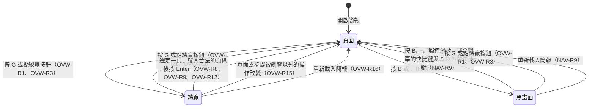
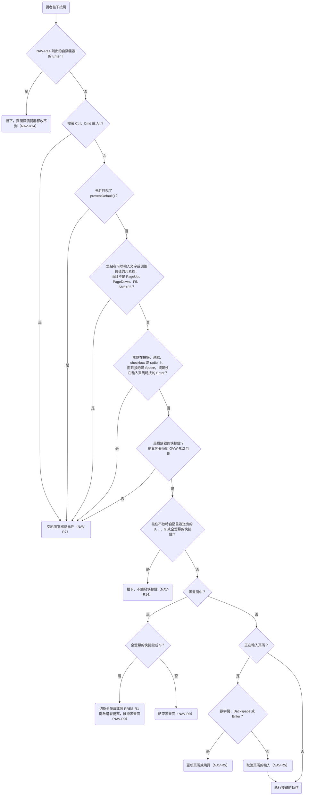
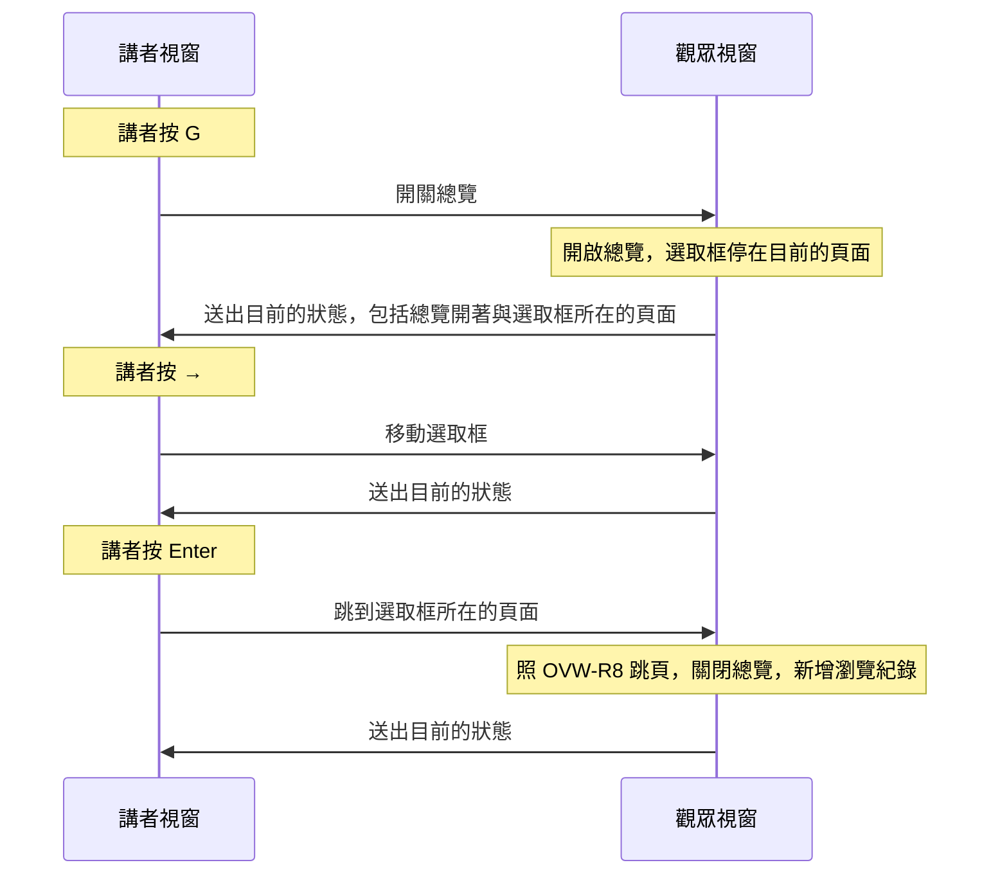

# 0005 預覽總覽

## 目標

完成後，講者播放簡報時按 `G`，或在平板上點右下角的總覽按鈕，就能把整份簡報排成每列 4 張的縮圖一次看完，每張縮圖顯示那一頁最後一步的畫面。講者用方向鍵移動選取框再按 Enter，或直接點縮圖，就會跳到那一頁的開頭，跳錯了可以用瀏覽器的上一頁回去。講者模式裡，觀眾視窗與講者視窗共用同一個總覽，講者在任一個視窗開關總覽或移動選取框，兩個視窗會一起改變。總覽出現時，目前的頁面縮小到它在總覽裡的位置；講者選定一頁時，那一頁從它的縮圖的位置放大成整頁。

## 範圍

- 要做：
  - 用 `G` 與觀眾視窗右下角的總覽按鈕開關總覽。總覽每列 4 張縮圖，縮圖顯示每頁的最後一步，並標出頁碼與目前的頁面。
  - 在總覽裡用方向鍵移動選取框，用 Enter、點縮圖或輸入頁碼跳頁。
  - 講者模式裡，兩個視窗共用同一個總覽。
  - 開關總覽時播放縮放動畫。
  - 新增 `overview.md`；修改 `navigation.md` 開頭的說明與 NAV-R5、NAV-R9、NAV-R11、NAV-R13、NAV-R14；修改 `steps.md` 的 STEP-R10；修改 `presenter.md` 開頭的說明與 PRES-R3、PRES-R8，並在 PRES-R9 新增情境；在 `product.md` 的術語表新增「總覽」與「選取框」。
  - 在 `README.md` 的「Playing a Deck」補上 `G` 與總覽按鈕，並寫明總覽開著時要用鍵盤、滑鼠或觸控操作，翻頁器只能捲動總覽。
- 刻意不做的事：
  - 在總覽裡拖曳縮圖調整順序與隱藏頁面，這屬於 roadmap 的下一個階段「排序與隱藏」。
  - 決定縮圖裡與總覽底下的頁面裡，影片的聲音與圖表的動畫要怎麼處理。這和講者視窗另外 render 的頁面一樣，由 roadmap 的「圖片與影片」與「ECharts 圖表」各自處理；roadmap 的「ECharts 圖表」已經寫了縮圖裡的圖表不播放動畫。
  - 用雙指捏合開啟總覽，理由寫在「決策」一節。

## Spec 變更

### overview.md

新增這份 spec，`prefix` 為 `OVW`，標題是「預覽總覽」，開頭的說明寫在下方「開頭的說明」。

- 新增 OVW-R1 用 `G` 開啟與關閉總覽
- 新增 OVW-R2 Esc 不關閉總覽
- 新增 OVW-R3 總覽按鈕
- 新增 OVW-R4 總覽的版面
- 新增 OVW-R5 縮圖上的頁碼與目前頁面的標記
- 新增 OVW-R6 縮圖顯示每頁的最後一步
- 新增 OVW-R7 用方向鍵移動選取框
- 新增 OVW-R8 跳到選取的頁面
- 新增 OVW-R9 選定目前的頁面
- 新增 OVW-R10 總覽底下保留目前的頁面
- 新增 OVW-R11 總覽開著時擋下 Tab
- 新增 OVW-R12 總覽開著時的快捷鍵
- 新增 OVW-R13 總覽開著時不能切換黑畫面
- 新增 OVW-R14 總覽開著時的觸控與滑鼠
- 新增 OVW-R15 頁面或步驟被總覽以外的操作改變時關閉總覽
- 新增 OVW-R16 重新載入簡報之後總覽關閉
- 新增 OVW-R17 講者模式的兩個視窗共用同一個總覽
- 新增 OVW-R18 講者模式裡兩個視窗各自捲動總覽
- 新增 OVW-R19 講者視窗的總覽蓋住整個視窗
- 新增 OVW-R20 講者視窗開著總覽時的提示
- 新增 OVW-R21 開關總覽的縮放動畫
- 新增 OVW-R22 縮放途中顯示的步驟
- 新增 OVW-R23 縮圖整張都在視窗外時淡出
- 新增 OVW-R24 動畫播放途中照常操作
- 新增 OVW-R25 減少動態效果時改成淡入淡出

#### 開頭的說明

預覽總覽是講者播放簡報時，把簡報的每一頁排成縮圖一次看完，並從中挑一頁跳過去的能力；本 spec 把排出這些縮圖的畫面叫做總覽。講者按 `G` 開啟總覽，總覽蓋住目前的頁面，每張縮圖顯示那一頁最後一步的畫面；講者用方向鍵移動選取框，按 Enter 或點縮圖，就跳到那一頁。

本 spec 同時描述觀眾視窗與講者視窗的總覽。講者視窗連上觀眾視窗時，兩個視窗共用同一個總覽，規則寫在 OVW-R17。

總覽開著時，講者按下按鍵後，播放器仍然依 [navigation.md](navigation.md) 開頭的流程圖決定要做什麼，只是播放器的快捷鍵換成 OVW-R12 列出的按鍵。這時頁面上的元件收不到鍵盤事件，焦點也不會停在頁面、縮圖或按鈕上（OVW-R6、OVW-R10、OVW-R11），所以流程圖裡「元件呼叫了 `preventDefault()`」「焦點在可以輸入文字或調整數值的元素裡」與「焦點在按鈕、連結、checkbox 或 radio 上」這三個判斷，在總覽開著時都不會成立。另外，Tab、Shift+Tab，以及 Safari 的 Option+Tab、Option+Shift+Tab，照流程圖會交給瀏覽器，但總覽開著時，播放器照 OVW-R11 擋下這幾個鍵。

觀眾視窗的畫面照下圖在頁面、總覽與黑畫面之間切換，每個轉換的細節寫在對應的需求裡。總覽與黑畫面之間沒有直接的轉換，所以兩者不會同時出現（OVW-R13）。

#### OVW-R1 用 `G` 開啟與關閉總覽

總覽沒有開著時，講者按 `G` 開啟總覽；總覽開著時，講者按 `G` 關閉總覽，畫面回到目前的頁面與步驟，網址的 hash 不變。`G` 和其他快捷鍵一樣適用 [navigation.md](navigation.md) 的 NAV-R7；按住 `G` 不放時，作業系統自動重複送出的 `G` 不觸發（NAV-R14）；黑畫面時按 `G` 只結束黑畫面，不開啟總覽（NAV-R9）。開啟或關閉總覽時，播放器取消輸入中的頁碼（NAV-R5），講者模式裡兩個視窗的輸入都取消（[presenter.md](presenter.md) 的 PRES-R3）。

- OVW-R1.1 開啟總覽
  - 前提：簡報有 6 頁，畫面顯示第 2 頁
  - 動作：按 `G`
  - 結果：畫面顯示總覽，總覽列出 6 張縮圖
- OVW-R1.2 關閉總覽
  - 前提：`list` 這一頁有 3 步，畫面顯示 `list` 的第 2 步
  - 動作：按 `G`，再按一次 `G`
  - 結果：第一次按下後畫面顯示總覽；第二次按下後總覽關閉，畫面顯示 `list` 的第 2 步；網址的 hash 一直是 `#/list/2`
- OVW-R1.3 按住 `G` 不放
  - 前提：總覽沒有開著
  - 動作：按住 `G`，直到作業系統自動送出好幾次 `G`
  - 結果：總覽開著，放開 `G` 之後仍然開著
- OVW-R1.4 黑畫面時按 `G`
  - 前提：畫面顯示 `intro`，接著切換成黑畫面
  - 動作：按 `G`
  - 結果：黑畫面結束，畫面顯示 `intro`，總覽沒有開著
- OVW-R1.5 輸入頁碼途中按 `G`
  - 前提：簡報依序是 `intro`、`agenda`、`recap` 三頁，畫面顯示 `intro`
  - 動作：在 3 秒內完成以下動作：輸入 3，按 `G`，再按 Enter
  - 結果：按 `G` 之後，頁碼消失，畫面顯示總覽，選取框在 `intro`；按 Enter 之後，總覽關閉，畫面顯示 `intro`
- OVW-R1.6 焦點在輸入框裡按 `G`
  - 前提：`intro` 這一頁有一個文字輸入框，畫面顯示 `intro`，焦點在輸入框裡
  - 動作：按 `G`
  - 結果：輸入框裡多了 `g`，總覽沒有開啟
- OVW-R1.7 按著 Cmd 按 `G`
  - 前提：總覽沒有開著
  - 動作：按著 Cmd（Windows 按 Ctrl）按 `G`
  - 結果：總覽沒有開啟
- OVW-R1.8 輸入頁碼途中按 `G` 關閉總覽
  - 前提：簡報依序是 `intro`、`agenda`、`recap` 三頁，畫面顯示 `intro`，總覽開著
  - 動作：在 3 秒內完成以下動作：輸入 3，按 `G`，再按 Enter
  - 結果：按 `G` 之後，頁碼消失，總覽關閉；按 Enter 之後，畫面顯示 `agenda`

> 設計理由：開關總覽用 `G`，因為 PowerPoint 播放時顯示所有投影片的快捷鍵就是 `G`，這延續了播放器的快捷鍵模仿 PowerPoint 的原則（[navigation.md](navigation.md) 開頭）。Esc 不能用來開啟總覽，因為全螢幕時瀏覽器收到 Esc 會直接離開全螢幕，網頁收不到 Esc 的 keydown 事件，而能讓網頁攔下 Esc 的 API 目前沒有一個是 Chromium、Firefox、Safari 都支援的。曾考慮用 reveal.js、Slidev 與 Marp 開啟總覽的 `O`，但這不符合播放器的快捷鍵模仿 PowerPoint 的原則。也考慮過讓 `G` 與 `O` 都能開啟總覽，但這樣總覽多佔一個鍵，之後畫筆標註、切換亮暗配色這些功能挑快捷鍵時，能用的鍵就少一個。完整討論見 [0005](../plans/archive/0005-overview.md)。

#### OVW-R2 Esc 不關閉總覽

總覽開著時，Esc 不是播放器的快捷鍵，講者按 Esc 不會關閉總覽。播放器在全螢幕時，瀏覽器收到 Esc 會讓播放器離開全螢幕（NAV-R10），總覽仍然開著。

- OVW-R2.1 不在全螢幕時按 Esc
  - 前提：播放器不在全螢幕，總覽開著
  - 動作：按 Esc
  - 結果：總覽仍然開著
- OVW-R2.2 全螢幕時按 Esc
  - 前提：播放器在全螢幕，總覽開著
  - 動作：按 Esc
  - 結果：播放器離開全螢幕，總覽仍然開著

> 設計理由：Esc 一律不關閉總覽，所以 Esc 不論在不在全螢幕、總覽有沒有開著，作用都相同。曾考慮在網頁收得到 Esc 時用 Esc 關閉總覽，但全螢幕時網頁收不到 Esc 的 keydown 事件，所以同一個鍵會在不是全螢幕時關閉總覽、在全螢幕時只離開全螢幕。也考慮過離開全螢幕時一併關閉總覽，但瀏覽器不會告訴網頁是哪個操作讓播放器離開全螢幕，所以講者按 `F` 或點全螢幕按鈕離開全螢幕時，總覽也會跟著關閉，總覽與全螢幕就不再是互不影響的兩個狀態。完整討論見 [0005](../plans/archive/0005-overview.md)。

#### OVW-R3 總覽按鈕

觀眾視窗的右下角、全螢幕按鈕（NAV-R11）的左邊有一顆總覽按鈕。總覽按鈕和全螢幕按鈕一起出現、一起隱藏，出現與隱藏的規則寫在 NAV-R11，其中一顆按鈕有焦點時，兩顆按鈕都保持顯示。總覽開著時，兩顆按鈕一直顯示；總覽關閉之後，兩顆按鈕再顯示 2 秒才隱藏，這段期間講者移動滑鼠或點畫面的話，照 NAV-R11 從最後一次移動滑鼠或點畫面開始計算 2 秒。用滑鼠或手指點總覽按鈕時，按鈕不取得焦點。總覽沒有開著時，講者用 Tab（Safari 預設是 Option+Tab）移動焦點，焦點先移到總覽按鈕，再移到全螢幕按鈕；焦點在總覽按鈕上時，按 Space 或 Enter 會按下按鈕（NAV-R7）。總覽開著時，講者點到按鈕與縮圖重疊的地方，按下的是按鈕。點總覽按鈕的作用和按 `G` 相同：總覽沒有開著時開啟總覽，開著時關閉總覽；黑畫面時點總覽按鈕只結束黑畫面。瀏覽器不支援讓網頁元素進入全螢幕時，例如 iPhone 的 Safari，播放器不顯示全螢幕按鈕，總覽按鈕單獨顯示在右下角。講者視窗沒有總覽按鈕，講者在講者視窗按 `G` 開關總覽。

- OVW-R3.1 點按鈕開關總覽
  - 前提：總覽沒有開著，總覽按鈕已經顯示
  - 動作：點總覽按鈕，再點一次
  - 結果：第一次點下後畫面顯示總覽，第二次點下後總覽關閉
- OVW-R3.2 點按鈕開啟總覽後按 Enter
  - 前提：簡報依序是 `intro`、`agenda`、`recap` 三頁，畫面顯示 `intro`
  - 動作：點總覽按鈕，按 →，再按 Enter
  - 結果：總覽關閉，畫面顯示 `agenda`
- OVW-R3.3 移動滑鼠時兩顆按鈕一起出現
  - 前提：瀏覽器支援讓網頁元素進入全螢幕，按鈕沒有顯示
  - 動作：移動滑鼠，接著 2 秒內不移動滑鼠
  - 結果：總覽按鈕出現在全螢幕按鈕的左邊，2 秒後兩顆按鈕一起隱藏
- OVW-R3.4 用 Tab 移到總覽按鈕
  - 前提：簡報依序是 `intro`、`agenda`、`recap` 三頁，畫面顯示 `intro`，總覽沒有開著，按鈕沒有顯示，頁面上沒有其他可以取得焦點的元素
  - 動作：按 Tab（Safari 按 Option+Tab），等 2 秒，按 Enter，按 →，再按 Enter
  - 結果：按 Tab 之後，總覽按鈕取得焦點，兩顆按鈕都出現，等 2 秒後仍然顯示；第一次按 Enter 之後，畫面顯示總覽；第二次按 Enter 之後，總覽關閉，畫面顯示 `agenda`
- OVW-R3.5 黑畫面時點總覽按鈕
  - 前提：畫面顯示 `intro`，接著切換成黑畫面
  - 動作：移動滑鼠，點總覽按鈕
  - 結果：黑畫面結束，畫面顯示 `intro`，總覽沒有開著
- OVW-R3.6 瀏覽器不支援全螢幕
  - 前提：在 iPhone 的 Safari 開啟簡報
  - 動作：手指點一下畫面
  - 結果：右下角出現總覽按鈕，沒有出現全螢幕按鈕
- OVW-R3.7 在平板上開啟與關閉總覽
  - 前提：在 iPad 的 Safari 開啟簡報，畫面顯示 `intro`
  - 動作：手指點一下畫面，點總覽按鈕，等 3 秒，再點一次總覽按鈕
  - 結果：第一次點總覽按鈕之後，畫面顯示總覽；等 3 秒之後，兩顆按鈕仍然顯示；第二次點總覽按鈕之後，總覽關閉，畫面顯示 `intro`
- OVW-R3.8 講者視窗沒有總覽按鈕
  - 前提：講者視窗已經開著
  - 動作：在講者視窗移動滑鼠
  - 結果：講者視窗沒有出現總覽按鈕
- OVW-R3.9 總覽開著時按鈕一直顯示
  - 前提：瀏覽器支援讓網頁元素進入全螢幕，總覽沒有開著
  - 動作：按 `G`，接著 3 秒內不移動滑鼠，也不點畫面
  - 結果：總覽按鈕與全螢幕按鈕一直顯示
- OVW-R3.10 關閉總覽之後按鈕隱藏
  - 前提：瀏覽器支援讓網頁元素進入全螢幕，總覽開著，兩顆按鈕都顯示著
  - 動作：按 `G`，接著 2 秒內不移動滑鼠，也不點畫面
  - 結果：總覽關閉，2 秒後兩顆按鈕一起隱藏
- OVW-R3.11 點到按鈕與縮圖重疊的地方
  - 前提：簡報有 40 頁，畫面顯示第 1 頁，總覽開著；講者用滑鼠滾輪把總覽捲到右下角的總覽按鈕蓋住某張縮圖一角的位置
  - 動作：點總覽按鈕
  - 結果：總覽關閉，畫面顯示第 1 頁

> 設計理由：觀眾視窗有總覽按鈕，因為用平板播放時沒有鍵盤可以按 `G`，這和 NAV-R11 提供全螢幕按鈕的理由相同。曾考慮用雙指捏合開啟總覽，但雙指捏合是瀏覽器的縮放手勢，播放器要擋下瀏覽器的縮放才能使用，各瀏覽器的擋法不同，iOS 的 Safari 也不理會網頁禁止縮放的設定；而且畫面上看不出有這個手勢。講者視窗沒有總覽按鈕，因為講者模式只在接著投影幕的電腦上使用，講者一定有鍵盤，這和 PRES-R1 不放開啟講者視窗的按鈕的理由相同。總覽開著時兩顆按鈕一直顯示，因為在平板上點總覽裡的縮圖會跳頁，如果按鈕照 NAV-R11 隱藏，講者就找不到不跳頁也能關閉總覽的地方點；總覽本來就是操作用的畫面，不是投影片本身，所以投影幕上多兩顆按鈕不影響觀眾看投影片。曾考慮讓講者點總覽的背景或縮圖之間的空隙來關閉總覽，但空隙很窄，講者點縮圖時手指點偏一點，總覽就直接關閉。完整討論見 [0005](../plans/archive/0005-overview.md)。

#### OVW-R4 總覽的版面

總覽蓋住整個視窗，背景是深色，不受簡報配色的影響。總覽照 `deck.json` 的順序排出每一頁的縮圖，每列固定 4 張；每張縮圖把 1920×1080 的畫布等比縮小，寬度跟著視窗的寬度縮放。所有縮圖放不進視窗時，總覽可以上下捲動。兩顆按鈕（OVW-R3）蓋在總覽上面，總覽捲動時，縮圖會從按鈕底下經過；總覽在最後一列下方多留一段空白，所以總覽捲到最下方時，最後一列的縮圖也不會被按鈕蓋住。本 spec 說縮圖「完整出現在視窗裡」，指整張縮圖連同下方的頁碼與「目前」的標記（OVW-R5）都在視窗裡，而且沒有被右下角的按鈕蓋住；輸入中的頁碼（NAV-R5）只會暫時出現，不算在內。輸入中的頁碼點不到，講者點到它的位置，等於點到它底下的縮圖或背景。播放器記錄總覽的捲動位置，記錄的是總覽的上緣切在第幾列的什麼位置，例如上緣切在第 3 列的一半；講者模式裡，兩個視窗各自記錄自己的位置（OVW-R18）。一列的範圍從這一列縮圖的上緣，到下一列縮圖的上緣，包括縮圖下方的頁碼與列之間的間距；總覽最上方的留白算進第 1 列，最後一列則到總覽的下緣為止，包括最後一列下方多留的空白。總覽每次捲動之後，記錄的位置就改成新的位置，不論是講者捲動總覽，還是播放器照本 spec 的規則捲動總覽，例如開啟總覽、照 OVW-R7 捲到選取框，以及講者視窗連上時捲到選取框（OVW-R18）。只有兩種捲動不改變記錄：視窗大小改變造成的捲動，以及捲不到記錄的位置而停在最下方。總覽一律照記錄的位置捲動，捲不到那個位置時就停在最下方。所以視窗大小改變時，例如播放器進入或離開全螢幕，每一列的高度跟著改變，總覽照記錄的位置重新捲動，改變之後仍然切在第 3 列的一半；選取框因此沒有完整出現時，總覽不另外捲動，講者按方向鍵時才照 OVW-R7 捲到選取框。每次開啟總覽時，總覽都從最上方開始，再照需要捲到目前頁面的縮圖完整出現在視窗裡的位置，記錄的位置改成總覽開啟之後停的位置，總覽不需要捲動時也一樣。

- OVW-R4.1 每列 4 張
  - 前提：簡報有 7 頁
  - 動作：按 `G`
  - 結果：第一列依序是第 1 到 4 頁的縮圖，第二列依序是第 5 到 7 頁的縮圖
- OVW-R4.2 視窗的寬度改變
  - 前提：瀏覽器視窗是 1280×720，總覽開著
  - 動作：把視窗改成 800×600
  - 結果：每列仍然是 4 張縮圖，縮圖的寬度變小
- OVW-R4.3 開啟時捲到目前的頁面
  - 前提：簡報有 40 頁，畫面顯示第 37 頁
  - 動作：按 `G`
  - 結果：第 37 頁的縮圖完整出現在視窗裡
- OVW-R4.4 視窗大小改變時維持捲動位置
  - 前提：瀏覽器視窗是 1280×720，簡報有 40 頁，總覽開著，總覽的上緣切在第 3 列的一半
  - 動作：把視窗改成 1920×1080
  - 結果：總覽的上緣仍然切在第 3 列的一半
- OVW-R4.5 最後一列的縮圖不被按鈕蓋住
  - 前提：瀏覽器視窗是 1280×720，簡報有 40 頁，畫面顯示第 40 頁
  - 動作：按 `G`
  - 結果：第 40 頁的縮圖完整出現在視窗裡，沒有被總覽按鈕蓋住
- OVW-R4.6 視窗變大到捲不到記錄的位置，再變回原本的大小
  - 前提：瀏覽器視窗是 1280×720，簡報有 40 頁，總覽開著，總覽捲在最下方
  - 動作：把視窗改成 1280×1000，再改回 1280×720
  - 結果：改成 1280×1000 之後，總覽停在最下方；改回 1280×720 之後，總覽仍然在最下方
- OVW-R4.7 視窗變小之後選取框沒有完整出現
  - 前提：瀏覽器視窗是 1280×720，簡報有 40 頁，總覽開著，總覽捲在最上方，選取框在第 9 頁，第 9 頁的縮圖完整出現在視窗裡
  - 動作：把視窗改成 1280×500
  - 結果：總覽仍然捲在最上方，第 9 頁的縮圖沒有完整出現在視窗裡
- OVW-R4.8 重新開啟總覽之後改變視窗大小
  - 前提：瀏覽器視窗是 1280×720，簡報有 40 頁，畫面顯示第 1 頁
  - 動作：按 `G`，用滑鼠滾輪把總覽捲到最下方，按 `G` 關閉總覽，再按 `G` 開啟總覽，接著把視窗改成 1920×1080
  - 結果：重新開啟總覽之後，總覽捲在最上方；改變視窗大小之後，總覽仍然捲在最上方，第 1 頁的縮圖完整出現在視窗裡

> 設計理由：每列固定 4 張縮圖，所以同一頁不論在哪個視窗、哪個螢幕上，都排在總覽的同一個位置，講者記得「第 6 頁在第二列」，換到現場的電腦也一樣，觀眾視窗與講者視窗的總覽也相同。曾考慮讓縮圖有固定的最小寬度，每列的張數隨視窗的寬度改變，但這樣講者視窗與觀眾視窗的每列張數會不同，同一頁在兩個視窗的位置也不同。也考慮過每列 5 張，但在 1920 寬的螢幕上，頁面裡 48 px 的字會縮成約 9 px，每列 4 張時約 11 px。完整討論見 [0005](../plans/archive/0005-overview.md)。

#### OVW-R5 縮圖上的頁碼與目前頁面的標記

每張縮圖下方寫這一頁的頁碼，頁碼從 1 開始；目前的頁面那張縮圖的頁碼旁邊另外寫「目前」。選取框是縮圖外圍的粗框，和「目前」的標記不同：選取框跟著講者的操作移動（OVW-R7），「目前」一直標在目前的頁面。

- OVW-R5.1 開啟時的標記
  - 前提：簡報有 7 頁，畫面顯示第 2 頁
  - 動作：按 `G`
  - 結果：每張縮圖下方依序寫著 1 到 7 的頁碼，第 2 頁的頁碼旁邊寫著「目前」，選取框在第 2 頁的縮圖外圍
- OVW-R5.2 移動選取框之後
  - 前提：簡報有 7 頁，畫面顯示第 2 頁，總覽開著
  - 動作：按 →
  - 結果：選取框移到第 3 頁的縮圖外圍，「目前」仍然寫在第 2 頁的頁碼旁邊

> 設計理由：縮圖上寫頁碼，因為講者在總覽裡也能輸入頁碼跳頁（OVW-R12），要看得到每一頁的頁碼。目前的頁面另外標記，因為選取框一移開，講者就看不出自己原本講到哪一頁，問答完要回去時找不到位置。曾考慮在頁碼旁邊再寫 slide ID，但觀眾視窗的總覽會出現在投影幕上，觀眾會看到 `draft-v2` 這種製作時取的名字；製作簡報時要查 slide ID，看 `deck.json` 或網址的 hash 就查得到。完整討論見 [0005](../plans/archive/0005-overview.md)。

#### OVW-R6 縮圖顯示每頁的最後一步

每張縮圖顯示那一頁最後一步的畫面。縮圖是另外 render 的一份頁面，和講者視窗的目前頁、下一步與下一頁相同（[presenter.md](presenter.md) 的 PRES-R6）：講者點不到縮圖裡的元素，點縮圖時點到的是整張縮圖（OVW-R8）；縮圖本身與縮圖裡的元素都不會取得焦點，包括寫了 `autoFocus` 或元件自己呼叫 `focus()` 的元素，講者也不能用 Tab 把焦點移到縮圖上。總覽開著時，縮圖裡的元件收不到鍵盤事件。觀眾視窗的總覽關閉之後淡出的期間（OVW-R21），縮圖還在，縮圖裡的元件收得到鍵盤事件，所以元件在 keydown 事件呼叫 `preventDefault()` 時，播放器不觸發快捷鍵，和頁面上的元件攔下 keydown 事件相同（[navigation.md](navigation.md) 的 NAV-R7）；講者視窗的縮圖一律收不到鍵盤事件（[presenter.md](presenter.md) 的 PRES-R6）。縮圖不影響目前頁面的步數。[steps.md](steps.md) 的 STEP-R7 與 STEP-R8 印在 console 的警告與錯誤，只有觀眾視窗播放的那一頁會印，縮圖不會印；STEP-R3 在 `<svg>` 裡放了 `<Step>` 時印出的錯誤，則由 `<Step>` 自己印出，所以縮圖 render 時也會印，和講者視窗的目前頁、下一步與下一頁相同。縮圖裡的元件照常執行 effect，例如計時器會繼續計時。

> 設計理由：觀眾視窗的總覽淡出的期間，播放器不替縮圖攔下鍵盤事件，因為播放器在這時攔下鍵盤事件的話，新換上的那一頁也會跟著收不到鍵盤事件，違反 NAV-R7；只有縮圖裡的元件比播放器先收到 keydown 事件並呼叫 `preventDefault()` 時，講者在這段期間按的快捷鍵才會失效。曾考慮關閉總覽時立刻拿掉縮圖的內容，但這樣淡出的會是空白的框；也考慮過關閉時把縮圖換成複製的靜態畫面，但這樣程式要直接改 React 管理的 DOM，圖表的 canvas 與影片複製之後也是空白的。完整討論見 [0005](../plans/archive/0005-overview.md)。

縮圖離視窗的上緣或下緣不到一個視窗的高度時，播放器才 render 這張縮圖，縮圖離得更遠時就移除，所以縮圖裡的元件會在講者捲回來時重新開始，例如計時器從頭計時。縮圖還沒 render 時，只顯示空白的框與頁碼。

- OVW-R6.1 用 `<Step>` 的頁面
  - 前提：`list` 這一頁有 `<Step at={1}>` 包住的「第一點」與 `<Step at={2}>` 包住的「第二點」，畫面顯示 `list` 的第 0 步
  - 動作：按 `G`，再按一次 `G`
  - 結果：第一次按下後，`list` 的縮圖顯示「第一點」與「第二點」；第二次按下後，畫面顯示 `list` 的第 0 步，「第一點」與「第二點」都看不見
- OVW-R6.2 用 `useStep` 的頁面
  - 前提：`list` 這一頁呼叫 `useStep(3)`，第 3 步之前顯示「舊的結論」，從第 3 步開始顯示「新的結論」，畫面顯示 `intro`
  - 動作：按 `G`
  - 結果：`list` 的縮圖顯示「新的結論」
- OVW-R6.3 縮圖裡有自動取得焦點的輸入框
  - 前提：簡報依序是 `intro`、`repl`、`recap` 三頁，`repl` 有一個寫了 `autoFocus` 的文字輸入框，畫面顯示 `intro`
  - 動作：按 `G`，再按 →
  - 結果：選取框移到 `repl`
- OVW-R6.4 點縮圖裡的按鈕
  - 前提：`counter` 這一頁有一個計數器，初始值是 0，畫面顯示 `intro`
  - 動作：按 `G`，點 `counter` 縮圖裡計數器的按鈕所在的位置
  - 結果：總覽關閉，畫面顯示 `counter`，計數器顯示 0
- OVW-R6.5 跳號的頁面
  - 前提：`gap` 這一頁只有 `<Step at={1}>` 與 `<Step at={3}>`，畫面顯示 `intro`
  - 動作：按 `G`
  - 結果：Console 沒有寫出 `gap` 的警告
- OVW-R6.6 捲回看過的縮圖
  - 前提：瀏覽器視窗是 1280×720，簡報有 40 頁，第 1 頁有一個每秒加 1 的計數器，畫面顯示第 1 頁
  - 動作：按 `G`，把總覽捲到最下方，等 3 秒，再捲回最上方
  - 結果：捲回最上方時，第 1 頁縮圖裡的計數器顯示的數字小於 3
- OVW-R6.7 總覽淡出途中，縮圖裡的元件攔下按鍵
  - 前提：簡報依序是 `intro`、`agenda`、`grabber` 三頁，三頁都沒有步驟；`grabber` 有一個元件，在 `window` 的 capture 階段遇到 → 時呼叫 `preventDefault()`；畫面顯示 `intro`，總覽開著，`grabber` 的縮圖已經顯示出來
  - 動作：按 `G`，300 毫秒內按 →，等總覽淡出之後再按一次 →
  - 結果：第一次按 → 之後，畫面仍然顯示 `intro`；第二次按 → 之後，畫面顯示 `agenda`

> 設計理由：縮圖顯示每頁的最後一步，因為最後一步的畫面包含這一頁的所有內容，講者最容易認出是哪一頁；Slidev、Spectacle 與 Marp 的縮圖也都顯示最後一步。曾考慮讓縮圖顯示第 0 步，但步驟多的頁面在第 0 步時大部分的內容都還沒出現，縮圖看起來幾乎是空的。完整討論見 [0005](../plans/archive/0005-overview.md)。

#### OVW-R7 用方向鍵移動選取框

開啟總覽時，選取框在目前頁面的縮圖上。總覽開著時，講者按方向鍵移動選取框，畫面不換頁，網址的 hash 也不變：

1. ← 與 → 照頁碼的順序移動一頁。選取框在一列的最後一張時按 →，選取框移到下一列的第一張；在一列的第一張時按 ←，選取框移到上一列的最後一張。
2. ↑ 與 ↓ 移到上一列或下一列同一欄的縮圖。按 ↓ 時，下一列的那一欄沒有縮圖的話，選取框移到最後一頁。
3. 選取框在第一頁時按 ←、在最後一頁時按 →、在第一列時按 ↑、在最後一列時按 ↓，選取框都不動。

講者每次按方向鍵之後，選取框所在的縮圖沒有完整出現在視窗裡（OVW-R4）的話，總覽就捲到它完整出現的位置；縮圖只露出一部分也算沒有完整出現，選取框因為碰到邊界而沒有移動時也一樣。講者用滑鼠滾輪、觸控板，或 OVW-R12 交給瀏覽器的按鍵捲動總覽時，選取框不動，所以選取框可能被捲到視窗外，講者接著按任何一個方向鍵，總覽就捲回選取框所在的縮圖。

> 設計理由：講者可以用方向鍵移動選取框，因為觀眾視窗在投影幕上全螢幕時，講者看不到投影幕上的游標（PRES-R3 的設計理由），只能用滑鼠的話，講者很難在投影幕上點到要的那一頁。Slidev、reveal.js 與 Marp 的總覽也都能用方向鍵移動選取框、按 Enter 選定。完整討論見 [0005](../plans/archive/0005-overview.md)。

- OVW-R7.1 按 →
  - 前提：簡報有 7 頁，畫面顯示第 1 頁，總覽開著
  - 動作：按 →
  - 結果：選取框移到第 2 頁，畫面仍然顯示總覽，網址的 hash 沒有改變
- OVW-R7.2 在一列的最後一張按 →
  - 前提：簡報有 7 頁，總覽開著，選取框在第 4 頁
  - 動作：按 →
  - 結果：選取框移到第 5 頁
- OVW-R7.3 在一列的第一張按 ←
  - 前提：簡報有 7 頁，總覽開著，選取框在第 5 頁
  - 動作：按 ←
  - 結果：選取框移到第 4 頁
- OVW-R7.4 按 ↓
  - 前提：簡報有 7 頁，總覽開著，選取框在第 2 頁
  - 動作：按 ↓
  - 結果：選取框移到第 6 頁
- OVW-R7.5 按 ↑
  - 前提：簡報有 7 頁，總覽開著，選取框在第 6 頁
  - 動作：按 ↑
  - 結果：選取框移到第 2 頁
- OVW-R7.6 下一列的同一欄沒有縮圖
  - 前提：簡報有 7 頁，總覽開著，選取框在第 4 頁
  - 動作：按 ↓
  - 結果：選取框移到第 7 頁
- OVW-R7.7 在最後一列按 ↓
  - 前提：簡報有 7 頁，總覽開著，選取框在第 6 頁
  - 動作：按 ↓
  - 結果：選取框仍然在第 6 頁
- OVW-R7.8 在第一列按 ↑
  - 前提：簡報有 7 頁，總覽開著，選取框在第 3 頁
  - 動作：按 ↑
  - 結果：選取框仍然在第 3 頁
- OVW-R7.9 在第一頁按 ←
  - 前提：簡報有 7 頁，總覽開著，選取框在第 1 頁
  - 動作：按 ←
  - 結果：選取框仍然在第 1 頁
- OVW-R7.10 在最後一頁按 →
  - 前提：簡報有 7 頁，總覽開著，選取框在第 7 頁
  - 動作：按 →
  - 結果：選取框仍然在第 7 頁
- OVW-R7.11 選取框移到視窗外
  - 前提：簡報有 40 頁，畫面顯示第 1 頁，總覽開著
  - 動作：按 9 次 ↓
  - 結果：選取框在第 37 頁，第 37 頁的縮圖完整出現在視窗裡
- OVW-R7.12 捲動總覽之後按方向鍵
  - 前提：簡報有 40 頁，畫面顯示第 1 頁，總覽開著
  - 動作：用滑鼠滾輪把總覽捲到最下方，再按 →
  - 結果：捲到最下方之後，選取框仍然在第 1 頁；按 → 之後，選取框移到第 2 頁，第 2 頁的縮圖完整出現在視窗裡
- OVW-R7.13 按住 → 不放
  - 前提：簡報有 7 頁，總覽開著，選取框在第 1 頁
  - 動作：按住 →，直到作業系統再自動送出兩次 →
  - 結果：選取框移到第 4 頁
- OVW-R7.14 選取框移到被按鈕蓋住的縮圖
  - 前提：瀏覽器視窗是 1280×720，簡報有 40 頁，總覽開著；講者用滑鼠滾輪把總覽捲到某一列最右邊那張縮圖整張都在視窗裡、但右下角被總覽按鈕蓋住的位置，選取框在同一列的第 3 張
  - 動作：按 →
  - 結果：選取框移到同一列最右邊那張縮圖，總覽往下捲動，這張縮圖沒有被按鈕蓋住
- OVW-R7.15 選取框只露出一部分
  - 前提：瀏覽器視窗是 1280×720，簡報有 40 頁，總覽開著；講者用滑鼠滾輪把總覽捲到視窗下緣切過某一列、那一列的縮圖只有上半部在視窗裡的位置，選取框在它上面那一列的第 2 張
  - 動作：按 ↓
  - 結果：選取框移到下一列的第 2 張，總覽往下捲動，這張縮圖完整出現在視窗裡
- OVW-R7.16 選取框被捲到視窗外時按方向鍵，選取框沒有移動
  - 前提：簡報有 40 頁，畫面顯示第 1 頁，總覽開著，選取框在第 1 頁；講者用滑鼠滾輪把總覽捲到最下方
  - 動作：按 ←
  - 結果：選取框仍然在第 1 頁，總覽捲回第 1 頁的縮圖完整出現在視窗裡的位置

> 設計理由：選取框不會從最後一頁循環回第一頁，理由和 NAV-R3 不從最後一頁循環回第一頁相同：講者按過頭時，選取框突然跳回第一頁，很容易看錯位置。按 ↓ 時，下一列的同一欄沒有縮圖就移到最後一頁，因為講者按 ↓ 是要往後找，下面還有一列時選取框卻不動的話，看起來像是播放器沒有反應。選取框因為碰到邊界而沒有移動時，總覽仍然捲到選取框，因為講者按方向鍵就是想看選取框在哪裡；曾考慮只在選取框真的移動時才捲動，但這樣講者在第一頁按 ← 時畫面沒有任何反應。完整討論見 [0005](../plans/archive/0005-overview.md)。

#### OVW-R8 跳到選取的頁面

總覽開著時，講者按 Enter，播放器就跳到選取框所在的頁面，並關閉總覽；講者用滑鼠或手指點縮圖，或點縮圖下方的頁碼時，播放器跳到那張縮圖的頁面，並關閉總覽；點總覽的背景或縮圖之間的空隙時，什麼都不發生。正在輸入頁碼時按的 Enter 用來確認頁碼，規則寫在 OVW-R12。跳到其他頁面時，畫面顯示那一頁的第 0 步（[steps.md](steps.md) 的 STEP-R10），播放器在瀏覽器新增一筆瀏覽紀錄（NAV-R6）。選定的頁面就是目前的頁面時，規則寫在 OVW-R9。

- OVW-R8.1 按 Enter 跳頁
  - 前提：簡報依序是 `intro`、`agenda`、`recap` 三頁，畫面顯示 `intro`
  - 動作：按 `G`，按兩次 →，再按 Enter
  - 結果：總覽關閉，畫面顯示 `recap`，網址的 hash 是 `#/recap`
- OVW-R8.2 點縮圖跳頁
  - 前提：簡報依序是 `intro`、`agenda`、`recap` 三頁，畫面顯示 `intro`
  - 動作：按 `G`，點 `recap` 的縮圖
  - 結果：總覽關閉，畫面顯示 `recap`
- OVW-R8.3 跳到有步驟的頁面
  - 前提：簡報依序是 `intro`、`list`、`recap` 三頁，`list` 有 3 步，畫面顯示 `recap`
  - 動作：按 `G`，點 `list` 的縮圖
  - 結果：畫面顯示 `list` 的第 0 步，網址的 hash 是 `#/list`
- OVW-R8.4 用瀏覽器的上一頁回到跳頁之前的位置
  - 前提：簡報依序是 `intro`、`list`、`recap` 三頁，`list` 有 3 步，畫面顯示 `list` 的第 2 步
  - 動作：按 `G`，點 `recap` 的縮圖，再按瀏覽器的上一頁
  - 結果：畫面顯示 `list` 的第 2 步，總覽沒有開著
- OVW-R8.5 在平板上點縮圖
  - 前提：在 iPad 的 Safari 開啟簡報，簡報依序是 `intro`、`agenda`、`recap` 三頁，畫面顯示 `intro`，總覽開著
  - 動作：手指點 `recap` 的縮圖
  - 結果：總覽關閉，畫面顯示 `recap`
- OVW-R8.6 點縮圖下方的頁碼
  - 前提：簡報依序是 `intro`、`agenda`、`recap` 三頁，畫面顯示 `intro`，總覽開著
  - 動作：點 `recap` 的縮圖下方的頁碼 3
  - 結果：總覽關閉，畫面顯示 `recap`
- OVW-R8.7 點縮圖之間的空隙
  - 前提：簡報依序是 `intro`、`agenda`、`recap` 三頁，畫面顯示 `intro`，總覽開著
  - 動作：點 `agenda` 與 `recap` 兩張縮圖之間的空隙
  - 結果：總覽仍然開著，選取框仍然在 `intro`
- OVW-R8.8 點到輸入中頁碼的位置
  - 前提：簡報有 40 頁，畫面顯示第 1 頁，總覽開著；講者輸入 3，頁碼蓋住右下角某張縮圖的一部分
  - 動作：在 3 秒內點頁碼所在的位置
  - 結果：總覽關閉，畫面顯示頁碼底下那張縮圖的頁面，頁碼消失

> 設計理由：從總覽跳到其他頁面時停在第 0 步，和 Home、End、輸入頁碼這些跳頁方式相同（STEP-R10）。總覽裡也能輸入頁碼跳頁（OVW-R12），如果點縮圖停在最後一步，講者在總覽裡用兩種方式選同一頁，結果就會不同；講者時間不夠、要跳過幾頁直接講後面的頁面時，也需要從第 0 步開始。曾考慮停在最後一步，和縮圖看到的畫面相同。停在第 0 步的代價是講者在問答時回到講過的頁面，要按好幾次 → 才看得到完整的畫面，不過講者按住 → 不放就會連續前進（NAV-R14.1）。也考慮過依方向決定，選定的頁面在目前的頁面之前時停在最後一步，但 Home、End 與輸入頁碼都不看方向，總覽會變成唯一一種依方向決定步驟的跳頁方式。完整討論見 [0005](../plans/archive/0005-overview.md)。

#### OVW-R9 選定目前的頁面

講者按 Enter 時選取框在目前的頁面，或講者點目前頁面的縮圖時，播放器只關閉總覽：畫面顯示原本的步驟，網址的 hash 不變，播放器也不新增瀏覽紀錄。不過講者在總覽裡輸入目前頁面的頁碼再按 Enter 時，播放器照 NAV-R5 跳到這一頁的第 0 步（OVW-R12）。

- OVW-R9.1 開啟總覽之後直接按 Enter
  - 前提：在瀏覽器開啟網站首頁，再從首頁開啟這份簡報；簡報依序是 `intro`、`list`、`recap` 三頁，`intro` 沒有步驟，`list` 有 3 步，講者按三次 →，畫面顯示 `list` 的第 2 步
  - 動作：按 `G`，按 Enter，再按瀏覽器的上一頁
  - 結果：按 Enter 之後，總覽關閉，畫面顯示 `list` 的第 2 步，網址的 hash 是 `#/list/2`；按瀏覽器的上一頁之後，瀏覽器回到網站首頁
- OVW-R9.2 點目前頁面的縮圖
  - 前提：`list` 這一頁有 3 步，畫面顯示 `list` 的第 2 步
  - 動作：按 `G`，點 `list` 的縮圖
  - 結果：總覽關閉，畫面顯示 `list` 的第 2 步

> 設計理由：選定目前的頁面時只關閉總覽，因為選取框一開始就停在目前的頁面，講者開啟總覽、沒移動選取框就按 Enter，多半是想回到原本的畫面。曾考慮照 OVW-R8 回到這一頁的第 0 步，但這樣講者在講者視窗開啟總覽看一眼，接著習慣性按 Enter，投影幕上這一頁已經出現的項目就會全部消失。輸入頁碼則照 NAV-R5 跳到第 0 步，因為輸入頁碼是講者刻意的操作。完整討論見 [0005](../plans/archive/0005-overview.md)。

#### OVW-R10 總覽底下保留目前的頁面

總覽開著時，目前的頁面留在總覽底下，播放器不重新 mount 這一頁，所以講者按 `G` 關閉總覽，或選定目前的頁面（OVW-R9）時，頁面上互動元件的狀態都還在；跳到其他頁面時，照 NAV-R13 重置。總覽開著的期間，講者點不到總覽底下的頁面，頁面上的元件收不到鍵盤事件，頁面上的元素也不會取得焦點。開啟總覽時，焦點離開原本所在的元素，包括頁面上的元素與總覽按鈕；關閉總覽時，焦點不會回到原本的元素。不論總覽是因為哪個操作關閉，畫面換上的新頁面裡寫了 `autoFocus` 的元素，都和平常換頁時一樣取得焦點。總覽底下的頁面照常執行 effect。

- OVW-R10.1 關閉總覽之後保留互動元件的狀態
  - 前提：`counter` 這一頁有一個計數器，初始值是 0，畫面顯示 `counter`，講者把計數器按到 3
  - 動作：按 `G`，再按一次 `G`
  - 結果：計數器顯示 3
- OVW-R10.2 選定目前的頁面之後保留互動元件的狀態
  - 前提：`counter` 這一頁有一個計數器，初始值是 0，畫面顯示 `counter`，講者把計數器按到 3
  - 動作：按 `G`，再按 Enter
  - 結果：總覽關閉，計數器顯示 3
- OVW-R10.3 焦點在頁面的輸入框裡時開啟總覽
  - 前提：簡報依序是 `intro`、`agenda`、`recap` 三頁，`intro` 有一個文字輸入框，畫面顯示 `intro`，焦點在輸入框裡
  - 動作：點總覽按鈕，按 →，再按 Enter
  - 結果：按 → 之後，選取框移到 `agenda`，輸入框的內容沒有改變；按 Enter 之後，畫面顯示 `agenda`
- OVW-R10.4 頁面上有攔下 → 的元件時在總覽裡按 →
  - 前提：簡報依序是 `gallery`、`recap` 兩頁，`gallery` 有一個輪播元件，在 `window` 的 keydown 事件遇到 → 時呼叫 `preventDefault()` 並換到下一張圖；畫面顯示 `gallery`，輪播顯示第一張圖
  - 動作：按 `G`，按 →，再按 `G`
  - 結果：按 → 之後，選取框移到 `recap`；再按 `G` 之後，畫面顯示 `gallery`，輪播仍然顯示第一張圖
- OVW-R10.5 按瀏覽器的上一頁回到有自動取得焦點的輸入框的頁面
  - 前提：簡報依序是 `intro`、`repl`、`recap` 三頁，`repl` 有一個寫了 `autoFocus` 的 `<textarea>`；畫面顯示 `repl` 時，講者點一下頁面上沒有元素的地方，讓 `<textarea>` 失去焦點，再按 End 跳到 `recap`，接著按 `G` 開啟總覽
  - 動作：按瀏覽器的上一頁
  - 結果：總覽關閉，畫面顯示 `repl`，`<textarea>` 取得焦點

> 設計理由：總覽底下保留目前的頁面，所以講者沒有換頁就關閉總覽時，頁面和開啟總覽之前相同，例如講者示範計數器途中開啟總覽看一眼後面還有哪幾頁，關閉總覽之後，計數器仍然停在原本的數字。曾考慮開啟總覽時移除目前的頁面、關閉時重新 render，但這樣只要開啟過總覽，互動元件的狀態就會重置。代價是頁面留在總覽底下時，頁面的 effect 會繼續執行，例如有聲音的影片會在總覽後面繼續播放，這和講者視窗另外 render 的頁面一樣，留給 roadmap 的「圖片與影片」處理。完整討論見 [0005](../plans/archive/0005-overview.md)。

#### OVW-R11 總覽開著時擋下 Tab

總覽開著時，播放器擋下 Tab 與 Shift+Tab，在 Safari 另外擋下 Option+Tab 與 Option+Shift+Tab，焦點不移動。開啟總覽時，焦點已經離開原本所在的元素（OVW-R10），所以總覽開著的期間，焦點不會停在總覽按鈕、全螢幕按鈕或縮圖上，也不會移到瀏覽器的網址列；講者按 Enter 或 Space 時不會按下任何按鈕，Enter 與 Space 的作用照 OVW-R8、OVW-R9 與 OVW-R12。講者視窗本來就擋下這幾個鍵（PRES-R11）。

- OVW-R11.1 總覽開著時按 Tab 之後按 Enter
  - 前提：簡報依序是 `intro`、`agenda`、`recap` 三頁，畫面顯示 `intro`，總覽開著
  - 動作：按 Tab（Safari 按 Option+Tab）五次，按 →，再按 Enter
  - 結果：焦點從來沒有移到總覽按鈕、全螢幕按鈕或任何一張縮圖上；按 Enter 之後，總覽關閉，畫面顯示 `agenda`
- OVW-R11.2 總覽開著時按 Shift+Tab 之後按 Space
  - 前提：簡報有 40 頁，畫面顯示第 1 頁，播放器不在全螢幕，總覽開著
  - 動作：按 Shift+Tab（Safari 按 Option+Shift+Tab）五次，再按 Space
  - 結果：總覽往下捲動，總覽仍然開著，播放器沒有進入全螢幕

> 設計理由：總覽開著時擋下 Tab，因為頁面與縮圖都不能取得焦點，講者按 Tab 時，焦點只會停在兩顆按鈕上，這時講者按 Enter 或 Space 會按下按鈕，例如關閉總覽而沒有跳頁，講者卻看不出焦點停在哪顆按鈕上；再多按幾次 Tab，焦點還可能移到瀏覽器的網址列，之後講者按的鍵都送不到網頁。總覽裡也用不到 Tab，因為關閉總覽可以按 `G`，切換全螢幕可以按 `F`。曾考慮保留 Tab，並寫明焦點在按鈕上時 Enter 與 Space 會按下按鈕，但這樣講者按過 Tab 之後再按 Enter，總覽就直接關閉、沒有跳頁。也考慮過只讓兩顆按鈕在總覽開著時不能用 Tab 移到，但這樣仍然擋不住焦點移到網址列。完整討論見 [0005](../plans/archive/0005-overview.md)。

#### OVW-R12 總覽開著時的快捷鍵

總覽開著時，播放器的快捷鍵只有下列按鍵；除了 OVW-R11 擋下的 Tab 這幾個鍵，其他按鍵都交給瀏覽器處理：

1. 方向鍵，移動選取框（OVW-R7）。
2. Enter，跳到選取框所在的頁面（OVW-R8、OVW-R9）。講者按住 Enter 不放時，自動重複送出的 Enter 照 NAV-R14 不觸發，總覽關閉之後也一樣。
3. 數字鍵，照 NAV-R5 輸入頁碼。輸入途中，Backspace 刪除最後一位數字，Enter 確認頁碼，播放器跳到那一頁的第 0 步並關閉總覽；頁碼是目前的頁面時也一樣。頁碼是 0 或大於總頁數時，播放器照 NAV-R5 不換頁、取消這次輸入，總覽維持開著，選取框也不動。輸入途中按方向鍵或 `G` 時，照 NAV-R5 取消輸入。
4. `G`，關閉總覽（OVW-R1）。
5. 全螢幕的快捷鍵（`F`、F5、Shift+F5），照 NAV-R10 作用，總覽維持開著。
6. `S`，照 PRES-R1 開啟講者視窗，總覽維持開著。`S` 在講者視窗不是快捷鍵（PRES-R1）。

所以 PageUp、PageDown、Space、Shift+Space、Home、End，以及沒在輸入頁碼時的 Backspace，都照瀏覽器的預設行為作用，例如 Space 與 PageDown 把總覽往下捲動，End 把總覽捲到最下方；這些按鍵不移動選取框，也不換頁。`B` 與 `.` 的規則寫在 OVW-R13。這些交給瀏覽器的按鍵不是快捷鍵，所以和用滑鼠滾輪捲動總覽一樣，不取消輸入中的頁碼。翻頁器送出的按鍵裡，PageUp 與 PageDown 只捲動總覽，F5、Shift+F5 與 Esc 照常切換全螢幕，黑畫面鍵沒有作用，所以總覽開著時，講者用翻頁器不能移動選取框、跳頁或關閉總覽，要用鍵盤、滑鼠或觸控操作總覽。

> 設計理由：總覽裡只有方向鍵移動選取框、只有 Enter 跳到選取的頁面，所以講者不必記住每個換頁的按鍵在總覽裡改成什麼作用。曾考慮讓 PageDown 與 PageUp 像 → 與 ← 一樣移動選取框、Space 像 Enter 一樣跳頁、Home 與 End 把選取框移到第一頁與最後一頁，但這樣總覽裡移動選取框的按鍵變多，Space 平常是下一步，在總覽裡卻會跳頁。這些按鍵交給瀏覽器，沿用 navigation.md 流程圖裡「不是快捷鍵的按鍵交給瀏覽器」的規則。也考慮過讓播放器擋下這些按鍵，畫面完全不動，但講者仍然可以用滑鼠滾輪捲動總覽，所以捲動總覽這件事會變成用滾輪可以、用按鍵不行。把這些按鍵交給瀏覽器，再加上 OVW-R13 的規則，代價是講者只拿著翻頁器時，總覽開著的期間不能移動選取框、跳頁或關閉總覽；不過開啟總覽本身就要用鍵盤按 `G`，或用滑鼠、手指點總覽按鈕，所以總覽開著時，講者本來就在電腦旁邊。完整討論見 [0005](../plans/archive/0005-overview.md)。

- OVW-R12.1 在總覽裡輸入頁碼
  - 前提：簡報依序是 `intro`、`agenda`、`recap` 三頁，畫面顯示 `intro`，總覽開著
  - 動作：輸入 3，再按 Enter
  - 結果：輸入 3 之後，視窗的右下角顯示 3，選取框仍然在 `intro`；按 Enter 之後，總覽關閉，畫面顯示 `recap`
- OVW-R12.2 輸入頁碼途中按方向鍵
  - 前提：簡報依序是 `intro`、`agenda`、`recap` 三頁，畫面顯示 `intro`，總覽開著
  - 動作：在 3 秒內完成以下動作：輸入 3，按 →，再按 Enter
  - 結果：按 → 之後，頁碼消失，選取框移到 `agenda`；按 Enter 之後，總覽關閉，畫面顯示 `agenda`
- OVW-R12.3 輸入目前頁面的頁碼
  - 前提：簡報依序是 `intro`、`list`、`recap` 三頁，`list` 有 3 步，畫面顯示 `list` 的第 2 步，總覽開著
  - 動作：輸入 2，再按 Enter
  - 結果：總覽關閉，畫面顯示 `list` 的第 0 步
- OVW-R12.4 在總覽裡輸入大於總頁數的頁碼
  - 前提：簡報依序是 `intro`、`agenda`、`recap` 三頁，畫面顯示 `intro`，總覽開著，選取框在 `agenda`
  - 動作：輸入 9，再按 Enter
  - 結果：頁碼消失，總覽仍然開著，選取框仍然在 `agenda`
- OVW-R12.5 按 Space
  - 前提：簡報有 40 頁，畫面顯示第 1 頁，總覽開著
  - 動作：按 Space
  - 結果：總覽往下捲動，選取框仍然在第 1 頁，總覽仍然開著
- OVW-R12.6 按 PageDown
  - 前提：簡報有 40 頁，畫面顯示第 1 頁，總覽開著
  - 動作：按 PageDown
  - 結果：總覽往下捲動，選取框仍然在第 1 頁，總覽仍然開著
- OVW-R12.7 按 End
  - 前提：簡報有 40 頁，畫面顯示第 1 頁，總覽開著
  - 動作：按 End
  - 結果：總覽捲到最下方，選取框仍然在第 1 頁，總覽仍然開著，網址的 hash 沒有改變
- OVW-R12.8 按 Backspace
  - 前提：簡報依序是 `intro`、`agenda`、`recap` 三頁，畫面顯示 `agenda`，總覽開著
  - 動作：按 Backspace
  - 結果：總覽仍然開著，選取框仍然在 `agenda`，網址的 hash 仍然是 `#/agenda`
- OVW-R12.9 按 `F`
  - 前提：播放器不在全螢幕，總覽開著
  - 動作：按 `F`
  - 結果：播放器進入全螢幕，總覽仍然開著
- OVW-R12.10 按 `S`
  - 前提：講者視窗沒有開啟，觀眾視窗不在全螢幕，簡報有 7 頁，總覽開著，選取框在第 3 頁
  - 動作：按 `S`
  - 結果：開啟講者視窗，觀眾視窗的總覽仍然開著；講者視窗也顯示總覽，選取框在第 3 頁
- OVW-R12.11 用翻頁器操作總覽
  - 前提：筆電接上翻頁器，簡報有 40 頁，畫面顯示第 1 頁，播放器在全螢幕，總覽開著
  - 動作：依序按翻頁器的下一頁鍵與黑畫面鍵
  - 結果：按下一頁鍵之後，總覽往下捲動，選取框仍然在第 1 頁；按黑畫面鍵之後，畫面沒有變成黑畫面，總覽仍然開著
- OVW-R12.12 在總覽裡輸入 0
  - 前提：簡報依序是 `intro`、`agenda`、`recap` 三頁，畫面顯示 `intro`，總覽開著，選取框在 `agenda`
  - 動作：輸入 0，再按 Enter
  - 結果：頁碼消失，總覽仍然開著，選取框仍然在 `agenda`
- OVW-R12.13 輸入頁碼途中按 Space
  - 前提：簡報有 40 頁，畫面顯示第 1 頁，總覽開著
  - 動作：在 3 秒內完成以下動作：輸入 3，按 Space，再按 Enter
  - 結果：按 Space 之後，總覽往下捲動，視窗的右下角仍然顯示 3；按 Enter 之後，總覽關閉，畫面顯示第 3 頁

> 設計理由：數字鍵在總覽裡照 NAV-R5 輸入頁碼，所以總覽裡外的頁碼輸入完全相同；輸入途中按的 Enter 用來確認頁碼，不是跳到選取框所在的頁面，這和 NAV-R7 第 4 點焦點在按鈕上時，輸入頁碼途中的 Enter 用來確認頁碼相同。曾考慮讓輸入的頁碼即時把選取框移到那一頁，但這樣講者輸入 12 時，選取框會先移到第 1 頁，而且輸入第二位數字時，還要另外規定它接在前一位數字後面，還是重新開始一個頁碼。頁碼是 0 或大於總頁數時總覽維持開著，因為這次 Enter 沒有跳頁，和 OVW-R15「頁面與步驟沒有改變時總覽維持開著」一致，講者打錯頁碼時也能直接重新輸入。完整討論見 [0005](../plans/archive/0005-overview.md)。

#### OVW-R13 總覽開著時不能切換黑畫面

總覽開著時，`B` 與 `.` 不是播放器的快捷鍵，講者在觀眾視窗或講者視窗按 `B` 或 `.`，都不會切換黑畫面。黑畫面時按 `G` 或點總覽按鈕只會結束黑畫面（OVW-R1、OVW-R3），所以總覽與黑畫面不會同時出現。總覽開著時要遮住投影幕，講者先按 `G` 關閉總覽，再按 `B`。

- OVW-R13.1 總覽開著時按 `B`
  - 前提：畫面顯示 `intro`，總覽開著
  - 動作：按 `B`
  - 結果：畫面沒有變成黑畫面，總覽仍然開著
- OVW-R13.2 總覽開著時在講者視窗按 `B`
  - 前提：講者視窗已經開著，焦點在講者視窗，兩個視窗的總覽開著
  - 動作：按 `B`
  - 結果：觀眾視窗沒有變成黑畫面，兩個視窗的總覽仍然開著
- OVW-R13.3 先關閉總覽再切換黑畫面
  - 前提：畫面顯示 `intro`，總覽開著
  - 動作：按 `G`，再按 `B`
  - 結果：總覽關閉，畫面變成黑畫面

> 設計理由：總覽開著時不能切換黑畫面，是為了讓播放器的狀態單純：總覽與黑畫面不會同時出現，所以不必另外規定兩者同時出現時，結束黑畫面之後畫面顯示什麼，以及講者視窗要疊哪一種遮罩。曾考慮讓黑畫面連總覽一起蓋住，總覽在底下維持開著，但這樣就會出現兩者同時存在的狀態；也考慮過按 `B` 時先關閉總覽再變成黑畫面，但這樣 `B` 一次改變兩個狀態，講者結束黑畫面之後，還得重新開啟總覽。完整討論見 [0005](../plans/archive/0005-overview.md)。

#### OVW-R14 總覽開著時的觸控與滑鼠

總覽開著時，觸控滑動不換頁，也不移動選取框，NAV-R8 不適用；手指上下滑動時，總覽照瀏覽器的預設行為捲動。這時的滑動也不算 NAV-R5 第 3 點的觸控滑動，所以和用滑鼠滾輪捲動總覽一樣，不取消輸入中的頁碼。滑鼠移到縮圖上時，選取框不動，講者點下縮圖時才跳頁（OVW-R8）。

- OVW-R14.1 往左滑
  - 前提：簡報有 7 頁，畫面顯示第 1 頁，總覽開著
  - 動作：手指往左滑 200 px
  - 結果：選取框仍然在第 1 頁，總覽仍然開著
- OVW-R14.2 滑鼠移到縮圖上
  - 前提：簡報有 7 頁，畫面顯示第 1 頁，總覽開著
  - 動作：把滑鼠移到第 3 頁的縮圖上
  - 結果：選取框仍然在第 1 頁
- OVW-R14.3 在平板上捲動總覽
  - 前提：在 iPad 的 Safari 開啟簡報，簡報有 40 頁，畫面顯示第 1 頁，總覽開著
  - 動作：手指往上滑
  - 結果：總覽往下捲動，總覽仍然開著，選取框仍然在第 1 頁
- OVW-R14.4 輸入頁碼途中滑動
  - 前提：簡報依序是 `intro`、`agenda`、`recap` 三頁，畫面顯示 `intro`，總覽開著
  - 動作：在 3 秒內完成以下動作：輸入 3，手指往左滑 200 px，再按 Enter
  - 結果：滑動之後，視窗的右下角仍然顯示 3；按 Enter 之後，總覽關閉，畫面顯示 `recap`

> 設計理由：總覽開著時，滑動與滑鼠的移動都不移動選取框，因為用觸控操作時，點縮圖就能直接跳頁，用不到選取框。曾考慮用左右滑動移動選取框，但手指左右滑動時很難完全水平，所以同一個手勢會同時移動選取框又捲動總覽。也考慮過讓選取框跟著滑鼠移到縮圖上，但講者用方向鍵移動選取框時，如果游標停在某張縮圖上，講者稍微碰到滑鼠，選取框就會移到游標下的那張縮圖；而且觀眾視窗在全螢幕時，游標閒置 2 秒就會隱藏（NAV-R12），講者看不到游標停在哪一張縮圖上。總覽裡的滑動也不取消輸入中的頁碼，因為這時的滑動只捲動總覽，和用滑鼠滾輪捲動一樣。完整討論見 [0005](../plans/archive/0005-overview.md)。

#### OVW-R15 頁面或步驟被總覽以外的操作改變時關閉總覽

總覽開著時，觀眾視窗的頁面或步驟因為總覽以外的操作改變，例如講者按瀏覽器的上一頁或下一頁，或改了網址的 hash，播放器就關閉總覽，畫面顯示新的頁面與步驟。頁面與步驟沒有改變時，例如網址的 hash 改成指向不存在的頁面（NAV-R2），總覽維持開著。

- OVW-R15.1 總覽開著時按瀏覽器的上一頁
  - 前提：簡報依序是 `intro`、`agenda`、`recap` 三頁；畫面顯示 `agenda` 時，講者按 End 跳到 `recap`，再按 `G` 開啟總覽
  - 動作：按瀏覽器的上一頁
  - 結果：總覽關閉，畫面顯示 `agenda`
- OVW-R15.2 Hash 改成指向不存在的頁面
  - 前提：畫面顯示 `agenda`，總覽開著，簡報沒有 `missing` 這一頁
  - 動作：把網址的 hash 改成 `#/missing`
  - 結果：總覽仍然開著，網址的 hash 變回 `#/agenda`
- OVW-R15.3 改 hash 換到同一頁的其他步驟
  - 前提：`list` 這一頁有 3 步，畫面顯示 `list` 的第 1 步，總覽開著
  - 動作：把網址的 hash 改成 `#/list/3`
  - 結果：總覽關閉，畫面顯示 `list` 的第 3 步

> 設計理由：頁面或步驟被總覽以外的操作改變時關閉總覽，因為這些操作都表示講者已經決定要去哪一頁，總覽用來找頁面的任務已經結束，這和從總覽跳頁之後關閉總覽的結果一致（OVW-R8、OVW-R12）。曾考慮讓總覽維持開著，只把「目前」的標記移到新的頁面，但這樣講者換了頁，投影幕上仍然是總覽，觀眾看不到換頁。這和黑畫面不同：黑畫面在 hash 改變時維持（NAV-R9），因為黑畫面是用來遮住投影幕的，要等講者自己結束，總覽則是用來找頁面的。完整討論見 [0005](../plans/archive/0005-overview.md)。

#### OVW-R16 重新載入簡報之後總覽關閉

總覽有沒有開著，以及選取框在哪一頁，只存在觀眾視窗的記憶體，不寫進網址，所以觀眾視窗重新整理之後，總覽沒有開著，畫面顯示網址的 hash 指向的頁面與步驟。觀眾視窗離開簡報之後再回到簡報時也一樣，例如講者按瀏覽器的上一頁回到網站首頁，再按下一頁回到簡報，不論瀏覽器是重新載入網頁，還是從 back-forward cache 還原網頁，總覽都沒有開著。

- OVW-R16.1 重新整理
  - 前提：`list` 這一頁有 3 步，畫面顯示 `list` 的第 2 步，總覽開著
  - 動作：重新整理網頁
  - 結果：總覽沒有開著，畫面顯示 `list` 的第 2 步
- OVW-R16.2 離開簡報之後再回到簡報
  - 前提：在瀏覽器開啟網站首頁，再從首頁開啟這份簡報，畫面顯示 `agenda`，總覽開著
  - 動作：按瀏覽器的上一頁，再按瀏覽器的下一頁
  - 結果：按上一頁之後，瀏覽器顯示網站首頁；按下一頁之後，總覽沒有開著，畫面顯示 `agenda`

> 設計理由：總覽的狀態只存在記憶體，和黑畫面、輸入中的頁碼相同。曾考慮把總覽的狀態寫進網址，但講者複製的網址會帶著總覽的狀態，觀眾用這個網址開啟簡報時，看到的是總覽而不是那一頁。也考慮過存進 `sessionStorage`，但講者重新整理網頁，通常是因為畫面出了問題，或簡報重新 build 過，這時只顯示網址指向的頁面、不還原總覽，最不容易出錯。從 back-forward cache 還原網頁時，記憶體裡的狀態都還在，但播放器仍然關閉總覽，也結束黑畫面、取消輸入中的頁碼（NAV-R9、NAV-R5），因為瀏覽器什麼時候用這個 cache 各不相同，照記憶體的狀態還原的話，同一個操作在不同瀏覽器會有不同的結果。完整討論見 [0005](../plans/archive/0005-overview.md)。

#### OVW-R17 講者模式的兩個視窗共用同一個總覽

講者視窗連上觀眾視窗時，兩個視窗共用同一個總覽：觀眾視窗的總覽開著時，講者視窗也顯示總覽，兩個視窗的選取框在同一頁。講者在講者視窗按 `G`、方向鍵、Enter、點縮圖或輸入頁碼時，作用和在觀眾視窗操作相同，兩個視窗一起開啟或關閉總覽，選取框也一起移動；兩個視窗各自有一份輸入中的頁碼（PRES-R3）。講者視窗開啟、重新整理或恢復連線時，照觀眾視窗當時的狀態顯示總覽，例如觀眾視窗重新整理之後總覽沒有開著（OVW-R16），講者視窗恢復連線時也就不顯示總覽。連線中斷時，講者視窗保留最後收到的畫面，包括總覽與選取框所在的頁面；需要觀眾視窗執行的操作照 PRES-R12 都沒有作用，例如開關總覽、移動選取框與跳頁，講者在講者視窗用滑鼠滾輪、觸控板、手指、拖曳捲軸或交給瀏覽器的按鍵捲動總覽時照常捲動（OVW-R4、OVW-R18），按方向鍵則沒有作用。這段期間，以及兩個視窗的版本不同時（PRES-R12），講者視窗照最後一次正常連線時收到的狀態判斷總覽有沒有開著，所以講者視窗保留著總覽時，講者按 Space、PageDown 這類交給瀏覽器的按鍵，照 OVW-R18 捲動講者視窗的總覽。

- OVW-R17.1 在講者視窗開啟總覽
  - 前提：講者視窗已經開著，焦點在講者視窗，觀眾視窗顯示 `intro`
  - 動作：按 `G`
  - 結果：觀眾視窗與講者視窗都顯示總覽，兩個視窗的選取框都在 `intro`
- OVW-R17.2 在觀眾視窗開啟總覽
  - 前提：講者視窗已經開著，觀眾視窗顯示 `intro`
  - 動作：在觀眾視窗按 `G`
  - 結果：觀眾視窗與講者視窗都顯示總覽
- OVW-R17.3 在講者視窗移動選取框
  - 前提：簡報依序是 `intro`、`agenda`、`recap` 三頁，講者視窗已經開著，焦點在講者視窗，兩個視窗的總覽開著，選取框在 `intro`
  - 動作：按 →
  - 結果：兩個視窗的選取框都移到 `agenda`，觀眾視窗仍然顯示總覽
- OVW-R17.4 在講者視窗按 Enter 跳頁
  - 前提：簡報依序是 `intro`、`agenda`、`recap` 三頁，講者視窗已經開著，焦點在講者視窗，兩個視窗的總覽開著，選取框在 `intro`
  - 動作：按 →，再按 Enter
  - 結果：兩個視窗的總覽都關閉，觀眾視窗顯示 `agenda`，講者視窗的目前頁顯示 `agenda`
- OVW-R17.5 在講者視窗點縮圖
  - 前提：簡報依序是 `intro`、`agenda`、`recap` 三頁，講者視窗已經開著，兩個視窗的總覽開著
  - 動作：在講者視窗點 `recap` 的縮圖
  - 結果：兩個視窗的總覽都關閉，觀眾視窗顯示 `recap`
- OVW-R17.6 在講者視窗關閉觀眾視窗開啟的總覽
  - 前提：講者視窗已經開著，講者在觀眾視窗按 `G` 開啟總覽
  - 動作：點講者視窗裡總覽的背景，按 `G`
  - 結果：兩個視窗的總覽都關閉
- OVW-R17.7 講者視窗重新整理
  - 前提：簡報依序是 `intro`、`agenda`、`recap` 三頁，講者視窗已經開著，兩個視窗的總覽開著，選取框在 `recap`
  - 動作：重新整理講者視窗
  - 結果：講者視窗載入完成之後 1 秒內，講者視窗顯示總覽，選取框在 `recap`
- OVW-R17.8 觀眾視窗重新整理
  - 前提：講者視窗已經開著，兩個視窗的總覽開著
  - 動作：重新整理觀眾視窗
  - 結果：觀眾視窗載入完成之後 1 秒內，兩個視窗都沒有顯示總覽
- OVW-R17.9 連線中斷時按方向鍵
  - 前提：在瀏覽器開啟網站首頁，再從首頁開啟這份簡報；簡報有 40 頁，講者視窗已經開著，兩個視窗的總覽開著，選取框在第 1 頁；講者在講者視窗用滑鼠滾輪把總覽捲到上緣切在第 5 列開頭的位置，再在觀眾視窗按瀏覽器的上一頁回到網站首頁
  - 動作：點講者視窗裡總覽的背景，按 ↓
  - 結果：講者視窗仍然顯示總覽與「連線中斷」，選取框仍然在第 1 頁，講者視窗的總覽上緣仍然切在第 5 列的開頭
- OVW-R17.10 在講者視窗按住 Enter 不放
  - 前提：簡報依序是 `intro`、`list`、`recap` 三頁，`list` 有 3 步，講者視窗已經開著，焦點在講者視窗，兩個視窗的總覽開著，選取框在 `list`
  - 動作：按住 Enter，直到作業系統自動送出好幾次 Enter
  - 結果：兩個視窗的總覽都關閉，觀眾視窗顯示 `list` 的第 0 步，放開 Enter 之後仍然是第 0 步

> 設計理由：兩個視窗共用同一個總覽，所以兩個視窗的總覽一直同時開關，選取框也停在同一頁，這和講者視窗顯示觀眾視窗目前的位置（PRES-R2）是同一個做法；講者人在講者視窗時，也能開關投影幕上的總覽。代價是講者在問答時用講者視窗找頁面，投影幕上也會出現總覽與選取框的移動。曾考慮讓兩個視窗各有一個互不影響的總覽，講者在講者視窗開的總覽只出現在講者視窗，Slidev 就是這樣做，但這樣講者視窗開著總覽時，投影幕上可能還是頁面，選取框也可能停在不同的頁，講者人在講者視窗時，也關不掉在觀眾視窗開啟的總覽。也考慮過只同步總覽的開關、兩個視窗各有一個選取框，但講者在講者視窗移動選取框時，投影幕上的選取框停在原地，兩個視窗看到的總覽就不一樣。完整討論見 [0005](../plans/archive/0005-overview.md)。

#### OVW-R18 講者模式裡兩個視窗各自捲動總覽

講者模式裡，兩個視窗的總覽各自捲動，各自照 OVW-R4 記錄自己的捲動位置。講者用滑鼠滾輪、觸控板、手指、拖曳捲軸，或交給瀏覽器的按鍵（OVW-R12）捲動一個視窗的總覽時，另一個視窗不跟著捲動。開啟總覽時，以及講者在任一個視窗按方向鍵之後，兩個視窗各自照 OVW-R4 與 OVW-R7 捲到選取框完整出現的位置；每個視窗只看自己的畫面判斷選取框有沒有完整出現，選取框本來就完整出現的那個視窗不捲動；選取框因為碰到邊界而沒有移動時也一樣，所以講者在講者視窗按方向鍵時，選取框在觀眾視窗沒有完整出現的話，觀眾視窗也會捲動。連線中斷時，講者在講者視窗按方向鍵沒有作用（OVW-R17），講者視窗也不捲到選取框。講者視窗開啟、重新整理或恢復連線時，觀眾視窗的總覽已經開著的話，講者視窗的總覽捲到選取框完整出現的位置，觀眾視窗不捲動。講者視窗開著總覽時，交給瀏覽器的按鍵一律捲動總覽，不捲動被總覽蓋住的備註區。

- OVW-R18.1 在講者視窗捲動總覽
  - 前提：簡報有 40 頁，講者視窗已經開著，觀眾視窗是 1920×1080，講者視窗是 1280×1000，兩個視窗的總覽開著，而且都捲在最上方
  - 動作：在講者視窗用滑鼠滾輪把總覽往下捲
  - 結果：講者視窗的總覽往下捲動，觀眾視窗的總覽仍然捲在最上方
- OVW-R18.2 在觀眾視窗捲動總覽
  - 前提：簡報有 40 頁，講者視窗已經開著，觀眾視窗是 1920×1080，講者視窗是 1280×1000，兩個視窗的總覽開著，而且都捲在最上方
  - 動作：在觀眾視窗用滑鼠滾輪把總覽往下捲
  - 結果：觀眾視窗的總覽往下捲動，講者視窗的總覽仍然捲在最上方
- OVW-R18.3 移動選取框時兩個視窗都捲到選取框
  - 前提：簡報有 40 頁，講者視窗已經開著，觀眾視窗是 1920×1080，講者視窗是 1280×1000，兩個視窗的總覽開著，而且都捲在最上方，第 13 頁的縮圖在講者視窗完整出現，選取框在第 1 頁，焦點在講者視窗
  - 動作：按三次 ↓
  - 結果：選取框在第 13 頁，第 13 頁的縮圖在兩個視窗都完整出現；講者視窗的總覽一直沒有捲動
- OVW-R18.4 捲走之後在另一個視窗按方向鍵
  - 前提：簡報有 40 頁，講者視窗已經開著，觀眾視窗是 1920×1080，講者視窗是 1280×1000，兩個視窗的總覽開著，而且都捲在最上方，選取框在第 1 頁；講者在講者視窗用滑鼠滾輪把總覽捲到最下方，焦點在觀眾視窗
  - 動作：在觀眾視窗按 →
  - 結果：選取框在第 2 頁，講者視窗的總覽捲回第 2 頁的縮圖完整出現的位置，觀眾視窗的總覽沒有捲動
- OVW-R18.5 先點過備註區再按 Space
  - 前提：簡報有 40 頁，講者視窗已經開著，第 1 頁的備註比備註區長，觀眾視窗顯示第 1 頁；講者點了一下講者視窗的備註區，再按 `G`
  - 動作：按 Space，再按 `G`
  - 結果：按 Space 之後，講者視窗的總覽往下捲動；按 `G` 之後，備註區的捲動位置和開啟總覽之前相同
- OVW-R18.6 連線中斷時按 Space
  - 前提：在瀏覽器開啟網站首頁，再從首頁開啟這份簡報；簡報有 40 頁，講者視窗已經開著，兩個視窗的總覽開著；講者在觀眾視窗按瀏覽器的上一頁回到網站首頁，講者視窗顯示「連線中斷」，焦點在講者視窗
  - 動作：按 Space
  - 結果：講者視窗的總覽往下捲動，仍然顯示「連線中斷」
- OVW-R18.7 講者視窗重新整理時捲到選取框
  - 前提：簡報有 40 頁，講者視窗已經開著，觀眾視窗是 1280×1000，講者視窗是 1920×1080，觀眾視窗顯示第 1 頁，兩個視窗的總覽開著，觀眾視窗的總覽捲在最上方，選取框在第 13 頁，第 13 頁的縮圖在觀眾視窗完整出現
  - 動作：重新整理講者視窗
  - 結果：講者視窗載入完成之後 1 秒內，第 13 頁的縮圖在講者視窗完整出現，觀眾視窗的總覽仍然捲在最上方
- OVW-R18.8 一個視窗的大小改變
  - 前提：簡報有 40 頁，講者視窗已經開著，觀眾視窗是 1280×720，講者視窗是 1280×1000，兩個視窗的總覽開著，講者視窗的總覽上緣切在第 3 列的一半
  - 動作：把觀眾視窗改成 1920×1080
  - 結果：講者視窗的總覽上緣仍然切在第 3 列的一半
- OVW-R18.9 在另一個視窗碰到邊界時按方向鍵
  - 前提：簡報有 40 頁，講者視窗已經開著，觀眾視窗是 1920×1080，講者視窗是 1280×1000，兩個視窗的總覽開著，選取框在第 1 頁；講者在講者視窗用滑鼠滾輪把總覽捲到最下方，焦點在觀眾視窗
  - 動作：在觀眾視窗按 ←
  - 結果：選取框仍然在第 1 頁，講者視窗的總覽捲回第 1 頁的縮圖完整出現的位置
- OVW-R18.10 講者視窗連上之後改變大小
  - 前提：簡報有 40 頁，講者視窗已經開著，觀眾視窗是 1280×1000，講者視窗是 1920×1080，觀眾視窗顯示第 1 頁，兩個視窗的總覽開著，選取框在第 13 頁；講者重新整理講者視窗，講者視窗捲到第 13 頁的縮圖完整出現的位置
  - 動作：把講者視窗改成 1280×720
  - 結果：講者視窗的總覽照講者視窗連上時捲到的列位置重新捲動，沒有回到最上方
- OVW-R18.11 在講者視窗碰到邊界時按方向鍵
  - 前提：簡報有 40 頁，講者視窗已經開著，觀眾視窗是 1920×1080，講者視窗是 1280×1000，兩個視窗的總覽開著，選取框在第 1 頁；講者在觀眾視窗用滑鼠滾輪把總覽捲到最下方，再點講者視窗裡總覽的背景
  - 動作：按 ←
  - 結果：選取框仍然在第 1 頁，觀眾視窗的總覽捲回第 1 頁的縮圖完整出現的位置

> 設計理由：兩個視窗的總覽各自捲動，只有開啟總覽、講者按方向鍵，以及講者視窗連上時，兩個視窗才各自捲到選取框，所以講者在講者視窗的操作，不會讓選取框從投影幕上消失，講者每次按方向鍵之後，投影幕上也一定看得到選取框。曾考慮讓兩個視窗一起捲動，用列對齊兩個視窗的位置，讓講者在講者視窗瀏覽總覽時，投影幕上的總覽也捲到同一段；但兩個視窗的大小不同，同步捲動要另外規定捲不到時停在最下方、不能把捲動送回原本的視窗，以及講者視窗剛連上與連線中斷時的位置，而且講者在講者視窗按 Space 時，瀏覽器正在平滑捲動，另一個視窗傳回的位置會把畫面拉回去。代價是講者在講者視窗用滾輪瀏覽時，投影幕上的總覽停在原地，要等講者移動選取框才會跟著捲。講者視窗連上時只捲動講者視窗自己，因為講者視窗連上這件事不應該讓投影幕上的總覽捲動。完整討論見 [0005](../plans/archive/0005-overview.md)。

#### OVW-R19 講者視窗的總覽蓋住整個視窗

講者視窗開著總覽時，總覽蓋住整個講者視窗，包括資訊列、目前頁、下一步、下一頁與備註區，版面和觀眾視窗的總覽相同（OVW-R4、OVW-R5）。這時講者在講者視窗輸入的頁碼顯示在講者視窗的右下角，外觀和觀眾視窗輸入中的頁碼相同（NAV-R5）。關閉總覽之後，講者視窗回到 PRES-R5 的版面。

- OVW-R19.1 講者視窗的總覽
  - 前提：講者視窗已經開著，焦點在講者視窗
  - 動作：按 `G`
  - 結果：講者視窗只顯示總覽，看不到資訊列、目前頁、下一步、下一頁與備註區
- OVW-R19.2 在講者視窗的總覽裡輸入頁碼
  - 前提：簡報依序是 `intro`、`agenda`、`recap` 三頁，講者視窗已經開著，焦點在講者視窗，兩個視窗的總覽開著
  - 動作：輸入 3，再按 Enter
  - 結果：輸入 3 之後，講者視窗的右下角顯示 3，觀眾視窗沒有顯示頁碼；按 Enter 之後，兩個視窗的總覽都關閉，觀眾視窗顯示 `recap`
- OVW-R19.3 點到講者視窗輸入中頁碼的位置
  - 前提：簡報有 40 頁，講者視窗已經開著，焦點在講者視窗，兩個視窗的總覽開著；講者在講者視窗輸入 3，頁碼蓋住講者視窗右下角某張縮圖的一部分
  - 動作：在 3 秒內點頁碼所在的位置
  - 結果：兩個視窗的總覽都關閉，觀眾視窗顯示頁碼底下那張縮圖的頁面，講者視窗的頁碼消失

> 設計理由：講者視窗的總覽蓋住整個視窗，所以講者視窗的總覽和投影幕上的總覽版面相同，兩個視窗的總覽版面相同，同一頁排在同一格，縮圖也能用到最大的空間。曾考慮保留最上方的資訊列，讓輸入中的頁碼、經過時間與目前時刻照常顯示，但總覽通常只開一下子，輸入中的頁碼也可以改顯示在右下角。也考慮過讓備註區留在下方，但 4 欄的總覽會被壓扁，縮圖變得更小。完整討論見 [0005](../plans/archive/0005-overview.md)。

#### OVW-R20 講者視窗開著總覽時的提示

講者視窗開著總覽時，觀眾視窗的分頁不在前景的話，講者視窗也不顯示「觀眾看不到簡報」（PRES-R6）；關閉總覽之後，觀眾視窗的分頁仍然不在前景時，講者視窗照 PRES-R6 在目前頁上面疊上「觀眾看不到簡報」。「連線中斷」與兩個視窗的簡報版本不同的提示，照 PRES-R12 疊在講者視窗上，總覽開著時也一樣。

- OVW-R20.1 觀眾視窗的分頁不在前景
  - 前提：講者視窗已經開著，兩個視窗的總覽開著
  - 動作：在觀眾視窗所在的瀏覽器視窗切到另一個分頁，再點講者視窗裡總覽的背景，按 `G`
  - 結果：切到另一個分頁之後，講者視窗仍然只顯示總覽，畫面上沒有「觀眾看不到簡報」；按 `G` 之後，講者視窗的目前頁上面疊著「觀眾看不到簡報」
- OVW-R20.2 總覽開著時連線中斷
  - 前提：在瀏覽器開啟網站首頁，再從首頁開啟這份簡報，講者視窗已經開著，兩個視窗的總覽開著
  - 動作：在觀眾視窗按瀏覽器的上一頁
  - 結果：1 秒內，講者視窗的總覽上面疊著「連線中斷」
- OVW-R20.3 總覽開著時兩個視窗的版本不同
  - 前提：講者視窗已經開著，兩個視窗的總覽開著；講者修改簡報之後重新 build
  - 動作：重新整理觀眾視窗
  - 結果：講者視窗仍然顯示總覽，上面疊著「兩個視窗的簡報版本不同，請用 Ctrl+R（macOS 用 Cmd+R）重新整理兩個視窗」

> 設計理由：講者視窗開著總覽時不顯示「觀眾看不到簡報」，因為不論在哪個視窗，開啟總覽時看到的都應該只有總覽本身；總覽通常只開一下子，關閉總覽之後提示就會出現。曾考慮用半透明的遮罩蓋住整個總覽，或在總覽最上方疊一條提示，但這兩種做法都讓總覽上多出和找頁面無關的東西，遮罩還會擋住講者要找的縮圖。「連線中斷」與版本不同的提示則照常疊在總覽上，因為這時講者的操作都沒有作用（PRES-R12），少了提示的話，講者不知道為什麼按了沒有反應。完整討論見 [0005](../plans/archive/0005-overview.md)。

#### OVW-R21 開關總覽的縮放動畫

開啟總覽時，畫面上那一頁在 300 毫秒內從畫布的位置縮小到它在總覽裡那張縮圖的位置，其他縮圖與總覽的背景在同一段時間內淡入。關閉總覽時，畫面上那一頁在 300 毫秒內從它的縮圖的位置放大到畫布的位置，其他縮圖與總覽的背景在同一段時間內淡出；這一頁是總覽底下保留的那一頁（OVW-R10），或是跳到其他頁面之後剛換上的頁面。縮放的一律是畫面上那一頁本身，不是另外 render 的縮圖，所以縮放途中，頁面上互動元件的狀態與正在執行的 effect，都和這一頁在整頁大小時相同。縮放途中顯示哪一步，寫在 OVW-R22；縮圖整張都在視窗外時，寫在 OVW-R23。

講者視窗開著總覽時，兩個視窗同時播放動畫，講者視窗縮放的是目前頁那一格：開啟時，目前頁那一格縮小到它在總覽裡那張縮圖的位置，資訊列、下一步、下一頁與備註區同時淡出；關閉時，目前頁那一格從要顯示的那一頁的縮圖的位置放大回原本的位置，其他部分同時淡入。觀眾視窗因為重新載入簡報而關閉總覽時（OVW-R16），包括從 back-forward cache 還原網頁，不播放動畫，直接顯示頁面。講者視窗開啟、重新整理或恢復連線時，直接照觀眾視窗當時的狀態顯示，不播放動畫：觀眾視窗的總覽開著時，講者視窗直接顯示總覽；講者視窗保留著總覽，而觀眾視窗的總覽已經關閉時，講者視窗直接回到 PRES-R5 的版面。

- OVW-R21.1 開啟時從目前的頁面縮小
  - 前提：簡報有 7 頁，畫面顯示第 6 頁
  - 動作：按 `G`
  - 結果：第 6 頁的畫面縮小到總覽第二列第二張縮圖的位置，其他縮圖同時淡入
- OVW-R21.2 跳頁時從縮圖放大
  - 前提：簡報有 7 頁，畫面顯示第 1 頁，總覽開著
  - 動作：點第 6 頁的縮圖
  - 結果：第 6 頁從它的縮圖的位置放大到畫布的位置，其他縮圖同時淡出
- OVW-R21.3 講者視窗的動畫
  - 前提：講者視窗已經開著，焦點在講者視窗
  - 動作：按 `G`
  - 結果：兩個視窗同時播放動畫；講者視窗的目前頁那一格縮小到它在總覽裡那張縮圖的位置，資訊列、下一步、下一頁與備註區同時淡出
- OVW-R21.4 講者視窗重新整理時不播放動畫
  - 前提：講者視窗已經開著，兩個視窗的總覽開著
  - 動作：重新整理講者視窗
  - 結果：講者視窗載入完成之後直接顯示總覽，沒有播放縮放的動畫
- OVW-R21.5 關閉總覽時保留互動元件的狀態
  - 前提：`counter` 這一頁有一個計數器，初始值是 0，畫面顯示 `counter`，講者把計數器按到 3
  - 動作：按 `G`，再按一次 `G`
  - 結果：放大途中，計數器一直顯示 3
- OVW-R21.6 講者視窗恢復連線時總覽已經關閉
  - 前提：在瀏覽器開啟網站首頁，再從首頁開啟這份簡報，講者視窗已經開著，兩個視窗的總覽開著；講者在觀眾視窗按瀏覽器的上一頁回到網站首頁，講者視窗保留著總覽，上面疊著「連線中斷」
  - 動作：在觀眾視窗按瀏覽器的下一頁
  - 結果：講者視窗恢復連線之後，直接回到 PRES-R5 的版面，沒有播放縮放的動畫
- OVW-R21.7 從 back-forward cache 還原時不播放動畫
  - 前提：在 Safari 開啟網站首頁，再從首頁開啟這份簡報，畫面顯示 `agenda`，總覽開著
  - 動作：按瀏覽器的上一頁，再按瀏覽器的下一頁，而且瀏覽器是從 back-forward cache 還原網頁
  - 結果：回到簡報時，畫面直接顯示 `agenda`，沒有播放縮放或淡出的動畫

> 設計理由：縮放的是畫面上那一頁本身，不是另外 render 的縮圖，因為縮圖沒有總覽底下那一頁的互動狀態；曾考慮放大縮圖，放大到整頁之後再換成那一頁，但這樣換頁面的那一刻，計數器這類元件的顯示會突然改變。完整討論見 [0005](../plans/archive/0005-overview.md)。

#### OVW-R22 縮放途中顯示的步驟

縮放途中，頁面一律顯示整頁那一端的步驟。整頁那一端指動畫裡頁面是整頁大小的那一端：開啟總覽時是起點，關閉總覽時是終點。開啟總覽時，畫面上那一頁維持目前的步驟縮小，縮到縮圖的位置之後，才換成顯示最後一步的縮圖。關閉總覽時，畫面上那一頁已經在總覽關閉之後要顯示的步驟，從縮圖的位置放大時就顯示這一步，例如跳到其他頁面時是第 0 步（OVW-R8），按 `G` 關閉總覽或點目前頁面的縮圖時是原本的步驟（OVW-R9），總覽因為 OVW-R15 關閉時是改變之後的步驟。

- OVW-R22.1 開啟時維持目前的步驟
  - 前提：`list` 這一頁有 `<Step at={1}>` 包住的「第一點」與 `<Step at={2}>` 包住的「第二點」，畫面顯示 `list` 的第 1 步
  - 動作：按 `G`
  - 結果：縮小途中看得到「第一點」，看不到「第二點」；縮到定位之後，縮圖裡出現「第二點」
- OVW-R22.2 跳到其他頁面時顯示第 0 步
  - 前提：`list` 這一頁有 `<Step at={1}>` 包住的「第一點」與 `<Step at={2}>` 包住的「第二點」，畫面顯示 `intro`，總覽開著
  - 動作：點 `list` 的縮圖
  - 結果：放大途中看不到「第一點」與「第二點」
- OVW-R22.3 關閉總覽時顯示原本的步驟
  - 前提：`list` 這一頁有 `<Step at={1}>` 包住的「第一點」與 `<Step at={2}>` 包住的「第二點」，畫面顯示 `list` 的第 1 步，總覽開著
  - 動作：按 `G`
  - 結果：放大途中看得到「第一點」，看不到「第二點」
- OVW-R22.4 頁面或步驟被總覽以外的操作改變時
  - 前提：`list` 這一頁有 `<Step at={1}>` 包住的「第一點」與 `<Step at={2}>` 包住的「第二點」，畫面顯示 `list` 的第 1 步，總覽開著，`list` 的縮圖完整出現在視窗裡
  - 動作：把網址的 hash 改成 `#/list/2`
  - 結果：`list` 從它的縮圖的位置放大成整頁，放大途中看得到「第一點」與「第二點」

> 設計理由：縮放途中一律顯示整頁那一端的步驟，因為這樣換步驟的那一刻，畫面只有縮圖那麼大，看起來最不明顯，整頁大小的畫面也不會突然多出或少掉內容。曾考慮讓縮圖那一端一律顯示最後一步，但這樣開啟總覽時，講者還沒講到的項目會先以整頁大小出現在投影幕上，才開始縮小。也考慮過在縮放途中讓起點與終點的畫面交叉淡化，但動畫期間兩個視窗都要多 render 一份頁面。完整討論見 [0005](../plans/archive/0005-overview.md)。

#### OVW-R23 縮圖整張都在視窗外時淡出

關閉總覽時，如果畫面要顯示的那一頁的縮圖整張都在視窗外，總覽就不播放縮放的動畫，而是在 300 毫秒內淡出，露出畫面上已經換好的頁面，例如講者在總覽裡輸入頁碼，跳到被捲到視窗外的頁面（OVW-R12），或講者按瀏覽器的上一頁，回到縮圖在視窗外的頁面（OVW-R15）。縮圖只要有一部分在視窗裡，總覽就照 OVW-R21 從縮圖實際的位置放大，超出視窗的部分照樣看不到；總覽因為 OVW-R15 關閉時也一樣。講者模式裡，兩個視窗各自依自己的視窗判斷要縮放還是淡出。

- OVW-R23.1 輸入頁碼跳到視窗外的頁面
  - 前提：簡報有 40 頁，畫面顯示第 1 頁，總覽開著，第 40 頁的縮圖不在視窗裡
  - 動作：輸入 40，再按 Enter
  - 結果：總覽淡出，露出第 40 頁，畫面沒有縮放
- OVW-R23.2 按瀏覽器的上一頁回到視窗外的頁面
  - 前提：簡報有 40 頁，畫面顯示第 1 頁；講者按 End 跳到第 40 頁，再按 `G` 開啟總覽，第 1 頁的縮圖不在視窗裡
  - 動作：按瀏覽器的上一頁
  - 結果：總覽淡出，露出第 1 頁，畫面沒有縮放
- OVW-R23.3 縮圖只露出一部分
  - 前提：簡報有 40 頁，畫面顯示第 1 頁，總覽開著；講者用滑鼠滾輪把總覽捲到視窗下緣切過第 17 頁的縮圖、它只有上半部在視窗裡的位置
  - 動作：輸入 17，再按 Enter
  - 結果：第 17 頁從縮圖露出的位置放大成整頁，總覽沒有直接淡出
- OVW-R23.4 縮圖只在其中一個視窗裡
  - 前提：簡報有 40 頁，講者視窗已經開著，講者視窗比觀眾視窗高，一個畫面放得下的列數比較多，兩個視窗的總覽開著，而且都捲在最上方；第 17 頁的縮圖完整出現在講者視窗裡，在觀眾視窗則整張都在視窗外
  - 動作：在講者視窗點第 17 頁的縮圖
  - 結果：講者視窗裡，目前頁那一格從第 17 頁的縮圖的位置放大回原本的位置；觀眾視窗的總覽直接淡出，露出第 17 頁

> 設計理由：縮圖整張都在視窗外時改成淡出，因為縮放是為了讓講者看出這一頁在總覽裡的位置，縮圖整張都在視窗外時看不到這個位置，縮放也就沒有意義；縮圖露出一部分時，講者仍然看得出頁面是從哪裡放大的；曾考慮縮圖完整出現在視窗裡才縮放，但這樣「露出多少才算」的界線難以判斷。兩個視窗各自判斷，因為縮圖在某個視窗整張都在視窗外時，照另一個視窗的判斷縮放的話，頁面會從這個視窗的畫面外放大進來。曾考慮先把總覽瞬間捲到那張縮圖的位置再放大，但投影幕上的總覽會先跳一下，再開始縮放，300 毫秒內發生兩個動作。也考慮過照縮圖在總覽裡的實際位置放大，但縮圖在視窗外時，頁面會從視窗外面放大進來，觀眾看不出它是從哪裡來的。完整討論見 [0005](../plans/archive/0005-overview.md)。

#### OVW-R24 動畫播放途中照常操作

動畫不擋任何操作。動畫播放途中，講者按下的快捷鍵與點擊都照當下的狀態立刻作用，動畫只是畫面的過場：開啟總覽的動畫播放途中按 `G`，總覽立刻關閉，畫面從縮到一半的大小直接放大回去；開啟總覽的動畫播放途中按方向鍵，選取框立刻移動；關閉總覽的動畫播放途中按 →，頁面立刻前進一步，正在放大的畫面也跟著顯示下一步，不過觀眾視窗淡出中的縮圖攔下 keydown 事件時除外（OVW-R6）。

- OVW-R24.1 開啟總覽的動畫途中按 →
  - 前提：簡報有 7 頁，畫面顯示第 1 頁
  - 動作：按 `G`，300 毫秒內再按 →
  - 結果：選取框移到第 2 頁
- OVW-R24.2 開啟總覽的動畫途中按 `G`
  - 前提：畫面顯示 `intro`
  - 動作：按 `G`，300 毫秒內再按一次 `G`
  - 結果：總覽關閉，畫面顯示 `intro`
- OVW-R24.3 關閉總覽的動畫途中按 →
  - 前提：`list` 這一頁有 3 步，畫面顯示 `intro`，總覽開著
  - 動作：點 `list` 的縮圖，300 毫秒內按 →
  - 結果：畫面顯示 `list` 的第 1 步，網址的 hash 是 `#/list/1`

> 設計理由：動畫不擋操作，因為講者按 `G` 之後常常立刻按方向鍵，或按住方向鍵不放（NAV-R14），翻頁器送出的按鍵也要照常作用。曾考慮在動畫播放途中忽略所有操作，但這樣講者在動畫途中按下的鍵都沒有作用；也考慮過把動畫途中的操作排隊，等動畫播完再依序執行，但講者按下的鍵最多要等 300 毫秒才有作用，講者會以為播放器沒有反應。完整討論見 [0005](../plans/archive/0005-overview.md)。

#### OVW-R25 減少動態效果時改成淡入淡出

作業系統開啟減少動態效果的設定時，例如 macOS 的「輔助使用」裡「顯示器」的「減少動態效果」，播放器開關總覽時不播放縮放的動畫，總覽在 300 毫秒內淡入或淡出。

- OVW-R25.1 開啟減少動態效果
  - 前提：作業系統開啟減少動態效果的設定
  - 動作：按 `G`，再按一次 `G`
  - 結果：總覽淡入，再淡出，畫面沒有縮放

> 設計理由：減少動態效果時改成淡入淡出，因為淡入淡出不移動畫面，不會讓對動態敏感的人不舒服，又讓觀眾看得出總覽是疊在頁面上的一層。曾考慮完全不播放動畫，但這樣觀眾看不出畫面為什麼突然變了；也考慮過不理會這項設定，但開啟這項設定的人，多半是看到大範圍的縮放會頭暈。完整討論見 [0005](../plans/archive/0005-overview.md)。

### navigation.md

- 修改開頭的說明：「滑鼠只用來操作」開頭的那段加上總覽按鈕與縮圖；「本 spec 把前進或後退一步叫做逐步換頁」開頭的那段，把從總覽選定其他頁面算進跳頁，快捷鍵加上 `G`，並說明總覽開著時按鍵的作用改照 overview.md；流程圖的 `known` 節點加上總覽、`repeat` 節點加上 `G`、`ignore` 節點改成擋下按鍵，並在最前面加上擋下 NAV-R14 列出的自動重複的 Enter 的判斷。
- 修改 NAV-R5：頁碼的位置改成兩顆按鈕的上方；第 3 點加上開關總覽時取消輸入，總覽開著時的滑動不算觸控滑動，離開簡報之後再回到簡報時也取消輸入；新增 NAV-R5.16 到 NAV-R5.18。
- 修改 NAV-R9：觀眾視窗重新整理，或離開簡報之後再回到簡報時，黑畫面結束；新增 NAV-R9.9、NAV-R9.10。
- 修改 NAV-R11：總覽開著時，全螢幕按鈕一直顯示；修改 NAV-R11.6。
- 修改 NAV-R13：縮圖不保留也不改變畫面上那一頁的狀態，只開關總覽時狀態保留。
- 修改 NAV-R14：`G` 和 `B` 一樣不理會自動重複，在總覽裡按下的 Enter 也不理會自動重複；總覽開著時自動重複的 Enter 一律不觸發，這些 Enter 也不交給頁面；自動重複送出、不觸發的按鍵由播放器擋下；新增 NAV-R14.4 到 NAV-R14.9；設計理由一併改寫。

#### 開頭的說明

其他段落、設計理由不變。「滑鼠只用來操作」開頭的那段改成：

滑鼠只用來操作頁面上的互動元件、視窗右下角的全螢幕按鈕與總覽按鈕，以及總覽裡的縮圖（[overview.md](overview.md)）。用滑鼠或手指點擊頁面、轉動滾輪都不會換頁。

「本 spec 把前進或後退一步叫做逐步換頁」開頭的那段改成：

本 spec 把前進或後退一步叫做逐步換頁，走完一頁的步驟之後換到相鄰的頁面也算逐步換頁，規則寫在 [steps.md](steps.md) 的 STEP-R9；頁面沒有步驟時，逐步換頁就是換到上一頁或下一頁。用 Home、End、輸入頁碼、從總覽選定其他頁面（[overview.md](overview.md) 的 OVW-R8），或改變網址的 hash 換到其他頁面或步驟，叫做跳頁。播放器的快捷鍵是 NAV-R3、NAV-R4、NAV-R5、NAV-R9、NAV-R10 列出的按鍵，包括輸入頁碼用的數字鍵，以及開啟講者視窗的 `S`（[presenter.md](presenter.md) 的 PRES-R1）與開關總覽的 `G`（OVW-R1）。總覽開著時，播放器的快捷鍵改成 OVW-R12 列出的按鍵，方向鍵與 Enter 改成移動選取框與跳到選取的頁面，所以本 spec 的 NAV-R3、NAV-R4、NAV-R8、NAV-R9 只描述總覽沒有開著的時候。講者按下按鍵時，播放器依下圖的順序決定要做什麼，每個判斷的細節寫在對應的需求裡。

流程圖改成：

#### NAV-R5 輸入頁碼跳頁

規則改成以下內容，既有的情境與設計理由不變，另外新增以下情境：

講者輸入頁碼後按 Enter 時，播放器跳到 `deck.json` 順序裡的那一頁，頁碼從 1 開始。輸入途中，視窗的右下角顯示講者目前輸入的頁碼，位置在全螢幕按鈕與總覽按鈕（[overview.md](overview.md) 的 OVW-R3）的上方，右緣和最右邊的那顆按鈕切齊。數字鍵盤的數字鍵與鍵盤上排的數字鍵作用相同。輸入途中另有以下規則：

1. 停止輸入 3 秒後，播放器取消這次輸入，頁碼消失。
2. 按 Backspace 時，播放器刪除頁碼的最後一位數字，不執行上一步。頁碼的數字全部刪除之後，這次輸入結束，頁碼消失，Backspace 與 Enter 恢復原本的動作。
3. 按其他快捷鍵或觸控滑動時（總覽開著時的滑動不算，見 OVW-R14），播放器取消這次輸入，頁碼消失，再照常執行原本的動作。目前的頁面或步驟因為其他原因改變時，例如講者按了瀏覽器的上一頁，播放器也會取消這次輸入；講者開啟或關閉總覽時（OVW-R1），以及觀眾視窗離開簡報之後再回到簡報時（OVW-R16），也一樣。
4. 頁碼是 0 或大於總頁數時，按 Enter 不換頁，播放器取消這次輸入，頁碼消失。

- NAV-R5.16 輸入頁碼途中點總覽按鈕
  - 前提：簡報依序是 `intro`、`agenda`、`recap` 三頁，畫面顯示 `intro`，總覽按鈕已經顯示
  - 動作：在 3 秒內完成以下動作：輸入 3，點總覽按鈕，再按 Enter
  - 結果：點總覽按鈕之後，頁碼消失，畫面顯示總覽；按 Enter 之後，總覽關閉，畫面顯示 `intro`
- NAV-R5.17 輸入頁碼途中離開簡報再回來
  - 前提：在瀏覽器開啟網站首頁，再從首頁開啟這份簡報；簡報依序是 `intro`、`agenda`、`recap` 三頁，畫面顯示 `intro`
  - 動作：在 3 秒內完成以下動作：輸入 3，按瀏覽器的上一頁，再按瀏覽器的下一頁；接著按 Enter
  - 結果：回到簡報之後，畫面上沒有頁碼；按 Enter 之後，畫面顯示 `agenda`
- NAV-R5.18 輸入頁碼途中點總覽按鈕關閉總覽
  - 前提：簡報依序是 `intro`、`agenda`、`recap` 三頁，畫面顯示 `intro`，總覽開著
  - 動作：在 3 秒內完成以下動作：輸入 3，點總覽按鈕，再按 Enter
  - 結果：點總覽按鈕之後，頁碼消失，總覽關閉；按 Enter 之後，畫面顯示 `agenda`

#### NAV-R9 黑畫面

規則改成以下內容，既有的情境與設計理由不變：

按 `B` 或 `.` 時切換黑畫面，黑畫面蓋住整個畫布。黑畫面時，按其他快捷鍵或觸控滑動只會結束黑畫面，不執行原本的動作。全螢幕的快捷鍵（`F`、F5、Shift+F5）與開啟講者視窗的 `S` 例外，照常切換全螢幕，或照 [presenter.md](presenter.md) 的 PRES-R1 開啟講者視窗，並維持黑畫面。黑畫面時，如果網址的 hash 改變，例如講者按了瀏覽器的上一頁，播放器照常換頁，並維持黑畫面。不過觀眾視窗重新整理，或離開簡報之後再回到簡報時，黑畫面結束，回到簡報時不論瀏覽器是重新載入網頁，還是從 back-forward cache 還原網頁都一樣（[overview.md](overview.md) 的 OVW-R16）。

新增以下情境：

- NAV-R9.9 黑畫面時離開簡報再回來
  - 前提：在瀏覽器開啟網站首頁，再從首頁開啟這份簡報，畫面顯示 `agenda`，接著切換成黑畫面
  - 動作：按瀏覽器的上一頁，再按瀏覽器的下一頁
  - 結果：畫面顯示 `agenda`，不是黑畫面
- NAV-R9.10 黑畫面時重新整理
  - 前提：畫面顯示 `agenda`，接著切換成黑畫面
  - 動作：重新整理網頁
  - 結果：畫面顯示 `agenda`，不是黑畫面

#### NAV-R11 全螢幕按鈕

規則改成以下內容，其他情境與設計理由不變：

滑鼠移動或手指點一下畫面時，視窗的右下角出現全螢幕按鈕，最後一次移動滑鼠或點畫面的 2 秒後，按鈕隱藏；開啟簡報時，按鈕也會先顯示 2 秒。點全螢幕按鈕時切換全螢幕。用滑鼠或手指點全螢幕按鈕時，按鈕不取得焦點，所以講者點過按鈕之後，按 Space 或 Enter 仍然會換頁（NAV-R7），總覽開著時則照 OVW-R12 作用。不過講者用 Tab（Safari 預設是 Option+Tab）把焦點移到全螢幕按鈕時，按鈕在有焦點的期間保持顯示，這時按 Space 或 Enter 會按下按鈕。總覽開著時，全螢幕按鈕一直顯示；總覽關閉之後，按鈕再顯示 2 秒才隱藏，這段期間講者移動滑鼠或點畫面的話，從最後一次移動滑鼠或點畫面開始計算 2 秒（[overview.md](overview.md) 的 OVW-R3）。瀏覽器不支援讓網頁元素進入全螢幕時，例如 iPhone 的 Safari，播放器不顯示這個按鈕。

NAV-R11.6 改成：

- NAV-R11.6 用 Tab 移到按鈕
  - 前提：播放器不在全螢幕，全螢幕按鈕沒有顯示，頁面上沒有其他可以取得焦點的元素
  - 動作：按兩次 Tab（Safari 按兩次 Option+Tab），等 2 秒，再按 Space
  - 結果：第一次按 Tab 之後，總覽按鈕取得焦點；第二次按 Tab 之後，全螢幕按鈕取得焦點，全螢幕按鈕與總覽按鈕都顯示著，等 2 秒後仍然顯示；按 Space 之後播放器進入全螢幕，畫面沒有換頁

#### NAV-R13 離開一頁時重置頁面

規則改成以下內容，既有的情境與設計理由不變：

播放器的畫面上只 render 目前這一頁，不過總覽裡的縮圖是另外 render 的頁面（[overview.md](overview.md) 的 OVW-R6），不保留也不改變畫面上那一頁的狀態。換到其他頁面之後再回到原來的頁面時，頁面上互動元件的狀態都會重置；只開關總覽、沒有換到其他頁面時，狀態都保留（OVW-R10）。

#### NAV-R14 按住按鍵不放時的快捷鍵

規則改成以下內容，既有的情境不變：

講者按住按鍵不放時，作業系統會自動重複送出這個按鍵，這時 `B`、`.`、開關總覽的 `G`（[overview.md](overview.md) 的 OVW-R1）與全螢幕的快捷鍵（`F`、F5、Shift+F5）只在第一次按下時觸發；之後自動重複送出的這些按鍵由播放器擋下，所以按住 F5 不放時，瀏覽器也不會重新整理網頁（NAV-R10）。總覽開著時，自動重複送出的 Enter 一律不觸發；在總覽裡按下的 Enter（OVW-R12）只在第一次按下時觸發，講者放開 Enter 之前，自動重複送出的 Enter 都不觸發，總覽關閉之後也一樣。這些不觸發的 Enter 由播放器擋下，頁面上的元件與瀏覽器都收不到，所以跳到的頁面上有自動取得焦點的輸入框時，輸入框也不會收到這些 Enter。其他快捷鍵照常連續觸發。

新增以下情境：

- NAV-R14.4 在總覽裡按住 Enter 不放
  - 前提：簡報依序是 `intro`、`list`、`recap` 三頁，`list` 有 3 步，畫面顯示 `intro`，總覽開著，選取框在 `list`
  - 動作：按住 Enter，直到作業系統自動送出好幾次 Enter
  - 結果：總覽關閉，畫面顯示 `list` 的第 0 步，放開 Enter 之後仍然是第 0 步
- NAV-R14.5 在總覽裡輸入頁碼之後按住 Enter 不放
  - 前提：簡報依序是 `intro`、`list`、`recap` 三頁，`list` 有 3 步，畫面顯示 `intro`，總覽開著
  - 動作：輸入 2，再按住 Enter，直到作業系統自動送出好幾次 Enter
  - 結果：總覽關閉，畫面顯示 `list` 的第 0 步，放開 Enter 之後仍然是第 0 步
- NAV-R14.6 總覽沒有開著時按住 Enter 不放
  - 前提：簡報依序是 `intro`、`agenda`、`recap` 三頁，三頁都沒有步驟，畫面顯示 `intro`，總覽沒有開著
  - 動作：按住 Enter，直到作業系統再自動送出一次 Enter
  - 結果：畫面顯示 `recap`
- NAV-R14.7 按住 Enter 途中開啟總覽
  - 前提：簡報依序是 `intro`、`agenda`、`recap`、`thanks` 四頁，四頁都沒有步驟，畫面顯示 `intro`，總覽沒有開著，總覽按鈕已經顯示
  - 動作：按住 Enter，畫面換到 `agenda` 之後，在作業系統繼續自動送出 Enter 的途中點總覽按鈕，等作業系統再自動送出兩次 Enter，再放開 Enter
  - 結果：點總覽按鈕之後，總覽開著；放開 Enter 時，總覽仍然開著，選取框在畫面點總覽按鈕時顯示的那一頁
- NAV-R14.8 在總覽裡按住 Enter 跳到有自動取得焦點的輸入框的頁面
  - 前提：簡報依序是 `intro`、`repl`、`recap` 三頁，`repl` 有一個寫了 `autoFocus` 的 `<textarea>`，畫面顯示 `intro`，總覽開著，選取框在 `repl`
  - 動作：按住 Enter，直到作業系統自動送出好幾次 Enter，再放開 Enter
  - 結果：總覽關閉，畫面顯示 `repl` 的第 0 步，`<textarea>` 取得焦點，內容是空的
- NAV-R14.9 按住 F5 不放
  - 前提：播放器不在全螢幕，畫面顯示 `agenda`
  - 動作：按住 F5，直到作業系統自動送出好幾次 F5
  - 結果：播放器進入全螢幕，網頁沒有重新載入，畫面仍然顯示 `agenda`

設計理由改成：

> 設計理由：`B`、`.`、`G` 與全螢幕的快捷鍵不理會自動重複，因為講者按住翻頁器的黑畫面鍵不放時，投影幕會在黑畫面與頁面之間快速閃爍，最後停在哪一邊取決於自動重複的次數，按住 `G` 不放時，總覽也會反覆開關。在總覽裡按下的 Enter 也不理會自動重複，因為這個 Enter 會跳頁並關閉總覽，如果自動重複送出的 Enter 照常觸發，選定的頁面會接著往後換好幾步；這些 Enter 也不交給頁面，否則跳到的頁面上自動取得焦點的輸入框，會收到好幾個換行。總覽開著時，自動重複的 Enter 一律不觸發，因為講者按住 Enter 連續換頁時開啟總覽的話，自動重複的 Enter 會照 OVW-R9 馬上關閉剛開啟的總覽。逐步換頁的按鍵照常重複，講者可以按住 → 快速往後翻；曾考慮讓所有快捷鍵都不理會自動重複，但講者就沒辦法這樣快速翻頁。完整討論見 [0002](../plans/archive/0002-navigation.md) 與 [0005](../plans/archive/0005-overview.md)。

### steps.md

- 修改 STEP-R10：從總覽選定其他頁面時，也從第 0 步開始。

#### STEP-R10 跳頁時從第 0 步開始

規則改成以下內容，既有的情境不變：

講者用 Home、End、輸入頁碼，或從總覽選定其他頁面（[overview.md](overview.md) 的 OVW-R8）跳頁，或網址的 hash 改成沒有第二段的 hash 時，畫面顯示那一頁的第 0 步。

### presenter.md

- 修改開頭的說明：「講者視窗載入同一份 slidetray」開頭的那段，說明講者視窗也套用 overview.md。
- 修改 PRES-R3：流程圖裡總覽有沒有開著看觀眾視窗；第 2 點補上總覽開著時頁碼的位置，以及開關總覽時取消兩個視窗的輸入；改規則時一併寫明照 overview.md 操作觀眾視窗，以及連線中斷或版本不同時看最後一次正常連線時收到的狀態；規則後面那段設計理由跟著改寫；新增 PRES-R3.32。
- 修改 PRES-R8：總覽開著時，輸入中的頁碼顯示在講者視窗的右下角。
- 修改 PRES-R9：新增 PRES-R9.21、PRES-R9.22。

#### 開頭的說明

其他段落與設計理由不變。「講者視窗載入同一份 slidetray」開頭的那段改成：

講者視窗載入同一份 slidetray，由同一個播放器 render，但 [playback.md](playback.md) 與 [navigation.md](navigation.md) 的需求只描述觀眾視窗；[steps.md](steps.md) 裡，`<Step>` 與 `useStep` 決定畫面的規則（STEP-R1 到 STEP-R8）也適用於講者視窗的目前頁、下一步與下一頁，換頁與網址 hash 的規則（STEP-R9 到 STEP-R14）只描述觀眾視窗。[overview.md](overview.md) 則同時描述兩個視窗的總覽，講者視窗連上觀眾視窗時，兩個視窗共用同一個總覽（OVW-R17）。講者視窗開著總覽時，按鍵的作用照 overview.md 的 OVW-R12，所以 PRES-R10 與 PRES-R11 寫的 Space、Enter、PageDown 與 ↓ 的作用，只描述總覽沒有開著的時候。除了 overview.md，講者視窗只套用本 spec 明確引用的需求，例如 PRES-R3 引用的快捷鍵規則，以及 PRES-R4 引用的 NAV-R10。

#### PRES-R3 在講者視窗操作簡報

規則改成以下內容，既有的情境與情境後面那段設計理由不變：

講者在講者視窗按下按鍵時，播放器依 [navigation.md](navigation.md) 開頭的流程圖決定要做什麼，再照 navigation.md、[steps.md](steps.md) 與 [overview.md](overview.md) 的規則操作觀眾視窗。這張流程圖的判斷裡，是不是黑畫面、總覽有沒有開著看觀眾視窗，連線中斷或兩個視窗的版本不同時，看講者視窗最後一次正常連線時收到的狀態（OVW-R17）；其他判斷都看講者視窗，例如講者有沒有同時按著 Ctrl、Cmd 或 Alt、焦點在哪裡、是不是正在輸入頁碼。講者在講者視窗操作簡報時，和在觀眾視窗操作有以下差別：

1. 全螢幕的快捷鍵只作用在講者視窗（PRES-R4）。
2. 兩個視窗各自有一份輸入中的頁碼。講者在講者視窗輸入的頁碼只顯示在講者視窗，總覽沒有開著時顯示在資訊列（PRES-R8），總覽開著時顯示在講者視窗的右下角（OVW-R19），觀眾視窗不顯示；講者在講者視窗按 Enter 時，觀眾視窗跳到這一頁。一個視窗的快捷鍵不會取消另一個視窗的輸入，但觀眾視窗的頁面或步驟改變、切換黑畫面，或開啟、關閉總覽時，兩個視窗的輸入都會取消。
3. 跳頁新增的瀏覽紀錄在觀眾視窗，要回到跳頁之前的頁面時，講者要在觀眾視窗按瀏覽器的上一頁（NAV-R6）。講者視窗不讀取也不改寫網址的 hash，所以講者在講者視窗按瀏覽器的上一頁或下一頁，或改了講者視窗網址的 hash 時，兩個視窗都不會換頁。不過在 Chrome 這類以 Chromium 為基礎的瀏覽器上，從觀眾視窗重新載入簡報開始，到觀眾視窗收到講者的使用者操作為止，這段期間講者在講者視窗跳頁的話，點觀眾視窗工具列上的上一頁按鈕會略過這份簡報的所有頁面，回到開啟簡報之前的網頁；開啟簡報之前沒有其他網頁時，上一頁按鈕不能按。重新載入簡報指講者重新整理觀眾視窗，或在觀眾視窗離開簡報之後再回到簡報。使用者操作指講者點觀眾視窗的畫面，或在觀眾視窗按下會送到網頁的按鍵，例如 →，但 Esc 與只按 Ctrl、Cmd、Alt 或 Shift 不算，詳細的規則寫在 [architecture.md](architecture.md) 的「講者視窗」一節。這時講者先點一下觀眾視窗畫面上沒有按鈕或連結的地方，再點上一頁按鈕，觀眾視窗就會回到跳頁之前的頁面。本 spec 其他在觀眾視窗按瀏覽器的上一頁的情境，觀眾視窗在講者按 `S` 之後都沒有重新載入簡報。
4. `S` 在講者視窗不是播放器的快捷鍵（PRES-R1），所以講者在講者視窗按 `S` 時，不會取消頁碼的輸入，也不會結束黑畫面。
5. 講者在講者視窗觸控滑動時，播放器不換頁、不結束黑畫面，也不取消頁碼的輸入（NAV-R5、NAV-R8、NAV-R9），因為講者在觸控螢幕上用手指左右捲動備註裡比較寬的程式碼區塊時，這個動作會被當成滑動。
6. Tab、Shift+Tab，以及 Safari 的 Option+Tab、Option+Shift+Tab 不交給瀏覽器，由講者視窗擋下（PRES-R11）。

規則後面那段設計理由（「講者在講者視窗按下按鍵時，除了是不是黑畫面」開頭）改成：

> 設計理由：講者在講者視窗按下按鍵時，除了是不是黑畫面與總覽有沒有開著，播放器都看講者視窗的狀態決定要做什麼，因為講者是對著講者視窗按下按鍵的；黑畫面與總覽則看觀眾視窗，因為這兩個狀態是兩個視窗共用的，以觀眾視窗為準。曾考慮全部看觀眾視窗，但講者有沒有同時按著 Ctrl、Cmd 或 Alt，只有講者視窗收到的 keydown 事件看得出來；而且講者在投影幕上點過頁面的按鈕之後，焦點會留在觀眾視窗的按鈕上，講者在講者視窗按 Space 時快捷鍵不觸發（NAV-R7），畫面沒有任何反應，講者又看不到投影幕上的游標，不知道原因。輸入中的頁碼如果只有觀眾視窗那一份，講者在講者視窗輸入的頁碼就會顯示在投影幕上。完整討論見 [0004](../plans/archive/0004-presenter-mode.md) 與 [0005](../plans/archive/0005-overview.md)。

新增以下情境：

- PRES-R3.32 在講者視窗輸入頁碼途中，在觀眾視窗開啟總覽
  - 前提：焦點在講者視窗，簡報依序是 `intro`、`agenda`、`recap` 三頁，觀眾視窗顯示 `intro`
  - 動作：在 3 秒內完成以下動作：在講者視窗輸入 3，點觀眾視窗按 `G`，再點講者視窗裡總覽的背景，按 Enter
  - 結果：按 `G` 之後，兩個視窗都顯示總覽，講者視窗沒有顯示頁碼；按 Enter 之後，兩個視窗的總覽都關閉，觀眾視窗顯示 `intro`

#### PRES-R8 資訊列

規則改成以下內容，既有的情境與設計理由不變：

講者視窗最上方的資訊列照 PRES-R5 的圖，顯示經過時間（PRES-R9）與歸零按鈕、目前時刻、目前的頁碼與步驟，以及講者在講者視窗輸入中的頁碼（PRES-R3）。目前時刻以 24 小時制顯示時與分，時與分都寫成兩位數，例如 `09:05`、`14:05`，0 點寫成 `00`，例如 `00:05`；目前時刻隨電腦的時間更新，不論經過時間有沒有在計時。頁碼寫成「第 4 / 12 頁」，頁碼從 1 開始；目前的頁面有步驟時，旁邊再寫目前的步驟與步數，例如「第 1 / 3 步」，步數依觀眾視窗目前 render 的步數決定。目前的步驟大於步數時，例如步數因為互動變少（STEP-R14），步驟寫成和步數相同，例如「第 1 / 1 步」；步數因此變成 0 時，資訊列不顯示步驟。講者在講者視窗輸入頁碼時，資訊列才顯示輸入中的頁碼，頁碼出現與消失的規則和觀眾視窗相同（NAV-R5），例如停止輸入 3 秒後，頁碼從資訊列消失。總覽開著時，總覽蓋住資訊列，講者在講者視窗輸入的頁碼改顯示在講者視窗的右下角（[overview.md](overview.md) 的 OVW-R19）。

#### PRES-R9 經過時間

既有的規則、情境與設計理由不變，新增以下情境：

- PRES-R9.21 在總覽裡移動選取框
  - 前提：講者視窗已經開著，焦點在講者視窗，經過時間顯示「未開始」，觀眾視窗顯示 `intro`
  - 動作：按 `G`，按 →，再按 `G`，等 5 秒
  - 結果：觀眾視窗顯示 `intro`，經過時間仍然顯示「未開始」
- PRES-R9.22 從總覽跳到其他頁面時開始計時
  - 前提：講者視窗已經開著，焦點在講者視窗，經過時間顯示「未開始」，觀眾視窗顯示 `intro`，下一頁是 `agenda`
  - 動作：按 `G`，按 →，按 Enter，等 5 秒
  - 結果：觀眾視窗顯示 `agenda`，經過時間顯示 `00:05`

### product.md

- 修改術語表：新增「總覽」與「選取框」兩列。

#### 術語表

| 術語 | 定義 |
| --- | --- |
| 總覽 | 播放器把簡報的每一頁排成縮圖，讓講者挑一頁跳過去的畫面，講者按 `G` 開啟，規則寫在 [overview.md](overview.md)。講者模式裡，觀眾視窗與講者視窗共用同一個總覽。 |
| 選取框 | 總覽裡圍住一張縮圖的粗框。講者用方向鍵移動選取框，按 Enter 跳到選取框所在的頁面。 |

## 決策

### 總覽在哪個視窗開啟

- 選項：
  1. 兩個視窗都能開，而且互不影響：在講者視窗開的總覽只出現在講者視窗，選定一頁之後觀眾視窗才換頁；在觀眾視窗開的總覽出現在投影幕上。
  2. 只有觀眾視窗能開。
  3. 兩個視窗共用同一個總覽，開關與選取框都同步。
  4. 兩個視窗同步總覽的開關，選取框各有一個。
  5. 這個 plan 只做選項 2，講者視窗的總覽另外開一個 plan。
- 取捨：選項 3 讓講者在問答時用講者視窗找頁面，投影幕上也會出現總覽與選取框的移動；兩個視窗都要 render 縮圖，而兩個視窗共用同一個執行緒（architecture.md 的「講者視窗」一節）。選項 1 讓講者視窗開著總覽時，投影幕上可能還是頁面，選取框也可能停在不同的頁；講者人在講者視窗時，也關不掉在觀眾視窗開啟的總覽。選項 4 讓兩個視窗顯示不同的選取框。
- 結論：選項 3。總覽的狀態以觀眾視窗為準，講者視窗把按鍵與點擊轉成指令送給觀眾視窗，再顯示觀眾視窗傳回的狀態，這和講者視窗現在同步目前位置的做法相同。
- 併入：overview.md#OVW-R17

### 開關總覽的快捷鍵

- 選項：
  1. `G`，和 PowerPoint 播放時顯示所有投影片的快捷鍵相同。
  2. `O`，和 reveal.js、Slidev、Marp 相同。
  3. `G` 與 `O` 都能開啟。
- 取捨：Esc 不能當成開啟總覽的唯一按鍵，因為全螢幕時瀏覽器收到 Esc 會直接離開全螢幕，網頁收不到 Esc 的 keydown 事件；能讓網頁攔下 Esc 的 Fullscreen API 的 `keyboardLock` 選項，寫這個 plan 時 Chromium 還不支援，`navigator.keyboard.lock()` 則只有 Chromium 支援。選項 3 多佔一個鍵，之後畫筆標註、切換亮暗配色這些功能挑快捷鍵時，能用的鍵就少一個。
- 結論：選項 1。同一個鍵再按一次關閉總覽；按住不放時，作業系統自動重複送出的 `G` 不觸發，和 `B`、`F` 相同（NAV-R14）。
- 併入：overview.md#OVW-R1、navigation.md#NAV-R14

### Esc 能不能關閉總覽

- 選項：
  1. 網頁收得到 Esc 時，Esc 關閉總覽；全螢幕時，Esc 只會讓瀏覽器離開全螢幕，總覽仍然開著。
  2. Esc 一律不關閉總覽，只有按 `G`、點總覽按鈕或選定一頁才會關閉。
  3. 和選項 1 相同，另外規定離開全螢幕時一併關閉總覽。
- 取捨：選項 1 讓 Esc 在全螢幕與不在全螢幕時結果不同。選項 3 讓講者按 `F` 或點全螢幕按鈕離開全螢幕時，總覽也跟著關閉，因為瀏覽器不會告訴網頁是哪個操作讓播放器離開全螢幕。選項 2 讓講者在講者視窗按 Esc 時畫面沒有反應，而有些講者習慣用 Esc 關閉疊在畫面上的東西。
- 結論：選項 2。
- 併入：overview.md#OVW-R2

### 沒有鍵盤時怎麼開啟總覽

- 選項：
  1. 在觀眾視窗的全螢幕按鈕旁邊加一顆總覽按鈕，出現與隱藏的規則、取不取得焦點都和全螢幕按鈕相同。
  2. 用雙指捏合開啟總覽。
  3. 這個 plan 不支援沒有鍵盤時開啟總覽。
- 取捨：選項 2 要擋下瀏覽器的縮放，各瀏覽器的擋法不同，iOS 的 Safari 也不理會網頁禁止縮放的設定。選項 3 讓只用平板播放的講者用不到總覽，而 roadmap 下一個階段「排序與隱藏」要在總覽裡拖曳縮圖。
- 結論：選項 1。總覽按鈕放在全螢幕按鈕的左邊，Tab 先移到總覽按鈕；瀏覽器不支援全螢幕時，總覽按鈕單獨顯示在右下角。講者視窗沒有總覽按鈕，理由和 PRES-R1 不放開啟講者視窗的按鈕相同。
- 併入：overview.md#OVW-R3

### 從 Back-forward Cache 還原時的黑畫面

第二輪 spec review 發現，從 back-forward cache 還原時，總覽一律關閉，但黑畫面與輸入中的頁碼也只存在記憶體，結果仍然因瀏覽器而異。

- 選項：
  1. 還原時黑畫面也結束，輸入中的頁碼也取消，和重新載入網頁的結果相同。
  2. 只有總覽關閉，黑畫面照記憶體的狀態，寫成已知限制。
  3. 總覽與黑畫面都照記憶體的狀態還原。
- 取捨：選項 1 改變既有的行為，現在的程式在有用這個 cache 的瀏覽器上會維持黑畫面。選項 2 與選項 3 讓同一個操作在不同瀏覽器的結果不同。
- 結論：選項 1。講者回到簡報時看得到畫面，需要遮住投影幕的話再按 `B`。
- 併入：overview.md#OVW-R16

### 在平板上不跳頁就關閉總覽

Spec review 發現，在平板上開啟總覽 2 秒後，按鈕就照 NAV-R11 隱藏，講者要點一下畫面才會讓按鈕出現，但在總覽裡點到縮圖會跳頁；點到背景、縮圖之間的空隙或頁碼時的作用也沒有規定。

- 選項：
  1. 總覽開著時，兩顆按鈕一直顯示；點背景或空隙時什麼都不發生，頁碼算縮圖的一部分。
  2. 和選項 1 相同，但點背景或空隙時直接關閉總覽。
  3. 按鈕照 NAV-R11 隱藏，點背景或空隙時讓按鈕出現，講者再點總覽按鈕關閉總覽。
- 取捨：選項 2 讓講者手指點偏到縮圖之間的空隙時，總覽直接關閉。選項 3 讓講者在平板上不跳頁就關閉總覽時要點兩下。選項 1 讓投影幕上的總覽一直顯示兩顆按鈕，不過總覽本來就是操作用的畫面，不是投影片本身。
- 結論：選項 1。總覽關閉之後，兩顆按鈕再顯示 2 秒才隱藏。按鈕會不會蓋住縮圖，見「按鈕蓋住縮圖時」。
- 併入：overview.md#OVW-R3

### 按鈕蓋住縮圖時

第二輪 spec review 發現，總覽開著時兩顆按鈕一直顯示，總覽沒有捲到最下方時，按鈕仍然蓋在某張縮圖上，點到重疊處的作用，以及被蓋住的縮圖算不算完整出現，都沒有規定。

- 選項：
  1. 視窗下緣留出一條和按鈕一樣高的空間，縮圖只在這條空間上方捲動。
  2. 和選項 1 相同，但留出的空間連輸入中的頁碼也放得下。
  3. 不留空間，按鈕蓋在總覽上面：點到重疊處時按下的是按鈕，被按鈕蓋住的縮圖不算完整出現。
- 取捨：選項 3 讓縮圖捲動時從按鈕底下經過，講者要點右下角那張縮圖時，可能點到按鈕。選項 2 在 1080 高的螢幕上大約佔掉一成的高度。
- 結論：選項 3。總覽仍然在最後一列下方多留一段空白，選取框移到最後一列右下角的縮圖時，總覽才捲得到讓它露出來的位置。
- 併入：無

### 總覽每列放幾張縮圖

- 選項：
  1. 每列固定 4 張，縮圖的寬度跟著視窗的寬度縮放。
  2. 每列固定 5 張。
  3. 縮圖有固定的最小寬度，每列放幾張隨視窗的寬度改變。
- 取捨：選項 3 讓講者視窗與觀眾視窗的每列張數不同。在 1920 寬的螢幕上，頁面裡 48 px 的字在每列 4 張時縮成約 11 px，每列 5 張時約 9 px；40 頁的簡報在每列 4 張時排成 10 列，大約要捲 3 個畫面，每列 5 張時排成 8 列，大約要捲 2 個畫面。
- 結論：選項 1。
- 併入：overview.md#OVW-R4

### 縮圖上標出哪些資訊

- 選項：
  1. 每張縮圖下方寫頁碼，目前的頁面另外標「目前」。
  2. 和選項 1 相同，頁碼旁邊再寫 slide ID。
  3. 只寫頁碼。
- 取捨：選項 2 讓觀眾在投影幕上看到製作時取的 slide ID。選項 3 讓講者移開選取框之後，看不出自己原本講到哪一頁。
- 結論：選項 1。
- 併入：overview.md#OVW-R5

### 縮圖顯示哪一步

Roadmap 已經記下這個決定，寫 plan 時沿用。

- 選項：
  1. 最後一步。
  2. 第 0 步。
- 取捨：選項 2 讓步驟多的頁面在縮圖裡大部分的內容都還沒出現。
- 結論：選項 1。播放器不記錄縮圖登記的步驟，所以縮圖不影響目前頁面的步數。
- 併入：overview.md#OVW-R6

### 怎麼用鍵盤選頁面

- 選項：
  1. 用方向鍵移動選取框，按 Enter 跳到選取框所在的頁面；用滑鼠或手指點縮圖時，直接跳到那一頁。
  2. 只能用滑鼠或手指點縮圖。
- 取捨：觀眾視窗在投影幕上全螢幕時，講者看不到游標，所以選項 2 讓講者很難點到要的那一頁。
- 結論：選項 1。總覽開啟時，選取框停在目前的頁面。第二輪 spec review 發現，選取框只露出一部分，或按了方向鍵、選取框卻沒有移動時，總覽要不要捲動沒有規定；結論是講者每次按方向鍵之後，選取框沒有完整出現就捲到它完整出現的位置，選取框沒有移動時也一樣。曾考慮只在選取框真的移動時才捲動，但這樣講者在第一頁按 ← 時畫面沒有任何反應。
- 併入：overview.md#OVW-R7

### 選取框移到邊界時怎麼處理

- 選項：
  1. 不循環；按 ↓ 時，下一列的同一欄沒有縮圖就移到最後一頁。
  2. 不循環；按 ↓ 時，下一列的同一欄沒有縮圖，選取框就不動。
  3. 循環，在最後一頁按 → 回到第一頁。
- 取捨：選項 2 讓講者按 ↓ 時，下面還有一列，選取框卻不動。選項 3 讓講者按過頭時，選取框突然跳回第一頁。
- 結論：選項 1。
- 併入：overview.md#OVW-R7

### 從總覽選定一頁之後停在哪一步

- 選項：
  1. 第 0 步，和其他跳頁方式相同。
  2. 最後一步，和縮圖看到的畫面相同。
  3. 選定的頁面在目前的頁面之前時停在最後一步，之後則停在第 0 步。
- 取捨：選項 1 讓講者在問答時回到講過的頁面，要按好幾次 → 才看得到完整的畫面。選項 2 讓總覽裡點縮圖與輸入頁碼選同一頁時，停在不同的步驟。選項 3 讓總覽成為唯一一種依方向決定步驟的跳頁方式。
- 結論：選項 1。
- 併入：overview.md#OVW-R8、steps.md#STEP-R10

### 在總覽選定目前的頁面

- 選項：
  1. 只關閉總覽，停在原本的步驟，不新增瀏覽紀錄。
  2. 照「從總覽選定一頁之後停在哪一步」的結論，回到這一頁的第 0 步。
- 取捨：選項 1 讓在總覽裡輸入目前頁面的頁碼時，結果和點縮圖不同。選項 2 讓講者開啟總覽看一眼、習慣性按 Enter 時，投影幕上這一頁已經出現的項目全部消失。
- 結論：選項 1。
- 併入：overview.md#OVW-R9

### 總覽開著時要不要保留目前的頁面

- 選項：
  1. 目前的頁面留在總覽底下，不重新 mount。
  2. 開啟總覽時移除目前的頁面，關閉時重新 render。
- 取捨：選項 1 讓頁面的 effect 在總覽底下繼續執行，例如有聲音的影片會繼續播放。選項 2 讓講者只要開啟過總覽，互動元件的狀態就會重置。
- 結論：選項 1。總覽開著時，總覽底下的頁面點不到、收不到鍵盤事件，焦點也會離開頁面。
- 併入：overview.md#OVW-R10

### 總覽開著時按 Tab

Spec review 發現，頁面與縮圖都不能取得焦點，所以總覽開著時按 Tab，焦點會停在總覽按鈕或全螢幕按鈕上，這時按 Enter 或 Space 會按下按鈕；再多按幾次，焦點還可能移到瀏覽器的網址列。

- 選項：
  1. 總覽開著時，比照 PRES-R11 擋下 Tab、Shift+Tab，以及 Safari 的 Option+Tab、Option+Shift+Tab。
  2. 保留 Tab，寫明焦點在按鈕上時，Enter 與 Space 會按下按鈕。
  3. 保留 Tab，但總覽開著時，兩顆按鈕都不能用 Tab 移到。
- 取捨：選項 2 讓講者按過 Tab 之後再按 Enter 時，總覽直接關閉、沒有跳頁。選項 3 擋不住焦點移到網址列。
- 結論：選項 1。
- 併入：overview.md#OVW-R11

### 在總覽裡按住 Enter 不放

Spec review 發現，講者在總覽裡按住 Enter 時，第一次的 Enter 跳頁並關閉總覽，之後自動重複送出的 Enter 變成下一步，頁面會接著往前走好幾步。

- 選項：
  1. 在總覽裡按下的 Enter，講者放開之前自動重複送出的 Enter 一律不觸發，總覽關閉之後也一樣。
  2. 總覽開著時，自動重複的 Enter 不觸發；總覽關閉之後照常觸發。
  3. 寫成已知限制。
- 取捨：選項 2 擋不住總覽關閉之後的 Enter。選項 3 讓講者按 Enter 稍微久一點，畫面就停在錯的步驟。
- 結論：選項 1。這些 Enter 由播放器擋下，頁面上的元件與瀏覽器都收不到。總覽開著時，自動重複的 Enter 也一律不觸發，包括講者在總覽外按住 Enter、途中開啟總覽的情況，否則自動重複的 Enter 會照 OVW-R9 馬上關閉剛開啟的總覽。總覽沒有開著、也不是在總覽裡按下的 Enter，按住時仍然照 NAV-R14 連續換頁。
- 併入：navigation.md#NAV-R14

### 總覽開著時換頁的按鍵怎麼處理

這一題處理 NAV-R3 與 NAV-R4 裡，方向鍵與 Enter 以外的按鍵。

- 選項：
  1. PageDown 往右移一頁，PageUp、Shift+Space、Backspace 往左移一頁，Space 和 Enter 一樣跳頁，Home 與 End 把選取框移到第一頁與最後一頁。
  2. 和選項 1 相同，但 Space 往右移一頁。
  3. 這些按鍵在總覽裡不是快捷鍵，交給瀏覽器處理，所以 Space、PageDown、PageUp、Shift+Space、Home、End 會捲動總覽，選取框不動。
  4. 這些按鍵在總覽裡不是快捷鍵，播放器擋下這些按鍵，畫面完全不動。
- 取捨：選項 1 與選項 2 讓總覽裡移動選取框的按鍵變多；選項 2 讓 Space 與 Enter 平常的作用相同，在總覽裡卻不同。選項 4 要另外寫一條例外，而且講者仍然可以用滑鼠滾輪捲動總覽。
- 結論：選項 3。
- 併入：overview.md#OVW-R12

### 只拿著翻頁器時怎麼操作總覽

Spec review 發現，照「總覽開著時換頁的按鍵怎麼處理」與「總覽開著時能不能切換黑畫面」的結論，翻頁器送出的 PageUp、PageDown、F5、Shift+F5、Esc、`B` 與 `.`，在總覽開著時都不能移動選取框、跳頁或關閉總覽。

- 選項：
  1. 寫成已知限制，總覽要用鍵盤、滑鼠或觸控操作。
  2. 黑畫面鍵在總覽開著時關閉總覽，但不變成黑畫面。
  3. PageDown 與 PageUp 移動選取框。
- 取捨：選項 1 讓講者開啟總覽之後離開電腦時，要回到電腦前才能關閉總覽。選項 2 讓黑畫面鍵在總覽裡變成顯示目前的頁面，和它平常遮住投影幕的作用相反。選項 3 的翻頁器仍然不能跳頁或關閉總覽。
- 結論：選項 1。開啟總覽本身就要用鍵盤或點總覽按鈕，所以總覽開著時，講者本來就在電腦旁邊。
- 併入：overview.md#OVW-R12

### 總覽開著時數字鍵的作用

- 選項：
  1. 照 NAV-R5 輸入頁碼，按 Enter 跳到那一頁並關閉總覽；輸入途中按的 Enter 用來確認頁碼。
  2. 輸入的頁碼即時把選取框移到那一頁，再按 Enter 跳到選取框所在的頁面。
  3. 數字鍵在總覽裡不是快捷鍵。
- 取捨：選項 2 讓選取框在講者打字途中先移到中間的頁碼，而且要另外規定第二位數字接在前一位後面，還是重新開始。選項 3 讓講者平常輸入頁碼的習慣在總覽裡不能用。
- 結論：選項 1。Spec review 發現輸入 0 或大於總頁數的頁碼再按 Enter 時，總覽要不要關閉沒有規定，結論是總覽維持開著，因為這次 Enter 沒有跳頁，和「位置沒有改變時總覽維持開著」一致，講者打錯頁碼時也能直接重新輸入。
- 併入：overview.md#OVW-R12

### 總覽開著時能不能切換黑畫面

- 選項：
  1. `B` 與 `.` 照平常的規則作用，黑畫面連總覽一起蓋住，結束黑畫面之後回到總覽；講者在講者視窗按 `B` 時也一樣。
  2. `B` 與 `.` 先關閉總覽再變成黑畫面。
  3. 總覽開著時，兩個視窗的 `B` 與 `.` 都沒有作用。
- 取捨：選項 1 要另外規定總覽與黑畫面同時出現時，各個按鍵的作用與講者視窗的遮罩。選項 2 讓講者按 `B` 時總覽也跟著關閉，結束黑畫面之後，講者要重新開啟總覽。
- 結論：選項 3。總覽開著時不能切換黑畫面，黑畫面時按 `G` 只結束黑畫面，所以總覽與黑畫面不會同時出現。`F` 與 `S` 照平常的規則作用。
- 併入：overview.md#OVW-R13

### 總覽開著時的觸控與滑鼠

- 選項：
  1. 觸控滑動不換頁也不移動選取框，上下滑動捲動總覽；滑鼠移到縮圖上時選取框不動。
  2. 左右滑動移動選取框，上下滑動捲動總覽。
  3. 和選項 1 相同，但滑鼠移到縮圖上時，選取框跟著移過去。
- 取捨：選項 2 讓同一個手勢同時移動選取框又捲動總覽。選項 3 讓游標停在縮圖上時，講者稍微碰到滑鼠，選取框就離開講者用方向鍵選好的那一頁。
- 結論：選項 1。Spec review 發現總覽開著時輸入頁碼途中滑動，要不要照 NAV-R5 第 3 點取消輸入沒有規定，結論是不取消，因為總覽裡的滑動只捲動總覽，和用滑鼠滾輪捲動一樣。
- 併入：overview.md#OVW-R14

### 頁面或步驟被總覽以外的操作改變時

- 選項：
  1. 關閉總覽，畫面顯示新的位置；位置沒有改變時，總覽維持開著。
  2. 總覽維持開著，「目前」的標記移到新的頁面，選取框不動。
  3. 總覽維持開著，「目前」的標記與選取框都移到新的頁面。
- 取捨：選項 2 與選項 3 讓講者換了頁，投影幕上仍然是總覽，觀眾看不到換頁。
- 結論：選項 1。
- 併入：overview.md#OVW-R15

### 重新整理之後總覽要不要保留

- 選項：
  1. 不保留，總覽的狀態只存在觀眾視窗的記憶體。
  2. 寫進網址。
  3. 存進 `sessionStorage`。
- 取捨：選項 2 讓講者複製的網址帶著總覽的狀態。選項 3 讓講者為了排除問題重新整理之後，仍然停在總覽。
- 結論：選項 1。Spec review 另外發現，觀眾視窗從 back-forward cache 還原時，記憶體裡的總覽仍然開著，結果因瀏覽器而異；結論是還原時也關閉總覽，和重新整理相同，因為 PRES-R3 也把離開簡報之後再回到簡報算成重新載入簡報。曾考慮維持離開時的狀態，但這樣同一個操作在不同瀏覽器的結果不同。
- 併入：overview.md#OVW-R16

### 兩個視窗的總覽怎麼捲動

Spec review 發現，兩個視窗的總覽各自捲動到哪裡沒有規定，而且講者先點過講者視窗的備註區再開啟總覽時，Space 捲動的可能是被總覽蓋住的備註區。

- 選項：
  1. 兩個視窗各自捲動，開啟總覽與移動選取框時，各自捲到看得到選取框的位置。
  2. 兩個視窗一起捲動，用總覽的上緣切在第幾列的什麼位置對齊。
- 取捨：選項 1 讓講者在講者視窗用滾輪瀏覽時，投影幕上的總覽停在原地。選項 2 讓兩個視窗在捲動時每秒互傳很多次訊息，而兩個視窗共用同一個執行緒；兩個視窗放得下的列數不同，所以只能對齊上緣，下緣看得到哪幾列仍然不同。
- 結論：選項 1。原本選了選項 2，但之後的 spec review 每一輪都找到同步捲動的新問題：兩個視窗的大小不同，要另外規定捲不到時停在最下方、不能把捲動送回原本的視窗，以及講者視窗剛連上與連線中斷時的位置；第六輪還發現講者在講者視窗按 Space 時，瀏覽器正在平滑捲動，另一個視窗傳回的位置會把畫面拉回去。所以改成選項 1：講者在講者視窗的操作，仍然不會讓選取框從投影幕上消失。不論選哪個選項，講者視窗開著總覽時，交給瀏覽器的按鍵都捲動總覽，不捲動備註區。
- 併入：overview.md#OVW-R18

### 視窗大小改變時總覽的捲動位置

第三輪 spec review 發現，視窗大小改變時，例如播放器進入或離開全螢幕，每一列的高度跟著改變，總覽的捲動位置與兩個視窗的同步都沒有規定。

- 選項：
  1. 總覽照記錄的列位置重新捲動；選取框因此沒有完整出現時不另外捲動。
  2. 和選項 1 相同，但選取框沒有完整出現時，捲到選取框完整出現的位置。
  3. 一律捲到選取框完整出現的位置。
- 取捨：選項 2 與選項 3 讓觀眾視窗進入或離開全螢幕時，投影幕上的總覽跟著捲動。
- 結論：選項 1：視窗大小改變本身不另外捲動，講者按方向鍵時才捲到選取框。播放器記錄捲動位置，只有講者捲動總覽、開啟總覽與捲到選取框時才改變記錄，其他情況都只照記錄的位置重新捲動，所以視窗變大到捲不到記錄的位置、再變回原本的大小時，總覽回到記錄的位置。
- 併入：無

### 講者視窗剛連上時總覽捲到哪裡

第二輪 spec review 發現，講者視窗開啟或重新整理時，觀眾視窗的總覽已經開著的話，講者視窗的總覽要捲到哪裡沒有規定。

- 選項：
  1. 先捲到觀眾視窗的位置；選取框在講者視窗沒有完整出現的話，兩個視窗再一起捲到選取框完整出現的位置。
  2. 只捲到觀眾視窗記錄的位置。
  3. 講者視窗自己捲到選取框完整出現的位置，觀眾視窗不動。
- 取捨：選項 2 讓講者視窗放得下的列數比較少時，選取框可能不在講者視窗的畫面裡，講者要按方向鍵才會捲到選取框。選項 1 讓講者視窗連上時，投影幕上的總覽可能跟著捲動。選項 3 讓兩個視窗的捲動位置一開始就不同步。
- 結論：原本選了選項 2；第六輪 spec review 之後，兩個視窗改成各自捲動（見「兩個視窗的總覽怎麼捲動」），選項 3 放棄的理由已經不存在，所以改成選項 3：講者視窗自己捲到選取框完整出現的位置，觀眾視窗不捲動，投影幕上的總覽一樣不會因為講者視窗連上而捲動。
- 併入：overview.md#OVW-R18

### 講者視窗開著總覽時的版面

- 選項：
  1. 資訊列留在最上方，總覽佔滿資訊列以下的區域。
  2. 總覽只蓋住目前頁、下一步與下一頁三格，備註區留在下方。
  3. 總覽佔滿整個講者視窗，資訊列也被蓋住。
- 取捨：選項 3 讓講者開著總覽時看不到經過時間與目前時刻，講者在講者視窗輸入的頁碼也要改顯示在其他位置。選項 2 讓 4 欄的總覽被壓扁。
- 結論：選項 3。總覽開著時，講者在講者視窗輸入的頁碼顯示在講者視窗的右下角，外觀和觀眾視窗相同；曾考慮讓講者視窗開著總覽時數字鍵沒有作用，但這樣同一個鍵在兩個視窗的作用不同。
- 併入：overview.md#OVW-R19

### 講者視窗開著總覽時的提示

- 選項：
  1. 「觀眾看不到簡報」、「連線中斷」與版本不同的提示都改成疊在總覽最上方的一條提示，不擋住縮圖。
  2. 「觀眾看不到簡報」用半透明遮罩蓋住整個總覽。
  3. 總覽開著時，不顯示「觀眾看不到簡報」；另外兩種提示照 PRES-R12。
- 取捨：選項 3 讓講者開著總覽時，不會發現投影幕已經切到其他分頁。選項 2 讓講者隔著遮罩看不清縮圖，不容易找到要的那一頁。
- 結論：選項 3。關閉總覽之後，觀眾視窗的分頁仍然不在前景時，講者視窗照 PRES-R6 在目前頁上面疊上「觀眾看不到簡報」。
- 併入：overview.md#OVW-R20

### 縮圖什麼時候 Render

- 選項：
  1. 縮圖離視窗不到一個視窗的高度時才 render，離得更遠時就移除；還沒 render 的縮圖顯示空白的框與頁碼。
  2. 縮圖捲進畫面才 render，render 過的縮圖保留到總覽關閉。
  3. 開啟總覽時一次 render 所有縮圖。
- 取捨：選項 1 讓講者快速捲動時，可能短暫看到空白的框，捲回看過的縮圖時，那一頁會重新 render。選項 2 在講者捲過整份簡報之後，工作量就和選項 3 相同。選項 3 讓 80 頁的簡報開啟總覽時，兩個視窗同時 render 160 份頁面，而兩個視窗共用同一個執行緒，所以觀眾視窗會卡住一段時間。
- 結論：選項 1。不論簡報有幾頁，同時 render 的縮圖都只有大約 3 個視窗份量，捲出範圍的縮圖也會停止執行 effect。
- 併入：architecture.md#總覽

### 開關總覽的動畫

- 選項：
  1. 淡入淡出，加上輕微的縮放，300 毫秒。
  2. 只有淡入淡出，300 毫秒。
  3. 從目前的頁面縮放：開啟時，頁面縮小到它在總覽裡那張縮圖的位置；選定一頁時，那張縮圖放大成整頁。
- 取捨：選項 3 要讓頁面的位置對準縮圖，而縮圖捲進視窗附近才 render，所以開啟時要先把總覽捲到目前頁面的位置；兩個視窗要同時播放這段動畫；效果也和 roadmap 的「換頁與進場動畫」有一部分重疊。選項 1 與選項 2 看不出目前的頁面在總覽裡的位置。
- 結論：選項 3，長度是 300 毫秒，其他縮圖與總覽的背景同時淡入或淡出。講者視窗縮放的是目前頁那一格；講者視窗開啟、重新整理或恢復連線時，直接顯示觀眾視窗當時的狀態，不播放動畫。
- 併入：無

### 縮放的是縮圖還是畫面上那一頁

第二輪 spec review 發現，關閉總覽時如果放大的是另外 render 的縮圖，放大到整頁之後才換成總覽底下保留的那一頁，計數器這類元件的顯示會在整頁大小時突然改變。

- 選項：
  1. 縮放的一律是畫面上那一頁本身：開啟時從畫布縮小到縮圖的位置，縮到定位後才換成縮圖；關閉時從縮圖的位置放大到畫布。
  2. 關閉時放大縮圖，寫成已知限制。
- 取捨：選項 2 讓有互動狀態或 effect 的頁面，在放大到整頁時突然改變。
- 結論：選項 1。總覽底下的頁面本來就保留著，跳頁之後也一定會 mount 新的頁面，所以放大途中看到的和放大完成之後相同。
- 併入：overview.md#OVW-R21

### 縮放途中顯示哪一步

- 選項：
  1. 一律顯示整頁那一端的步驟，到縮圖那一端才換成另一步。
  2. 讓起點與終點的畫面交叉淡化。
  3. 縮圖那一端一律顯示最後一步，到整頁那一端才換成另一步。
- 取捨：選項 3 讓講者還沒講到的項目在開啟總覽時，先以整頁大小出現在投影幕上。選項 2 讓動畫期間兩個視窗都多 render 一份頁面。
- 結論：選項 1。
- 併入：overview.md#OVW-R22

### 縮圖不在視窗裡時怎麼關閉總覽

- 選項：
  1. 總覽直接淡出，露出已經換好的頁面。
  2. 先把總覽瞬間捲到那張縮圖的位置，再從縮圖放大。
  3. 照縮圖在總覽裡的實際位置放大，頁面從視窗外面放大進來。
- 取捨：選項 2 讓總覽在 300 毫秒內先跳一下再縮放。選項 3 讓觀眾看不出頁面是從哪裡來的。
- 結論：選項 1。縮圖只要有一部分在視窗裡，就從縮圖實際的位置放大；整張都在視窗外時才淡出。Spec review 發現縮圖只露出一部分的情況沒有規定，另外考慮過縮圖完整出現在視窗裡才縮放，但這樣「露出多少才算」的界線難以判斷；也考慮過兩個視窗一律照觀眾視窗的判斷，但這樣頁面會從看不到縮圖的那個視窗的畫面外放大進來。兩個視窗各自判斷。
- 併入：overview.md#OVW-R23

### 動畫播放途中的操作

- 選項：
  1. 動畫不擋任何操作，按鍵與點擊照當下的狀態立刻作用。
  2. 動畫播放途中忽略所有操作。
  3. 動畫播放途中的操作先排隊，等動畫播完再依序執行。
- 取捨：選項 2 讓講者在動畫途中按下的鍵沒有作用，包括翻頁器的按鍵。選項 3 讓講者按下的鍵要等動畫播完才有作用。
- 結論：選項 1。E2E test 不必等動畫播完，就能確認操作的結果。
- 併入：overview.md#OVW-R24

### 作業系統開啟減少動態效果時

- 選項：
  1. 不播放縮放，改成 300 毫秒的淡入淡出。
  2. 完全不播放動畫。
  3. 不理會這項設定。
- 取捨：選項 2 讓觀眾看不出畫面為什麼突然改變。選項 3 讓對動態敏感的人看到大範圍的縮放。
- 結論：選項 1。
- 併入：overview.md#OVW-R25

### 總覽開著時怎麼讓交給瀏覽器的按鍵捲動總覽

實作時發現，在 Chromium、Firefox、WebKit 實測，沒有元素取得焦點時，Space、PageDown 與 End 都不會捲動用 `position: fixed` 疊在畫面上的總覽，所以 OVW-R12 交給瀏覽器的按鍵捲不動總覽。

- 選項：
  1. 總覽開著時，總覽本身取得焦點。
  2. 總覽開著時，改由整份文件捲動，總覽排在文件裡。
  3. 播放器自己處理 Space、PageDown 這些按鍵，捲動總覽。
- 取捨：選項 1 讓焦點停在總覽本身，所以 overview.md 開頭「焦點也不會停在任何元素上」要改成焦點不會停在頁面、縮圖或按鈕上；Firefox 有時在總覽剛 mount 時不讓它取得焦點，要在下一個 frame 再確認一次。選項 2 要把 `html` 與 `body` 的高度與 `overflow` 改掉，講者先點過的備註區也要另外設成 `overflow: hidden`，否則 Space 會捲動備註區。選項 3 讓這些按鍵不再交給瀏覽器，和 OVW-R12 的規則不同，捲動的距離與平滑捲動也要自己實作。
- 結論：選項 1。
- 併入：architecture.md#總覽

### 總覽淡出時縮圖收到的按鍵

實作的 code review 發現，觀眾視窗的總覽關閉之後還要淡出 300 毫秒才 unmount，這段期間縮圖裡的元件收得到鍵盤事件，和 OVW-R6「縮圖裡的元件收不到鍵盤事件」不同。播放器不能在這段期間攔下鍵盤事件，否則新換上的那一頁也收不到鍵盤事件，違反 NAV-R7。講者視窗一律攔下所有鍵盤事件，所以沒有這個問題。

- 選項：
  1. OVW-R6 寫明這個例外，程式不動。
  2. 關閉總覽時立刻拿掉縮圖的內容。
  3. 關閉總覽時把縮圖換成複製的靜態畫面。
- 取捨：選項 1 讓縮圖裡的元件比播放器先收到 keydown 事件並呼叫 `preventDefault()` 時，講者在這 300 毫秒內按的快捷鍵失效。選項 2 讓淡出的是空白的框，OVW-R21 的畫面也要改。選項 3 要直接改 React 管理的 DOM，圖表的 canvas 與影片複製之後是空白的。
- 結論：選項 1。OVW-R24 寫明這個例外。
- 併入：overview.md#OVW-R6

### 需求寫在哪一份 Spec

- 選項：
  1. 新增 `overview.md`，prefix 是 `OVW`，同時描述兩個視窗的總覽；`presenter.md` 的開頭說明講者視窗也套用 `overview.md`。
  2. 寫進 `navigation.md`。
  3. 和選項 1 相同，但 prefix 改用 `OVER`。
- 取捨：選項 2 讓已經有 14 條需求的 `navigation.md` 混進總覽的版面、講者視窗的同步與動畫。選項 3 的 `OVER-R1` 看起來像英文單字 over 開頭的一句話。
- 結論：選項 1。`navigation.md`、`steps.md` 與 `presenter.md` 只修改引用總覽的地方。
- 併入：無

## 做法要點

- 總覽的狀態，也就是總覽有沒有開著與選取框所在的頁面，只存在觀眾視窗的記憶體，觀眾視窗是 source of truth。實作時在觀眾視窗回覆給講者視窗的狀態裡加上這兩項，並新增講者視窗送給觀眾視窗的指令：開關總覽、移動選取框、跳到選取框所在的頁面、跳到某張縮圖的頁面，流程和現在的換頁指令相同（見下圖）。兩個視窗連線時已經比對 build ID，所以不會出現一邊有總覽、一邊沒有的版本。實作時改寫 `architecture.md`「播放器的狀態」與「講者視窗」兩節。

- 縮圖和講者視窗的三格一樣，由播放器提供步驟的 context：要求的步驟是 `Infinity`，`useStep` 回傳自己參數裡的最大值（`architecture.md`「播放器的狀態」一節），所以縮圖不必先知道步數就能顯示最後一步；播放器不記錄縮圖登記的步驟。縮圖放在 `inert` 的元素裡，用 `IntersectionObserver` 決定要不要 render，範圍是視窗上下各多一個視窗的高度。這些做法與「縮圖什麼時候 Render」的設計理由，寫進 `architecture.md` 新增的「總覽」一節。
- 總覽開著時，觀眾視窗比照講者視窗，在 window 的 capture 階段攔下 keydown、keyup 與 keypress，處理完之後停止傳遞，所以總覽底下的頁面與縮圖都收不到鍵盤事件（OVW-R10）；總覽底下的頁面放進 `inert` 的元素裡，開啟總覽時讓目前有焦點的元素失去焦點。
- 動畫用瀏覽器的 Web Animations API 改變畫面上那一頁的 transform，以及總覽的 opacity，不新增 library。播放器的狀態在按下按鍵時立刻改變，動畫只改變畫面（OVW-R24）；減少動態效果的設定用 `matchMedia('(prefers-reduced-motion: reduce)')` 判斷。E2E test 只驗證狀態，動畫的畫面另外手動檢查。
- 縮圖與總覽底下的頁面都會執行 effect，所以有影片或計時器的頁面，在總覽開著時會同時有好幾份在執行。實作時在 `architecture.md` 的「總覽」一節記下這件事，之後由「圖片與影片」與「ECharts 圖表」的 plan 決定縮圖裡與總覽底下的頁面裡，影片的聲音與圖表的動畫要怎麼處理。
- 兩個視窗各自記錄自己的捲動位置，不互相傳送。觀眾視窗替方向鍵記一個序號：講者在觀眾視窗按方向鍵，或觀眾視窗收到講者視窗送來的移動選取框指令時，序號加 1，即使選取框沒有移動也一樣，觀眾視窗也在這時照 OVW-R7 判斷自己要不要捲到選取框。觀眾視窗送給講者視窗的狀態帶上這個序號，講者視窗看到序號和上次收到的不同時，照 OVW-R7 判斷要不要捲到選取框（OVW-R18）。觀眾視窗重新整理之後序號重新開始，所以講者視窗比的是「不同」，不是「比較大」；講者視窗連上或恢復連線時收到的第一個狀態不算一次方向鍵，這時照 OVW-R18 捲到選取框。
- 觀眾視窗在 `pageshow` 事件的 `persisted` 是 `true` 時，也就是從 back-forward cache 還原時，關閉總覽、結束黑畫面並取消輸入中的頁碼（OVW-R16、NAV-R9、NAV-R5）。現在的程式在這種情況下會維持黑畫面，實作 PR 一起修改。Playwright 的瀏覽器不一定會用 back-forward cache，所以 E2E test 要確認 `persisted` 是 `true` 的那一次才算驗證到這個分支，OVW-R16.2、NAV-R5.17、NAV-R9.9 另外在 Chrome 與 Safari 手動檢查；手動檢查時，也要先確認這一次確實是從 back-forward cache 還原，例如在 console 看 `pageshow` 事件的 `persisted` 是 `true`。
- 總覽按鈕在 DOM 裡放在全螢幕按鈕之前，所以 Tab 先移到總覽按鈕。
- Headless 的 Chromium 收到 Esc 不會離開全螢幕（`architecture.md` 的「測試」一節），所以 OVW-R2.2 手動檢查。

## 驗證方式

| 情境 | 驗證方式 |
| --- | --- |
| OVW-R1.1 開啟總覽 | e2e |
| OVW-R1.2 關閉總覽 | e2e |
| OVW-R1.3 按住 `G` 不放 | e2e |
| OVW-R1.4 黑畫面時按 `G` | e2e |
| OVW-R1.5 輸入頁碼途中按 `G` | e2e |
| OVW-R1.6 焦點在輸入框裡按 `G` | e2e |
| OVW-R1.7 按著 Cmd 按 `G` | e2e |
| OVW-R1.8 輸入頁碼途中按 `G` 關閉總覽 | e2e |
| OVW-R2.1 不在全螢幕時按 Esc | e2e |
| OVW-R2.2 全螢幕時按 Esc | 手動 |
| OVW-R3.1 點按鈕開關總覽 | e2e |
| OVW-R3.2 點按鈕開啟總覽後按 Enter | e2e |
| OVW-R3.3 移動滑鼠時兩顆按鈕一起出現 | e2e |
| OVW-R3.4 用 Tab 移到總覽按鈕 | e2e |
| OVW-R3.5 黑畫面時點總覽按鈕 | e2e |
| OVW-R3.6 瀏覽器不支援全螢幕 | 手動 |
| OVW-R3.7 在平板上開啟與關閉總覽 | 手動 |
| OVW-R3.8 講者視窗沒有總覽按鈕 | e2e |
| OVW-R3.9 總覽開著時按鈕一直顯示 | e2e |
| OVW-R3.10 關閉總覽之後按鈕隱藏 | e2e |
| OVW-R3.11 點到按鈕與縮圖重疊的地方 | e2e |
| OVW-R4.1 每列 4 張 | e2e |
| OVW-R4.2 視窗的寬度改變 | e2e |
| OVW-R4.3 開啟時捲到目前的頁面 | e2e |
| OVW-R4.4 視窗大小改變時維持捲動位置 | e2e |
| OVW-R4.5 最後一列的縮圖不被按鈕蓋住 | e2e |
| OVW-R4.6 視窗變大到捲不到記錄的位置，再變回原本的大小 | e2e |
| OVW-R4.7 視窗變小之後選取框沒有完整出現 | e2e |
| OVW-R4.8 重新開啟總覽之後改變視窗大小 | e2e |
| OVW-R5.1 開啟時的標記 | e2e |
| OVW-R5.2 移動選取框之後 | e2e |
| OVW-R6.1 用 `<Step>` 的頁面 | e2e |
| OVW-R6.2 用 `useStep` 的頁面 | e2e |
| OVW-R6.3 縮圖裡有自動取得焦點的輸入框 | e2e |
| OVW-R6.4 點縮圖裡的按鈕 | e2e |
| OVW-R6.5 跳號的頁面 | e2e |
| OVW-R6.6 捲回看過的縮圖 | e2e |
| OVW-R6.7 總覽淡出途中，縮圖裡的元件攔下按鍵 | e2e |
| OVW-R7.1 按 → | unit、e2e |
| OVW-R7.2 在一列的最後一張按 → | unit |
| OVW-R7.3 在一列的第一張按 ← | unit |
| OVW-R7.4 按 ↓ | unit、e2e |
| OVW-R7.5 按 ↑ | unit |
| OVW-R7.6 下一列的同一欄沒有縮圖 | unit |
| OVW-R7.7 在最後一列按 ↓ | unit |
| OVW-R7.8 在第一列按 ↑ | unit |
| OVW-R7.9 在第一頁按 ← | unit |
| OVW-R7.10 在最後一頁按 → | unit |
| OVW-R7.11 選取框移到視窗外 | e2e |
| OVW-R7.12 捲動總覽之後按方向鍵 | e2e |
| OVW-R7.13 按住 → 不放 | e2e |
| OVW-R7.14 選取框移到被按鈕蓋住的縮圖 | e2e |
| OVW-R7.15 選取框只露出一部分 | e2e |
| OVW-R7.16 選取框被捲到視窗外時按方向鍵，選取框沒有移動 | e2e |
| OVW-R8.1 按 Enter 跳頁 | e2e |
| OVW-R8.2 點縮圖跳頁 | e2e |
| OVW-R8.3 跳到有步驟的頁面 | e2e |
| OVW-R8.4 用瀏覽器的上一頁回到跳頁之前的位置 | e2e |
| OVW-R8.5 在平板上點縮圖 | 手動 |
| OVW-R8.6 點縮圖下方的頁碼 | e2e |
| OVW-R8.7 點縮圖之間的空隙 | e2e |
| OVW-R8.8 點到輸入中頁碼的位置 | e2e |
| OVW-R9.1 開啟總覽之後直接按 Enter | e2e |
| OVW-R9.2 點目前頁面的縮圖 | e2e |
| OVW-R10.1 關閉總覽之後保留互動元件的狀態 | e2e |
| OVW-R10.2 選定目前的頁面之後保留互動元件的狀態 | e2e |
| OVW-R10.3 焦點在頁面的輸入框裡時開啟總覽 | e2e |
| OVW-R10.4 頁面上有攔下 → 的元件時在總覽裡按 → | e2e |
| OVW-R10.5 按瀏覽器的上一頁回到有自動取得焦點的輸入框的頁面 | e2e |
| OVW-R11.1 總覽開著時按 Tab 之後按 Enter | e2e、手動 |
| OVW-R11.2 總覽開著時按 Shift+Tab 之後按 Space | e2e |
| OVW-R12.1 在總覽裡輸入頁碼 | e2e |
| OVW-R12.2 輸入頁碼途中按方向鍵 | e2e |
| OVW-R12.3 輸入目前頁面的頁碼 | e2e |
| OVW-R12.4 在總覽裡輸入大於總頁數的頁碼 | e2e |
| OVW-R12.5 按 Space | e2e |
| OVW-R12.6 按 PageDown | e2e |
| OVW-R12.7 按 End | e2e |
| OVW-R12.8 按 Backspace | e2e、手動 |
| OVW-R12.9 按 `F` | e2e |
| OVW-R12.10 按 `S` | e2e |
| OVW-R12.11 用翻頁器操作總覽 | 手動 |
| OVW-R12.12 在總覽裡輸入 0 | e2e |
| OVW-R12.13 輸入頁碼途中按 Space | e2e |
| OVW-R13.1 總覽開著時按 `B` | e2e |
| OVW-R13.2 總覽開著時在講者視窗按 `B` | e2e |
| OVW-R13.3 先關閉總覽再切換黑畫面 | e2e |
| OVW-R14.1 往左滑 | e2e |
| OVW-R14.2 滑鼠移到縮圖上 | e2e |
| OVW-R14.3 在平板上捲動總覽 | 手動 |
| OVW-R14.4 輸入頁碼途中滑動 | e2e |
| OVW-R15.1 總覽開著時按瀏覽器的上一頁 | e2e |
| OVW-R15.2 Hash 改成指向不存在的頁面 | e2e |
| OVW-R15.3 改 hash 換到同一頁的其他步驟 | e2e |
| OVW-R16.1 重新整理 | e2e |
| OVW-R16.2 離開簡報之後再回到簡報 | e2e、手動 |
| OVW-R17.1 在講者視窗開啟總覽 | e2e |
| OVW-R17.2 在觀眾視窗開啟總覽 | e2e |
| OVW-R17.3 在講者視窗移動選取框 | e2e |
| OVW-R17.4 在講者視窗按 Enter 跳頁 | e2e |
| OVW-R17.5 在講者視窗點縮圖 | e2e |
| OVW-R17.6 在講者視窗關閉觀眾視窗開啟的總覽 | e2e |
| OVW-R17.7 講者視窗重新整理 | e2e |
| OVW-R17.8 觀眾視窗重新整理 | e2e |
| OVW-R17.9 連線中斷時按方向鍵 | e2e |
| OVW-R17.10 在講者視窗按住 Enter 不放 | e2e |
| OVW-R18.1 在講者視窗捲動總覽 | e2e |
| OVW-R18.2 在觀眾視窗捲動總覽 | e2e |
| OVW-R18.3 移動選取框時兩個視窗都捲到選取框 | e2e |
| OVW-R18.4 捲走之後在另一個視窗按方向鍵 | e2e |
| OVW-R18.5 先點過備註區再按 Space | e2e |
| OVW-R18.6 連線中斷時按 Space | e2e |
| OVW-R18.7 講者視窗重新整理時捲到選取框 | e2e |
| OVW-R18.8 一個視窗的大小改變 | e2e |
| OVW-R18.9 在另一個視窗碰到邊界時按方向鍵 | e2e |
| OVW-R18.10 講者視窗連上之後改變大小 | e2e |
| OVW-R18.11 在講者視窗碰到邊界時按方向鍵 | e2e |
| OVW-R19.1 講者視窗的總覽 | e2e |
| OVW-R19.2 在講者視窗的總覽裡輸入頁碼 | e2e |
| OVW-R19.3 點到講者視窗輸入中頁碼的位置 | e2e |
| OVW-R20.1 觀眾視窗的分頁不在前景 | e2e、手動 |
| OVW-R20.2 總覽開著時連線中斷 | e2e |
| OVW-R20.3 總覽開著時兩個視窗的版本不同 | e2e |
| OVW-R21.1 開啟時從目前的頁面縮小 | 手動 |
| OVW-R21.2 跳頁時從縮圖放大 | 手動 |
| OVW-R21.3 講者視窗的動畫 | 手動 |
| OVW-R21.4 講者視窗重新整理時不播放動畫 | 手動 |
| OVW-R21.5 關閉總覽時保留互動元件的狀態 | 手動 |
| OVW-R21.6 講者視窗恢復連線時總覽已經關閉 | 手動 |
| OVW-R21.7 從 back-forward cache 還原時不播放動畫 | 手動 |
| OVW-R22.1 開啟時維持目前的步驟 | 手動 |
| OVW-R22.2 跳到其他頁面時顯示第 0 步 | 手動 |
| OVW-R22.3 關閉總覽時顯示原本的步驟 | 手動 |
| OVW-R22.4 頁面或步驟被總覽以外的操作改變時 | 手動 |
| OVW-R23.1 輸入頁碼跳到視窗外的頁面 | 手動 |
| OVW-R23.2 按瀏覽器的上一頁回到視窗外的頁面 | 手動 |
| OVW-R23.3 縮圖只露出一部分 | 手動 |
| OVW-R23.4 縮圖只在其中一個視窗裡 | 手動 |
| OVW-R24.1 開啟總覽的動畫途中按 → | e2e |
| OVW-R24.2 開啟總覽的動畫途中按 `G` | e2e |
| OVW-R24.3 關閉總覽的動畫途中按 → | e2e |
| OVW-R25.1 開啟減少動態效果 | 手動 |
| NAV-R5.16 輸入頁碼途中點總覽按鈕 | e2e |
| NAV-R5.17 輸入頁碼途中離開簡報再回來 | e2e、手動 |
| NAV-R5.18 輸入頁碼途中點總覽按鈕關閉總覽 | e2e |
| NAV-R9.9 黑畫面時離開簡報再回來 | e2e、手動 |
| NAV-R9.10 黑畫面時重新整理 | e2e |
| NAV-R11.6 用 Tab 移到按鈕 | e2e |
| NAV-R14.4 在總覽裡按住 Enter 不放 | e2e |
| NAV-R14.5 在總覽裡輸入頁碼之後按住 Enter 不放 | e2e |
| NAV-R14.6 總覽沒有開著時按住 Enter 不放 | e2e |
| NAV-R14.7 按住 Enter 途中開啟總覽 | e2e |
| NAV-R14.8 在總覽裡按住 Enter 跳到有自動取得焦點的輸入框的頁面 | e2e |
| NAV-R14.9 按住 F5 不放 | 手動 |
| PRES-R3.32 在講者視窗輸入頁碼途中，在觀眾視窗開啟總覽 | e2e |
| PRES-R9.21 在總覽裡移動選取框 | e2e |
| PRES-R9.22 從總覽跳到其他頁面時開始計時 | e2e |

## 還沒定案的問題

無
