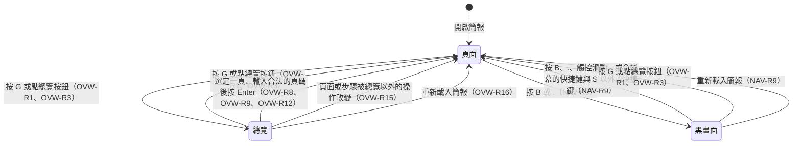

# 預覽總覽

預覽總覽是講者播放簡報時，把簡報的每一頁排成縮圖一次看完，並從中挑一頁跳過去的能力；本 spec 把排出這些縮圖的畫面叫做總覽。講者按 `G` 開啟總覽，總覽蓋住目前的頁面，每張縮圖顯示那一頁最後一步的畫面；講者用方向鍵移動選取框，按 Enter 或點縮圖，就跳到那一頁。

本 spec 同時描述觀眾視窗與講者視窗的總覽。講者視窗連上觀眾視窗時，兩個視窗共用同一個總覽，規則寫在 OVW-R17。

總覽開著時，講者按下按鍵後，播放器仍然依 [navigation.md](navigation.md) 開頭的流程圖決定要做什麼，只是播放器的快捷鍵換成 OVW-R12 列出的按鍵。這時頁面上的元件收不到鍵盤事件，焦點也不會停在頁面、縮圖或按鈕上（OVW-R6、OVW-R10、OVW-R11），所以流程圖裡「元件呼叫了 `preventDefault()`」「焦點在可以輸入文字或調整數值的元素裡」與「焦點在按鈕、連結、checkbox 或 radio 上」這三個判斷，在總覽開著時都不會成立。另外，Tab、Shift+Tab，以及 Safari 的 Option+Tab、Option+Shift+Tab，照流程圖會交給瀏覽器，但總覽開著時，播放器照 OVW-R11 擋下這幾個鍵。

觀眾視窗的畫面照下圖在頁面、總覽與黑畫面之間切換，每個轉換的細節寫在對應的需求裡。總覽與黑畫面之間沒有直接的轉換，所以兩者不會同時出現（OVW-R13）。

## 需求

### OVW-R1 用 `G` 開啟與關閉總覽

總覽沒有開著時，講者按 `G` 開啟總覽；總覽開著時，講者按 `G` 關閉總覽，畫面回到目前的頁面與步驟，網址的 hash 不變。`G` 和其他快捷鍵一樣適用 [navigation.md](navigation.md) 的 NAV-R7；按住 `G` 不放時，作業系統自動重複送出的 `G` 不觸發（NAV-R14）；黑畫面時按 `G` 只結束黑畫面，不開啟總覽（NAV-R9）。開啟或關閉總覽時，播放器取消輸入中的頁碼（NAV-R5），講者模式裡兩個視窗的輸入都取消（[presenter.md](presenter.md) 的 PRES-R3）。

- OVW-R1.1 開啟總覽
  - 前提：簡報有 6 頁，畫面顯示第 2 頁
  - 動作：按 `G`
  - 結果：畫面顯示總覽，總覽列出 6 張縮圖
- OVW-R1.2 關閉總覽
  - 前提：`list` 這一頁有 3 步，畫面顯示 `list` 的第 2 步
  - 動作：按 `G`，再按一次 `G`
  - 結果：第一次按下後畫面顯示總覽；第二次按下後總覽關閉，畫面顯示 `list` 的第 2 步；網址的 hash 一直是 `#/list/2`
- OVW-R1.3 按住 `G` 不放
  - 前提：總覽沒有開著
  - 動作：按住 `G`，直到作業系統自動送出好幾次 `G`
  - 結果：總覽開著，放開 `G` 之後仍然開著
- OVW-R1.4 黑畫面時按 `G`
  - 前提：畫面顯示 `intro`，接著切換成黑畫面
  - 動作：按 `G`
  - 結果：黑畫面結束，畫面顯示 `intro`，總覽沒有開著
- OVW-R1.5 輸入頁碼途中按 `G`
  - 前提：簡報依序是 `intro`、`agenda`、`recap` 三頁，畫面顯示 `intro`
  - 動作：在 3 秒內完成以下動作：輸入 3，按 `G`，再按 Enter
  - 結果：按 `G` 之後，頁碼消失，畫面顯示總覽，選取框在 `intro`；按 Enter 之後，總覽關閉，畫面顯示 `intro`
- OVW-R1.6 焦點在輸入框裡按 `G`
  - 前提：`intro` 這一頁有一個文字輸入框，畫面顯示 `intro`，焦點在輸入框裡
  - 動作：按 `G`
  - 結果：輸入框裡多了 `g`，總覽沒有開啟
- OVW-R1.7 按著 Cmd 按 `G`
  - 前提：總覽沒有開著
  - 動作：按著 Cmd（Windows 按 Ctrl）按 `G`
  - 結果：總覽沒有開啟
- OVW-R1.8 輸入頁碼途中按 `G` 關閉總覽
  - 前提：簡報依序是 `intro`、`agenda`、`recap` 三頁，畫面顯示 `intro`，總覽開著
  - 動作：在 3 秒內完成以下動作：輸入 3，按 `G`，再按 Enter
  - 結果：按 `G` 之後，頁碼消失，總覽關閉；按 Enter 之後，畫面顯示 `agenda`

> 設計理由：開關總覽用 `G`，因為 PowerPoint 播放時顯示所有投影片的快捷鍵就是 `G`，這延續了播放器的快捷鍵模仿 PowerPoint 的原則（[navigation.md](navigation.md) 開頭）。Esc 不能用來開啟總覽，因為全螢幕時瀏覽器收到 Esc 會直接離開全螢幕，網頁收不到 Esc 的 keydown 事件，而能讓網頁攔下 Esc 的 API 目前沒有一個是 Chromium、Firefox、Safari 都支援的。曾考慮用 reveal.js、Slidev 與 Marp 開啟總覽的 `O`，但這不符合播放器的快捷鍵模仿 PowerPoint 的原則。也考慮過讓 `G` 與 `O` 都能開啟總覽，但這樣總覽多佔一個鍵，之後畫筆標註、切換亮暗配色這些功能挑快捷鍵時，能用的鍵就少一個。完整討論見 [0005](../plans/archive/0005-overview.md)。

### OVW-R2 Esc 不關閉總覽

總覽開著時，Esc 不是播放器的快捷鍵，講者按 Esc 不會關閉總覽。播放器在全螢幕時，瀏覽器收到 Esc 會讓播放器離開全螢幕（NAV-R10），總覽仍然開著。

- OVW-R2.1 不在全螢幕時按 Esc
  - 前提：播放器不在全螢幕，總覽開著
  - 動作：按 Esc
  - 結果：總覽仍然開著
- OVW-R2.2 全螢幕時按 Esc
  - 前提：播放器在全螢幕，總覽開著
  - 動作：按 Esc
  - 結果：播放器離開全螢幕，總覽仍然開著

> 設計理由：Esc 一律不關閉總覽，所以 Esc 不論在不在全螢幕、總覽有沒有開著，作用都相同。曾考慮在網頁收得到 Esc 時用 Esc 關閉總覽，但全螢幕時網頁收不到 Esc 的 keydown 事件，所以同一個鍵會在不是全螢幕時關閉總覽、在全螢幕時只離開全螢幕。也考慮過離開全螢幕時一併關閉總覽，但瀏覽器不會告訴網頁是哪個操作讓播放器離開全螢幕，所以講者按 `F` 或點全螢幕按鈕離開全螢幕時，總覽也會跟著關閉，總覽與全螢幕就不再是互不影響的兩個狀態。完整討論見 [0005](../plans/archive/0005-overview.md)。

### OVW-R3 總覽按鈕

觀眾視窗的右下角、全螢幕按鈕（NAV-R11）的左邊有一顆總覽按鈕。總覽按鈕和全螢幕按鈕一起出現、一起隱藏，出現與隱藏的規則寫在 NAV-R11，其中一顆按鈕有焦點時，兩顆按鈕都保持顯示。總覽開著時，兩顆按鈕一直顯示；總覽關閉之後，兩顆按鈕再顯示 2 秒才隱藏，這段期間講者移動滑鼠或點畫面的話，照 NAV-R11 從最後一次移動滑鼠或點畫面開始計算 2 秒。用滑鼠或手指點總覽按鈕時，按鈕不取得焦點。總覽沒有開著時，講者用 Tab（Safari 預設是 Option+Tab）移動焦點，焦點先移到總覽按鈕，再移到全螢幕按鈕；焦點在總覽按鈕上時，按 Space 或 Enter 會按下按鈕（NAV-R7）。總覽開著時，講者點到按鈕與縮圖重疊的地方，按下的是按鈕。點總覽按鈕的作用和按 `G` 相同：總覽沒有開著時開啟總覽，開著時關閉總覽；黑畫面時點總覽按鈕只結束黑畫面。瀏覽器不支援讓網頁元素進入全螢幕時，例如 iPhone 的 Safari，播放器不顯示全螢幕按鈕，總覽按鈕單獨顯示在右下角。講者視窗沒有總覽按鈕，講者在講者視窗按 `G` 開關總覽。

- OVW-R3.1 點按鈕開關總覽
  - 前提：總覽沒有開著，總覽按鈕已經顯示
  - 動作：點總覽按鈕，再點一次
  - 結果：第一次點下後畫面顯示總覽，第二次點下後總覽關閉
- OVW-R3.2 點按鈕開啟總覽後按 Enter
  - 前提：簡報依序是 `intro`、`agenda`、`recap` 三頁，畫面顯示 `intro`
  - 動作：點總覽按鈕，按 →，再按 Enter
  - 結果：總覽關閉，畫面顯示 `agenda`
- OVW-R3.3 移動滑鼠時兩顆按鈕一起出現
  - 前提：瀏覽器支援讓網頁元素進入全螢幕，按鈕沒有顯示
  - 動作：移動滑鼠，接著 2 秒內不移動滑鼠
  - 結果：總覽按鈕出現在全螢幕按鈕的左邊，2 秒後兩顆按鈕一起隱藏
- OVW-R3.4 用 Tab 移到總覽按鈕
  - 前提：簡報依序是 `intro`、`agenda`、`recap` 三頁，畫面顯示 `intro`，總覽沒有開著，按鈕沒有顯示，頁面上沒有其他可以取得焦點的元素
  - 動作：按 Tab（Safari 按 Option+Tab），等 2 秒，按 Enter，按 →，再按 Enter
  - 結果：按 Tab 之後，總覽按鈕取得焦點，兩顆按鈕都出現，等 2 秒後仍然顯示；第一次按 Enter 之後，畫面顯示總覽；第二次按 Enter 之後，總覽關閉，畫面顯示 `agenda`
- OVW-R3.5 黑畫面時點總覽按鈕
  - 前提：畫面顯示 `intro`，接著切換成黑畫面
  - 動作：移動滑鼠，點總覽按鈕
  - 結果：黑畫面結束，畫面顯示 `intro`，總覽沒有開著
- OVW-R3.6 瀏覽器不支援全螢幕
  - 前提：在 iPhone 的 Safari 開啟簡報
  - 動作：手指點一下畫面
  - 結果：右下角出現總覽按鈕，沒有出現全螢幕按鈕
- OVW-R3.7 在平板上開啟與關閉總覽
  - 前提：在 iPad 的 Safari 開啟簡報，畫面顯示 `intro`
  - 動作：手指點一下畫面，點總覽按鈕，等 3 秒，再點一次總覽按鈕
  - 結果：第一次點總覽按鈕之後，畫面顯示總覽；等 3 秒之後，兩顆按鈕仍然顯示；第二次點總覽按鈕之後，總覽關閉，畫面顯示 `intro`
- OVW-R3.8 講者視窗沒有總覽按鈕
  - 前提：講者視窗已經開著
  - 動作：在講者視窗移動滑鼠
  - 結果：講者視窗沒有出現總覽按鈕
- OVW-R3.9 總覽開著時按鈕一直顯示
  - 前提：瀏覽器支援讓網頁元素進入全螢幕，總覽沒有開著
  - 動作：按 `G`，接著 3 秒內不移動滑鼠，也不點畫面
  - 結果：總覽按鈕與全螢幕按鈕一直顯示
- OVW-R3.10 關閉總覽之後按鈕隱藏
  - 前提：瀏覽器支援讓網頁元素進入全螢幕，總覽開著，兩顆按鈕都顯示著
  - 動作：按 `G`，接著 2 秒內不移動滑鼠，也不點畫面
  - 結果：總覽關閉，2 秒後兩顆按鈕一起隱藏
- OVW-R3.11 點到按鈕與縮圖重疊的地方
  - 前提：簡報有 40 頁，畫面顯示第 1 頁，總覽開著；講者用滑鼠滾輪把總覽捲到右下角的總覽按鈕蓋住某張縮圖一角的位置
  - 動作：點總覽按鈕
  - 結果：總覽關閉，畫面顯示第 1 頁

> 設計理由：觀眾視窗有總覽按鈕，因為用平板播放時沒有鍵盤可以按 `G`，這和 NAV-R11 提供全螢幕按鈕的理由相同。曾考慮用雙指捏合開啟總覽，但雙指捏合是瀏覽器的縮放手勢，播放器要擋下瀏覽器的縮放才能使用，各瀏覽器的擋法不同，iOS 的 Safari 也不理會網頁禁止縮放的設定；而且畫面上看不出有這個手勢。講者視窗沒有總覽按鈕，因為講者模式只在接著投影幕的電腦上使用，講者一定有鍵盤，這和 PRES-R1 不放開啟講者視窗的按鈕的理由相同。總覽開著時兩顆按鈕一直顯示，因為在平板上點總覽裡的縮圖會跳頁，如果按鈕照 NAV-R11 隱藏，講者就找不到不跳頁也能關閉總覽的地方點；總覽本來就是操作用的畫面，不是投影片本身，所以投影幕上多兩顆按鈕不影響觀眾看投影片。曾考慮讓講者點總覽的背景或縮圖之間的空隙來關閉總覽，但空隙很窄，講者點縮圖時手指點偏一點，總覽就直接關閉。完整討論見 [0005](../plans/archive/0005-overview.md)。

### OVW-R4 總覽的版面

總覽蓋住整個視窗，背景是深色，不受簡報配色的影響。總覽照 `deck.json` 的順序排出每一頁的縮圖，每列固定 4 張；每張縮圖把 1920×1080 的畫布等比縮小，寬度跟著視窗的寬度縮放。所有縮圖放不進視窗時，總覽可以上下捲動。兩顆按鈕（OVW-R3）蓋在總覽上面，總覽捲動時，縮圖會從按鈕底下經過；總覽在最後一列下方多留一段空白，所以總覽捲到最下方時，最後一列的縮圖也不會被按鈕蓋住。本 spec 說縮圖「完整出現在視窗裡」，指整張縮圖連同下方的頁碼與「目前」的標記（OVW-R5）都在視窗裡，而且沒有被右下角的按鈕蓋住；輸入中的頁碼（NAV-R5）只會暫時出現，不算在內。輸入中的頁碼點不到，講者點到它的位置，等於點到它底下的縮圖或背景。播放器記錄總覽的捲動位置，記錄的是總覽的上緣切在第幾列的什麼位置，例如上緣切在第 3 列的一半；講者模式裡，兩個視窗各自記錄自己的位置（OVW-R18）。一列的範圍從這一列縮圖的上緣，到下一列縮圖的上緣，包括縮圖下方的頁碼與列之間的間距；總覽最上方的留白算進第 1 列，最後一列則到總覽的下緣為止，包括最後一列下方多留的空白。總覽每次捲動之後，記錄的位置就改成新的位置，不論是講者捲動總覽，還是播放器照本 spec 的規則捲動總覽，例如開啟總覽、照 OVW-R7 捲到選取框，以及講者視窗連上時捲到選取框（OVW-R18）。只有兩種捲動不改變記錄：視窗大小改變造成的捲動，以及捲不到記錄的位置而停在最下方。總覽一律照記錄的位置捲動，捲不到那個位置時就停在最下方。所以視窗大小改變時，例如播放器進入或離開全螢幕，每一列的高度跟著改變，總覽照記錄的位置重新捲動，改變之後仍然切在第 3 列的一半；選取框因此沒有完整出現時，總覽不另外捲動，講者按方向鍵時才照 OVW-R7 捲到選取框。每次開啟總覽時，總覽都從最上方開始，再照需要捲到目前頁面的縮圖完整出現在視窗裡的位置，記錄的位置改成總覽開啟之後停的位置，總覽不需要捲動時也一樣。

- OVW-R4.1 每列 4 張
  - 前提：簡報有 7 頁
  - 動作：按 `G`
  - 結果：第一列依序是第 1 到 4 頁的縮圖，第二列依序是第 5 到 7 頁的縮圖
- OVW-R4.2 視窗的寬度改變
  - 前提：瀏覽器視窗是 1280×720，總覽開著
  - 動作：把視窗改成 800×600
  - 結果：每列仍然是 4 張縮圖，縮圖的寬度變小
- OVW-R4.3 開啟時捲到目前的頁面
  - 前提：簡報有 40 頁，畫面顯示第 37 頁
  - 動作：按 `G`
  - 結果：第 37 頁的縮圖完整出現在視窗裡
- OVW-R4.4 視窗大小改變時維持捲動位置
  - 前提：瀏覽器視窗是 1280×720，簡報有 40 頁，總覽開著，總覽的上緣切在第 3 列的一半
  - 動作：把視窗改成 1920×1080
  - 結果：總覽的上緣仍然切在第 3 列的一半
- OVW-R4.5 最後一列的縮圖不被按鈕蓋住
  - 前提：瀏覽器視窗是 1280×720，簡報有 40 頁，畫面顯示第 40 頁
  - 動作：按 `G`
  - 結果：第 40 頁的縮圖完整出現在視窗裡，沒有被總覽按鈕蓋住
- OVW-R4.6 視窗變大到捲不到記錄的位置，再變回原本的大小
  - 前提：瀏覽器視窗是 1280×720，簡報有 40 頁，總覽開著，總覽捲在最下方
  - 動作：把視窗改成 1280×1000，再改回 1280×720
  - 結果：改成 1280×1000 之後，總覽停在最下方；改回 1280×720 之後，總覽仍然在最下方
- OVW-R4.7 視窗變小之後選取框沒有完整出現
  - 前提：瀏覽器視窗是 1280×720，簡報有 40 頁，總覽開著，總覽捲在最上方，選取框在第 9 頁，第 9 頁的縮圖完整出現在視窗裡
  - 動作：把視窗改成 1280×500
  - 結果：總覽仍然捲在最上方，第 9 頁的縮圖沒有完整出現在視窗裡
- OVW-R4.8 重新開啟總覽之後改變視窗大小
  - 前提：瀏覽器視窗是 1280×720，簡報有 40 頁，畫面顯示第 1 頁
  - 動作：按 `G`，用滑鼠滾輪把總覽捲到最下方，按 `G` 關閉總覽，再按 `G` 開啟總覽，接著把視窗改成 1920×1080
  - 結果：重新開啟總覽之後，總覽捲在最上方；改變視窗大小之後，總覽仍然捲在最上方，第 1 頁的縮圖完整出現在視窗裡

> 設計理由：每列固定 4 張縮圖，所以同一頁不論在哪個視窗、哪個螢幕上，都排在總覽的同一個位置，講者記得「第 6 頁在第二列」，換到現場的電腦也一樣，觀眾視窗與講者視窗的總覽也相同。曾考慮讓縮圖有固定的最小寬度，每列的張數隨視窗的寬度改變，但這樣講者視窗與觀眾視窗的每列張數會不同，同一頁在兩個視窗的位置也不同。也考慮過每列 5 張，但在 1920 寬的螢幕上，頁面裡 48 px 的字會縮成約 9 px，每列 4 張時約 11 px。完整討論見 [0005](../plans/archive/0005-overview.md)。

### OVW-R5 縮圖上的頁碼與目前頁面的標記

每張縮圖下方寫這一頁的頁碼，頁碼從 1 開始；目前的頁面那張縮圖的頁碼旁邊另外寫「目前」。選取框是縮圖外圍的粗框，和「目前」的標記不同：選取框跟著講者的操作移動（OVW-R7），「目前」一直標在目前的頁面。

- OVW-R5.1 開啟時的標記
  - 前提：簡報有 7 頁，畫面顯示第 2 頁
  - 動作：按 `G`
  - 結果：每張縮圖下方依序寫著 1 到 7 的頁碼，第 2 頁的頁碼旁邊寫著「目前」，選取框在第 2 頁的縮圖外圍
- OVW-R5.2 移動選取框之後
  - 前提：簡報有 7 頁，畫面顯示第 2 頁，總覽開著
  - 動作：按 →
  - 結果：選取框移到第 3 頁的縮圖外圍，「目前」仍然寫在第 2 頁的頁碼旁邊

> 設計理由：縮圖上寫頁碼，因為講者在總覽裡也能輸入頁碼跳頁（OVW-R12），要看得到每一頁的頁碼。目前的頁面另外標記，因為選取框一移開，講者就看不出自己原本講到哪一頁，問答完要回去時找不到位置。曾考慮在頁碼旁邊再寫 slide ID，但觀眾視窗的總覽會出現在投影幕上，觀眾會看到 `draft-v2` 這種製作時取的名字；製作簡報時要查 slide ID，看 `deck.json` 或網址的 hash 就查得到。完整討論見 [0005](../plans/archive/0005-overview.md)。

### OVW-R6 縮圖顯示每頁的最後一步

每張縮圖顯示那一頁最後一步的畫面。縮圖是另外 render 的一份頁面，和講者視窗的目前頁、下一步與下一頁相同（[presenter.md](presenter.md) 的 PRES-R6）：講者點不到縮圖裡的元素，點縮圖時點到的是整張縮圖（OVW-R8）；縮圖本身與縮圖裡的元素都不會取得焦點，包括寫了 `autoFocus` 或元件自己呼叫 `focus()` 的元素，講者也不能用 Tab 把焦點移到縮圖上。總覽開著時，縮圖裡的元件收不到鍵盤事件。觀眾視窗的總覽關閉之後淡出的期間（OVW-R21），縮圖還在，縮圖裡的元件收得到鍵盤事件，所以元件在 keydown 事件呼叫 `preventDefault()` 時，播放器不觸發快捷鍵，和頁面上的元件攔下 keydown 事件相同（[navigation.md](navigation.md) 的 NAV-R7）；講者視窗的縮圖一律收不到鍵盤事件（[presenter.md](presenter.md) 的 PRES-R6）。縮圖不影響目前頁面的步數。[steps.md](steps.md) 的 STEP-R7 與 STEP-R8 印在 console 的警告與錯誤，只有觀眾視窗播放的那一頁會印，縮圖不會印；STEP-R3 在 `<svg>` 裡放了 `<Step>` 時印出的錯誤，則由 `<Step>` 自己印出，所以縮圖 render 時也會印，和講者視窗的目前頁、下一步與下一頁相同。縮圖裡的元件照常執行 effect，例如計時器會繼續計時。

> 設計理由：觀眾視窗的總覽淡出的期間，播放器不替縮圖攔下鍵盤事件，因為播放器在這時攔下鍵盤事件的話，新換上的那一頁也會跟著收不到鍵盤事件，違反 NAV-R7；只有縮圖裡的元件比播放器先收到 keydown 事件並呼叫 `preventDefault()` 時，講者在這段期間按的快捷鍵才會失效。曾考慮關閉總覽時立刻拿掉縮圖的內容，但這樣淡出的會是空白的框；也考慮過關閉時把縮圖換成複製的靜態畫面，但這樣程式要直接改 React 管理的 DOM，圖表的 canvas 與影片複製之後也是空白的。完整討論見 [0005](../plans/archive/0005-overview.md)。

縮圖離視窗的上緣或下緣不到一個視窗的高度時，播放器才 render 這張縮圖，縮圖離得更遠時就移除，所以縮圖裡的元件會在講者捲回來時重新開始，例如計時器從頭計時。縮圖還沒 render 時，只顯示空白的框與頁碼。

- OVW-R6.1 用 `<Step>` 的頁面
  - 前提：`list` 這一頁有 `<Step at={1}>` 包住的「第一點」與 `<Step at={2}>` 包住的「第二點」，畫面顯示 `list` 的第 0 步
  - 動作：按 `G`，再按一次 `G`
  - 結果：第一次按下後，`list` 的縮圖顯示「第一點」與「第二點」；第二次按下後，畫面顯示 `list` 的第 0 步，「第一點」與「第二點」都看不見
- OVW-R6.2 用 `useStep` 的頁面
  - 前提：`list` 這一頁呼叫 `useStep(3)`，第 3 步之前顯示「舊的結論」，從第 3 步開始顯示「新的結論」，畫面顯示 `intro`
  - 動作：按 `G`
  - 結果：`list` 的縮圖顯示「新的結論」
- OVW-R6.3 縮圖裡有自動取得焦點的輸入框
  - 前提：簡報依序是 `intro`、`repl`、`recap` 三頁，`repl` 有一個寫了 `autoFocus` 的文字輸入框，畫面顯示 `intro`
  - 動作：按 `G`，再按 →
  - 結果：選取框移到 `repl`
- OVW-R6.4 點縮圖裡的按鈕
  - 前提：`counter` 這一頁有一個計數器，初始值是 0，畫面顯示 `intro`
  - 動作：按 `G`，點 `counter` 縮圖裡計數器的按鈕所在的位置
  - 結果：總覽關閉，畫面顯示 `counter`，計數器顯示 0
- OVW-R6.5 跳號的頁面
  - 前提：`gap` 這一頁只有 `<Step at={1}>` 與 `<Step at={3}>`，畫面顯示 `intro`
  - 動作：按 `G`
  - 結果：Console 沒有寫出 `gap` 的警告
- OVW-R6.6 捲回看過的縮圖
  - 前提：瀏覽器視窗是 1280×720，簡報有 40 頁，第 1 頁有一個每秒加 1 的計數器，畫面顯示第 1 頁
  - 動作：按 `G`，把總覽捲到最下方，等 3 秒，再捲回最上方
  - 結果：捲回最上方時，第 1 頁縮圖裡的計數器顯示的數字小於 3
- OVW-R6.7 總覽淡出途中，縮圖裡的元件攔下按鍵
  - 前提：簡報依序是 `intro`、`agenda`、`grabber` 三頁，三頁都沒有步驟；`grabber` 有一個元件，在 `window` 的 capture 階段遇到 → 時呼叫 `preventDefault()`；畫面顯示 `intro`，總覽開著，`grabber` 的縮圖已經顯示出來
  - 動作：按 `G`，300 毫秒內按 →，等總覽淡出之後再按一次 →
  - 結果：第一次按 → 之後，畫面仍然顯示 `intro`；第二次按 → 之後，畫面顯示 `agenda`

> 設計理由：縮圖顯示每頁的最後一步，因為最後一步的畫面包含這一頁的所有內容，講者最容易認出是哪一頁；Slidev、Spectacle 與 Marp 的縮圖也都顯示最後一步。曾考慮讓縮圖顯示第 0 步，但步驟多的頁面在第 0 步時大部分的內容都還沒出現，縮圖看起來幾乎是空的。完整討論見 [0005](../plans/archive/0005-overview.md)。

### OVW-R7 用方向鍵移動選取框

開啟總覽時，選取框在目前頁面的縮圖上。總覽開著時，講者按方向鍵移動選取框，畫面不換頁，網址的 hash 也不變：

1. ← 與 → 照頁碼的順序移動一頁。選取框在一列的最後一張時按 →，選取框移到下一列的第一張；在一列的第一張時按 ←，選取框移到上一列的最後一張。
2. ↑ 與 ↓ 移到上一列或下一列同一欄的縮圖。按 ↓ 時，下一列的那一欄沒有縮圖的話，選取框移到最後一頁。
3. 選取框在第一頁時按 ←、在最後一頁時按 →、在第一列時按 ↑、在最後一列時按 ↓，選取框都不動。

講者每次按方向鍵之後，選取框所在的縮圖沒有完整出現在視窗裡（OVW-R4）的話，總覽就捲到它完整出現的位置；縮圖只露出一部分也算沒有完整出現，選取框因為碰到邊界而沒有移動時也一樣。講者用滑鼠滾輪、觸控板，或 OVW-R12 交給瀏覽器的按鍵捲動總覽時，選取框不動，所以選取框可能被捲到視窗外，講者接著按任何一個方向鍵，總覽就捲回選取框所在的縮圖。

> 設計理由：講者可以用方向鍵移動選取框，因為觀眾視窗在投影幕上全螢幕時，講者看不到投影幕上的游標（PRES-R3 的設計理由），只能用滑鼠的話，講者很難在投影幕上點到要的那一頁。Slidev、reveal.js 與 Marp 的總覽也都能用方向鍵移動選取框、按 Enter 選定。完整討論見 [0005](../plans/archive/0005-overview.md)。

- OVW-R7.1 按 →
  - 前提：簡報有 7 頁，畫面顯示第 1 頁，總覽開著
  - 動作：按 →
  - 結果：選取框移到第 2 頁，畫面仍然顯示總覽，網址的 hash 沒有改變
- OVW-R7.2 在一列的最後一張按 →
  - 前提：簡報有 7 頁，總覽開著，選取框在第 4 頁
  - 動作：按 →
  - 結果：選取框移到第 5 頁
- OVW-R7.3 在一列的第一張按 ←
  - 前提：簡報有 7 頁，總覽開著，選取框在第 5 頁
  - 動作：按 ←
  - 結果：選取框移到第 4 頁
- OVW-R7.4 按 ↓
  - 前提：簡報有 7 頁，總覽開著，選取框在第 2 頁
  - 動作：按 ↓
  - 結果：選取框移到第 6 頁
- OVW-R7.5 按 ↑
  - 前提：簡報有 7 頁，總覽開著，選取框在第 6 頁
  - 動作：按 ↑
  - 結果：選取框移到第 2 頁
- OVW-R7.6 下一列的同一欄沒有縮圖
  - 前提：簡報有 7 頁，總覽開著，選取框在第 4 頁
  - 動作：按 ↓
  - 結果：選取框移到第 7 頁
- OVW-R7.7 在最後一列按 ↓
  - 前提：簡報有 7 頁，總覽開著，選取框在第 6 頁
  - 動作：按 ↓
  - 結果：選取框仍然在第 6 頁
- OVW-R7.8 在第一列按 ↑
  - 前提：簡報有 7 頁，總覽開著，選取框在第 3 頁
  - 動作：按 ↑
  - 結果：選取框仍然在第 3 頁
- OVW-R7.9 在第一頁按 ←
  - 前提：簡報有 7 頁，總覽開著，選取框在第 1 頁
  - 動作：按 ←
  - 結果：選取框仍然在第 1 頁
- OVW-R7.10 在最後一頁按 →
  - 前提：簡報有 7 頁，總覽開著，選取框在第 7 頁
  - 動作：按 →
  - 結果：選取框仍然在第 7 頁
- OVW-R7.11 選取框移到視窗外
  - 前提：簡報有 40 頁，畫面顯示第 1 頁，總覽開著
  - 動作：按 9 次 ↓
  - 結果：選取框在第 37 頁，第 37 頁的縮圖完整出現在視窗裡
- OVW-R7.12 捲動總覽之後按方向鍵
  - 前提：簡報有 40 頁，畫面顯示第 1 頁，總覽開著
  - 動作：用滑鼠滾輪把總覽捲到最下方，再按 →
  - 結果：捲到最下方之後，選取框仍然在第 1 頁；按 → 之後，選取框移到第 2 頁，第 2 頁的縮圖完整出現在視窗裡
- OVW-R7.13 按住 → 不放
  - 前提：簡報有 7 頁，總覽開著，選取框在第 1 頁
  - 動作：按住 →，直到作業系統再自動送出兩次 →
  - 結果：選取框移到第 4 頁
- OVW-R7.14 選取框移到被按鈕蓋住的縮圖
  - 前提：瀏覽器視窗是 1280×720，簡報有 40 頁，總覽開著；講者用滑鼠滾輪把總覽捲到某一列最右邊那張縮圖整張都在視窗裡、但右下角被總覽按鈕蓋住的位置，選取框在同一列的第 3 張
  - 動作：按 →
  - 結果：選取框移到同一列最右邊那張縮圖，總覽往下捲動，這張縮圖沒有被按鈕蓋住
- OVW-R7.15 選取框只露出一部分
  - 前提：瀏覽器視窗是 1280×720，簡報有 40 頁，總覽開著；講者用滑鼠滾輪把總覽捲到視窗下緣切過某一列、那一列的縮圖只有上半部在視窗裡的位置，選取框在它上面那一列的第 2 張
  - 動作：按 ↓
  - 結果：選取框移到下一列的第 2 張，總覽往下捲動，這張縮圖完整出現在視窗裡
- OVW-R7.16 選取框被捲到視窗外時按方向鍵，選取框沒有移動
  - 前提：簡報有 40 頁，畫面顯示第 1 頁，總覽開著，選取框在第 1 頁；講者用滑鼠滾輪把總覽捲到最下方
  - 動作：按 ←
  - 結果：選取框仍然在第 1 頁，總覽捲回第 1 頁的縮圖完整出現在視窗裡的位置

> 設計理由：選取框不會從最後一頁循環回第一頁，理由和 NAV-R3 不從最後一頁循環回第一頁相同：講者按過頭時，選取框突然跳回第一頁，很容易看錯位置。按 ↓ 時，下一列的同一欄沒有縮圖就移到最後一頁，因為講者按 ↓ 是要往後找，下面還有一列時選取框卻不動的話，看起來像是播放器沒有反應。選取框因為碰到邊界而沒有移動時，總覽仍然捲到選取框，因為講者按方向鍵就是想看選取框在哪裡；曾考慮只在選取框真的移動時才捲動，但這樣講者在第一頁按 ← 時畫面沒有任何反應。完整討論見 [0005](../plans/archive/0005-overview.md)。

### OVW-R8 跳到選取的頁面

總覽開著時，講者按 Enter，播放器就跳到選取框所在的頁面，並關閉總覽；講者用滑鼠或手指點縮圖，或點縮圖下方的頁碼時，播放器跳到那張縮圖的頁面，並關閉總覽；點總覽的背景或縮圖之間的空隙時，什麼都不發生。正在輸入頁碼時按的 Enter 用來確認頁碼，規則寫在 OVW-R12。跳到其他頁面時，畫面顯示那一頁的第 0 步（[steps.md](steps.md) 的 STEP-R10），播放器在瀏覽器新增一筆瀏覽紀錄（NAV-R6）。選定的頁面就是目前的頁面時，規則寫在 OVW-R9。

- OVW-R8.1 按 Enter 跳頁
  - 前提：簡報依序是 `intro`、`agenda`、`recap` 三頁，畫面顯示 `intro`
  - 動作：按 `G`，按兩次 →，再按 Enter
  - 結果：總覽關閉，畫面顯示 `recap`，網址的 hash 是 `#/recap`
- OVW-R8.2 點縮圖跳頁
  - 前提：簡報依序是 `intro`、`agenda`、`recap` 三頁，畫面顯示 `intro`
  - 動作：按 `G`，點 `recap` 的縮圖
  - 結果：總覽關閉，畫面顯示 `recap`
- OVW-R8.3 跳到有步驟的頁面
  - 前提：簡報依序是 `intro`、`list`、`recap` 三頁，`list` 有 3 步，畫面顯示 `recap`
  - 動作：按 `G`，點 `list` 的縮圖
  - 結果：畫面顯示 `list` 的第 0 步，網址的 hash 是 `#/list`
- OVW-R8.4 用瀏覽器的上一頁回到跳頁之前的位置
  - 前提：簡報依序是 `intro`、`list`、`recap` 三頁，`list` 有 3 步，畫面顯示 `list` 的第 2 步
  - 動作：按 `G`，點 `recap` 的縮圖，再按瀏覽器的上一頁
  - 結果：畫面顯示 `list` 的第 2 步，總覽沒有開著
- OVW-R8.5 在平板上點縮圖
  - 前提：在 iPad 的 Safari 開啟簡報，簡報依序是 `intro`、`agenda`、`recap` 三頁，畫面顯示 `intro`，總覽開著
  - 動作：手指點 `recap` 的縮圖
  - 結果：總覽關閉，畫面顯示 `recap`
- OVW-R8.6 點縮圖下方的頁碼
  - 前提：簡報依序是 `intro`、`agenda`、`recap` 三頁，畫面顯示 `intro`，總覽開著
  - 動作：點 `recap` 的縮圖下方的頁碼 3
  - 結果：總覽關閉，畫面顯示 `recap`
- OVW-R8.7 點縮圖之間的空隙
  - 前提：簡報依序是 `intro`、`agenda`、`recap` 三頁，畫面顯示 `intro`，總覽開著
  - 動作：點 `agenda` 與 `recap` 兩張縮圖之間的空隙
  - 結果：總覽仍然開著，選取框仍然在 `intro`
- OVW-R8.8 點到輸入中頁碼的位置
  - 前提：簡報有 40 頁，畫面顯示第 1 頁，總覽開著；講者輸入 3，頁碼蓋住右下角某張縮圖的一部分
  - 動作：在 3 秒內點頁碼所在的位置
  - 結果：總覽關閉，畫面顯示頁碼底下那張縮圖的頁面，頁碼消失

> 設計理由：從總覽跳到其他頁面時停在第 0 步，和 Home、End、輸入頁碼這些跳頁方式相同（STEP-R10）。總覽裡也能輸入頁碼跳頁（OVW-R12），如果點縮圖停在最後一步，講者在總覽裡用兩種方式選同一頁，結果就會不同；講者時間不夠、要跳過幾頁直接講後面的頁面時，也需要從第 0 步開始。曾考慮停在最後一步，和縮圖看到的畫面相同。停在第 0 步的代價是講者在問答時回到講過的頁面，要按好幾次 → 才看得到完整的畫面，不過講者按住 → 不放就會連續前進（NAV-R14.1）。也考慮過依方向決定，選定的頁面在目前的頁面之前時停在最後一步，但 Home、End 與輸入頁碼都不看方向，總覽會變成唯一一種依方向決定步驟的跳頁方式。完整討論見 [0005](../plans/archive/0005-overview.md)。

### OVW-R9 選定目前的頁面

講者按 Enter 時選取框在目前的頁面，或講者點目前頁面的縮圖時，播放器只關閉總覽：畫面顯示原本的步驟，網址的 hash 不變，播放器也不新增瀏覽紀錄。不過講者在總覽裡輸入目前頁面的頁碼再按 Enter 時，播放器照 NAV-R5 跳到這一頁的第 0 步（OVW-R12）。

- OVW-R9.1 開啟總覽之後直接按 Enter
  - 前提：在瀏覽器開啟網站首頁，再從首頁開啟這份簡報；簡報依序是 `intro`、`list`、`recap` 三頁，`intro` 沒有步驟，`list` 有 3 步，講者按三次 →，畫面顯示 `list` 的第 2 步
  - 動作：按 `G`，按 Enter，再按瀏覽器的上一頁
  - 結果：按 Enter 之後，總覽關閉，畫面顯示 `list` 的第 2 步，網址的 hash 是 `#/list/2`；按瀏覽器的上一頁之後，瀏覽器回到網站首頁
- OVW-R9.2 點目前頁面的縮圖
  - 前提：`list` 這一頁有 3 步，畫面顯示 `list` 的第 2 步
  - 動作：按 `G`，點 `list` 的縮圖
  - 結果：總覽關閉，畫面顯示 `list` 的第 2 步

> 設計理由：選定目前的頁面時只關閉總覽，因為選取框一開始就停在目前的頁面，講者開啟總覽、沒移動選取框就按 Enter，多半是想回到原本的畫面。曾考慮照 OVW-R8 回到這一頁的第 0 步，但這樣講者在講者視窗開啟總覽看一眼，接著習慣性按 Enter，投影幕上這一頁已經出現的項目就會全部消失。輸入頁碼則照 NAV-R5 跳到第 0 步，因為輸入頁碼是講者刻意的操作。完整討論見 [0005](../plans/archive/0005-overview.md)。

### OVW-R10 總覽底下保留目前的頁面

總覽開著時，目前的頁面留在總覽底下，播放器不重新 mount 這一頁，所以講者按 `G` 關閉總覽，或選定目前的頁面（OVW-R9）時，頁面上互動元件的狀態都還在；跳到其他頁面時，照 NAV-R13 重置。總覽開著的期間，講者點不到總覽底下的頁面，頁面上的元件收不到鍵盤事件，頁面上的元素也不會取得焦點。開啟總覽時，焦點離開原本所在的元素，包括頁面上的元素與總覽按鈕；關閉總覽時，焦點不會回到原本的元素。不論總覽是因為哪個操作關閉，畫面換上的新頁面裡寫了 `autoFocus` 的元素，都和平常換頁時一樣取得焦點。總覽底下的頁面照常執行 effect。

- OVW-R10.1 關閉總覽之後保留互動元件的狀態
  - 前提：`counter` 這一頁有一個計數器，初始值是 0，畫面顯示 `counter`，講者把計數器按到 3
  - 動作：按 `G`，再按一次 `G`
  - 結果：計數器顯示 3
- OVW-R10.2 選定目前的頁面之後保留互動元件的狀態
  - 前提：`counter` 這一頁有一個計數器，初始值是 0，畫面顯示 `counter`，講者把計數器按到 3
  - 動作：按 `G`，再按 Enter
  - 結果：總覽關閉，計數器顯示 3
- OVW-R10.3 焦點在頁面的輸入框裡時開啟總覽
  - 前提：簡報依序是 `intro`、`agenda`、`recap` 三頁，`intro` 有一個文字輸入框，畫面顯示 `intro`，焦點在輸入框裡
  - 動作：點總覽按鈕，按 →，再按 Enter
  - 結果：按 → 之後，選取框移到 `agenda`，輸入框的內容沒有改變；按 Enter 之後，畫面顯示 `agenda`
- OVW-R10.4 頁面上有攔下 → 的元件時在總覽裡按 →
  - 前提：簡報依序是 `gallery`、`recap` 兩頁，`gallery` 有一個輪播元件，在 `window` 的 keydown 事件遇到 → 時呼叫 `preventDefault()` 並換到下一張圖；畫面顯示 `gallery`，輪播顯示第一張圖
  - 動作：按 `G`，按 →，再按 `G`
  - 結果：按 → 之後，選取框移到 `recap`；再按 `G` 之後，畫面顯示 `gallery`，輪播仍然顯示第一張圖
- OVW-R10.5 按瀏覽器的上一頁回到有自動取得焦點的輸入框的頁面
  - 前提：簡報依序是 `intro`、`repl`、`recap` 三頁，`repl` 有一個寫了 `autoFocus` 的 `<textarea>`；畫面顯示 `repl` 時，講者點一下頁面上沒有元素的地方，讓 `<textarea>` 失去焦點，再按 End 跳到 `recap`，接著按 `G` 開啟總覽
  - 動作：按瀏覽器的上一頁
  - 結果：總覽關閉，畫面顯示 `repl`，`<textarea>` 取得焦點

> 設計理由：總覽底下保留目前的頁面，所以講者沒有換頁就關閉總覽時，頁面和開啟總覽之前相同，例如講者示範計數器途中開啟總覽看一眼後面還有哪幾頁，關閉總覽之後，計數器仍然停在原本的數字。曾考慮開啟總覽時移除目前的頁面、關閉時重新 render，但這樣只要開啟過總覽，互動元件的狀態就會重置。代價是頁面留在總覽底下時，頁面的 effect 會繼續執行，例如有聲音的影片會在總覽後面繼續播放，這和講者視窗另外 render 的頁面一樣，留給 roadmap 的「圖片與影片」處理。完整討論見 [0005](../plans/archive/0005-overview.md)。

### OVW-R11 總覽開著時擋下 Tab

總覽開著時，播放器擋下 Tab 與 Shift+Tab，在 Safari 另外擋下 Option+Tab 與 Option+Shift+Tab，焦點不移動。開啟總覽時，焦點已經離開原本所在的元素（OVW-R10），所以總覽開著的期間，焦點不會停在總覽按鈕、全螢幕按鈕或縮圖上，也不會移到瀏覽器的網址列；講者按 Enter 或 Space 時不會按下任何按鈕，Enter 與 Space 的作用照 OVW-R8、OVW-R9 與 OVW-R12。講者視窗本來就擋下這幾個鍵（PRES-R11）。

- OVW-R11.1 總覽開著時按 Tab 之後按 Enter
  - 前提：簡報依序是 `intro`、`agenda`、`recap` 三頁，畫面顯示 `intro`，總覽開著
  - 動作：按 Tab（Safari 按 Option+Tab）五次，按 →，再按 Enter
  - 結果：焦點從來沒有移到總覽按鈕、全螢幕按鈕或任何一張縮圖上；按 Enter 之後，總覽關閉，畫面顯示 `agenda`
- OVW-R11.2 總覽開著時按 Shift+Tab 之後按 Space
  - 前提：簡報有 40 頁，畫面顯示第 1 頁，播放器不在全螢幕，總覽開著
  - 動作：按 Shift+Tab（Safari 按 Option+Shift+Tab）五次，再按 Space
  - 結果：總覽往下捲動，總覽仍然開著，播放器沒有進入全螢幕

> 設計理由：總覽開著時擋下 Tab，因為頁面與縮圖都不能取得焦點，講者按 Tab 時，焦點只會停在兩顆按鈕上，這時講者按 Enter 或 Space 會按下按鈕，例如關閉總覽而沒有跳頁，講者卻看不出焦點停在哪顆按鈕上；再多按幾次 Tab，焦點還可能移到瀏覽器的網址列，之後講者按的鍵都送不到網頁。總覽裡也用不到 Tab，因為關閉總覽可以按 `G`，切換全螢幕可以按 `F`。曾考慮保留 Tab，並寫明焦點在按鈕上時 Enter 與 Space 會按下按鈕，但這樣講者按過 Tab 之後再按 Enter，總覽就直接關閉、沒有跳頁。也考慮過只讓兩顆按鈕在總覽開著時不能用 Tab 移到，但這樣仍然擋不住焦點移到網址列。完整討論見 [0005](../plans/archive/0005-overview.md)。

### OVW-R12 總覽開著時的快捷鍵

總覽開著時，播放器的快捷鍵只有下列按鍵；除了 OVW-R11 擋下的 Tab 這幾個鍵，其他按鍵都交給瀏覽器處理：

1. 方向鍵，移動選取框（OVW-R7）。
2. Enter，跳到選取框所在的頁面（OVW-R8、OVW-R9）。講者按住 Enter 不放時，自動重複送出的 Enter 照 NAV-R14 不觸發，總覽關閉之後也一樣。
3. 數字鍵，照 NAV-R5 輸入頁碼。輸入途中，Backspace 刪除最後一位數字，Enter 確認頁碼，播放器跳到那一頁的第 0 步並關閉總覽；頁碼是目前的頁面時也一樣。頁碼是 0 或大於總頁數時，播放器照 NAV-R5 不換頁、取消這次輸入，總覽維持開著，選取框也不動。輸入途中按方向鍵或 `G` 時，照 NAV-R5 取消輸入。
4. `G`，關閉總覽（OVW-R1）。
5. 全螢幕的快捷鍵（`F`、F5、Shift+F5），照 NAV-R10 作用，總覽維持開著。
6. `S`，照 PRES-R1 開啟講者視窗，總覽維持開著。`S` 在講者視窗不是快捷鍵（PRES-R1）。

所以 PageUp、PageDown、Space、Shift+Space、Home、End，以及沒在輸入頁碼時的 Backspace，都照瀏覽器的預設行為作用，例如 Space 與 PageDown 把總覽往下捲動，End 把總覽捲到最下方；這些按鍵不移動選取框，也不換頁。`B` 與 `.` 的規則寫在 OVW-R13。這些交給瀏覽器的按鍵不是快捷鍵，所以和用滑鼠滾輪捲動總覽一樣，不取消輸入中的頁碼。翻頁器送出的按鍵裡，PageUp 與 PageDown 只捲動總覽，F5、Shift+F5 與 Esc 照常切換全螢幕，黑畫面鍵沒有作用，所以總覽開著時，講者用翻頁器不能移動選取框、跳頁或關閉總覽，要用鍵盤、滑鼠或觸控操作總覽。

> 設計理由：總覽裡只有方向鍵移動選取框、只有 Enter 跳到選取的頁面，所以講者不必記住每個換頁的按鍵在總覽裡改成什麼作用。曾考慮讓 PageDown 與 PageUp 像 → 與 ← 一樣移動選取框、Space 像 Enter 一樣跳頁、Home 與 End 把選取框移到第一頁與最後一頁，但這樣總覽裡移動選取框的按鍵變多，Space 平常是下一步，在總覽裡卻會跳頁。這些按鍵交給瀏覽器，沿用 navigation.md 流程圖裡「不是快捷鍵的按鍵交給瀏覽器」的規則。也考慮過讓播放器擋下這些按鍵，畫面完全不動，但講者仍然可以用滑鼠滾輪捲動總覽，所以捲動總覽這件事會變成用滾輪可以、用按鍵不行。把這些按鍵交給瀏覽器，再加上 OVW-R13 的規則，代價是講者只拿著翻頁器時，總覽開著的期間不能移動選取框、跳頁或關閉總覽；不過開啟總覽本身就要用鍵盤按 `G`，或用滑鼠、手指點總覽按鈕，所以總覽開著時，講者本來就在電腦旁邊。完整討論見 [0005](../plans/archive/0005-overview.md)。

- OVW-R12.1 在總覽裡輸入頁碼
  - 前提：簡報依序是 `intro`、`agenda`、`recap` 三頁，畫面顯示 `intro`，總覽開著
  - 動作：輸入 3，再按 Enter
  - 結果：輸入 3 之後，視窗的右下角顯示 3，選取框仍然在 `intro`；按 Enter 之後，總覽關閉，畫面顯示 `recap`
- OVW-R12.2 輸入頁碼途中按方向鍵
  - 前提：簡報依序是 `intro`、`agenda`、`recap` 三頁，畫面顯示 `intro`，總覽開著
  - 動作：在 3 秒內完成以下動作：輸入 3，按 →，再按 Enter
  - 結果：按 → 之後，頁碼消失，選取框移到 `agenda`；按 Enter 之後，總覽關閉，畫面顯示 `agenda`
- OVW-R12.3 輸入目前頁面的頁碼
  - 前提：簡報依序是 `intro`、`list`、`recap` 三頁，`list` 有 3 步，畫面顯示 `list` 的第 2 步，總覽開著
  - 動作：輸入 2，再按 Enter
  - 結果：總覽關閉，畫面顯示 `list` 的第 0 步
- OVW-R12.4 在總覽裡輸入大於總頁數的頁碼
  - 前提：簡報依序是 `intro`、`agenda`、`recap` 三頁，畫面顯示 `intro`，總覽開著，選取框在 `agenda`
  - 動作：輸入 9，再按 Enter
  - 結果：頁碼消失，總覽仍然開著，選取框仍然在 `agenda`
- OVW-R12.5 按 Space
  - 前提：簡報有 40 頁，畫面顯示第 1 頁，總覽開著
  - 動作：按 Space
  - 結果：總覽往下捲動，選取框仍然在第 1 頁，總覽仍然開著
- OVW-R12.6 按 PageDown
  - 前提：簡報有 40 頁，畫面顯示第 1 頁，總覽開著
  - 動作：按 PageDown
  - 結果：總覽往下捲動，選取框仍然在第 1 頁，總覽仍然開著
- OVW-R12.7 按 End
  - 前提：簡報有 40 頁，畫面顯示第 1 頁，總覽開著
  - 動作：按 End
  - 結果：總覽捲到最下方，選取框仍然在第 1 頁，總覽仍然開著，網址的 hash 沒有改變
- OVW-R12.8 按 Backspace
  - 前提：簡報依序是 `intro`、`agenda`、`recap` 三頁，畫面顯示 `agenda`，總覽開著
  - 動作：按 Backspace
  - 結果：總覽仍然開著，選取框仍然在 `agenda`，網址的 hash 仍然是 `#/agenda`
- OVW-R12.9 按 `F`
  - 前提：播放器不在全螢幕，總覽開著
  - 動作：按 `F`
  - 結果：播放器進入全螢幕，總覽仍然開著
- OVW-R12.10 按 `S`
  - 前提：講者視窗沒有開啟，觀眾視窗不在全螢幕，簡報有 7 頁，總覽開著，選取框在第 3 頁
  - 動作：按 `S`
  - 結果：開啟講者視窗，觀眾視窗的總覽仍然開著；講者視窗也顯示總覽，選取框在第 3 頁
- OVW-R12.11 用翻頁器操作總覽
  - 前提：筆電接上翻頁器，簡報有 40 頁，畫面顯示第 1 頁，播放器在全螢幕，總覽開著
  - 動作：依序按翻頁器的下一頁鍵與黑畫面鍵
  - 結果：按下一頁鍵之後，總覽往下捲動，選取框仍然在第 1 頁；按黑畫面鍵之後，畫面沒有變成黑畫面，總覽仍然開著
- OVW-R12.12 在總覽裡輸入 0
  - 前提：簡報依序是 `intro`、`agenda`、`recap` 三頁，畫面顯示 `intro`，總覽開著，選取框在 `agenda`
  - 動作：輸入 0，再按 Enter
  - 結果：頁碼消失，總覽仍然開著，選取框仍然在 `agenda`
- OVW-R12.13 輸入頁碼途中按 Space
  - 前提：簡報有 40 頁，畫面顯示第 1 頁，總覽開著
  - 動作：在 3 秒內完成以下動作：輸入 3，按 Space，再按 Enter
  - 結果：按 Space 之後，總覽往下捲動，視窗的右下角仍然顯示 3；按 Enter 之後，總覽關閉，畫面顯示第 3 頁

> 設計理由：數字鍵在總覽裡照 NAV-R5 輸入頁碼，所以總覽裡外的頁碼輸入完全相同；輸入途中按的 Enter 用來確認頁碼，不是跳到選取框所在的頁面，這和 NAV-R7 第 4 點焦點在按鈕上時，輸入頁碼途中的 Enter 用來確認頁碼相同。曾考慮讓輸入的頁碼即時把選取框移到那一頁，但這樣講者輸入 12 時，選取框會先移到第 1 頁，而且輸入第二位數字時，還要另外規定它接在前一位數字後面，還是重新開始一個頁碼。頁碼是 0 或大於總頁數時總覽維持開著，因為這次 Enter 沒有跳頁，和 OVW-R15「頁面與步驟沒有改變時總覽維持開著」一致，講者打錯頁碼時也能直接重新輸入。完整討論見 [0005](../plans/archive/0005-overview.md)。

### OVW-R13 總覽開著時不能切換黑畫面

總覽開著時，`B` 與 `.` 不是播放器的快捷鍵，講者在觀眾視窗或講者視窗按 `B` 或 `.`，都不會切換黑畫面。黑畫面時按 `G` 或點總覽按鈕只會結束黑畫面（OVW-R1、OVW-R3），所以總覽與黑畫面不會同時出現。總覽開著時要遮住投影幕，講者先按 `G` 關閉總覽，再按 `B`。

- OVW-R13.1 總覽開著時按 `B`
  - 前提：畫面顯示 `intro`，總覽開著
  - 動作：按 `B`
  - 結果：畫面沒有變成黑畫面，總覽仍然開著
- OVW-R13.2 總覽開著時在講者視窗按 `B`
  - 前提：講者視窗已經開著，焦點在講者視窗，兩個視窗的總覽開著
  - 動作：按 `B`
  - 結果：觀眾視窗沒有變成黑畫面，兩個視窗的總覽仍然開著
- OVW-R13.3 先關閉總覽再切換黑畫面
  - 前提：畫面顯示 `intro`，總覽開著
  - 動作：按 `G`，再按 `B`
  - 結果：總覽關閉，畫面變成黑畫面

> 設計理由：總覽開著時不能切換黑畫面，是為了讓播放器的狀態單純：總覽與黑畫面不會同時出現，所以不必另外規定兩者同時出現時，結束黑畫面之後畫面顯示什麼，以及講者視窗要疊哪一種遮罩。曾考慮讓黑畫面連總覽一起蓋住，總覽在底下維持開著，但這樣就會出現兩者同時存在的狀態；也考慮過按 `B` 時先關閉總覽再變成黑畫面，但這樣 `B` 一次改變兩個狀態，講者結束黑畫面之後，還得重新開啟總覽。完整討論見 [0005](../plans/archive/0005-overview.md)。

### OVW-R14 總覽開著時的觸控與滑鼠

總覽開著時，觸控滑動不換頁，也不移動選取框，NAV-R8 不適用；手指上下滑動時，總覽照瀏覽器的預設行為捲動。這時的滑動也不算 NAV-R5 第 3 點的觸控滑動，所以和用滑鼠滾輪捲動總覽一樣，不取消輸入中的頁碼。滑鼠移到縮圖上時，選取框不動，講者點下縮圖時才跳頁（OVW-R8）。

- OVW-R14.1 往左滑
  - 前提：簡報有 7 頁，畫面顯示第 1 頁，總覽開著
  - 動作：手指往左滑 200 px
  - 結果：選取框仍然在第 1 頁，總覽仍然開著
- OVW-R14.2 滑鼠移到縮圖上
  - 前提：簡報有 7 頁，畫面顯示第 1 頁，總覽開著
  - 動作：把滑鼠移到第 3 頁的縮圖上
  - 結果：選取框仍然在第 1 頁
- OVW-R14.3 在平板上捲動總覽
  - 前提：在 iPad 的 Safari 開啟簡報，簡報有 40 頁，畫面顯示第 1 頁，總覽開著
  - 動作：手指往上滑
  - 結果：總覽往下捲動，總覽仍然開著，選取框仍然在第 1 頁
- OVW-R14.4 輸入頁碼途中滑動
  - 前提：簡報依序是 `intro`、`agenda`、`recap` 三頁，畫面顯示 `intro`，總覽開著
  - 動作：在 3 秒內完成以下動作：輸入 3，手指往左滑 200 px，再按 Enter
  - 結果：滑動之後，視窗的右下角仍然顯示 3；按 Enter 之後，總覽關閉，畫面顯示 `recap`

> 設計理由：總覽開著時，滑動與滑鼠的移動都不移動選取框，因為用觸控操作時，點縮圖就能直接跳頁，用不到選取框。曾考慮用左右滑動移動選取框，但手指左右滑動時很難完全水平，所以同一個手勢會同時移動選取框又捲動總覽。也考慮過讓選取框跟著滑鼠移到縮圖上，但講者用方向鍵移動選取框時，如果游標停在某張縮圖上，講者稍微碰到滑鼠，選取框就會移到游標下的那張縮圖；而且觀眾視窗在全螢幕時，游標閒置 2 秒就會隱藏（NAV-R12），講者看不到游標停在哪一張縮圖上。總覽裡的滑動也不取消輸入中的頁碼，因為這時的滑動只捲動總覽，和用滑鼠滾輪捲動一樣。完整討論見 [0005](../plans/archive/0005-overview.md)。

### OVW-R15 頁面或步驟被總覽以外的操作改變時關閉總覽

總覽開著時，觀眾視窗的頁面或步驟因為總覽以外的操作改變，例如講者按瀏覽器的上一頁或下一頁，或改了網址的 hash，播放器就關閉總覽，畫面顯示新的頁面與步驟。頁面與步驟沒有改變時，例如網址的 hash 改成指向不存在的頁面（NAV-R2），總覽維持開著。

- OVW-R15.1 總覽開著時按瀏覽器的上一頁
  - 前提：簡報依序是 `intro`、`agenda`、`recap` 三頁；畫面顯示 `agenda` 時，講者按 End 跳到 `recap`，再按 `G` 開啟總覽
  - 動作：按瀏覽器的上一頁
  - 結果：總覽關閉，畫面顯示 `agenda`
- OVW-R15.2 Hash 改成指向不存在的頁面
  - 前提：畫面顯示 `agenda`，總覽開著，簡報沒有 `missing` 這一頁
  - 動作：把網址的 hash 改成 `#/missing`
  - 結果：總覽仍然開著，網址的 hash 變回 `#/agenda`
- OVW-R15.3 改 hash 換到同一頁的其他步驟
  - 前提：`list` 這一頁有 3 步，畫面顯示 `list` 的第 1 步，總覽開著
  - 動作：把網址的 hash 改成 `#/list/3`
  - 結果：總覽關閉，畫面顯示 `list` 的第 3 步

> 設計理由：頁面或步驟被總覽以外的操作改變時關閉總覽，因為這些操作都表示講者已經決定要去哪一頁，總覽用來找頁面的任務已經結束，這和從總覽跳頁之後關閉總覽的結果一致（OVW-R8、OVW-R12）。曾考慮讓總覽維持開著，只把「目前」的標記移到新的頁面，但這樣講者換了頁，投影幕上仍然是總覽，觀眾看不到換頁。這和黑畫面不同：黑畫面在 hash 改變時維持（NAV-R9），因為黑畫面是用來遮住投影幕的，要等講者自己結束，總覽則是用來找頁面的。完整討論見 [0005](../plans/archive/0005-overview.md)。

### OVW-R16 重新載入簡報之後總覽關閉

總覽有沒有開著，以及選取框在哪一頁，只存在觀眾視窗的記憶體，不寫進網址，所以觀眾視窗重新整理之後，總覽沒有開著，畫面顯示網址的 hash 指向的頁面與步驟。觀眾視窗離開簡報之後再回到簡報時也一樣，例如講者按瀏覽器的上一頁回到網站首頁，再按下一頁回到簡報，不論瀏覽器是重新載入網頁，還是從 back-forward cache 還原網頁，總覽都沒有開著。

- OVW-R16.1 重新整理
  - 前提：`list` 這一頁有 3 步，畫面顯示 `list` 的第 2 步，總覽開著
  - 動作：重新整理網頁
  - 結果：總覽沒有開著，畫面顯示 `list` 的第 2 步
- OVW-R16.2 離開簡報之後再回到簡報
  - 前提：在瀏覽器開啟網站首頁，再從首頁開啟這份簡報，畫面顯示 `agenda`，總覽開著
  - 動作：按瀏覽器的上一頁，再按瀏覽器的下一頁
  - 結果：按上一頁之後，瀏覽器顯示網站首頁；按下一頁之後，總覽沒有開著，畫面顯示 `agenda`

> 設計理由：總覽的狀態只存在記憶體，和黑畫面、輸入中的頁碼相同。曾考慮把總覽的狀態寫進網址，但講者複製的網址會帶著總覽的狀態，觀眾用這個網址開啟簡報時，看到的是總覽而不是那一頁。也考慮過存進 `sessionStorage`，但講者重新整理網頁，通常是因為畫面出了問題，或簡報重新 build 過，這時只顯示網址指向的頁面、不還原總覽，最不容易出錯。從 back-forward cache 還原網頁時，記憶體裡的狀態都還在，但播放器仍然關閉總覽，也結束黑畫面、取消輸入中的頁碼（NAV-R9、NAV-R5），因為瀏覽器什麼時候用這個 cache 各不相同，照記憶體的狀態還原的話，同一個操作在不同瀏覽器會有不同的結果。完整討論見 [0005](../plans/archive/0005-overview.md)。

### OVW-R17 講者模式的兩個視窗共用同一個總覽

講者視窗連上觀眾視窗時，兩個視窗共用同一個總覽：觀眾視窗的總覽開著時，講者視窗也顯示總覽，兩個視窗的選取框在同一頁。講者在講者視窗按 `G`、方向鍵、Enter、點縮圖或輸入頁碼時，作用和在觀眾視窗操作相同，兩個視窗一起開啟或關閉總覽，選取框也一起移動；兩個視窗各自有一份輸入中的頁碼（PRES-R3）。講者視窗開啟、重新整理或恢復連線時，照觀眾視窗當時的狀態顯示總覽，例如觀眾視窗重新整理之後總覽沒有開著（OVW-R16），講者視窗恢復連線時也就不顯示總覽。連線中斷時，講者視窗保留最後收到的畫面，包括總覽與選取框所在的頁面；需要觀眾視窗執行的操作照 PRES-R12 都沒有作用，例如開關總覽、移動選取框與跳頁，講者在講者視窗用滑鼠滾輪、觸控板、手指、拖曳捲軸或交給瀏覽器的按鍵捲動總覽時照常捲動（OVW-R4、OVW-R18），按方向鍵則沒有作用。這段期間，以及兩個視窗的版本不同時（PRES-R12），講者視窗照最後一次正常連線時收到的狀態判斷總覽有沒有開著，所以講者視窗保留著總覽時，講者按 Space、PageDown 這類交給瀏覽器的按鍵，照 OVW-R18 捲動講者視窗的總覽。

- OVW-R17.1 在講者視窗開啟總覽
  - 前提：講者視窗已經開著，焦點在講者視窗，觀眾視窗顯示 `intro`
  - 動作：按 `G`
  - 結果：觀眾視窗與講者視窗都顯示總覽，兩個視窗的選取框都在 `intro`
- OVW-R17.2 在觀眾視窗開啟總覽
  - 前提：講者視窗已經開著，觀眾視窗顯示 `intro`
  - 動作：在觀眾視窗按 `G`
  - 結果：觀眾視窗與講者視窗都顯示總覽
- OVW-R17.3 在講者視窗移動選取框
  - 前提：簡報依序是 `intro`、`agenda`、`recap` 三頁，講者視窗已經開著，焦點在講者視窗，兩個視窗的總覽開著，選取框在 `intro`
  - 動作：按 →
  - 結果：兩個視窗的選取框都移到 `agenda`，觀眾視窗仍然顯示總覽
- OVW-R17.4 在講者視窗按 Enter 跳頁
  - 前提：簡報依序是 `intro`、`agenda`、`recap` 三頁，講者視窗已經開著，焦點在講者視窗，兩個視窗的總覽開著，選取框在 `intro`
  - 動作：按 →，再按 Enter
  - 結果：兩個視窗的總覽都關閉，觀眾視窗顯示 `agenda`，講者視窗的目前頁顯示 `agenda`
- OVW-R17.5 在講者視窗點縮圖
  - 前提：簡報依序是 `intro`、`agenda`、`recap` 三頁，講者視窗已經開著，兩個視窗的總覽開著
  - 動作：在講者視窗點 `recap` 的縮圖
  - 結果：兩個視窗的總覽都關閉，觀眾視窗顯示 `recap`
- OVW-R17.6 在講者視窗關閉觀眾視窗開啟的總覽
  - 前提：講者視窗已經開著，講者在觀眾視窗按 `G` 開啟總覽
  - 動作：點講者視窗裡總覽的背景，按 `G`
  - 結果：兩個視窗的總覽都關閉
- OVW-R17.7 講者視窗重新整理
  - 前提：簡報依序是 `intro`、`agenda`、`recap` 三頁，講者視窗已經開著，兩個視窗的總覽開著，選取框在 `recap`
  - 動作：重新整理講者視窗
  - 結果：講者視窗載入完成之後 1 秒內，講者視窗顯示總覽，選取框在 `recap`
- OVW-R17.8 觀眾視窗重新整理
  - 前提：講者視窗已經開著，兩個視窗的總覽開著
  - 動作：重新整理觀眾視窗
  - 結果：觀眾視窗載入完成之後 1 秒內，兩個視窗都沒有顯示總覽
- OVW-R17.9 連線中斷時按方向鍵
  - 前提：在瀏覽器開啟網站首頁，再從首頁開啟這份簡報；簡報有 40 頁，講者視窗已經開著，兩個視窗的總覽開著，選取框在第 1 頁；講者在講者視窗用滑鼠滾輪把總覽捲到上緣切在第 5 列開頭的位置，再在觀眾視窗按瀏覽器的上一頁回到網站首頁
  - 動作：點講者視窗裡總覽的背景，按 ↓
  - 結果：講者視窗仍然顯示總覽與「連線中斷」，選取框仍然在第 1 頁，講者視窗的總覽上緣仍然切在第 5 列的開頭
- OVW-R17.10 在講者視窗按住 Enter 不放
  - 前提：簡報依序是 `intro`、`list`、`recap` 三頁，`list` 有 3 步，講者視窗已經開著，焦點在講者視窗，兩個視窗的總覽開著，選取框在 `list`
  - 動作：按住 Enter，直到作業系統自動送出好幾次 Enter
  - 結果：兩個視窗的總覽都關閉，觀眾視窗顯示 `list` 的第 0 步，放開 Enter 之後仍然是第 0 步

> 設計理由：兩個視窗共用同一個總覽，所以兩個視窗的總覽一直同時開關，選取框也停在同一頁，這和講者視窗顯示觀眾視窗目前的位置（PRES-R2）是同一個做法；講者人在講者視窗時，也能開關投影幕上的總覽。代價是講者在問答時用講者視窗找頁面，投影幕上也會出現總覽與選取框的移動。曾考慮讓兩個視窗各有一個互不影響的總覽，講者在講者視窗開的總覽只出現在講者視窗，Slidev 就是這樣做，但這樣講者視窗開著總覽時，投影幕上可能還是頁面，選取框也可能停在不同的頁，講者人在講者視窗時，也關不掉在觀眾視窗開啟的總覽。也考慮過只同步總覽的開關、兩個視窗各有一個選取框，但講者在講者視窗移動選取框時，投影幕上的選取框停在原地，兩個視窗看到的總覽就不一樣。完整討論見 [0005](../plans/archive/0005-overview.md)。

### OVW-R18 講者模式裡兩個視窗各自捲動總覽

講者模式裡，兩個視窗的總覽各自捲動，各自照 OVW-R4 記錄自己的捲動位置。講者用滑鼠滾輪、觸控板、手指、拖曳捲軸，或交給瀏覽器的按鍵（OVW-R12）捲動一個視窗的總覽時，另一個視窗不跟著捲動。開啟總覽時，以及講者在任一個視窗按方向鍵之後，兩個視窗各自照 OVW-R4 與 OVW-R7 捲到選取框完整出現的位置；每個視窗只看自己的畫面判斷選取框有沒有完整出現，選取框本來就完整出現的那個視窗不捲動；選取框因為碰到邊界而沒有移動時也一樣，所以講者在講者視窗按方向鍵時，選取框在觀眾視窗沒有完整出現的話，觀眾視窗也會捲動。連線中斷時，講者在講者視窗按方向鍵沒有作用（OVW-R17），講者視窗也不捲到選取框。講者視窗開啟、重新整理或恢復連線時，觀眾視窗的總覽已經開著的話，講者視窗的總覽捲到選取框完整出現的位置，觀眾視窗不捲動。講者視窗開著總覽時，交給瀏覽器的按鍵一律捲動總覽，不捲動被總覽蓋住的備註區。

- OVW-R18.1 在講者視窗捲動總覽
  - 前提：簡報有 40 頁，講者視窗已經開著，觀眾視窗是 1920×1080，講者視窗是 1280×1000，兩個視窗的總覽開著，而且都捲在最上方
  - 動作：在講者視窗用滑鼠滾輪把總覽往下捲
  - 結果：講者視窗的總覽往下捲動，觀眾視窗的總覽仍然捲在最上方
- OVW-R18.2 在觀眾視窗捲動總覽
  - 前提：簡報有 40 頁，講者視窗已經開著，觀眾視窗是 1920×1080，講者視窗是 1280×1000，兩個視窗的總覽開著，而且都捲在最上方
  - 動作：在觀眾視窗用滑鼠滾輪把總覽往下捲
  - 結果：觀眾視窗的總覽往下捲動，講者視窗的總覽仍然捲在最上方
- OVW-R18.3 移動選取框時兩個視窗都捲到選取框
  - 前提：簡報有 40 頁，講者視窗已經開著，觀眾視窗是 1920×1080，講者視窗是 1280×1000，兩個視窗的總覽開著，而且都捲在最上方，第 13 頁的縮圖在講者視窗完整出現，選取框在第 1 頁，焦點在講者視窗
  - 動作：按三次 ↓
  - 結果：選取框在第 13 頁，第 13 頁的縮圖在兩個視窗都完整出現；講者視窗的總覽一直沒有捲動
- OVW-R18.4 捲走之後在另一個視窗按方向鍵
  - 前提：簡報有 40 頁，講者視窗已經開著，觀眾視窗是 1920×1080，講者視窗是 1280×1000，兩個視窗的總覽開著，而且都捲在最上方，選取框在第 1 頁；講者在講者視窗用滑鼠滾輪把總覽捲到最下方，焦點在觀眾視窗
  - 動作：在觀眾視窗按 →
  - 結果：選取框在第 2 頁，講者視窗的總覽捲回第 2 頁的縮圖完整出現的位置，觀眾視窗的總覽沒有捲動
- OVW-R18.5 先點過備註區再按 Space
  - 前提：簡報有 40 頁，講者視窗已經開著，第 1 頁的備註比備註區長，觀眾視窗顯示第 1 頁；講者點了一下講者視窗的備註區，再按 `G`
  - 動作：按 Space，再按 `G`
  - 結果：按 Space 之後，講者視窗的總覽往下捲動；按 `G` 之後，備註區的捲動位置和開啟總覽之前相同
- OVW-R18.6 連線中斷時按 Space
  - 前提：在瀏覽器開啟網站首頁，再從首頁開啟這份簡報；簡報有 40 頁，講者視窗已經開著，兩個視窗的總覽開著；講者在觀眾視窗按瀏覽器的上一頁回到網站首頁，講者視窗顯示「連線中斷」，焦點在講者視窗
  - 動作：按 Space
  - 結果：講者視窗的總覽往下捲動，仍然顯示「連線中斷」
- OVW-R18.7 講者視窗重新整理時捲到選取框
  - 前提：簡報有 40 頁，講者視窗已經開著，觀眾視窗是 1280×1000，講者視窗是 1920×1080，觀眾視窗顯示第 1 頁，兩個視窗的總覽開著，觀眾視窗的總覽捲在最上方，選取框在第 13 頁，第 13 頁的縮圖在觀眾視窗完整出現
  - 動作：重新整理講者視窗
  - 結果：講者視窗載入完成之後 1 秒內，第 13 頁的縮圖在講者視窗完整出現，觀眾視窗的總覽仍然捲在最上方
- OVW-R18.8 一個視窗的大小改變
  - 前提：簡報有 40 頁，講者視窗已經開著，觀眾視窗是 1280×720，講者視窗是 1280×1000，兩個視窗的總覽開著，講者視窗的總覽上緣切在第 3 列的一半
  - 動作：把觀眾視窗改成 1920×1080
  - 結果：講者視窗的總覽上緣仍然切在第 3 列的一半
- OVW-R18.9 在另一個視窗碰到邊界時按方向鍵
  - 前提：簡報有 40 頁，講者視窗已經開著，觀眾視窗是 1920×1080，講者視窗是 1280×1000，兩個視窗的總覽開著，選取框在第 1 頁；講者在講者視窗用滑鼠滾輪把總覽捲到最下方，焦點在觀眾視窗
  - 動作：在觀眾視窗按 ←
  - 結果：選取框仍然在第 1 頁，講者視窗的總覽捲回第 1 頁的縮圖完整出現的位置
- OVW-R18.10 講者視窗連上之後改變大小
  - 前提：簡報有 40 頁，講者視窗已經開著，觀眾視窗是 1280×1000，講者視窗是 1920×1080，觀眾視窗顯示第 1 頁，兩個視窗的總覽開著，選取框在第 13 頁；講者重新整理講者視窗，講者視窗捲到第 13 頁的縮圖完整出現的位置
  - 動作：把講者視窗改成 1280×720
  - 結果：講者視窗的總覽照講者視窗連上時捲到的列位置重新捲動，沒有回到最上方
- OVW-R18.11 在講者視窗碰到邊界時按方向鍵
  - 前提：簡報有 40 頁，講者視窗已經開著，觀眾視窗是 1920×1080，講者視窗是 1280×1000，兩個視窗的總覽開著，選取框在第 1 頁；講者在觀眾視窗用滑鼠滾輪把總覽捲到最下方，再點講者視窗裡總覽的背景
  - 動作：按 ←
  - 結果：選取框仍然在第 1 頁，觀眾視窗的總覽捲回第 1 頁的縮圖完整出現的位置

> 設計理由：兩個視窗的總覽各自捲動，只有開啟總覽、講者按方向鍵，以及講者視窗連上時，兩個視窗才各自捲到選取框，所以講者在講者視窗的操作，不會讓選取框從投影幕上消失，講者每次按方向鍵之後，投影幕上也一定看得到選取框。曾考慮讓兩個視窗一起捲動，用列對齊兩個視窗的位置，讓講者在講者視窗瀏覽總覽時，投影幕上的總覽也捲到同一段；但兩個視窗的大小不同，同步捲動要另外規定捲不到時停在最下方、不能把捲動送回原本的視窗，以及講者視窗剛連上與連線中斷時的位置，而且講者在講者視窗按 Space 時，瀏覽器正在平滑捲動，另一個視窗傳回的位置會把畫面拉回去。代價是講者在講者視窗用滾輪瀏覽時，投影幕上的總覽停在原地，要等講者移動選取框才會跟著捲。講者視窗連上時只捲動講者視窗自己，因為講者視窗連上這件事不應該讓投影幕上的總覽捲動。完整討論見 [0005](../plans/archive/0005-overview.md)。

### OVW-R19 講者視窗的總覽蓋住整個視窗

講者視窗開著總覽時，總覽蓋住整個講者視窗，包括資訊列、目前頁、下一步、下一頁與備註區，版面和觀眾視窗的總覽相同（OVW-R4、OVW-R5）。這時講者在講者視窗輸入的頁碼顯示在講者視窗的右下角，外觀和觀眾視窗輸入中的頁碼相同（NAV-R5）。關閉總覽之後，講者視窗回到 PRES-R5 的版面。

- OVW-R19.1 講者視窗的總覽
  - 前提：講者視窗已經開著，焦點在講者視窗
  - 動作：按 `G`
  - 結果：講者視窗只顯示總覽，看不到資訊列、目前頁、下一步、下一頁與備註區
- OVW-R19.2 在講者視窗的總覽裡輸入頁碼
  - 前提：簡報依序是 `intro`、`agenda`、`recap` 三頁，講者視窗已經開著，焦點在講者視窗，兩個視窗的總覽開著
  - 動作：輸入 3，再按 Enter
  - 結果：輸入 3 之後，講者視窗的右下角顯示 3，觀眾視窗沒有顯示頁碼；按 Enter 之後，兩個視窗的總覽都關閉，觀眾視窗顯示 `recap`
- OVW-R19.3 點到講者視窗輸入中頁碼的位置
  - 前提：簡報有 40 頁，講者視窗已經開著，焦點在講者視窗，兩個視窗的總覽開著；講者在講者視窗輸入 3，頁碼蓋住講者視窗右下角某張縮圖的一部分
  - 動作：在 3 秒內點頁碼所在的位置
  - 結果：兩個視窗的總覽都關閉，觀眾視窗顯示頁碼底下那張縮圖的頁面，講者視窗的頁碼消失

> 設計理由：講者視窗的總覽蓋住整個視窗，所以講者視窗的總覽和投影幕上的總覽版面相同，兩個視窗的總覽版面相同，同一頁排在同一格，縮圖也能用到最大的空間。曾考慮保留最上方的資訊列，讓輸入中的頁碼、經過時間與目前時刻照常顯示，但總覽通常只開一下子，輸入中的頁碼也可以改顯示在右下角。也考慮過讓備註區留在下方，但 4 欄的總覽會被壓扁，縮圖變得更小。完整討論見 [0005](../plans/archive/0005-overview.md)。

### OVW-R20 講者視窗開著總覽時的提示

講者視窗開著總覽時，觀眾視窗的分頁不在前景的話，講者視窗也不顯示「觀眾看不到簡報」（PRES-R6）；關閉總覽之後，觀眾視窗的分頁仍然不在前景時，講者視窗照 PRES-R6 在目前頁上面疊上「觀眾看不到簡報」。「連線中斷」與兩個視窗的簡報版本不同的提示，照 PRES-R12 疊在講者視窗上，總覽開著時也一樣。

- OVW-R20.1 觀眾視窗的分頁不在前景
  - 前提：講者視窗已經開著，兩個視窗的總覽開著
  - 動作：在觀眾視窗所在的瀏覽器視窗切到另一個分頁，再點講者視窗裡總覽的背景，按 `G`
  - 結果：切到另一個分頁之後，講者視窗仍然只顯示總覽，畫面上沒有「觀眾看不到簡報」；按 `G` 之後，講者視窗的目前頁上面疊著「觀眾看不到簡報」
- OVW-R20.2 總覽開著時連線中斷
  - 前提：在瀏覽器開啟網站首頁，再從首頁開啟這份簡報，講者視窗已經開著，兩個視窗的總覽開著
  - 動作：在觀眾視窗按瀏覽器的上一頁
  - 結果：1 秒內，講者視窗的總覽上面疊著「連線中斷」
- OVW-R20.3 總覽開著時兩個視窗的版本不同
  - 前提：講者視窗已經開著，兩個視窗的總覽開著；講者修改簡報之後重新 build
  - 動作：重新整理觀眾視窗
  - 結果：講者視窗仍然顯示總覽，上面疊著「兩個視窗的簡報版本不同，請用 Ctrl+R（macOS 用 Cmd+R）重新整理兩個視窗」

> 設計理由：講者視窗開著總覽時不顯示「觀眾看不到簡報」，因為不論在哪個視窗，開啟總覽時看到的都應該只有總覽本身；總覽通常只開一下子，關閉總覽之後提示就會出現。曾考慮用半透明的遮罩蓋住整個總覽，或在總覽最上方疊一條提示，但這兩種做法都讓總覽上多出和找頁面無關的東西，遮罩還會擋住講者要找的縮圖。「連線中斷」與版本不同的提示則照常疊在總覽上，因為這時講者的操作都沒有作用（PRES-R12），少了提示的話，講者不知道為什麼按了沒有反應。完整討論見 [0005](../plans/archive/0005-overview.md)。

### OVW-R21 開關總覽的縮放動畫

開啟總覽時，畫面上那一頁在 300 毫秒內從畫布的位置縮小到它在總覽裡那張縮圖的位置，其他縮圖與總覽的背景在同一段時間內淡入。關閉總覽時，畫面上那一頁在 300 毫秒內從它的縮圖的位置放大到畫布的位置，其他縮圖與總覽的背景在同一段時間內淡出；這一頁是總覽底下保留的那一頁（OVW-R10），或是跳到其他頁面之後剛換上的頁面。縮放的一律是畫面上那一頁本身，不是另外 render 的縮圖，所以縮放途中，頁面上互動元件的狀態與正在執行的 effect，都和這一頁在整頁大小時相同。縮放途中顯示哪一步，寫在 OVW-R22；縮圖整張都在視窗外時，寫在 OVW-R23。

講者視窗開著總覽時，兩個視窗同時播放動畫，講者視窗縮放的是目前頁那一格：開啟時，目前頁那一格縮小到它在總覽裡那張縮圖的位置，資訊列、下一步、下一頁與備註區同時淡出；關閉時，目前頁那一格從要顯示的那一頁的縮圖的位置放大回原本的位置，其他部分同時淡入。觀眾視窗因為重新載入簡報而關閉總覽時（OVW-R16），包括從 back-forward cache 還原網頁，不播放動畫，直接顯示頁面。講者視窗開啟、重新整理或恢復連線時，直接照觀眾視窗當時的狀態顯示，不播放動畫：觀眾視窗的總覽開著時，講者視窗直接顯示總覽；講者視窗保留著總覽，而觀眾視窗的總覽已經關閉時，講者視窗直接回到 PRES-R5 的版面。

- OVW-R21.1 開啟時從目前的頁面縮小
  - 前提：簡報有 7 頁，畫面顯示第 6 頁
  - 動作：按 `G`
  - 結果：第 6 頁的畫面縮小到總覽第二列第二張縮圖的位置，其他縮圖同時淡入
- OVW-R21.2 跳頁時從縮圖放大
  - 前提：簡報有 7 頁，畫面顯示第 1 頁，總覽開著
  - 動作：點第 6 頁的縮圖
  - 結果：第 6 頁從它的縮圖的位置放大到畫布的位置，其他縮圖同時淡出
- OVW-R21.3 講者視窗的動畫
  - 前提：講者視窗已經開著，焦點在講者視窗
  - 動作：按 `G`
  - 結果：兩個視窗同時播放動畫；講者視窗的目前頁那一格縮小到它在總覽裡那張縮圖的位置，資訊列、下一步、下一頁與備註區同時淡出
- OVW-R21.4 講者視窗重新整理時不播放動畫
  - 前提：講者視窗已經開著，兩個視窗的總覽開著
  - 動作：重新整理講者視窗
  - 結果：講者視窗載入完成之後直接顯示總覽，沒有播放縮放的動畫
- OVW-R21.5 關閉總覽時保留互動元件的狀態
  - 前提：`counter` 這一頁有一個計數器，初始值是 0，畫面顯示 `counter`，講者把計數器按到 3
  - 動作：按 `G`，再按一次 `G`
  - 結果：放大途中，計數器一直顯示 3
- OVW-R21.6 講者視窗恢復連線時總覽已經關閉
  - 前提：在瀏覽器開啟網站首頁，再從首頁開啟這份簡報，講者視窗已經開著，兩個視窗的總覽開著；講者在觀眾視窗按瀏覽器的上一頁回到網站首頁，講者視窗保留著總覽，上面疊著「連線中斷」
  - 動作：在觀眾視窗按瀏覽器的下一頁
  - 結果：講者視窗恢復連線之後，直接回到 PRES-R5 的版面，沒有播放縮放的動畫
- OVW-R21.7 從 back-forward cache 還原時不播放動畫
  - 前提：在 Safari 開啟網站首頁，再從首頁開啟這份簡報，畫面顯示 `agenda`，總覽開著
  - 動作：按瀏覽器的上一頁，再按瀏覽器的下一頁，而且瀏覽器是從 back-forward cache 還原網頁
  - 結果：回到簡報時，畫面直接顯示 `agenda`，沒有播放縮放或淡出的動畫

> 設計理由：縮放的是畫面上那一頁本身，不是另外 render 的縮圖，因為縮圖沒有總覽底下那一頁的互動狀態；曾考慮放大縮圖，放大到整頁之後再換成那一頁，但這樣換頁面的那一刻，計數器這類元件的顯示會突然改變。完整討論見 [0005](../plans/archive/0005-overview.md)。

### OVW-R22 縮放途中顯示的步驟

縮放途中，頁面一律顯示整頁那一端的步驟。整頁那一端指動畫裡頁面是整頁大小的那一端：開啟總覽時是起點，關閉總覽時是終點。開啟總覽時，畫面上那一頁維持目前的步驟縮小，縮到縮圖的位置之後，才換成顯示最後一步的縮圖。關閉總覽時，畫面上那一頁已經在總覽關閉之後要顯示的步驟，從縮圖的位置放大時就顯示這一步，例如跳到其他頁面時是第 0 步（OVW-R8），按 `G` 關閉總覽或點目前頁面的縮圖時是原本的步驟（OVW-R9），總覽因為 OVW-R15 關閉時是改變之後的步驟。

- OVW-R22.1 開啟時維持目前的步驟
  - 前提：`list` 這一頁有 `<Step at={1}>` 包住的「第一點」與 `<Step at={2}>` 包住的「第二點」，畫面顯示 `list` 的第 1 步
  - 動作：按 `G`
  - 結果：縮小途中看得到「第一點」，看不到「第二點」；縮到定位之後，縮圖裡出現「第二點」
- OVW-R22.2 跳到其他頁面時顯示第 0 步
  - 前提：`list` 這一頁有 `<Step at={1}>` 包住的「第一點」與 `<Step at={2}>` 包住的「第二點」，畫面顯示 `intro`，總覽開著
  - 動作：點 `list` 的縮圖
  - 結果：放大途中看不到「第一點」與「第二點」
- OVW-R22.3 關閉總覽時顯示原本的步驟
  - 前提：`list` 這一頁有 `<Step at={1}>` 包住的「第一點」與 `<Step at={2}>` 包住的「第二點」，畫面顯示 `list` 的第 1 步，總覽開著
  - 動作：按 `G`
  - 結果：放大途中看得到「第一點」，看不到「第二點」
- OVW-R22.4 頁面或步驟被總覽以外的操作改變時
  - 前提：`list` 這一頁有 `<Step at={1}>` 包住的「第一點」與 `<Step at={2}>` 包住的「第二點」，畫面顯示 `list` 的第 1 步，總覽開著，`list` 的縮圖完整出現在視窗裡
  - 動作：把網址的 hash 改成 `#/list/2`
  - 結果：`list` 從它的縮圖的位置放大成整頁，放大途中看得到「第一點」與「第二點」

> 設計理由：縮放途中一律顯示整頁那一端的步驟，因為這樣換步驟的那一刻，畫面只有縮圖那麼大，看起來最不明顯，整頁大小的畫面也不會突然多出或少掉內容。曾考慮讓縮圖那一端一律顯示最後一步，但這樣開啟總覽時，講者還沒講到的項目會先以整頁大小出現在投影幕上，才開始縮小。也考慮過在縮放途中讓起點與終點的畫面交叉淡化，但動畫期間兩個視窗都要多 render 一份頁面。完整討論見 [0005](../plans/archive/0005-overview.md)。

### OVW-R23 縮圖整張都在視窗外時淡出

關閉總覽時，如果畫面要顯示的那一頁的縮圖整張都在視窗外，總覽就不播放縮放的動畫，而是在 300 毫秒內淡出，露出畫面上已經換好的頁面，例如講者在總覽裡輸入頁碼，跳到被捲到視窗外的頁面（OVW-R12），或講者按瀏覽器的上一頁，回到縮圖在視窗外的頁面（OVW-R15）。縮圖只要有一部分在視窗裡，總覽就照 OVW-R21 從縮圖實際的位置放大，超出視窗的部分照樣看不到；總覽因為 OVW-R15 關閉時也一樣。講者模式裡，兩個視窗各自依自己的視窗判斷要縮放還是淡出。

- OVW-R23.1 輸入頁碼跳到視窗外的頁面
  - 前提：簡報有 40 頁，畫面顯示第 1 頁，總覽開著，第 40 頁的縮圖不在視窗裡
  - 動作：輸入 40，再按 Enter
  - 結果：總覽淡出，露出第 40 頁，畫面沒有縮放
- OVW-R23.2 按瀏覽器的上一頁回到視窗外的頁面
  - 前提：簡報有 40 頁，畫面顯示第 1 頁；講者按 End 跳到第 40 頁，再按 `G` 開啟總覽，第 1 頁的縮圖不在視窗裡
  - 動作：按瀏覽器的上一頁
  - 結果：總覽淡出，露出第 1 頁，畫面沒有縮放
- OVW-R23.3 縮圖只露出一部分
  - 前提：簡報有 40 頁，畫面顯示第 1 頁，總覽開著；講者用滑鼠滾輪把總覽捲到視窗下緣切過第 17 頁的縮圖、它只有上半部在視窗裡的位置
  - 動作：輸入 17，再按 Enter
  - 結果：第 17 頁從縮圖露出的位置放大成整頁，總覽沒有直接淡出
- OVW-R23.4 縮圖只在其中一個視窗裡
  - 前提：簡報有 40 頁，講者視窗已經開著，講者視窗比觀眾視窗高，一個畫面放得下的列數比較多，兩個視窗的總覽開著，而且都捲在最上方；第 17 頁的縮圖完整出現在講者視窗裡，在觀眾視窗則整張都在視窗外
  - 動作：在講者視窗點第 17 頁的縮圖
  - 結果：講者視窗裡，目前頁那一格從第 17 頁的縮圖的位置放大回原本的位置；觀眾視窗的總覽直接淡出，露出第 17 頁

> 設計理由：縮圖整張都在視窗外時改成淡出，因為縮放是為了讓講者看出這一頁在總覽裡的位置，縮圖整張都在視窗外時看不到這個位置，縮放也就沒有意義；縮圖露出一部分時，講者仍然看得出頁面是從哪裡放大的；曾考慮縮圖完整出現在視窗裡才縮放，但這樣「露出多少才算」的界線難以判斷。兩個視窗各自判斷，因為縮圖在某個視窗整張都在視窗外時，照另一個視窗的判斷縮放的話，頁面會從這個視窗的畫面外放大進來。曾考慮先把總覽瞬間捲到那張縮圖的位置再放大，但投影幕上的總覽會先跳一下，再開始縮放，300 毫秒內發生兩個動作。也考慮過照縮圖在總覽裡的實際位置放大，但縮圖在視窗外時，頁面會從視窗外面放大進來，觀眾看不出它是從哪裡來的。完整討論見 [0005](../plans/archive/0005-overview.md)。

### OVW-R24 動畫播放途中照常操作

動畫不擋任何操作。動畫播放途中，講者按下的快捷鍵與點擊都照當下的狀態立刻作用，動畫只是畫面的過場：開啟總覽的動畫播放途中按 `G`，總覽立刻關閉，畫面從縮到一半的大小直接放大回去；開啟總覽的動畫播放途中按方向鍵，選取框立刻移動；關閉總覽的動畫播放途中按 →，頁面立刻前進一步，正在放大的畫面也跟著顯示下一步，不過觀眾視窗淡出中的縮圖攔下 keydown 事件時除外（OVW-R6）。

- OVW-R24.1 開啟總覽的動畫途中按 →
  - 前提：簡報有 7 頁，畫面顯示第 1 頁
  - 動作：按 `G`，300 毫秒內再按 →
  - 結果：選取框移到第 2 頁
- OVW-R24.2 開啟總覽的動畫途中按 `G`
  - 前提：畫面顯示 `intro`
  - 動作：按 `G`，300 毫秒內再按一次 `G`
  - 結果：總覽關閉，畫面顯示 `intro`
- OVW-R24.3 關閉總覽的動畫途中按 →
  - 前提：`list` 這一頁有 3 步，畫面顯示 `intro`，總覽開著
  - 動作：點 `list` 的縮圖，300 毫秒內按 →
  - 結果：畫面顯示 `list` 的第 1 步，網址的 hash 是 `#/list/1`

> 設計理由：動畫不擋操作，因為講者按 `G` 之後常常立刻按方向鍵，或按住方向鍵不放（NAV-R14），翻頁器送出的按鍵也要照常作用。曾考慮在動畫播放途中忽略所有操作，但這樣講者在動畫途中按下的鍵都沒有作用；也考慮過把動畫途中的操作排隊，等動畫播完再依序執行，但講者按下的鍵最多要等 300 毫秒才有作用，講者會以為播放器沒有反應。完整討論見 [0005](../plans/archive/0005-overview.md)。

### OVW-R25 減少動態效果時改成淡入淡出

作業系統開啟減少動態效果的設定時，例如 macOS 的「輔助使用」裡「顯示器」的「減少動態效果」，播放器開關總覽時不播放縮放的動畫，總覽在 300 毫秒內淡入或淡出。

- OVW-R25.1 開啟減少動態效果
  - 前提：作業系統開啟減少動態效果的設定
  - 動作：按 `G`，再按一次 `G`
  - 結果：總覽淡入，再淡出，畫面沒有縮放

> 設計理由：減少動態效果時改成淡入淡出，因為淡入淡出不移動畫面，不會讓對動態敏感的人不舒服，又讓觀眾看得出總覽是疊在頁面上的一層。曾考慮完全不播放動畫，但這樣觀眾看不出畫面為什麼突然變了；也考慮過不理會這項設定，但開啟這項設定的人，多半是看到大範圍的縮放會頭暈。完整討論見 [0005](../plans/archive/0005-overview.md)。
