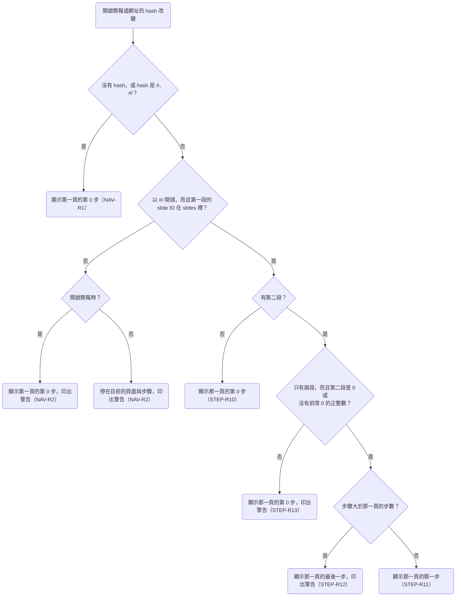

# 頁內分步

頁內分步是講者播放簡報時，每按一次下一步，頁面就出現下一個項目的能力。每一頁從第 0 步開始，第 0 步是還沒按過下一步的畫面。頁面用 `<Step>` 標出在某一步出現的內容，需要其他變化的元件用 `useStep` 讀出目前的步驟；`Step` 與 `useStep` 都從 `#diapo` import，兩者共用同一套步驟編號。

```tsx
import { Step, useStep } from "#diapo";

export default function Agenda() {
  const step = useStep(3);
  return (
    <div className="flex flex-col gap-8 p-16 text-[48px]">
      <p>一開始就顯示</p>
      <Step at={1}>
        <p>第 1 步出現</p>
      </Step>
      <Step at={2}>
        <p>第 2 步出現</p>
      </Step>
      <p>{step < 3 ? "第 3 步之前顯示這一句" : "從第 3 步開始顯示這一句"}</p>
    </div>
  );
}
```

`<Step>` 的內容到了 `at` 指定的步驟時直接出現，在之後的每一步都繼續顯示。要讓內容消失或換成其他內容時，用 `useStep` 判斷目前的步驟。

> 設計理由：`<Step>` 只負責讓內容出現，替換內容交給 `useStep`。曾考慮讓 `<Step>` 加上 `until`，例如 `<Step at={2} until={4}>`，但第 4 步時內容是已經消失、還是第 4 步之後才消失，AI 容易寫錯，講者也要實際按到那一步才看得出來；頁面元件本身就能呼叫 `useStep`，替換內容只要寫一個條件判斷。完整討論見 [0003](../plans/archive/0003-steps.md)。

本 spec 裡換頁與網址 hash 的規則（STEP-R9 到 STEP-R14）描述播放簡報的視窗，也就是講者模式的觀眾視窗；講者視窗的行為寫在 [presenter.md](presenter.md)。

開啟簡報或網址的 hash 改變時，播放器依下圖的順序決定顯示哪一頁的哪一步，每個判斷的細節寫在對應的需求裡。畫面顯示的頁面與步驟和 hash 不一致時，播放器把 hash 改成畫面顯示的頁面與步驟。



## 需求

### STEP-R1 `<Step>` 從 `at` 指定的步驟開始顯示

`<Step at={n}>` 包住的內容在第 n 步之前看不見，從第 n 步開始顯示。同一頁的好幾個 `<Step>` 可以寫同一個 `at`，這些 `<Step>` 在同一步一起出現。

- STEP-R1.1 逐步出現
  - 前提：`list` 這一頁有 `<Step at={1}>` 包住的「第一點」與 `<Step at={2}>` 包住的「第二點」，畫面顯示第 0 步
  - 動作：按 →
  - 結果：「第一點」出現，「第二點」仍然看不見
- STEP-R1.2 後退一步時再次隱藏
  - 前提：`list` 這一頁有 `<Step at={1}>` 包住的「第一點」與 `<Step at={2}>` 包住的「第二點」，畫面顯示第 2 步
  - 動作：按 ←
  - 結果：「第二點」看不見，「第一點」仍然顯示
- STEP-R1.3 同一步出現兩個項目
  - 前提：左欄的「第二點」與右欄的圖都包在 `<Step at={2}>` 裡，畫面顯示第 1 步
  - 動作：按 →
  - 結果：「第二點」與圖同時出現
- STEP-R1.4 不照 DOM 順序出現
  - 前提：頁面上先寫 `<Step at={2}>` 包住的「後出現」，再寫 `<Step at={1}>` 包住的「先出現」，畫面顯示第 0 步
  - 動作：按 →
  - 結果：「先出現」出現，「後出現」仍然看不見

> 設計理由：每個 `<Step>` 都寫明 `at`，AI 讀檔就知道每一項在第幾步出現，編號重複或跳號也直接寫在檔案裡。曾考慮依 `<Step>` 在 DOM 裡的順序自動編號，但這樣不相鄰的項目沒辦法同時出現，用 `useStep` 的元件也要另外在 DOM 裡放標記，才能排進順序。也考慮過預設依 DOM 順序編號、需要時再寫 `at`，但 `at={2}` 表示和第 2 個沒寫 `at` 的 `<Step>` 在同一步出現，AI 在這個 `<Step>` 前面插入新的一項之後，寫了 `at={2}` 的項目會改成和新插入的那一項一起出現，build 不會失敗，畫面上也看不出錯誤。完整討論見 [0003](../plans/archive/0003-steps.md)。

### STEP-R2 `<Step>` 的內容出現之前保留位置

在 `at` 指定的步驟之前，`<Step>` 的內容仍然會 render，也占著版面的位置，但看不見、點不到，也不能用 Tab 把焦點移到裡面的元素上。

- STEP-R2.1 保留位置
  - 前提：`list` 這一頁的「第一點」包在 `<Step at={1}>` 裡，下方有一段沒有包進 `<Step>` 的「結語」，畫面顯示第 0 步
  - 動作：按 →
  - 結果：「第一點」出現，「結語」在畫布上的位置不變
- STEP-R2.2 點不到隱藏的按鈕
  - 前提：`<Step at={1}>` 裡有一個按鈕，畫面顯示第 0 步
  - 動作：點按鈕所在的位置
  - 結果：按鈕沒有被按下
- STEP-R2.3 Tab 移不到隱藏的元素
  - 前提：`<Step at={1}>` 裡有一個按鈕，畫面顯示第 0 步
  - 動作：按 Tab
  - 結果：焦點沒有移到這個按鈕上

> 設計理由：`<Step>` 的內容在出現之前保留位置，所以每一步的版面都和最後一步相同，新的項目出現時，其他內容不會移動。曾考慮到了 `at` 指定的步驟才把內容放進版面，但垂直置中的內容每多一項就要重新置中，已經出現的項目會跟著移動；用 `display: none` 隱藏時，ECharts、Mermaid 這類在初始化時量容器大小的 library 會量到 0×0。也考慮過用 `opacity: 0` 隱藏，但看不見的按鈕仍然點得到。隱藏的內容一樣會執行 effect，例如自動播放的影片會在 `<Step>` 出現之前就開始播放，這類元件要用 `useStep` 決定什麼時候開始。完整討論見 [0003](../plans/archive/0003-steps.md)。

### STEP-R3 `<Step>` 不影響排版

元素包進 `<Step>` 之後，在 flex 或 grid 版面裡的位置與大小，和沒有包進 `<Step>` 時相同。不過包進 `<Step>` 的元素在 DOM 裡不再是原本父元素的直接子元素，所以父元素上依直接子元素套用樣式的 Tailwind class，例如 `space-y-*`、`divide-y-*`、`*:`，不會套用到這個元素，這個元素本身的 `first:`、`last:` 也改成依它在 `<Step>` 裡的位置判斷；項目之間的間距要用 flex 或 grid 的 `gap`。

`<Step>` 放在 `<svg>` 裡時，內容在每一步都看不見，播放器在 console 印出錯誤，寫出 slide ID。SVG 裡隨步驟出現的內容要用 `useStep`。

`<Step>` 包住表格的列或儲存格時，畫面照常顯示，但 `<Step>` 加上的那層元素不是表格元素，HTML 不允許它出現在 `<tbody>`、`<tr>` 這類元素裡，所以用 `make dev` 預覽時，React 會在 console 印出錯誤。表格裡隨步驟出現的內容要用 `useStep`。

- STEP-R3.1 Grid 裡的項目
  - 前提：一個三欄的 grid 依序有三個項目，中間的項目包在 `<Step at={1}>` 裡
  - 動作：顯示第 1 步
  - 結果：三個項目的位置與大小，和三個項目都沒有包進 `<Step>` 時相同
- STEP-R3.2 Flex 裡的項目
  - 前提：一個 `justify-between` 的 flex 版面依序有三個項目，中間的項目包在 `<Step at={1}>` 裡
  - 動作：顯示第 1 步
  - 結果：三個項目的位置與大小，和三個項目都沒有包進 `<Step>` 時相同
- STEP-R3.3 放在 SVG 裡
  - 前提：`diagram` 這一頁的 `<svg>` 裡有一個 `<Step at={1}>`
  - 動作：開啟這份簡報，網址的 hash 是 `#/diagram`
  - 結果：console 的錯誤寫出 `diagram`

> 設計理由：`<Step>` 用一層 `display: contents` 的元素包住內容，所以任何內容都能包，包括沒有把 `style` 傳到 DOM 的元件。曾考慮不加這層元素，直接把隱藏用的樣式合併進唯一子元素的 `style`，這樣 `space-y-*` 照常套用，`<Step>` 放在 `<svg>` 裡也能顯示，但子元素是沒有把 `style` 傳到 DOM 的元件時，內容會從第 0 步就顯示，build 不會失敗，console 也沒有任何訊息。完整討論見 [0003](../plans/archive/0003-steps.md)。

### STEP-R4 用 `useStep` 讀出目前的步驟

頁面或頁面裡的元件呼叫 `useStep(...steps)` 時，`useStep` 回傳這一頁目前的步驟，並把參數列出的每個步驟，登記成這個元件有變化的步驟。參數至少要有一個步驟。

- STEP-R4.1 依步驟替換內容
  - 前提：`list` 這一頁呼叫 `useStep(3)`，第 3 步之前顯示「舊的結論」，從第 3 步開始顯示「新的結論」，畫面顯示第 2 步
  - 動作：按 →
  - 結果：畫面顯示「新的結論」，「舊的結論」消失
- STEP-R4.2 後退時換回原本的內容
  - 前提：`list` 這一頁呼叫 `useStep(3)`，第 3 步之前顯示「舊的結論」，從第 3 步開始顯示「新的結論」，畫面顯示第 3 步
  - 動作：按 ←
  - 結果：畫面顯示「舊的結論」，「新的結論」消失

> 設計理由：`useStep` 列出元件有變化的每一步，所以播放器知道 1 到步數之間的每一步有沒有東西會變化，才找得出跳號（STEP-R7）。曾考慮只寫元件的最後一步，例如 `useStep(4)`，但這樣播放器分辨不出第 2、3 步是跳號，還是元件在這兩步確實有變化。可以重複使用的元件由頁面用 props 傳入步驟，例如 `<Chart steps={[2, 3, 4]} />`，元件裡再呼叫 `useStep(...steps)`，所以整頁共用同一套編號。完整討論見 [0003](../plans/archive/0003-steps.md)。

### STEP-R5 一頁的步數是登記過的最大步驟

一頁的步數，是這一頁目前 render 出來的所有 `<Step>` 的 `at` 與所有 `useStep` 的參數之中最大的值。沒有登記任何步驟的頁面，步數是 0。

- STEP-R5.1 `<Step>` 與 `useStep` 一起算
  - 前提：`list` 這一頁有 `<Step at={1}>` 與 `<Step at={2}>`，頁面上另一個元件呼叫 `useStep(3)`，下一頁是 `recap`，畫面顯示 `list` 的第 0 步
  - 動作：按 4 次 →
  - 結果：前 3 次按 → 之後，畫面停在 `list`，依序顯示第 1、2、3 步；第 4 次按 → 之後，畫面顯示 `recap`

> 設計理由：步數由播放器統計，所以頁面寫的步驟和步數不會對不上。曾考慮讓頁面用 `export const steps = 3` 宣告步數，讓播放器不必 render 頁面就知道步數，但宣告的步數少於頁面寫的步驟時，後面的項目不會出現；多於頁面寫的步驟時，講者按下一步，畫面不會改變。播放器需要一頁的步數時，都已經 render 過那一頁，例如從下一頁往回時（STEP-R9），播放器先把上一頁 render 成所有步驟都已經走完的畫面，再依 render 時登記的步驟，把 hash 改成最後一步的 hash。完整討論見 [0003](../plans/archive/0003-steps.md)。

### STEP-R6 換步驟時頁面保持原狀

換到同一頁的其他步驟時，播放器不重新 mount 頁面，所以互動元件的狀態都保留。換到其他頁面時，播放器照 [navigation.md](navigation.md) 的 NAV-R13 重置頁面。

- STEP-R6.1 換步驟後保留互動元件的狀態
  - 前提：`list` 這一頁有 2 步，還有一個一開始就顯示的計數器，初始值是 0；畫面顯示第 1 步，講者把計數器按到 3
  - 動作：按 →，再按 ←
  - 結果：按 → 之後與再按 ← 之後，計數器都顯示 3

### STEP-R7 跳號的步驟照常播放

1 到步數之間沒有任何 `<Step>` 或 `useStep` 登記的步驟，叫做空的步驟。空的步驟仍然算一步，講者按到空的步驟時畫面不變。播放器顯示這一頁時，在 console 印出警告，寫出 slide ID 與空的步驟。

- STEP-R7.1 跳號
  - 前提：`list` 這一頁只有 `<Step at={1}>` 與 `<Step at={3}>`，沒有其他元件登記步驟
  - 動作：開啟這份簡報，網址的 hash 是 `#/list/1`，再按 →
  - 結果：開啟時 console 的警告寫出 `list` 與 2；按 → 之後，網址的 hash 變成 `#/list/2`，畫面和第 1 步相同

> 設計理由：跳號時照寫的步驟播放，所以一頁的步驟一定是 0 到步數之間的每一個整數，hash 與上一步都不用為空的步驟另外訂規則；跳號在彩排時就看得出來，console 也會印出警告。曾考慮按下一步時跳過空的步驟，但這樣 hash 指向空的步驟時要顯示什麼、講者在空的步驟的下一步按上一步時要停在哪裡，都要另外訂規則。也考慮過由播放器重新編號、去掉空的步驟，但這樣 hash 裡的步驟和頁面寫的 `at` 對不上。完整討論見 [0003](../plans/archive/0003-steps.md)。

### STEP-R8 不合法的步驟

`<Step>` 的 `at` 或 `useStep` 的參數不是正整數時，播放器在 console 印出錯誤，寫出 slide ID 與這個值。這個值不計入步數，`at` 不合法的 `<Step>` 從第 0 步就顯示。

- STEP-R8.1 `at` 是 0
  - 前提：`hint` 這一頁只有一個 `<Step at={0}>`，裡面是「提示」，下一頁是 `recap`
  - 動作：開啟這份簡報，網址的 hash 是 `#/hint`，再按 →
  - 結果：開啟時畫面顯示「提示」，console 的錯誤寫出 `hint` 與 0；按 → 之後畫面顯示 `recap`
- STEP-R8.2 `at` 不是整數
  - 前提：`hint` 這一頁只有一個 `<Step at={1.5}>`，裡面是「提示」
  - 動作：開啟這份簡報，網址的 hash 是 `#/hint`
  - 結果：畫面顯示「提示」，console 的錯誤寫出 `hint` 與 1.5
- STEP-R8.3 `useStep` 的參數不合法
  - 前提：`hint` 這一頁有 `<Step at={1}>`，另一個元件呼叫 `useStep(-1)`，下一頁是 `recap`
  - 動作：開啟這份簡報，網址的 hash 是 `#/hint`，再按兩次 →
  - 結果：開啟時 console 的錯誤寫出 `hint` 與 -1；第一次按 → 之後畫面顯示 `hint` 的第 1 步，第二次按 → 之後畫面顯示 `recap`

> 設計理由：TypeScript 的型別沒辦法限制只能寫正整數，所以播放器在執行時檢查。`at` 不合法的 `<Step>` 照常顯示內容，講者沒發現錯誤就上台時，觀眾看到的只是這段內容從第 0 步就出現。曾考慮不顯示這段內容，或丟出 exception 讓這一頁 render 失敗，但這樣觀眾會看不到那一項，或看到整頁空白。完整討論見 [0003](../plans/archive/0003-steps.md)。

### STEP-R9 逐步換頁

講者按下一步時，畫面還沒到這一頁的最後一步，播放器就前進一步；已經在最後一步時，播放器換到下一頁的第 0 步。講者按上一步時，畫面不在第 0 步，播放器就後退一步；在第 0 步時，播放器換到上一頁的最後一步。在最後一頁的最後一步按下一步，或在第一頁的第 0 步按上一步時，畫面不動。下一步與上一步的按鍵寫在 [navigation.md](navigation.md) 的 NAV-R3，觸控滑動寫在 NAV-R8。

- STEP-R9.1 前進一步
  - 前提：`list` 這一頁有 3 步，畫面顯示 `list` 的第 0 步
  - 動作：按 →
  - 結果：畫面顯示 `list` 的第 1 步
- STEP-R9.2 走完步驟後換頁
  - 前提：`list` 這一頁有 3 步，下一頁是 `recap`，畫面顯示 `list` 的第 3 步
  - 動作：按 →
  - 結果：畫面顯示 `recap` 的第 0 步
- STEP-R9.3 後退一步
  - 前提：`list` 這一頁有 3 步，畫面顯示 `list` 的第 2 步
  - 動作：按 ←
  - 結果：畫面顯示 `list` 的第 1 步
- STEP-R9.4 往回時停在上一頁的最後一步
  - 前提：`list` 這一頁有 3 步，下一頁是 `recap`，畫面顯示 `recap` 的第 0 步
  - 動作：按 ←
  - 結果：畫面直接顯示 `list` 的第 3 步，中間沒有閃過 `list` 第 0 步的畫面，網址的 hash 變成 `#/list/3`
- STEP-R9.5 用滑動前進一步
  - 前提：`list` 這一頁有 3 步，畫面顯示 `list` 的第 0 步
  - 動作：手指往左滑 200 px
  - 結果：畫面顯示 `list` 的第 1 步
- STEP-R9.6 在最後一頁的最後一步按下一步
  - 前提：最後一頁 `finale` 有 2 步，畫面顯示 `finale` 的第 2 步
  - 動作：按 →
  - 結果：畫面仍然顯示 `finale` 的第 2 步
- STEP-R9.7 在第一頁的第 0 步按上一步
  - 前提：第一頁 `intro` 有 2 步，畫面顯示 `intro` 的第 0 步
  - 動作：按 ←
  - 結果：畫面仍然顯示 `intro` 的第 0 步

> 設計理由：播放器沒有跳過剩下的步驟、直接換頁的快捷鍵。翻頁器的每個按鈕都送出固定的按鍵，沒有一個按鈕會送出 Shift 加方向鍵；而 Shift+Space 已經是上一步（NAV-R3），如果 Shift 加方向鍵代表跳過剩下的步驟，Shift 在兩組快捷鍵裡的意思就不一致。講者要跳過剩下的步驟時，可以輸入頁碼跳頁，跳頁也會新增瀏覽紀錄，跳錯了能用瀏覽器的上一頁回去。完整討論見 [0003](../plans/archive/0003-steps.md)。

### STEP-R10 跳頁時從第 0 步開始

講者用 Home、End 或輸入頁碼跳頁，或網址的 hash 改成沒有第二段的 hash 時，畫面顯示那一頁的第 0 步。

- STEP-R10.1 用 End 跳頁
  - 前提：最後一頁 `finale` 有 2 步，畫面顯示 `intro`
  - 動作：按 End
  - 結果：畫面顯示 `finale` 的第 0 步
- STEP-R10.2 輸入頁碼跳頁
  - 前提：第 3 頁是 `list`，`list` 有 3 步，畫面顯示 `intro`
  - 動作：輸入 3，再按 Enter
  - 結果：畫面顯示 `list` 的第 0 步
- STEP-R10.3 點沒有寫步驟的連結
  - 前提：`list` 這一頁有 3 步，畫面顯示 `recap`，`recap` 有一個 `href` 是 `#/list` 的連結
  - 動作：點這個連結
  - 結果：畫面顯示 `list` 的第 0 步

### STEP-R11 網址的 Hash 記錄目前的步驟

頁面在第 1 步以後時，播放器把步驟寫進網址的 hash 的第二段，格式是 `#/<slide-id>/<步驟>`，步驟寫成沒有前導 0 的正整數；頁面在第 0 步時，hash 是 `#/<slide-id>`。網址的 hash 改成 `#/<slide-id>/<步驟>` 時，畫面換到那一頁的那一步。Hash 的步驟是 0 時，例如 `#/list/0`，播放器顯示那一頁的第 0 步，並把 hash 改成 `#/<slide-id>`。

- STEP-R11.1 前進一步後更新 hash
  - 前提：畫面顯示 `list` 的第 0 步，網址的 hash 是 `#/list`
  - 動作：按 →
  - 結果：網址的 hash 變成 `#/list/1`
- STEP-R11.2 回到第 0 步
  - 前提：畫面顯示 `list` 的第 1 步
  - 動作：按 ←
  - 結果：網址的 hash 變成 `#/list`
- STEP-R11.3 開啟指定的步驟
  - 前提：`list` 這一頁有 3 步
  - 動作：開啟這份簡報，網址的 hash 是 `#/list/2`
  - 結果：畫面顯示 `list` 的第 2 步
- STEP-R11.4 重新整理
  - 前提：畫面顯示 `list` 的第 2 步
  - 動作：重新整理網頁
  - 結果：畫面顯示 `list` 的第 2 步
- STEP-R11.5 開啟第 0 步的 hash
  - 前提：`list` 這一頁有 3 步
  - 動作：開啟這份簡報，網址的 hash 是 `#/list/0`
  - 結果：畫面顯示 `list` 的第 0 步，網址的 hash 變成 `#/list`
- STEP-R11.6 點寫了步驟的連結
  - 前提：`list` 這一頁有 3 步，畫面顯示 `recap`，`recap` 有一個 `href` 是 `#/list/2` 的連結
  - 動作：點這個連結
  - 結果：畫面顯示 `list` 的第 2 步
- STEP-R11.7 播放途中修改 hash 的步驟
  - 前提：`list` 這一頁有 3 步，畫面顯示 `list` 的第 1 步
  - 動作：把網址的 hash 改成 `#/list/3`
  - 結果：畫面顯示 `list` 的第 3 步

> 設計理由：第 0 步的 hash 不寫第二段，所以 `#/<slide-id>` 一直指向一頁的開頭，頁面加上步驟之後，既有的連結仍然指向同一個畫面，AI 在頁面裡寫連結時也不必先查那一頁有沒有步驟。曾考慮有步驟的頁面一律寫第二段，例如 `#/intro/0`，但這樣一頁加上步驟之後，這一頁開頭的網址就跟著改變。完整討論見 [0003](../plans/archive/0003-steps.md)。

### STEP-R12 Hash 的步驟大於步數

網址的 hash 的步驟大於那一頁的步數時，畫面顯示那一頁的最後一步，播放器把 hash 改成最後一步的 hash，並在 console 印出警告，寫出原本的 hash。開啟簡報時與播放途中都這樣處理。步驟的格式錯誤時，播放器的行為寫在 STEP-R13。

- STEP-R12.1 開啟時步驟大於步數
  - 前提：`list` 這一頁有 3 步
  - 動作：開啟這份簡報，網址的 hash 是 `#/list/5`
  - 結果：畫面顯示 `list` 的第 3 步，網址的 hash 變成 `#/list/3`，console 的警告寫出 `#/list/5`
- STEP-R12.2 播放途中步驟大於步數
  - 前提：`list` 這一頁有 3 步，畫面顯示 `intro`
  - 動作：把網址的 hash 改成 `#/list/9`
  - 結果：畫面顯示 `list` 的第 3 步，網址的 hash 變成 `#/list/3`
- STEP-R12.3 沒有步驟的頁面
  - 前提：`agenda` 這一頁沒有步驟
  - 動作：開啟這份簡報，網址的 hash 是 `#/agenda/2`
  - 結果：畫面顯示 `agenda`，網址的 hash 變成 `#/agenda`

> 設計理由：Hash 的步驟大於步數，最常見的原因是那一頁改版後刪掉了幾項，這時連結指向的頁面仍然存在，所以播放器顯示這一頁的最後一步，這個畫面最接近連結原本指向的畫面。曾考慮照 NAV-R2 視為指向不存在的頁面，但開啟簡報時會顯示第一頁，和連結原本指向的畫面差得更遠。完整討論見 [0003](../plans/archive/0003-steps.md)。

### STEP-R13 Hash 的步驟格式錯誤

網址的 hash 的第一段是存在的 slide ID，但 hash 既不是 `#/<slide-id>`，也不是 `#/<slide-id>/<步驟>`（步驟是 0 或沒有前導 0 的正整數）時，畫面顯示那一頁的第 0 步，播放器把 hash 改成 `#/<slide-id>`，並在 console 印出警告，寫出原本的 hash。開啟簡報時與播放途中都這樣處理。

- STEP-R13.1 步驟不是數字
  - 前提：`list` 這一頁有 3 步
  - 動作：開啟這份簡報，網址的 hash 是 `#/list/abc`
  - 結果：畫面顯示 `list` 的第 0 步，網址的 hash 變成 `#/list`，console 的警告寫出 `#/list/abc`
- STEP-R13.2 步驟有前導 0
  - 前提：`list` 這一頁有 3 步
  - 動作：開啟這份簡報，網址的 hash 是 `#/list/01`
  - 結果：畫面顯示 `list` 的第 0 步，網址的 hash 變成 `#/list`
- STEP-R13.3 Hash 有第三段
  - 前提：`list` 這一頁有 3 步
  - 動作：開啟這份簡報，網址的 hash 是 `#/list/1/2`
  - 結果：畫面顯示 `list` 的第 0 步，網址的 hash 變成 `#/list`
- STEP-R13.4 播放途中步驟的格式錯誤
  - 前提：`list` 這一頁有 3 步，畫面顯示 `intro`
  - 動作：把網址的 hash 改成 `#/list/abc`
  - 結果：畫面顯示 `list` 的第 0 步，網址的 hash 變成 `#/list`

> 設計理由：Hash 的第一段是存在的 slide ID 時，連結指向哪一頁是確定的，只是看不出指向哪一步，所以播放器顯示那一頁的開頭，也就是第 0 步。曾考慮照 NAV-R2 視為指向不存在的頁面，但這樣開啟簡報時會顯示第一頁，播放途中會停在目前的頁面，兩種情況都不會顯示連結指向的那一頁。完整討論見 [0003](../plans/archive/0003-steps.md)。

### STEP-R14 頁面顯示途中步數改變時維持目前的步驟

頁面顯示途中，元件因為互動而 mount 或 unmount，使步數改變時，播放器維持目前的步驟與 hash，等講者按下一步或上一步時，才依當時的步數決定怎麼換頁（STEP-R9）。播放器只在開啟簡報或換到其他頁面時，對畫面顯示的頁面執行 STEP-R7 與 STEP-R8 的檢查。

- STEP-R14.1 顯示途中步數變少
  - 前提：`toggle` 這一頁有 `<Step at={1}>`、`<Step at={2}>`，以及一個按下後移除 `<Step at={2}>` 的按鈕，下一頁是 `recap`，畫面顯示 `toggle` 的第 2 步
  - 動作：按這個按鈕，再按 →
  - 結果：按下按鈕之後，網址的 hash 仍然是 `#/toggle/2`；按 → 之後，畫面顯示 `recap`

> 設計理由：步數改變時，播放器不主動修正目前的步驟。曾考慮步數一改變，就把大於步數的目前步驟改成最後一步並改寫 hash，但這樣 hash 會在講者沒按任何鍵時改變；而且依 STEP-R4，元件在大於參數最大值的步驟畫出的內容，和在最大值那一步相同，所以改成最後一步之後，畫面和改之前一樣。完整討論見 [0003](../plans/archive/0003-steps.md)。
